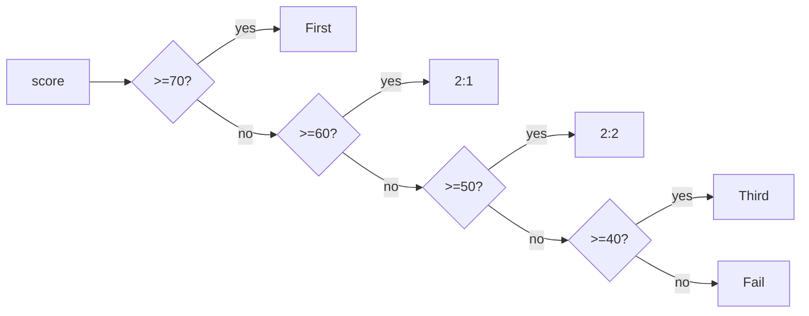

# Day 3 — Conditionals

> **AI-90** · Block 1 · Python + automation + real data · Day 3 of 90  
> Practise it with live tests on [telugucoders.com](https://telugucoders.com/) · run it locally with the [master file](../syllabus/AI90_MASTER.md) (`python ai90.py check 3`)

[← Day 2](day02-strings.md) · [All 90 days](README.md) · [Day 4 →](day04-loops.md)

---

**Dataset:** none — pure Python · **Time:** ~2 h

#### Visual



**Goal:** make your code choose. Every classifier you build later ends in a decision like these.

#### 1. Comparisons give booleans

```python
5 > 3        # True
5 == 5.0     # True   — == compares value
"a" != "b"   # True
3 <= 3       # True
0 < x < 10   # chained — True if x is between 0 and 10
```

`=` assigns, `==` compares. Mixing them up is the #1 beginner bug.

#### 2. if / elif / else

Python checks top to bottom and runs the **first** branch that's true, then skips the rest.

```python
if temp > 25:
    print("hot")
elif temp > 15:
    print("mild")
else:
    print("cold")
```

Indentation (4 spaces) defines the block — no braces.

Because the first match wins, **order matters**: check the biggest threshold first.

#### 3. and / or / not

```python
if age >= 18 and has_id:
    ...
if day == "Sat" or day == "Sun":
    ...
if not finished:
    ...
```

#### 4. Truthiness

Empty things are false: `0`, `""`, `[]`, `{}`, `None`. Everything else is true.

```python
name = ""
if not name:
    print("name is empty")
```

#### 5. Raising an error on bad input

When an input makes no sense, stop loudly instead of returning nonsense:

```python
if score < 0 or score > 100:
    raise ValueError("score must be 0-100")
```

#### 6. Early return

Inside a function, `return` exits immediately. That often removes the need for `else`:

```python
def sign(x):
    if x > 0:
        return "positive"
    if x < 0:
        return "negative"
    return "zero"
```

#### Exercises

`python ai90.py check 3`. `file_category` is the brain of the Day 17 folder organiser.

**Tip:** `str.endswith` accepts a tuple: `name.endswith((".jpg", ".png"))`.

#### Your task — write `ai90/work/day03.py` with: `grade`, `is_leap`, `file_category`, `clamp`, `sign`

#### Tests

```python
# file: test_day03.py
import day03 as ex


def test_grade():
    assert ex.grade(85) == "First"
    assert ex.grade(70) == "First"
    assert ex.grade(69) == "2:1"
    assert ex.grade(55) == "2:2"
    assert ex.grade(40) == "Third"
    assert ex.grade(12) == "Fail"


def test_grade_rejects_bad_scores():
    for bad in (-1, 101):
        try:
            ex.grade(bad)
        except ValueError:
            continue
        raise AssertionError(f"grade({bad}) should raise ValueError")


def test_is_leap():
    assert ex.is_leap(2024) is True
    assert ex.is_leap(2026) is False
    assert ex.is_leap(1900) is False
    assert ex.is_leap(2000) is True


def test_file_category():
    assert ex.file_category("Holiday.JPG") == "image"
    assert ex.file_category("cv.pdf") == "document"
    assert ex.file_category("train.py") == "code"
    assert ex.file_category("song.mp3") == "other"


def test_clamp():
    assert ex.clamp(15, 0, 10) == 10
    assert ex.clamp(-3, 0, 10) == 0
    assert ex.clamp(5, 0, 10) == 5


def test_sign():
    assert ex.sign(4) == "positive"
    assert ex.sign(-0.5) == "negative"
    assert ex.sign(0) == "zero"
```

<details><summary>Reference solution (try first!)</summary>

```python
# file: day03.py
"""Day 3 — conditionals."""


def grade(score):
    """UK-style grade: 70+ 'First', 60+ '2:1', 50+ '2:2', 40+ 'Third', else 'Fail'.
    Scores outside 0-100 raise ValueError."""
    if score < 0 or score > 100:
        raise ValueError("score must be 0-100")
    if score >= 70:
        return "First"
    elif score >= 60:
        return "2:1"
    elif score >= 50:
        return "2:2"
    elif score >= 40:
        return "Third"
    return "Fail"


def is_leap(year):
    """Leap year: divisible by 4, except centuries, unless divisible by 400."""
    return year % 4 == 0 and (year % 100 != 0 or year % 400 == 0)


def file_category(filename):
    """'image' for .jpg .jpeg .png .gif, 'document' for .pdf .docx .txt,
    'code' for .py .js .html, else 'other'. Case-insensitive."""
    name = filename.lower()
    if name.endswith((".jpg", ".jpeg", ".png", ".gif")):
        return "image"
    if name.endswith((".pdf", ".docx", ".txt")):
        return "document"
    if name.endswith((".py", ".js", ".html")):
        return "code"
    return "other"


def clamp(x, low, high):
    """Keep x inside [low, high]. clamp(15, 0, 10) -> 10"""
    if x < low:
        return low
    if x > high:
        return high
    return x


def sign(x):
    """'positive', 'negative' or 'zero'."""
    if x > 0:
        return "positive"
    if x < 0:
        return "negative"
    return "zero"
```

</details>

**Done when:** `python ai90.py check 3` is all green → tick Day 3 in the tracker.

---

[← Day 2](day02-strings.md) · [All 90 days](README.md) · [Day 4 →](day04-loops.md)

<sub>Generated from `syllabus/AI90_MASTER.md` by `tools/build_notes.py`. AI-90 — 90 days to build your own AI, by Asish Teja Vinnakota.</sub>
