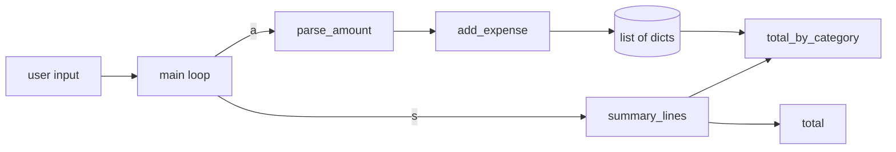

# Day 7 — Project: CLI expense tracker

> **AI-90** · Block 1 · Python + automation + real data · Day 7 of 90  
> Practise it with live tests on [telugucoders.com](https://telugucoders.com/) · run it locally with the [master file](../syllabus/AI90_MASTER.md) (`python ai90.py check 7`)

[← Day 6](day06-dicts-and-sets.md) · [All 90 days](README.md) · [Day 8 →](day08-functions-in-depth.md)

---

**Dataset:** your own expenses · **Time:** ~2 h

#### Visual



**Goal:** combine the whole first week into one tool you actually use.

#### What you're building

```
[a]dd  [l]ist  [s]ummary  [q]uit > a
Amount: £12.50
Category: food
Note: lunch

[a]dd  [l]ist  [s]ummary  [q]uit > s
transport   £40.00
food        £20.00
TOTAL       £60.00
```

#### Data model: a list of dicts

```python
expenses = [
    {"amount": 12.5, "category": "food", "note": "lunch"},
    {"amount": 40.0, "category": "transport", "note": ""},
]
```

A list of dicts is a mini database. Pandas DataFrames (Day 36) are the grown-up version of exactly this.

#### Separate logic from input/output

Every function in `day07.py` takes data and **returns** a result — no `input()`, no `print()`. Only `main()` talks to the user. That split is why the checker can test your code, and it's how all real software is structured.

#### Plan of attack

1. `parse_amount` — Day 2 string skills + Day 3 raising errors. `float("abc")` already raises `ValueError` for you.
2. `add_expense` — build a dict, append it, return it.
3. `total` — accumulator (Day 4).
4. `total_by_category` — counting pattern, but adding amounts instead of 1 (Day 6).
5. `biggest` — like `min_max` from Day 5.
6. `summary_lines` — f-string alignment: `f"{cat:<12}"` pads to 12 characters, `f"{x:.2f}"` gives 2 decimals.

Then run `python ai90.py check 7`, and once green, run `python day07.py` and use it.

#### Rounding note

`0.1 + 0.2` is `0.30000000000000004` in every language — floats are binary. Round money to 2 dp when you report it.

#### Sunday task

Start `DEVLOG.md` in your repo: what you built this week, what confused you, one thing to revisit. Keep one entry per week for all 90 days.

#### Your task — write `ai90/work/day07.py` with: `parse_amount`, `add_expense`, `total`, `total_by_category`, `biggest`, `summary_lines`

#### Tests

```python
# file: test_day07.py
import day07 as ex


def sample():
    data = []
    ex.add_expense(data, 12.5, " Food ", "lunch")
    ex.add_expense(data, 40, "transport")
    ex.add_expense(data, 7.5, "food", "coffee")
    return data


def test_parse_amount():
    assert ex.parse_amount("£12.50") == 12.5
    assert ex.parse_amount(" 3 ") == 3.0
    for bad in ("abc", "-4", "0", ""):
        try:
            ex.parse_amount(bad)
        except ValueError:
            continue
        raise AssertionError(f"parse_amount({bad!r}) should raise ValueError")


def test_add_expense():
    data = []
    item = ex.add_expense(data, 9.99, " Fun ")
    assert item == {"amount": 9.99, "category": "fun", "note": ""}
    assert data == [item]


def test_total():
    assert ex.total(sample()) == 60.0
    assert ex.total([]) == 0


def test_total_by_category():
    assert ex.total_by_category(sample()) == {"food": 20.0, "transport": 40.0}


def test_biggest():
    assert ex.biggest(sample())["category"] == "transport"
    assert ex.biggest([]) is None


def test_summary_lines():
    assert ex.summary_lines(sample()) == [
        "transport   £40.00",
        "food        £20.00",
        "TOTAL       £60.00",
    ]
```

<details><summary>Reference solution (try first!)</summary>

```python
# file: day07.py
"""Day 7 — weekend project: CLI expense tracker.

An expense is a dict: {"amount": 12.5, "category": "food", "note": "lunch"}.
The tracker is a list of those dicts. Get the functions passing first,
then run `python day07.py` to use it for real.
"""


def parse_amount(text):
    """'£12.50' / '12.5' / ' 3 ' -> float. Strip spaces and a leading '£'.
    Raise ValueError if it isn't a positive number."""
    cleaned = text.strip().lstrip("£")
    value = float(cleaned)  # raises ValueError on junk
    if value <= 0:
        raise ValueError("amount must be positive")
    return value


def add_expense(expenses, amount, category, note=""):
    """Append a new expense dict (category lowercased + stripped) and return it."""
    item = {"amount": amount, "category": category.strip().lower(), "note": note}
    expenses.append(item)
    return item


def total(expenses):
    """Sum of all amounts, rounded to 2 dp."""
    return round(sum(e["amount"] for e in expenses), 2)


def total_by_category(expenses):
    """{'food': 20.0, ...} rounded to 2 dp."""
    out = {}
    for e in expenses:
        out[e["category"]] = round(out.get(e["category"], 0) + e["amount"], 2)
    return out


def biggest(expenses):
    """The single largest expense dict, or None if there are none."""
    best = None
    for e in expenses:
        if best is None or e["amount"] > best["amount"]:
            best = e
    return best


def summary_lines(expenses):
    """Lines like 'food        £20.00', biggest category first, then 'TOTAL       £x.xx'.
    Category left-justified to 12 chars."""
    lines = [f"{cat:<12}£{amt:.2f}" for cat, amt in
             sorted(total_by_category(expenses).items(), key=lambda p: -p[1])]
    lines.append(f"{'TOTAL':<12}£{total(expenses):.2f}")
    return lines


def main():
    expenses = []
    menu = "\n[a]dd  [l]ist  [s]ummary  [q]uit > "
    while True:
        choice = input(menu).strip().lower()
        if choice == "a":
            try:
                amount = parse_amount(input("Amount: "))
            except ValueError:
                print("Not a valid amount.")
                continue
            add_expense(expenses, amount, input("Category: "), input("Note: "))
        elif choice == "l":
            for i, e in enumerate(expenses, 1):
                print(f"{i:>3}. £{e['amount']:.2f}  {e['category']}  {e['note']}")
        elif choice == "s":
            print("\n".join(summary_lines(expenses)))
        elif choice == "q":
            break


if __name__ == "__main__":
    main()
```

</details>

**Done when:** `python ai90.py check 7` is all green → tick Day 7 in the tracker.

---

[← Day 6](day06-dicts-and-sets.md) · [All 90 days](README.md) · [Day 8 →](day08-functions-in-depth.md)

<sub>Generated from `syllabus/AI90_MASTER.md` by `tools/build_notes.py`. AI-90 — 90 days to build your own AI, by Asish Teja Vinnakota.</sub>
