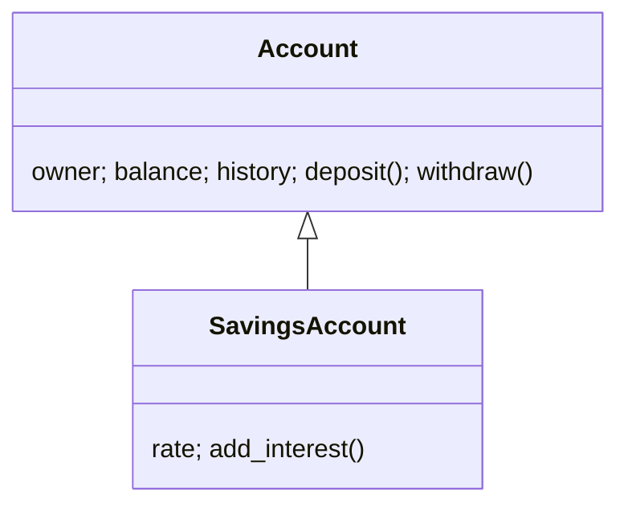

# Day 14 — Dataclasses, type hints, testing

> **AI-90** · Block 1 · Python + automation + real data · Day 14 of 90  
> Practise it with live tests on [telugucoders.com](https://telugucoders.com/) · run it locally with the [master file](../syllabus/AI90_MASTER.md) (`python ai90.py check 14`)

[← Day 13](day13-classes-a-vector.md) · [All 90 days](README.md) · [Day 15 →](day15-capstone-matrix-library.md)

---

**Dataset:** none — pure Python · **Time:** ~2 h

#### Visual



**Goal:** write classes with less boilerplate, document types, and prove your code works with your own tests.

#### 1. @dataclass

For classes that mainly hold data, `@dataclass` writes `__init__`, `__repr__` and `__eq__` for you:

```python
from dataclasses import dataclass, field

@dataclass
class Config:
    lr: float = 0.01
    epochs: int = 10
    layers: list = field(default_factory=list)   # mutable default: ALWAYS this way

cfg = Config(lr=0.001)
cfg               # Config(lr=0.001, epochs=10, layers=[])
```

You still add methods normally.

#### 2. Type hints

```python
def total(prices: list[float], tax: float = 0.2) -> float:
    ...
```

Python doesn't enforce them at runtime, but your editor uses them to catch mistakes and autocomplete. Use them from now on.

#### 3. Inheritance

A subclass gets everything from its parent and adds or changes behaviour:

```python
@dataclass
class SavingsAccount(Account):
    rate: float = 0.0
    def add_interest(self): ...
```

`isinstance(s, Account)` is `True`. In PyTorch, every model you write is `class MyNet(nn.Module)`.

Note: with dataclass inheritance, new fields with defaults must come after the parent's fields — which is why `rate` has a default.

#### 4. Testing

A test is a function that calls your code and `assert`s the answer:

```python
def test_deposit():
    a = Account("Asish")
    assert a.deposit(100) == 100
```

Test the normal case, the edge case (zero, empty, one item) and the error case. To test an error:

```python
import pytest
def test_overdraft():
    with pytest.raises(ValueError):
        Account("x").withdraw(5)
```

Install and run: `pip install pytest`, then `pytest` — it finds every `test_*.py` file. The `check.py` you've been using is a tiny version of pytest.

#### Exercises

1. `python ai90.py check 14`.
2. Write **three tests of your own** in a new file `test_mine.py` (e.g. withdrawing the exact balance, interest on zero, many deposits) and run them with `pytest`.

#### Your task — write `ai90/work/day14.py` with: `Account`, `SavingsAccount`, `total_balance`

#### Tests

```python
# file: test_day14.py
from day14 import Account, SavingsAccount, total_balance


def raises(func, exc=ValueError):
    try:
        func()
    except exc:
        return
    raise AssertionError(f"expected {exc.__name__}")


def test_dataclass_basics():
    a = Account("Asish")
    assert a.balance == 0.0 and a.history == []
    assert Account("Sam", 10.0) == Account("Sam", 10.0)
    assert Account("A").history is not Account("B").history, "use field(default_factory=list)"


def test_deposit_withdraw():
    a = Account("Asish")
    assert a.deposit(100) == 100
    assert a.withdraw(30) == 70
    assert a.history == [("deposit", 100), ("withdraw", 30)]


def test_rejects_bad_amounts():
    a = Account("Asish", 50.0)
    raises(lambda: a.deposit(0))
    raises(lambda: a.withdraw(-5))
    raises(lambda: a.withdraw(51))
    assert a.balance == 50.0


def test_savings_inherits():
    s = SavingsAccount("Asish", 200.0, rate=0.05)
    assert isinstance(s, Account)
    s.deposit(100)
    assert s.add_interest() == 315.0
    assert s.history[-1] == ("interest", 15.0)


def test_total_balance():
    assert total_balance([Account("a", 10.004), Account("b", 0.003)]) == 10.01
```

<details><summary>Reference solution (try first!)</summary>

```python
# file: day14.py
"""Day 14 — dataclasses, type hints, inheritance."""
from dataclasses import dataclass, field


@dataclass
class Account:
    """A bank account. history records ('deposit'|'withdraw'|'interest', amount) tuples."""
    owner: str
    balance: float = 0.0
    history: list = field(default_factory=list)

    def deposit(self, amount: float) -> float:
        """Add a positive amount, record it, return the new balance. Non-positive -> ValueError."""
        if amount <= 0:
            raise ValueError("deposit must be positive")
        self.balance += amount
        self.history.append(("deposit", amount))
        return self.balance

    def withdraw(self, amount: float) -> float:
        """Remove a positive amount if funds allow, record it, return the new balance.
        Non-positive or more than the balance -> ValueError."""
        if amount <= 0:
            raise ValueError("withdrawal must be positive")
        if amount > self.balance:
            raise ValueError("insufficient funds")
        self.balance -= amount
        self.history.append(("withdraw", amount))
        return self.balance


@dataclass
class SavingsAccount(Account):
    """An Account with an interest rate (0.05 = 5%)."""
    rate: float = 0.0

    def add_interest(self) -> float:
        """Add balance * rate (rounded to 2 dp), record ('interest', amount), return the new balance."""
        interest = round(self.balance * self.rate, 2)
        self.balance = round(self.balance + interest, 2)
        self.history.append(("interest", interest))
        return self.balance


def total_balance(accounts: list[Account]) -> float:
    """Sum of balances, rounded to 2 dp."""
    return round(sum(a.balance for a in accounts), 2)
```

</details>

**Done when:** `python ai90.py check 14` is all green → tick Day 14 in the tracker.

---

[← Day 13](day13-classes-a-vector.md) · [All 90 days](README.md) · [Day 15 →](day15-capstone-matrix-library.md)

<sub>Generated from `syllabus/AI90_MASTER.md` by `tools/build_notes.py`. AI-90 — 90 days to build your own AI, by Asish Teja Vinnakota.</sub>
