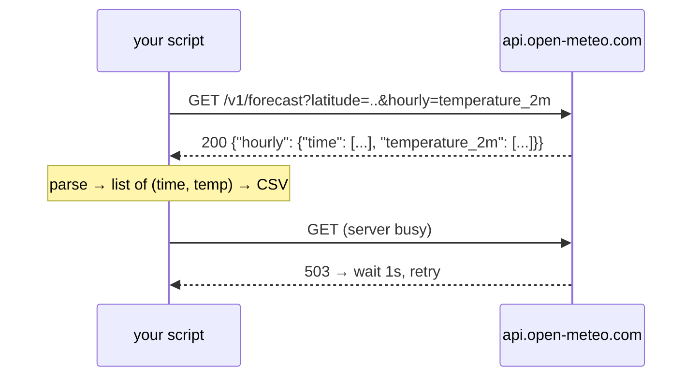

# Day 19 — HTTP APIs and JSON: live weather

> **AI-90** · Block 1 · Python + automation + real data · Day 19 of 90  
> Practise it with live tests on [telugucoders.com](https://telugucoders.com/) · run it locally with the [master file](../syllabus/AI90_MASTER.md) (`python ai90.py check 19`)

[← Day 18](day18-regular-expressions-log-parser.md) · [All 90 days](README.md) · [Day 20 →](day20-web-scraping.md)

---

**Dataset:** Open-Meteo live forecast API (free, no key): `https://api.open-meteo.com/v1/forecast?latitude=52.08&longitude=0.01&hourly=temperature_2m` · **Time:** ~2 h

#### Visual



#### Notes

- HTTP = method (`GET` read, `POST` send) + URL + headers → status code + body. 2xx ok, 4xx your fault, 5xx server's fault (retry those).
- `requests.get(url, params={...}, timeout=10)`; `r.raise_for_status()`; `r.json()`.
- **Always** set a timeout. Never hard-code API keys — read them from env vars (Day 23).
- Testability trick: pass the `get` function in as a parameter (dependency injection). Real code uses `requests.get`; tests pass a fake. No network in tests.

#### Worked example (real call)

```python
import requests
r = requests.get("https://api.open-meteo.com/v1/forecast",
                 params={"latitude": 52.08, "longitude": 0.01, "hourly": "temperature_2m"}, timeout=10)
data = r.json()
print(data["hourly"]["time"][:3], data["hourly"]["temperature_2m"][:3])
```

#### Your task — `day19.py`

- `build_url(base, **params)` — reuse Day 8's `build_url`, then re-export it.
- `parse_forecast(data)` → list of `(time, temp)` tuples from the JSON dict.
- `fetch_json(url, get, retries=3, sleep=lambda s: None)` → calls `get(url, timeout=10)`; returns `.json()` on status 200; on 5xx or `ConnectionError` retries with sleeps 1, 2, 4…; on 4xx raises `ValueError` immediately; after all retries raises `RuntimeError`.

#### Tests

```python
# file: test_day19.py
import day19 as ex


class Resp:
    def __init__(self, status, payload=None):
        self.status_code, self._p = status, payload

    def json(self):
        return self._p


def fake_get(responses):
    calls = []

    def get(url, timeout):
        calls.append(url)
        r = responses.pop(0)
        if isinstance(r, Exception):
            raise r
        return r
    return get, calls


DATA = {"hourly": {"time": ["2026-11-17T00:00", "2026-11-17T01:00"], "temperature_2m": [6.1, 5.8]}}


def test_parse_forecast():
    assert ex.parse_forecast(DATA) == [("2026-11-17T00:00", 6.1), ("2026-11-17T01:00", 5.8)]


def test_fetch_ok_after_retries():
    get, calls = fake_get([Resp(503), ConnectionError("x"), Resp(200, DATA)])
    waits = []
    assert ex.fetch_json("u", get, sleep=waits.append) == DATA
    assert waits == [1, 2] and len(calls) == 3


def test_fetch_4xx_no_retry():
    get, calls = fake_get([Resp(404)])
    try:
        ex.fetch_json("u", get)
    except ValueError:
        assert len(calls) == 1
        return
    raise AssertionError("404 should raise ValueError")


def test_fetch_gives_up():
    get, _ = fake_get([Resp(500)] * 3)
    try:
        ex.fetch_json("u", get, retries=3)
    except RuntimeError:
        return
    raise AssertionError("should raise RuntimeError after 3 failures")


def test_build_url():
    assert ex.build_url("https://a.io/f", latitude=52.08, hourly="t") == "https://a.io/f?hourly=t&latitude=52.08"
```

<details><summary>Reference solution (try first!)</summary>

```python
# file: day19.py
from day08 import build_url  # noqa: F401  (re-exported)


def parse_forecast(data):
    h = data["hourly"]
    return list(zip(h["time"], h["temperature_2m"]))


def fetch_json(url, get, retries=3, sleep=lambda s: None):
    for attempt in range(retries):
        try:
            r = get(url, timeout=10)
        except ConnectionError:
            r = None
        if r is not None:
            if r.status_code == 200:
                return r.json()
            if 400 <= r.status_code < 500:
                raise ValueError(f"client error {r.status_code} for {url}")
        if attempt < retries - 1:
            sleep(2 ** attempt)
    raise RuntimeError(f"gave up on {url} after {retries} tries")


if __name__ == "__main__":
    import requests
    url = build_url("https://api.open-meteo.com/v1/forecast", latitude=52.08, longitude=0.01, hourly="temperature_2m")
    for t, temp in parse_forecast(fetch_json(url, requests.get))[:5]:
        print(t, temp)
```

</details>

**Done when:** green + `python day19.py` prints real temperatures.

---

[← Day 18](day18-regular-expressions-log-parser.md) · [All 90 days](README.md) · [Day 20 →](day20-web-scraping.md)

<sub>Generated from `syllabus/AI90_MASTER.md` by `tools/build_notes.py`. AI-90 — 90 days to build your own AI, by Asish Teja Vinnakota.</sub>
