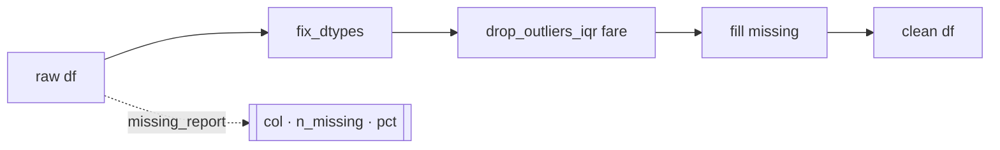

# Day 27 — A reusable data-cleaning pipeline

> **AI-90** · Block 1 · Python + automation + real data · Day 27 of 90  
> Practise it with live tests on [telugucoders.com](https://telugucoders.com/) · run it locally with the [master file](../syllabus/AI90_MASTER.md) (`python ai90.py check 27`)

[← Day 26](day26-spreadsheet-automation-excel-reports.md) · [All 90 days](README.md) · [Day 28 →](day28-git-github-actions-run-jobs-in-the-cloud.md)

---

**Dataset:** Titanic (raw) · **Time:** ~2 h

#### Visual



#### Notes

- Real data is messy: numbers stored as text, outliers, blanks. Write **small functions that each take a df and return a df**, then chain them.
- `pd.to_numeric(s, errors="coerce")` turns junk into NaN instead of crashing.
- IQR rule: outlier if value < Q1 − 1.5·IQR or > Q3 + 1.5·IQR, where IQR = Q3 − Q1.
- A pipeline = list of functions applied in order: `for step in steps: df = step(df)`. sklearn's `Pipeline` (Day 50) is the same idea.

#### Your task — `day27.py`

- `missing_report(df)` → DataFrame with columns `column, n_missing, pct` (pct rounded 1), only columns with missing, sorted by n_missing desc.
- `fix_dtypes(df, numeric_cols)` → copy with those columns coerced to numbers.
- `drop_outliers_iqr(df, col, k=1.5)` → rows within the IQR fences (NaN rows kept).
- `pipeline(df, steps)` → apply each function in order.

#### Tests

```python
# file: test_day27.py
import numpy as np
import pandas as pd

import day27 as ex


def frame():
    return pd.DataFrame({"fare": ["7.25", "71.3", "8.05", "oops", "7.9", "8.5", "512.3"],
                         "age": [22, np.nan, 26, 35, np.nan, 30, 40], "name": list("abcdefg")})


def test_missing_report():
    r = ex.missing_report(frame())
    assert list(r["column"]) == ["age"] and r.iloc[0]["n_missing"] == 2 and r.iloc[0]["pct"] == 28.6


def test_fix_dtypes():
    df = ex.fix_dtypes(frame(), ["fare"])
    assert df["fare"].dtype.kind == "f" and np.isnan(df.loc[3, "fare"])


def test_outliers():
    df = ex.drop_outliers_iqr(ex.fix_dtypes(frame(), ["fare"]), "fare")
    assert 512.3 not in df["fare"].values and 71.3 in df["fare"].values  # fences ≈ [-63.5, 127.1]
    assert df["fare"].isna().sum() == 1, "keep NaN rows"


def test_pipeline():
    out = ex.pipeline(frame(), [lambda d: ex.fix_dtypes(d, ["fare"]), lambda d: ex.drop_outliers_iqr(d, "fare")])
    assert len(out) == 6
```

<details><summary>Reference solution (try first!)</summary>

```python
# file: day27.py
import pandas as pd


def missing_report(df):
    n = df.isna().sum()
    n = n[n > 0].sort_values(ascending=False)
    return pd.DataFrame({"column": n.index, "n_missing": n.values,
                         "pct": (n.values / len(df) * 100).round(1)}).reset_index(drop=True)


def fix_dtypes(df, numeric_cols):
    df = df.copy()
    for c in numeric_cols:
        df[c] = pd.to_numeric(df[c], errors="coerce")
    return df


def drop_outliers_iqr(df, col, k=1.5):
    q1, q3 = df[col].quantile([0.25, 0.75])
    iqr = q3 - q1
    keep = df[col].between(q1 - k * iqr, q3 + k * iqr) | df[col].isna()
    return df[keep].copy()


def pipeline(df, steps):
    for step in steps:
        df = step(df)
    return df


if __name__ == "__main__":
    from day24 import load_titanic
    raw = load_titanic()
    print(missing_report(raw))
    clean = pipeline(raw, [lambda d: fix_dtypes(d, ["fare", "age"]), lambda d: drop_outliers_iqr(d, "fare")])
    print(len(raw), "->", len(clean), "rows after removing fare outliers")
```

</details>

**Done when:** green + run on real Titanic: how many fare outliers did you drop? Were they real people? (Yes — first class. Outlier ≠ error. Write that thought in your dev log.)

---

[← Day 26](day26-spreadsheet-automation-excel-reports.md) · [All 90 days](README.md) · [Day 28 →](day28-git-github-actions-run-jobs-in-the-cloud.md)

<sub>Generated from `syllabus/AI90_MASTER.md` by `tools/build_notes.py`. AI-90 — 90 days to build your own AI, by Asish Teja Vinnakota.</sub>
