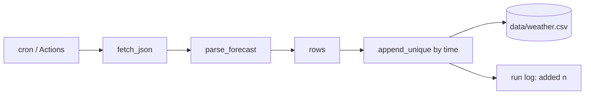

# Day 29 — The data-collector bot

> **AI-90** · Block 1 · Python + automation + real data · Day 29 of 90  
> Practise it with live tests on [telugucoders.com](https://telugucoders.com/) · run it locally with the [master file](../syllabus/AI90_MASTER.md) (`python ai90.py check 29`)

[← Day 28](day28-git-github-actions-run-jobs-in-the-cloud.md) · [All 90 days](README.md) · [Day 30 →](day30-block-1-capstone-automatic-eda-report-generator.md)

---

**Dataset:** live weather (Day 19) appended over days → your own growing time series · **Time:** ~2 h

#### Visual



#### Notes

- Combine Days 19 + 21 + 28: fetch → transform → idempotent store → log.
- Inject the fetcher (`fetch=`) so the bot is testable offline.
- Return stats (`fetched`, `added`) — that's what the log line and alerts use.
- After a week this CSV is **your own real dataset** — you'll forecast it in Block 2 (Day 54).

#### Your task — `day29.py`

- `collect(fetch, csv_path, log_path, now_iso)` → `fetch()` returns forecast JSON; convert to rows `{"time", "temp"}`; `append_unique` by `time`; append one log line `"<now> fetched=<n> added=<k>"`; return `{"fetched": n, "added": k}`.

#### Tests

```python
# file: test_day29.py
import tempfile
from pathlib import Path

import day29 as ex


def fake(times, temps):
    return lambda: {"hourly": {"time": times, "temperature_2m": temps}}


def test_collect_idempotent_and_logs():
    d = Path(tempfile.mkdtemp())
    csv_p, log_p = d / "data" / "weather.csv", d / "run.log"
    s1 = ex.collect(fake(["T0", "T1"], [6.1, 5.8]), csv_p, log_p, "2026-11-17T10:00")
    s2 = ex.collect(fake(["T1", "T2"], [5.8, 5.5]), csv_p, log_p, "2026-11-17T11:00")
    assert s1 == {"fetched": 2, "added": 2} and s2 == {"fetched": 2, "added": 1}
    assert csv_p.read_text().splitlines() == ["time,temp", "T0,6.1", "T1,5.8", "T2,5.5"]
    assert log_p.read_text().splitlines() == ["2026-11-17T10:00 fetched=2 added=2",
                                              "2026-11-17T11:00 fetched=2 added=1"]
```

<details><summary>Reference solution (try first!)</summary>

```python
# file: day29.py
from datetime import datetime
from pathlib import Path

from day19 import parse_forecast
from day21 import append_unique


def collect(fetch, csv_path, log_path, now_iso):
    rows = [{"time": t, "temp": temp} for t, temp in parse_forecast(fetch())]
    Path(csv_path).parent.mkdir(parents=True, exist_ok=True)
    added = append_unique(csv_path, rows, "time")
    with open(log_path, "a", encoding="utf-8") as f:
        f.write(f"{now_iso} fetched={len(rows)} added={added}\n")
    return {"fetched": len(rows), "added": added}


if __name__ == "__main__":
    import requests
    from day08 import build_url
    from day19 import fetch_json
    url = build_url("https://api.open-meteo.com/v1/forecast", latitude=52.08, longitude=0.01,
                    hourly="temperature_2m", past_days=1)
    print(collect(lambda: fetch_json(url, requests.get), "data/weather.csv", "data/run.log",
                  datetime.now().isoformat(timespec="minutes")))
```

</details>

**Done when:** green + the bot runs on GitHub Actions (Day 28 workflow with `script="day29.py"`) for 3+ days.

---

[← Day 28](day28-git-github-actions-run-jobs-in-the-cloud.md) · [All 90 days](README.md) · [Day 30 →](day30-block-1-capstone-automatic-eda-report-generator.md)

<sub>Generated from `syllabus/AI90_MASTER.md` by `tools/build_notes.py`. AI-90 — 90 days to build your own AI, by Asish Teja Vinnakota.</sub>
