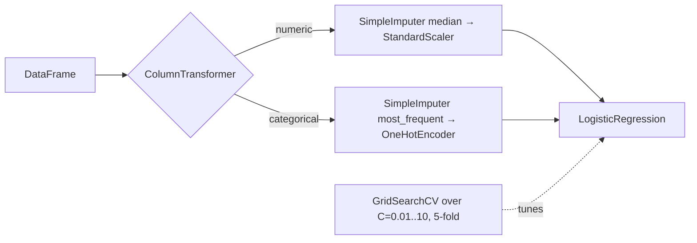

# Day 50 — scikit-learn pipelines and grid search

> **AI-90** · Block 2 · Machine learning from scratch · Day 50 of 90  
> Practise it with live tests on [telugucoders.com](https://telugucoders.com/) · run it locally with the [master file](../syllabus/AI90_MASTER.md) (`python ai90.py check 50`)

[← Day 49](day49-feature-engineering-titanic-model-ready-matrix.md) · [All 90 days](README.md) · [Day 51 →](day51-project-titanic-your-models-vs-scikit-learn.md)

---

**Dataset:** Titanic · **Time:** ~2 h

#### Visual



#### Notes

- Now you know what each piece does inside, use the real tools. A `Pipeline` bundles preprocessing + model so CV never leaks.
- `ColumnTransformer` routes columns to different preprocessing.
- `GridSearchCV(pipe, {"model__C": [...]}, cv=5)` — parameter names are `step__param`.
- `OneHotEncoder(handle_unknown="ignore")` = your Day 49 "unseen → zeros".

#### Your task — `day50.py`

- `NUMERIC = ["age", "fare", "sibsp", "parch"]`, `CATEGORICAL = ["sex", "pclass", "embarked"]`.
- `make_pipeline()` → `Pipeline([("prep", ColumnTransformer(...)), ("model", LogisticRegression(max_iter=1000))])`.
- `tune(df, y, Cs)` → fitted `GridSearchCV` (5-fold, accuracy).

#### Tests

```python
# file: test_day50.py
import numpy as np
import pandas as pd

import day50 as ex


def synthetic(n=200, seed=0):
    rng = np.random.default_rng(seed)
    sex = rng.choice(["male", "female"], n)
    df = pd.DataFrame({"sex": sex, "pclass": rng.choice([1, 2, 3], n), "age": rng.uniform(1, 70, n),
                       "fare": rng.uniform(5, 100, n), "sibsp": rng.integers(0, 3, n), "parch": rng.integers(0, 3, n),
                       "embarked": rng.choice(["S", "C", "Q"], n)})
    df.loc[::10, "age"] = np.nan
    y = ((sex == "female") ^ (rng.random(n) < 0.1)).astype(int)
    return df, y


def test_pipeline_steps():
    p = ex.make_pipeline()
    assert [name for name, _ in p.steps] == ["prep", "model"]


def test_fit_handles_nan_and_learns():
    df, y = synthetic()
    p = ex.make_pipeline().fit(df, y)
    assert p.score(df, y) > 0.85


def test_tune():
    df, y = synthetic()
    gs = ex.tune(df, y, [0.01, 1.0])
    assert gs.best_params_["model__C"] in (0.01, 1.0) and gs.best_score_ > 0.8
```

<details><summary>Reference solution (try first!)</summary>

```python
# file: day50.py
from sklearn.compose import ColumnTransformer
from sklearn.impute import SimpleImputer
from sklearn.linear_model import LogisticRegression
from sklearn.model_selection import GridSearchCV
from sklearn.pipeline import Pipeline
from sklearn.preprocessing import OneHotEncoder, StandardScaler

NUMERIC = ["age", "fare", "sibsp", "parch"]
CATEGORICAL = ["sex", "pclass", "embarked"]


def make_pipeline():
    num = Pipeline([("impute", SimpleImputer(strategy="median")), ("scale", StandardScaler())])
    cat = Pipeline([("impute", SimpleImputer(strategy="most_frequent")),
                    ("onehot", OneHotEncoder(handle_unknown="ignore"))])
    prep = ColumnTransformer([("num", num, NUMERIC), ("cat", cat, CATEGORICAL)])
    return Pipeline([("prep", prep), ("model", LogisticRegression(max_iter=1000))])


def tune(df, y, Cs):
    gs = GridSearchCV(make_pipeline(), {"model__C": list(Cs)}, cv=5, scoring="accuracy")
    return gs.fit(df, y)


if __name__ == "__main__":
    from day24 import load_titanic
    df = load_titanic()
    gs = tune(df[NUMERIC + CATEGORICAL], df["survived"], [0.01, 0.1, 1, 10])
    print("best C:", gs.best_params_, "CV accuracy:", round(gs.best_score_, 3))
```

</details>

**Done when:** green + real Titanic CV accuracy (expect ≈ 0.80).

---

[← Day 49](day49-feature-engineering-titanic-model-ready-matrix.md) · [All 90 days](README.md) · [Day 51 →](day51-project-titanic-your-models-vs-scikit-learn.md)

<sub>Generated from `syllabus/AI90_MASTER.md` by `tools/build_notes.py`. AI-90 — 90 days to build your own AI, by Asish Teja Vinnakota.</sub>
