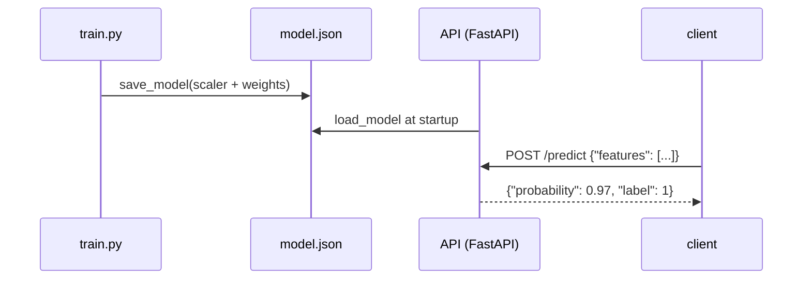

# Day 56 — Saving models and serving predictions

> **AI-90** · Block 2 · Machine learning from scratch · Day 56 of 90  
> Practise it with live tests on [telugucoders.com](https://telugucoders.com/) · run it locally with the [master file](../syllabus/AI90_MASTER.md) (`python ai90.py check 56`)

[← Day 55](day55-text-as-numbers-bag-of-words-and-tf-idf.md) · [All 90 days](README.md) · [Day 57 →](day57-learning-curves-diagnosing-bias-vs-variance.md)

---

**Dataset:** your Day 39 breast-cancer model · **Time:** ~2 h

#### Visual



#### Notes

- Training happens once; predicting happens many times somewhere else. Save **everything** prediction needs: scaler stats, weights, feature order, threshold, version.
- JSON is readable, diff-able and safe (unlike pickle, which can run code when loaded).
- NumPy arrays → `.tolist()` to save; `np.array(...)` to load.
- A FastAPI endpoint is ~10 lines (below). Install with `pip install fastapi uvicorn`; run `uvicorn day56:app`.

#### Worked example (serving)

```python
from fastapi import FastAPI
from pydantic import BaseModel

app = FastAPI()
MODEL = load_model("models/cancer.json")

class Req(BaseModel):
    features: list[float]

@app.post("/predict")
def predict(req: Req):
    return predict_one(MODEL, req.features)
```

#### Your task — `day56.py`

- `save_model(path, scaler, model, feature_names, threshold=0.5)` → JSON with `mean, scale, coef, intercept, feature_names, threshold, version=1`.
- `load_model(path)` → dict with NumPy arrays restored.
- `predict_one(m, features)` → `{"probability": p rounded to 4, "label": 0|1}`; raise `ValueError` if the feature count is wrong.

#### Tests

```python
# file: test_day56.py
import json
import tempfile
from pathlib import Path

import numpy as np
from sklearn.datasets import load_breast_cancer

import day56 as ex
from day34 import StandardScaler
from day39 import LogisticRegression


def test_round_trip_same_predictions():
    d = load_breast_cancer()
    s = StandardScaler().fit(d.data)
    m = LogisticRegression(epochs=200).fit(s.transform(d.data), d.target)
    path = Path(tempfile.mkdtemp()) / "m.json"
    ex.save_model(path, s, m, list(d.feature_names))
    assert json.loads(path.read_text())["version"] == 1
    loaded = ex.load_model(path)
    for row in d.data[:20]:
        out = ex.predict_one(loaded, row.tolist())
        p = m.predict_proba(s.transform(row[None]))[0]
        assert np.isclose(out["probability"], round(p, 4)) and out["label"] == int(p >= 0.5)


def test_wrong_length():
    path = Path(tempfile.mkdtemp()) / "m.json"
    s = StandardScaler().fit(np.array([[0.0, 1], [1, 0]]))
    m = LogisticRegression(epochs=5).fit(s.transform(np.array([[0.0, 1], [1, 0]])), np.array([0, 1]))
    ex.save_model(path, s, m, ["a", "b"])
    try:
        ex.predict_one(ex.load_model(path), [1.0])
    except ValueError:
        return
    raise AssertionError("expected ValueError")
```

<details><summary>Reference solution (try first!)</summary>

```python
# file: day56.py
import json
from pathlib import Path

import numpy as np

from day32 import sigmoid


def save_model(path, scaler, model, feature_names, threshold=0.5):
    path = Path(path)
    path.parent.mkdir(parents=True, exist_ok=True)
    path.write_text(json.dumps({
        "version": 1, "feature_names": list(feature_names), "threshold": threshold,
        "mean": scaler.mean_.tolist(), "scale": scaler.scale_.tolist(),
        "coef": model.coef_.tolist(), "intercept": float(model.intercept_)}, indent=1))
    return path


def load_model(path):
    m = json.loads(Path(path).read_text())
    for k in ("mean", "scale", "coef"):
        m[k] = np.array(m[k])
    return m


def predict_one(m, features):
    x = np.asarray(features, float)
    if x.shape != m["mean"].shape:
        raise ValueError(f"expected {len(m['mean'])} features, got {x.size}")
    p = float(sigmoid(((x - m["mean"]) / m["scale"]) @ m["coef"] + m["intercept"]))
    return {"probability": round(p, 4), "label": int(p >= m["threshold"])}
```

</details>

**Done when:** green + (optional) serve it with FastAPI and `curl` a prediction.

---

[← Day 55](day55-text-as-numbers-bag-of-words-and-tf-idf.md) · [All 90 days](README.md) · [Day 57 →](day57-learning-curves-diagnosing-bias-vs-variance.md)

<sub>Generated from `syllabus/AI90_MASTER.md` by `tools/build_notes.py`. AI-90 — 90 days to build your own AI, by Asish Teja Vinnakota.</sub>
