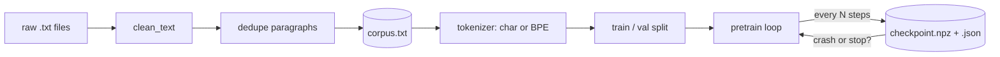

# Day 84 — Your own corpus, pretraining and checkpoints

> **AI-90** · Block 3 · Build an AI from scratch · Day 84 of 90  
> Practise it with live tests on [telugucoders.com](https://telugucoders.com/) · run it locally with the [master file](../syllabus/AI90_MASTER.md) (`python ai90.py check 84`)

[← Day 83](day83-training-like-the-pros-evaluation-clipping-sched.md) · [All 90 days](README.md) · [Day 85 →](day85-turning-it-into-a-chat-model-supervised-fine-tun.md)

---

**Dataset:** YOUR text — notes, dev log, lecture notes, public-domain books, or a Telugu–English mix · **Time:** ~3 h
**Progress:** `[████████████████████████░░░░░░] 24/30` · **System after today:** a GPT pretrained on a corpus you chose, with resumable checkpoints.

#### Visual



#### Notes

- Data quality beats model size at this scale: remove duplicates, boilerplate and broken encoding.
- Only use text you're allowed to use (your own writing, public domain, open licences).
- Checkpoint = parameters + step + config + tokenizer info. Save regularly; resume after interruptions.
- Keep a tiny held-out val set from the same distribution.

#### Your task — `day84.py`

- `clean_text(text)` → `\r\n`→`\n`, strip trailing spaces on each line, collapse 3+ newlines into 2, strip ends.
- `build_corpus(texts)` → cleaned texts split into paragraphs (`\n\n`), exact duplicates removed (first kept), rejoined with `\n\n`.
- `save_checkpoint(model, path, step, config)` → writes `path` (npz) and `path.with_suffix(".json")` (`step, config, n_params`).
- `load_checkpoint(model, path)` → `(step, config)`.

#### Tests

```python
# file: test_day84.py
import tempfile
from pathlib import Path

import numpy as np

import day84 as ex
from day79 import GPT


def test_clean_and_corpus():
    assert ex.clean_text("a  \r\nb\n\n\n\nc  ") == "a\nb\n\nc"
    corpus = ex.build_corpus(["Para one.\n\nPara two.", "Para two.\n\n\n\nPara three.  "])
    assert corpus == "Para one.\n\nPara two.\n\nPara three."


def test_checkpoint_round_trip():
    path = Path(tempfile.mkdtemp()) / "ckpt.npz"
    m = GPT(12, 8, 16, 2, 1, seed=0)
    ex.save_checkpoint(m, path, step=250, config={"n_embd": 16})
    fresh = GPT(12, 8, 16, 2, 1, seed=99)
    step, cfg = ex.load_checkpoint(fresh, path)
    assert step == 250 and cfg == {"n_embd": 16}
    assert all(np.array_equal(a.data, b.data) for a, b in zip(m.parameters(), fresh.parameters()))
    idx = np.zeros((1, 4), dtype=int)
    assert np.allclose(m(idx)[0].data, fresh(idx)[0].data)
```

<details><summary>Reference solution (try first!)</summary>

```python
# file: day84.py
import json
import re
from pathlib import Path

from day71 import load_params, save_params


def clean_text(text):
    text = text.replace("\r\n", "\n")
    text = "\n".join(line.rstrip() for line in text.split("\n"))
    return re.sub(r"\n{3,}", "\n\n", text).strip()


def build_corpus(texts):
    seen, paras = set(), []
    for t in texts:
        for p in clean_text(t).split("\n\n"):
            p = p.strip()
            if p and p not in seen:
                seen.add(p)
                paras.append(p)
    return "\n\n".join(paras)


def save_checkpoint(model, path, step, config):
    path = Path(path)
    path.parent.mkdir(parents=True, exist_ok=True)
    save_params(model, path)
    path.with_suffix(".json").write_text(json.dumps({"step": step, "config": config, "n_params": model.num_params()}))
    return path


def load_checkpoint(model, path):
    path = Path(path)
    load_params(model, path)
    meta = json.loads(path.with_suffix(".json").read_text())
    return meta["step"], meta["config"]
```

</details>

**Done when:** green + pretrain a GPT on your own corpus with checkpoints every 500 steps; stop it and resume once.

---

[← Day 83](day83-training-like-the-pros-evaluation-clipping-sched.md) · [All 90 days](README.md) · [Day 85 →](day85-turning-it-into-a-chat-model-supervised-fine-tun.md)

<sub>Generated from `syllabus/AI90_MASTER.md` by `tools/build_notes.py`. AI-90 — 90 days to build your own AI, by Asish Teja Vinnakota.</sub>
