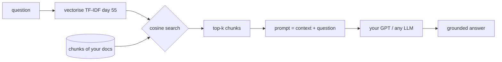

# Day 86 — RAG from scratch: give your AI a memory

> **AI-90** · Block 3 · Build an AI from scratch · Day 86 of 90  
> Practise it with live tests on [telugucoders.com](https://telugucoders.com/) · run it locally with the [master file](../syllabus/AI90_MASTER.md) (`python ai90.py check 86`)

[← Day 85](day85-turning-it-into-a-chat-model-supervised-fine-tun.md) · [All 90 days](README.md) · [Day 87 →](day87-tool-use-let-the-ai-run-your-automations.md)

---

**Dataset:** this syllabus file + your dev log (chunked) · **Time:** ~2 h
**Progress:** `[██████████████████████████░░░░] 26/30` · **System after today:** your AI looks things up before answering.

#### Visual



#### Notes

- Small models can't memorise everything. **Retrieval-Augmented Generation**: find relevant text, paste it into the prompt.
- Chunk with overlap so facts aren't cut in half at a boundary.
- Today's vectors are TF-IDF (Day 55) — real systems use learned embeddings, same cosine search (Day 31).
- Always show which chunks were used (citations) — it makes answers checkable.

#### Your task — `day86.py`

- `chunk_text(text, size=50, overlap=10)` → list of word chunks (`size` words, step `size − overlap`, last chunk may be shorter, no empty chunks).
- `class Retriever(chunks)` → `search(query, k=3)` → list of `(score, chunk)` best first, zero-score hits dropped.
- `build_prompt(question, hits)` → `"Context:\n[1] …\n[2] …\n\nQuestion: …\nAnswer:"`.

#### Tests

```python
# file: test_day86.py
import day86 as ex

DOCS = ["Day 66 builds the Tensor engine with autograd and gradient checks.",
        "Day 44 trains a Naive Bayes spam filter on real SMS messages.",
        "Day 82 builds a byte pair encoding tokenizer that handles Telugu and emoji.",
        "Day 22 downloads the Titanic dataset with a cache."]


def test_chunking():
    words = " ".join(f"w{i}" for i in range(23))
    chunks = ex.chunk_text(words, size=10, overlap=3)
    assert chunks[0].split()[-3:] == chunks[1].split()[:3]
    assert chunks[-1].split()[-1] == "w22" and all(chunks)
    assert len(ex.chunk_text("a b c", 10, 3)) == 1


def test_search():
    r = ex.Retriever(DOCS)
    hits = r.search("which day builds the tokenizer for telugu?", k=2)
    assert hits[0][1] == DOCS[2] and hits[0][0] > hits[1][0] > 0
    assert r.search("zzzz qqqq") == []


def test_prompt():
    p = ex.build_prompt("What is RAG?", [(0.9, "chunk A"), (0.5, "chunk B")])
    assert p == "Context:\n[1] chunk A\n[2] chunk B\n\nQuestion: What is RAG?\nAnswer:"
```

<details><summary>Reference solution (try first!)</summary>

```python
# file: day86.py
import numpy as np

from day55 import TfidfVectorizer


def chunk_text(text, size=50, overlap=10):
    words = text.split()
    step = size - overlap
    chunks = []
    for start in range(0, max(len(words) - overlap, 1), step):
        piece = words[start:start + size]
        if piece:
            chunks.append(" ".join(piece))
    return chunks


class Retriever:
    def __init__(self, chunks):
        self.chunks = list(chunks)
        self.vec = TfidfVectorizer().fit(self.chunks)
        self.M = self.vec.transform(self.chunks)

    def search(self, query, k=3):
        scores = self.M @ self.vec.transform([query])[0]
        order = np.argsort(-scores, kind="stable")[:k]
        return [(float(scores[i]), self.chunks[i]) for i in order if scores[i] > 0]


def build_prompt(question, hits):
    ctx = "\n".join(f"[{i}] {chunk}" for i, (_, chunk) in enumerate(hits, 1))
    return f"Context:\n{ctx}\n\nQuestion: {question}\nAnswer:"


if __name__ == "__main__":
    import sys
    text = open(sys.argv[1] if len(sys.argv) > 1 else "AI90_MASTER.md", encoding="utf-8").read()
    r = Retriever(chunk_text(text, 80, 20))
    for score, chunk in r.search("how does gradient clipping work", k=3):
        print(round(score, 3), chunk[:120], "…")
```

</details>

**Done when:** green + `python day86.py AI90_MASTER.md` answers questions about this course.

---

[← Day 85](day85-turning-it-into-a-chat-model-supervised-fine-tun.md) · [All 90 days](README.md) · [Day 87 →](day87-tool-use-let-the-ai-run-your-automations.md)

<sub>Generated from `syllabus/AI90_MASTER.md` by `tools/build_notes.py`. AI-90 — 90 days to build your own AI, by Asish Teja Vinnakota.</sub>
