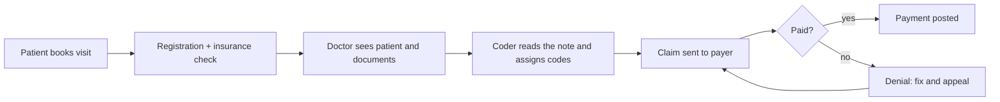

# Medical Coding 1 — What a medical coder does

> **AIM Biological path** · Stage 1 · Healthcare foundations · Lesson 1 of 28  
> ICD-10-CM FY2026 · CPT descriptions are AMA copyright: use your own CPT book · source: [MEDCODE_MASTER.md](../syllabus/MEDCODE_MASTER.md)

[All notes](README.md) · [Lesson 2 →](mc02-medical-terminology-i-roots-prefixes-suffixes.md)

---

**Dataset:** a day in a US physician practice · **Time:** ~1.5 h

**Goal:** Understand where coding sits in US healthcare, the four code sets, and the career path from fresher to certified coder.

#### Visual

#### Notes

- In the US, a doctor is paid by an **insurer (payer)** only after sending a **claim**. The claim cannot say "treated her diabetes and gave a flu shot"; it must say it in **codes**. A **medical coder** reads the doctor's documentation and assigns those codes.
- Two questions every claim answers:
  - **Why** was the patient seen? → **diagnosis codes**, from **ICD-10-CM** (about 74,700 billable codes in FY2026).
  - **What** was done? → **procedure codes**, from **CPT** (doctors' services, maintained by the AMA) and **HCPCS Level II** (supplies, drugs, ambulance, equipment, maintained by CMS). Hospitals code inpatient procedures with **ICD-10-PCS**.
- The diagnosis must **support** (justify) the procedure. A chest X-ray billed with a sprained ankle as the only reason gets denied. This link is called **medical necessity**.
- The whole money journey is the **revenue cycle** (diagram above). Coding sits in the middle: a wrong code means a denial, a delayed payment, or worse, an overpayment the practice must return.
- **Golden rule: code only what is documented.** Never guess, never "upgrade" to get paid more. If the note is unclear, you **query** the provider.
- **Career in India:** large RCM (revenue cycle management) companies code US charts remotely. Most hire freshers with **CPC** (AAPC) or **CCS** (AHIMA). Life-science, pharmacy and nursing graduates have a head start because of the terminology.
- **CPC exam:** 100 multiple-choice questions, 4 hours, open code book, 70% to pass. Surgery and E/M are the biggest parts. Lesson 28 is a timed mock.

#### Practice

Answer these, then check yourself with instant grading on [telugucoders.com](https://telugucoders.com/) (choose the Biological path).

1. Which code set explains WHY the patient was seen?
   - a) CPT
   - b) ICD-10-CM
   - c) HCPCS Level II
   - d) ICD-10-PCS
2. A clinic gave a patient crutches to take home. Which code set describes the crutches?
   - a) ICD-10-CM
   - b) CPT
   - c) HCPCS Level II
   - d) ICD-10-PCS
3. Which code set do hospitals use for procedures done during an inpatient stay?
   - a) CPT
   - b) HCPCS Level II
   - c) ICD-10-PCS
   - d) ICD-10-CM
4. The note says 'possible pneumonia, waiting for X-ray'. The coder is unsure. What should the coder do?
   - a) Code pneumonia anyway
   - b) Pick the highest-paying code
   - c) Query the provider or follow the uncertain-diagnosis rules
   - d) Leave the claim blank
5. What does 'medical necessity' mean on a claim?
   - a) The visit was urgent
   - b) The diagnosis justifies the service billed
   - c) The patient has insurance
   - d) The doctor signed the note
6. How many questions and how long is the CPC exam?
   - a) 50 questions, 2 hours
   - b) 100 questions, 4 hours
   - c) 150 questions, 5 hours
   - d) 135 questions, 4 hours
7. Fill the gap: the whole process from booking a visit to the practice being paid is called the ______ cycle.

**Done when:** all checks green and you can draw the revenue cycle from memory.

---

[All notes](README.md) · [Lesson 2 →](mc02-medical-terminology-i-roots-prefixes-suffixes.md)

Generated from `syllabus/MEDCODE_MASTER.md` by `tools/build_notes.py`.
