# AI-90 — 90 Days to Build Your Own AI (master file)

**One file, everything in it:** the plan, daily notes, visual examples, worked code, tests, reference solutions, real datasets and progress tracking. Forward this file to any AI tutor (or a future you) and work can continue from where it stopped.

```text
 Days  1–30   PYTHON + AUTOMATION + REAL DATA    basics → files → APIs → scraping → scheduling → pandas → plots → EDA bot
 Days 31–60   MACHINE LEARNING FROM SCRATCH      maths → regression → classification → trees/forests/boosting → PCA → projects
 Days 61–90   AI FROM SCRATCH                    neuron → autograd engine → nn library → attention → GPT → chat → RAG → tools → server
```

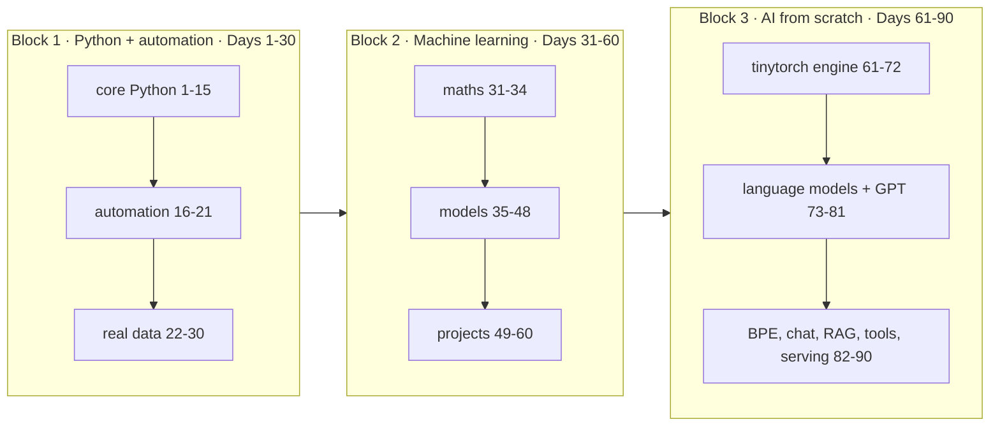

**Status:** every day's tests were run against the reference solutions on 2026-11-17 (Python 3.13, NumPy 2.5, pandas 3.0, scikit-learn 1.9, Matplotlib 3.11) → **307 / 307 tests pass across all 90 days.** The real-data scripts were also run on the actual downloads. The numbers marked "real run" in the visuals come from those runs. The live web API (Open-Meteo) and the scraping site (books.toscrape.com) couldn't be reached from the build machine, so those two days' parsing code is tested offline only; the live calls are untested there.

---

## 0. For the next AI reading this file

You are taking over as tutor for this course. Read this section first.

- **Learner:** Asish — MSc Artificial Intelligence & Robotics (University of Hertfordshire), BSc Maths/Physics/Chemistry. GitHub: `Asishteja18`. Works in hospitality alongside study. Prefers **casual, direct, practical** help — short explanations, working code, no fluff.
- **Goal:** finish all 90 days, publish the work on GitHub as portfolio evidence, and reuse the content on his Python + ML teaching website.
- **How progress is tracked:** `python ai90.py progress` reads `ai90/progress.json` (day → date first fully green). Ask him to paste that output plus his latest `DEVLOG.md` entry at the start of a session — that tells you exactly where he is.
- **File conventions (do not break them):**
  - Every runnable file is a fenced block that starts with `# file: <name>`. Solutions are `dayNN.py`; tests are `test_dayNN.py`. `ai90.py extract` relies on this exact format.
  - Inside code blocks, never write three backticks in a row (it ends the block and breaks extraction).
  - Later days import earlier days (`from day22 import download`, `from day66 import Tensor`). Keep function names and signatures stable.
  - Block 3 is NumPy-only on purpose: the learner's own `Tensor` engine (Days 66–72) runs everything up to a GPT. PyTorch is only the optional scale-up path on Day 90.
- **When helping on a day:** point to that day's Notes and Visual first, give hints before solutions, and have him run `python ai90.py check N`. Only show the reference solution after a real attempt.
- **When adding or changing content:** keep each day's structure (Visual · Notes · Task · Tests · Solution · Done when). Re-run `python ai90.py extract AI90_MASTER.md && python ai90.py check --solutions`, and only ship the change if everything is still green.
- **Natural extensions after Day 90:** port tinytorch models to PyTorch + GPU, train a bigger GPT with BPE, learned embeddings for RAG, publish `minisklearn` and the GPT as separate repos.

---

## 1. Quick start (learner)

```bash
# 1. setup (once)
python -m venv .venv && source .venv/bin/activate        # Windows: .venv\Scripts\activate
pip install numpy pandas scikit-learn matplotlib requests beautifulsoup4 openpyxl pytest
#    optional: pip install fastapi uvicorn     (Day 56 serving)

# 2. pull the runner out of this file, then extract every test + reference solution
python -c "import re;t=open('AI90_MASTER.md',encoding='utf-8').read();open('ai90.py','w',encoding='utf-8').write(re.search(r'```python\n# file: ai90.py\n(.*?)```',t,re.S).group(1))"
python ai90.py extract AI90_MASTER.md

# 3. every day
#    read the day below → write ai90/work/dayNN.py → check it
python ai90.py check 1
python ai90.py progress
```

- Your code: `ai90/work/dayNN.py`. Tests: `ai90/tests/`. Reference solutions: `ai90/solutions/` (try first, peek later).
- Real-data scripts: run them from `ai90/work/` (e.g. `python day22.py`); downloads are cached in a `data/` folder there, fetched once.
- If a later day imports an earlier day you skipped, the runner falls back to the reference solution, so you're never blocked.

### Daily routine (~2 h weekdays, 3–4 h on project days)

```text
 15 min  read Notes + Visual         ─┐
 60 min  write dayNN.py              ─┼─ python ai90.py check N  until all green
 30 min  run it on the real dataset  ─┘
 15 min  DEVLOG.md entry + git commit + push
```

### Progress log template (copy into `DEVLOG.md`)

```text
| date       | day | hours | tests  | real-data result            | stuck on / learned          |
|------------|-----|-------|--------|-----------------------------|-----------------------------|
| 2026-11-18 |  1  | 1.5   | 5/5 ✔  | —                           | // vs % for time formatting |
| 2026-11-19 |  2  | 2.0   | 5/5 ✔  | —                           | slugify edge cases          |
```

---

## 2. Datasets used (all real, all free)

| Dataset | Size | Source | Used on days |
| --- | --- | --- | --- |
| Titanic passengers | 891 rows | `download("titanic")` → seaborn-data on GitHub | 22, 24, 25, 27, 30, 49–51 |
| Flights (airline passengers) | 144 months | `download("flights")` | 26, 30, 54 |
| Car MPG | 398 cars | `download("mpg")` | 38, 58, 59 |
| SMS Spam Collection | 5,572 texts | `download("sms")` | 44, 55 |
| First names | 32,033 names | `download("names")` (karpathy/makemore) | 73, 74 |
| Tiny Shakespeare | 1.1 M characters | `download("shakespeare")` (karpathy/char-rnn) | 75, 80–84 |
| Iris · Wine · Breast Cancer · Diabetes · Digits | 150–1,797 rows | bundled in scikit-learn (offline) | 23, 31–48, 52–53, 57, 60–72 |
| Live weather | grows hourly | Open-Meteo API (no key) | 19, 21, 29 |
| Books catalogue | 1,000 books | books.toscrape.com (made for scraping practice) | 20 |
| Your own text | you decide | notes, dev log, public-domain books, Telugu–English mix | 84–86 |

`download()` is built on Day 22 and caches everything in `data/`.

---

## 3. All 90 days at a glance

| Day | Block | Topic | Dataset |
| --- | --- | --- | --- |
| 1 | Python | Setup, variables and types | none — pure Python |
| 2 | Python | Strings | none — pure Python |
| 3 | Python | Conditionals | none — pure Python |
| 4 | Python | Loops | none — pure Python |
| 5 | Python | Lists and tuples | none — pure Python |
| 6 | Python | Dicts and sets | none — pure Python |
| 7 | Python | Project: CLI expense tracker | your own expenses |
| 8 | Python | Functions in depth | none — pure Python |
| 9 | Python | Files, CSV and JSON | files you create |
| 10 | Python | Errors and debugging | none — pure Python |
| 11 | Python | Modules and the standard library | none — pure Python |
| 12 | Python | Comprehensions, generators, lambda | none — pure Python |
| 13 | Python | Classes: a Vector | none — pure Python |
| 14 | Python | Dataclasses, type hints, testing | none — pure Python |
| 15 | Python | Capstone: Matrix library | none — pure Python |
| 16 | Python | CLI tools: argparse and logging | none |
| 17 | Python | File automation: the folder organiser | a messy test folder (made by the tests) |
| 18 | Python | Regular expressions: log parser | web-server access logs (Common Log Format). Real one to try after: the NASA-HTTP July 1995 log (search "NASA HTTP access log 1995"). |
| 19 | Python | HTTP APIs and JSON: live weather | Open-Meteo live forecast API (free, no key): `https://api.open-meteo.com/v1/forecast?latitude=52.08&longitude=0.01&hourly=temperature_2m` |
| 20 | Python | Web scraping | books.toscrape.com (a site built for scraping practice) |
| 21 | Python | Scheduling and idempotent jobs | your Day 19 weather data, appended hourly |
| 22 | Python | Real dataset #1: Titanic, by hand | Titanic passengers (891 rows) |
| 23 | Python | NumPy on a real dataset: Iris | Iris (150 flowers × 4 measurements, 3 species) |
| 24 | Python | Pandas on real data: cleaning Titanic | Titanic (via Day 22's `download`) |
| 25 | Python | Visualising data with Matplotlib | Iris + Titanic |
| 26 | Python | Spreadsheet automation: Excel reports | Flights — monthly airline passengers 1949–1960 (`download("flights")`) |
| 27 | Python | A reusable data-cleaning pipeline | Titanic (raw) |
| 28 | Python | Git + GitHub Actions: run jobs in the cloud | none |
| 29 | Python | The data-collector bot | live weather (Day 19) appended over days → your own growing time series |
| 30 | Python | Block 1 capstone: automatic EDA report generator | run it on Titanic, Iris and Flights — any CSV |
| 31 | ML | Vectors and matrices for ML | Iris (bundled) |
| 32 | ML | Derivatives and gradients | none (functions) |
| 33 | ML | Gradient descent | none (a 2-D bowl), then real data from Day 37 on |
| 34 | ML | Probability and statistics for ML | Wine (bundled) |
| 35 | ML | The ML workflow: splits, baselines, metrics | Diabetes progression (442 patients, 10 features) |
| 36 | ML | Linear regression: the closed-form solution | Diabetes |
| 37 | ML | Linear regression with gradient descent (mini-batch) | Diabetes (standardised) |
| 38 | ML | Overfitting: polynomial features and ridge regression | Car MPG (`download("mpg")`) for the real run; synthetic sine for tests |
| 39 | ML | Logistic regression | Breast Cancer Wisconsin (569 tumours, 30 features) |
| 40 | ML | Classification metrics | Breast Cancer predictions from Day 39 |
| 41 | ML | Softmax regression (multi-class) | Wine (178 wines, 3 cultivars, 13 chemical features) |
| 42 | ML | Cross-validation | Wine + Diabetes |
| 43 | ML | k-Nearest Neighbours | Iris + Wine |
| 44 | ML | Naive Bayes: an SMS spam filter | SMS Spam Collection (5,572 real texts) |
| 45 | ML | Decision trees | Iris, then Titanic |
| 46 | ML | Random forests | Breast Cancer |
| 47 | ML | k-means clustering | Iris without labels (then check against the real species) |
| 48 | ML | PCA: compressing 64 pixels into 2 | Digits (1,797 handwritten 8×8 images) |
| 49 | ML | Feature engineering: Titanic → model-ready matrix | Titanic |
| 50 | ML | scikit-learn pipelines and grid search | Titanic |
| 51 | ML | Project: Titanic, your models vs scikit-learn | Titanic |
| 52 | ML | Gradient boosting from scratch | Diabetes |
| 53 | ML | Imbalanced data and decision thresholds | Breast Cancer, artificially made rare (keep 10% of malignant cases) |
| 54 | ML | Time series: forecasting airline passengers | Flights 1949–1960 (144 months) — and later your own Day 29 weather CSV |
| 55 | ML | Text as numbers: bag-of-words and TF-IDF | SMS Spam |
| 56 | ML | Saving models and serving predictions | your Day 39 breast-cancer model |
| 57 | ML | Learning curves: diagnosing bias vs variance | Digits |
| 58 | ML | Project: predicting car fuel efficiency | Car MPG (398 cars, 1970–82) |
| 59 | ML | Explaining models: permutation importance | Car MPG / Titanic |
| 60 | ML | Block 2 capstone: `minisklearn` benchmark | Iris, Wine, Breast Cancer, Digits |
| 61 | AI | The perceptron | logic gates; then Iris setosa vs rest |
| 62 | AI | Multi-layer networks: the forward pass | XOR |
| 63 | AI | Backpropagation by hand | XOR, then Breast Cancer |
| 64 | AI | Autograd, part 1: a scalar engine | none |
| 65 | AI | A neural-net library on your scalar engine | two moons (`sklearn.datasets.make_moons`, 100 points) |
| 66 | AI | Autograd, part 2: the Tensor engine | none (gradient checks) |
| 67 | AI | Autograd, part 3: the ops a language model needs | none (gradient checks) |
| 68 | AI | `nn.Module`: layers on your engine | Digits (8×8 handwritten, 1,797 images) |
| 69 | AI | Optimisers: SGD, momentum, Adam | a quadratic; Digits |
| 70 | AI | LayerNorm and Dropout | none (gradient checks) |
| 71 | AI | A reusable trainer: batches, early stopping, checkpoints | Digits |
| 72 | AI | Convolution from scratch | Digits as 1×8×8 images |
| 73 | AI | Language model #1: bigram counts | 32,033 real first names |
| 74 | AI | Language model #2: embeddings + MLP (Bengio 2003) | names |
| 75 | AI | Preparing text for a GPT: tokenizer and batches | Tiny Shakespeare (1.1 M characters) |
| 76 | AI | Self-attention, step by step (NumPy) | toy matrices |
| 77 | AI | Causal multi-head attention as a trainable layer | none (gradient checks) |
| 78 | AI | The transformer block | none |
| 79 | AI | GPT: the whole model | none (shape + initial-loss checks) |
| 80 | AI | Train your GPT | Tiny Shakespeare |
| 81 | AI | Generating text: temperature, top-k, top-p | your trained Shakespeare GPT |
| 82 | AI | A BPE tokenizer from scratch | Tiny Shakespeare; test with English + Telugu + emoji |
| 83 | AI | Training like the pros: evaluation, clipping, schedules | Shakespeare train/val |
| 84 | AI | Your own corpus, pretraining and checkpoints | YOUR text — notes, dev log, lecture notes, public-domain books, or a Telugu–English mix |
| 85 | AI | Turning it into a chat model (supervised fine-tuning) | a small chat set you write (≥ 50 Q&A pairs about Python/ML — you know the material now) |
| 86 | AI | RAG from scratch: give your AI a memory | this syllabus file + your dev log (chunked) |
| 87 | AI | Tool use: let the AI run your automations | tools built from Blocks 1–2 (calculator, Titanic stats, dataset downloader) |
| 88 | AI | Serving your AI: an API and a chat page | your chat model (Day 85) |
| 89 | AI | Evaluation and the model card | an eval set you write (30+ prompts with expected answers) |
| 90 | AI | Demo day: ship it | everything |

---

## BLOCK 1 — PYTHON + AUTOMATION + REAL DATA (Days 1–30)

Days 1–15: core Python. Days 16–30: automation and real datasets.

---

### Day 1 — Setup, variables and types

**Dataset:** none — pure Python · **Time:** ~2 h

#### Visual

```text
 name        value      type
 ┌──────┐   ┌───────┐
 │ age  │──▶│  24   │   int
 │ price│──▶│ 3.50  │   float
 │ name │──▶│"Asish"│   str
 └──────┘   └───────┘
 3723 s ─┬─ // 3600 ──▶ 1 h
         ├─ %3600 //60 ▶ 2 min      f"{1:02}:{2:02}:{3:02}" ─▶ "01:02:03"
         └─ % 60 ──────▶ 3 s
```

**Goal:** get Python running, then store values in variables and turn them into readable text.

#### 1. Setup (30 min)

1. Install Python 3.13 or 3.14 from python.org (tick "Add to PATH" on Windows).
2. Install VS Code and its Python extension.
3. Check it works: open a terminal and run `python --version`.
4. Create a GitHub repo called `ai-90`, clone it, and copy this starter pack in.

#### 2. REPL vs script

Typing `python` opens the **REPL** — you type a line, it answers straight away. Great for testing ideas. A **script** is a `.py` file you run with `python file.py`. Real work lives in scripts.

#### 3. Variables and types

A variable is a name pointing at a value. Python works out the type for you.

```python
age = 24            # int   — whole number
price = 3.50        # float — decimal number
name = "Asish"      # str   — text
is_student = True   # bool  — True / False

print(type(price))  # <class 'float'>
```

Maths works as you'd expect, plus three you'll use constantly:

```python
7 / 2    # 3.5  — true division, always a float
7 // 2   # 3    — floor division, drops the remainder
7 % 2    # 1    — remainder (modulo)
2 ** 10  # 1024 — power
```

`//` and `%` together split a number into parts — that's how you turn 3723 seconds into 1 hour, 2 minutes, 3 seconds.

#### 4. f-strings

Put `f` before a string and drop variables inside `{}`:

```python
name = "Asish"
print(f"Hello, {name}!")           # Hello, Asish!
print(f"{3.14159:.2f}")            # 3.14   — 2 decimal places
print(f"{7:02}")                   # 07     — pad to width 2 with zeros
```

#### 5. return vs print

Exercises ask you to **return** a value, not print it. `print` shows it on screen; `return` hands it back so other code (and the checker) can use it.

#### Exercises

Open `day01.py`, replace each `raise NotImplementedError` with your code, then run:

```
python ai90.py check 1
```

Green = done. Yellow = not started. Red = wrong answer — read the message and try again.

**Bonus (automation):** write `convert.py` that asks for a temperature with `input()` and prints both units. Note `input()` always gives you a `str` — convert with `float()`.

#### Your task — write `ai90/work/day01.py` with: `c_to_f`, `greet`, `circle_area`, `seconds_to_hms`, `describe`

#### Tests

```python
# file: test_day01.py
import day01 as ex


def test_c_to_f():
    assert ex.c_to_f(100) == 212.0
    assert ex.c_to_f(0) == 32.0
    assert ex.c_to_f(-40) == -40.0


def test_greet():
    assert ex.greet("Asish") == "Hello, Asish!"
    assert ex.greet("world") == "Hello, world!"


def test_circle_area():
    assert ex.circle_area(2) == 12.57
    assert ex.circle_area(0) == 0


def test_seconds_to_hms():
    assert ex.seconds_to_hms(3723) == "01:02:03"
    assert ex.seconds_to_hms(59) == "00:00:59"
    assert ex.seconds_to_hms(86399) == "23:59:59"


def test_describe():
    assert ex.describe(3.0) == "float"
    assert ex.describe(3) == "int"
    assert ex.describe("3") == "str"
    assert ex.describe(True) == "bool"
```

<details><summary>Reference solution (try first!)</summary>

```python
# file: day01.py
"""Day 1 — variables, types, f-strings."""


def c_to_f(celsius):
    """Convert Celsius to Fahrenheit. c_to_f(100) -> 212.0"""
    return celsius * 9 / 5 + 32


def greet(name):
    """Return 'Hello, <name>!' using an f-string. greet('Asish') -> 'Hello, Asish!'"""
    return f"Hello, {name}!"


def circle_area(radius):
    """Area of a circle rounded to 2 decimals. Use 3.14159 for pi. circle_area(2) -> 12.57"""
    return round(3.14159 * radius ** 2, 2)


def seconds_to_hms(total_seconds):
    """Format seconds as HH:MM:SS with zero padding. seconds_to_hms(3723) -> '01:02:03'"""
    hours = total_seconds // 3600
    minutes = (total_seconds % 3600) // 60
    seconds = total_seconds % 60
    return f"{hours:02}:{minutes:02}:{seconds:02}"


def describe(value):
    """Return the type name of value as a string. describe(3.0) -> 'float'"""
    return type(value).__name__
```

</details>

**Done when:** `python ai90.py check 1` is all green → tick Day 1 in the tracker.

---

### Day 2 — Strings

**Dataset:** none — pure Python · **Time:** ~2 h

#### Visual

```text
  index:   0   1   2   3   4   5
           p   y   t   h   o   n
  neg:    -6  -5  -4  -3  -2  -1
  s[0:3] = "pyt"   s[2:] = "thon"   s[::-1] = "nohtyp"
  slugify:  "  My Photos (2026)!! " ─▶ "my-photos-2026"
```

**Goal:** slice, search and reshape text — the raw material for every tokenizer and data-cleaning script you'll write later.

#### 1. Indexing and slicing

A string is a sequence of characters, numbered from 0. Negative numbers count from the end.

```python
s = "python"
s[0]      # 'p'
s[-1]     # 'n'
s[0:3]    # 'pyt'   — start included, end excluded
s[2:]     # 'thon'
s[::-1]   # 'nohtyp' — step -1 reverses
len(s)    # 6
```

#### 2. Strings are immutable

You can't change a character in place (`s[0] = "P"` fails). You build a **new** string instead: `"P" + s[1:]`.

#### 3. Methods you'll use every day

```python
"  Hi There ".strip()        # 'Hi There'   — remove outer whitespace
"Hi There".lower()           # 'hi there'
"a,b,c".split(",")           # ['a', 'b', 'c']
"one two  three".split()     # ['one', 'two', 'three'] — any whitespace
"-".join(["a", "b", "c"])    # 'a-b-c'
"report.pdf".endswith(".pdf")  # True
"data".replace("a", "4")     # 'd4t4'
"x7".isalnum()               # True  — letters or digits only
"hello".count("l")           # 2
```

#### 4. Looping over characters

```python
for ch in "abc":
    print(ch)
```

A **generator expression** inside `sum()` is a neat way to count:

```python
sum(1 for ch in "banana" if ch == "a")   # 3
```

#### 5. Building strings piece by piece

Appending to a list and joining once at the end is the clean pattern:

```python
parts = []
for word in ["ai", "is", "fun"]:
    parts.append(word.upper())
"_".join(parts)   # 'AI_IS_FUN'
```

#### Exercises

`python ai90.py check 2`. The last one, `slugify`, is real automation: it turns messy titles into safe filenames. You'll reuse it on Day 17's folder organiser.

**Hint for slugify:** walk the characters; keep letters/digits; for anything else add a `-` only if the last thing you added wasn't already a `-`. Strip `-` from both ends at the end.

#### Your task — write `ai90/work/day02.py` with: `count_vowels`, `longest_word`, `initials`, `is_palindrome`, `slugify`

#### Tests

```python
# file: test_day02.py
import day02 as ex


def test_count_vowels():
    assert ex.count_vowels("Hello World") == 3
    assert ex.count_vowels("rhythm") == 0
    assert ex.count_vowels("AEIOU") == 5


def test_longest_word():
    assert ex.longest_word("a bb ccc dd") == "ccc"
    assert ex.longest_word("one two six") == "one"
    assert ex.longest_word("") == ""


def test_initials():
    assert ex.initials("asish teja vinnakota") == "ATV"
    assert ex.initials("Ada Lovelace") == "AL"


def test_is_palindrome():
    assert ex.is_palindrome("A man, a plan, a canal: Panama") is True
    assert ex.is_palindrome("racecar") is True
    assert ex.is_palindrome("python") is False


def test_slugify():
    assert ex.slugify("  My Holiday Photos (2026)!! ") == "my-holiday-photos-2026"
    assert ex.slugify("Report_FINAL v2.docx") == "report-final-v2-docx"
    assert ex.slugify("---") == ""
```

<details><summary>Reference solution (try first!)</summary>

```python
# file: day02.py
"""Day 2 — strings."""


def count_vowels(text):
    """Count a, e, i, o, u (any case). count_vowels('Hello World') -> 3"""
    return sum(1 for ch in text.lower() if ch in "aeiou")


def longest_word(text):
    """Return the longest word; on a tie, the first one. longest_word('a bb ccc dd') -> 'ccc'"""
    best = ""
    for word in text.split():
        if len(word) > len(best):
            best = word
    return best


def initials(full_name):
    """Uppercase initials. initials('asish teja vinnakota') -> 'ATV'"""
    return "".join(part[0].upper() for part in full_name.split())


def is_palindrome(text):
    """True if text reads the same backwards, ignoring case and non-letters/digits.
    is_palindrome('A man, a plan, a canal: Panama') -> True"""
    cleaned = "".join(ch.lower() for ch in text if ch.isalnum())
    return cleaned == cleaned[::-1]


def slugify(title):
    """Make a safe filename: lowercase, any run of non-alphanumeric chars becomes one '-',
    no '-' at either end. slugify('  My Holiday Photos (2026)!! ') -> 'my-holiday-photos-2026'"""
    out = []
    for ch in title.lower():
        if ch.isalnum():
            out.append(ch)
        elif out and out[-1] != "-":
            out.append("-")
    return "".join(out).strip("-")
```

</details>

**Done when:** `python ai90.py check 2` is all green → tick Day 2 in the tracker.

---

### Day 3 — Conditionals

**Dataset:** none — pure Python · **Time:** ~2 h

#### Visual

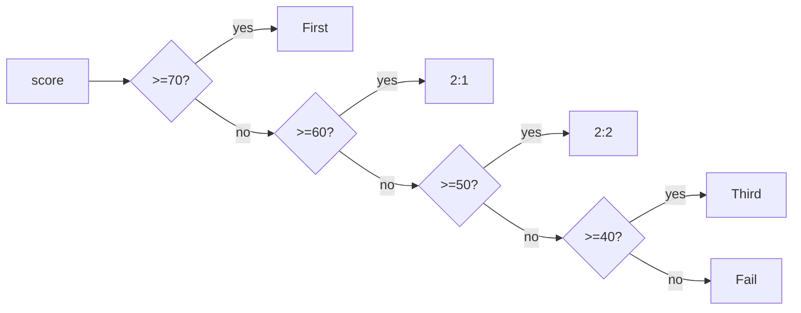

**Goal:** make your code choose. Every classifier you build later ends in a decision like these.

#### 1. Comparisons give booleans

```python
5 > 3        # True
5 == 5.0     # True   — == compares value
"a" != "b"   # True
3 <= 3       # True
0 < x < 10   # chained — True if x is between 0 and 10
```

`=` assigns, `==` compares. Mixing them up is the #1 beginner bug.

#### 2. if / elif / else

Python checks top to bottom and runs the **first** branch that's true, then skips the rest.

```python
if temp > 25:
    print("hot")
elif temp > 15:
    print("mild")
else:
    print("cold")
```

Indentation (4 spaces) defines the block — no braces.

Because the first match wins, **order matters**: check the biggest threshold first.

#### 3. and / or / not

```python
if age >= 18 and has_id:
    ...
if day == "Sat" or day == "Sun":
    ...
if not finished:
    ...
```

#### 4. Truthiness

Empty things are false: `0`, `""`, `[]`, `{}`, `None`. Everything else is true.

```python
name = ""
if not name:
    print("name is empty")
```

#### 5. Raising an error on bad input

When an input makes no sense, stop loudly instead of returning nonsense:

```python
if score < 0 or score > 100:
    raise ValueError("score must be 0-100")
```

#### 6. Early return

Inside a function, `return` exits immediately. That often removes the need for `else`:

```python
def sign(x):
    if x > 0:
        return "positive"
    if x < 0:
        return "negative"
    return "zero"
```

#### Exercises

`python ai90.py check 3`. `file_category` is the brain of the Day 17 folder organiser.

**Tip:** `str.endswith` accepts a tuple: `name.endswith((".jpg", ".png"))`.

#### Your task — write `ai90/work/day03.py` with: `grade`, `is_leap`, `file_category`, `clamp`, `sign`

#### Tests

```python
# file: test_day03.py
import day03 as ex


def test_grade():
    assert ex.grade(85) == "First"
    assert ex.grade(70) == "First"
    assert ex.grade(69) == "2:1"
    assert ex.grade(55) == "2:2"
    assert ex.grade(40) == "Third"
    assert ex.grade(12) == "Fail"


def test_grade_rejects_bad_scores():
    for bad in (-1, 101):
        try:
            ex.grade(bad)
        except ValueError:
            continue
        raise AssertionError(f"grade({bad}) should raise ValueError")


def test_is_leap():
    assert ex.is_leap(2024) is True
    assert ex.is_leap(2026) is False
    assert ex.is_leap(1900) is False
    assert ex.is_leap(2000) is True


def test_file_category():
    assert ex.file_category("Holiday.JPG") == "image"
    assert ex.file_category("cv.pdf") == "document"
    assert ex.file_category("train.py") == "code"
    assert ex.file_category("song.mp3") == "other"


def test_clamp():
    assert ex.clamp(15, 0, 10) == 10
    assert ex.clamp(-3, 0, 10) == 0
    assert ex.clamp(5, 0, 10) == 5


def test_sign():
    assert ex.sign(4) == "positive"
    assert ex.sign(-0.5) == "negative"
    assert ex.sign(0) == "zero"
```

<details><summary>Reference solution (try first!)</summary>

```python
# file: day03.py
"""Day 3 — conditionals."""


def grade(score):
    """UK-style grade: 70+ 'First', 60+ '2:1', 50+ '2:2', 40+ 'Third', else 'Fail'.
    Scores outside 0-100 raise ValueError."""
    if score < 0 or score > 100:
        raise ValueError("score must be 0-100")
    if score >= 70:
        return "First"
    elif score >= 60:
        return "2:1"
    elif score >= 50:
        return "2:2"
    elif score >= 40:
        return "Third"
    return "Fail"


def is_leap(year):
    """Leap year: divisible by 4, except centuries, unless divisible by 400."""
    return year % 4 == 0 and (year % 100 != 0 or year % 400 == 0)


def file_category(filename):
    """'image' for .jpg .jpeg .png .gif, 'document' for .pdf .docx .txt,
    'code' for .py .js .html, else 'other'. Case-insensitive."""
    name = filename.lower()
    if name.endswith((".jpg", ".jpeg", ".png", ".gif")):
        return "image"
    if name.endswith((".pdf", ".docx", ".txt")):
        return "document"
    if name.endswith((".py", ".js", ".html")):
        return "code"
    return "other"


def clamp(x, low, high):
    """Keep x inside [low, high]. clamp(15, 0, 10) -> 10"""
    if x < low:
        return low
    if x > high:
        return high
    return x


def sign(x):
    """'positive', 'negative' or 'zero'."""
    if x > 0:
        return "positive"
    if x < 0:
        return "negative"
    return "zero"
```

</details>

**Done when:** `python ai90.py check 3` is all green → tick Day 3 in the tracker.

---

### Day 4 — Loops

**Dataset:** none — pure Python · **Time:** ~2 h

#### Visual

```text
 accumulator pattern            while loop (Collatz 6)
 total = 0                      6 → 3 → 10 → 5 → 16 → 8 → 4 → 2 → 1
 for x in [3,4,5]:              steps:  1   2    3   4    5   6   7   8
   total += x   0→3→7→12
```

**Goal:** repeat work. A training loop is just a `for` loop that runs thousands of times — today you learn its shape.

#### 1. for + range

```python
for i in range(5):        # 0 1 2 3 4
    print(i)

range(1, 6)      # 1..5   — end excluded
range(0, 10, 2)  # 0 2 4 6 8
```

`for` walks over anything iterable: lists, strings, files, dict keys.

#### 2. while

Runs as long as a condition stays true. Use it when you don't know how many steps you need.

```python
n = 1000
steps = 0
while n > 1:
    n //= 2
    steps += 1
```

Make sure something inside changes the condition, or it never stops (Ctrl+C to escape).

#### 3. break and continue

```python
for x in data:
    if x < 0:
        continue      # skip this one, go to the next
    if x > 100:
        break         # stop the whole loop
    process(x)
```

#### 4. The accumulator pattern

Start with an empty/zero value, update it each pass, return it at the end. You'll write this hundreds of times.

```python
total = 0
for x in [3, 4, 5]:
    total += x        # total = total + x
```

#### 5. enumerate — index and value together

```python
for i, name in enumerate(["a", "b"]):
    print(i, name)    # 0 a, then 1 b
```

#### 6. Digits trick

`n % 10` is the last digit, `n // 10` drops it. Loop until `n` is 0 to visit every digit.

#### Exercises

`python ai90.py check 4`.

- `is_prime`: you only need to test divisors up to √n — loop `while i * i <= n`.
- `primes_up_to` can call your own `is_prime`. Reusing your own functions is the whole point.

**Bonus:** a number-guessing game — `import random`, `secret = random.randint(1, 100)`, loop on `input()` saying "higher" / "lower" until correct, then print the number of guesses.

#### Your task — write `ai90/work/day04.py` with: `fizzbuzz`, `sum_of_digits`, `is_prime`, `primes_up_to`, `collatz_steps`, `first_index_over`

#### Tests

```python
# file: test_day04.py
import day04 as ex


def test_fizzbuzz():
    assert ex.fizzbuzz(5) == ["1", "2", "Fizz", "4", "Buzz"]
    assert ex.fizzbuzz(15)[-1] == "FizzBuzz"
    assert len(ex.fizzbuzz(100)) == 100


def test_sum_of_digits():
    assert ex.sum_of_digits(1234) == 10
    assert ex.sum_of_digits(0) == 0
    assert ex.sum_of_digits(9999) == 36


def test_is_prime():
    assert [n for n in range(20) if ex.is_prime(n)] == [2, 3, 5, 7, 11, 13, 17, 19]


def test_primes_up_to():
    assert ex.primes_up_to(10) == [2, 3, 5, 7]
    assert ex.primes_up_to(1) == []
    assert len(ex.primes_up_to(100)) == 25


def test_collatz_steps():
    assert ex.collatz_steps(1) == 0
    assert ex.collatz_steps(6) == 8
    assert ex.collatz_steps(27) == 111


def test_first_index_over():
    assert ex.first_index_over([1, 5, 9, 12], 6) == 2
    assert ex.first_index_over([1, 2], 10) == -1
```

<details><summary>Reference solution (try first!)</summary>

```python
# file: day04.py
"""Day 4 — loops."""


def fizzbuzz(n):
    """List for 1..n: 'Fizz' for multiples of 3, 'Buzz' for 5, 'FizzBuzz' for both, else the number as str."""
    out = []
    for i in range(1, n + 1):
        if i % 15 == 0:
            out.append("FizzBuzz")
        elif i % 3 == 0:
            out.append("Fizz")
        elif i % 5 == 0:
            out.append("Buzz")
        else:
            out.append(str(i))
    return out


def sum_of_digits(n):
    """Sum the digits of a non-negative int. sum_of_digits(1234) -> 10"""
    total = 0
    while n > 0:
        total += n % 10
        n //= 10
    return total


def is_prime(n):
    """True if n is prime."""
    if n < 2:
        return False
    i = 2
    while i * i <= n:
        if n % i == 0:
            return False
        i += 1
    return True


def primes_up_to(n):
    """All primes <= n in order. primes_up_to(10) -> [2, 3, 5, 7]"""
    return [k for k in range(2, n + 1) if is_prime(k)]


def collatz_steps(n):
    """Steps to reach 1: if even n//=2, else n=3n+1. collatz_steps(6) -> 8"""
    steps = 0
    while n != 1:
        n = n // 2 if n % 2 == 0 else 3 * n + 1
        steps += 1
    return steps


def first_index_over(nums, limit):
    """Index of the first number > limit, or -1. Use break."""
    found = -1
    for i, x in enumerate(nums):
        if x > limit:
            found = i
            break
    return found
```

</details>

**Done when:** `python ai90.py check 4` is all green → tick Day 4 in the tracker.

---

### Day 5 — Lists and tuples

**Dataset:** none — pure Python · **Time:** ~2 h

#### Visual

```text
 chunk(items, 2)   = mini-batches, exactly what a DataLoader does
 [1, 2, 3, 4, 5]
  └─┬─┘ └─┬─┘ └┘
  [1,2] [3,4] [5]
 running_mean([2,4,6]) → [2.0, 3.0, 4.0]
```

**Goal:** hold many values and work through them. Datasets, batches and model weights all start life as lists.

#### 1. Lists

```python
nums = [3, 1, 4]
nums.append(1)        # [3, 1, 4, 1]
nums.extend([5, 9])   # [3, 1, 4, 1, 5, 9]
nums[0] = 10          # lists ARE mutable
len(nums)             # 6
4 in nums             # True
nums.pop()            # removes and returns the last item
```

Slicing works exactly like strings: `nums[1:3]`, `nums[-2:]`, `nums[::-1]`.

#### 2. sorted vs .sort

```python
data = [5, 1, 9]
sorted(data)              # [1, 5, 9]  — NEW list, data unchanged
sorted(data, reverse=True)
data.sort()               # sorts data IN PLACE, returns None
```

If a function shouldn't change its input, use `sorted()` or slice a copy (`data[:]`).

#### 3. Tuples

Like lists but **immutable** — good for fixed records and returning several values.

```python
point = (3, 4)
x, y = point          # unpacking
def stats(nums):
    return min(nums), max(nums)   # returns a tuple
lo, hi = stats([2, 8, 5])
```

#### 4. zip and enumerate

```python
names = ["a", "b"]; scores = [90, 75]
for name, score in zip(names, scores):
    print(name, score)

for i, x in enumerate(nums, start=1):   # counting from 1
    ...
```

#### 5. Batching with range steps

ML trains on **mini-batches**. A step in `range` + slicing does it:

```python
items = list(range(7))
[items[i:i + 3] for i in range(0, len(items), 3)]   # [[0,1,2],[3,4,5],[6]]
```

(That `[... for ...]` is a list comprehension — Day 12 covers it properly. A plain loop with `append` works too.)

#### Exercises

`python ai90.py check 5`. `running_mean` is how you'll smooth noisy loss curves; `chunk` is your first data loader.

#### Your task — write `ai90/work/day05.py` with: `running_mean`, `top_k`, `flatten`, `chunk`, `dedupe`, `min_max`

#### Tests

```python
# file: test_day05.py
import day05 as ex


def test_running_mean():
    assert ex.running_mean([2, 4, 6]) == [2.0, 3.0, 4.0]
    assert ex.running_mean([]) == []


def test_top_k():
    data = [5, 1, 9, 3, 7]
    assert ex.top_k(data, 2) == [9, 7]
    assert data == [5, 1, 9, 3, 7], "input list must not change"
    assert ex.top_k(data, 10) == [9, 7, 5, 3, 1]


def test_flatten():
    assert ex.flatten([[1, 2], [3], []]) == [1, 2, 3]
    assert ex.flatten([]) == []


def test_chunk():
    assert ex.chunk([1, 2, 3, 4, 5], 2) == [[1, 2], [3, 4], [5]]
    assert ex.chunk([1, 2, 3], 3) == [[1, 2, 3]]
    assert ex.chunk([], 4) == []


def test_dedupe():
    assert ex.dedupe([3, 1, 3, 2, 1]) == [3, 1, 2]
    assert ex.dedupe(list("banana")) == ["b", "a", "n"]


def test_min_max():
    assert ex.min_max([4, -2, 9, 0]) == (-2, 9)
    assert ex.min_max([7]) == (7, 7)
```

<details><summary>Reference solution (try first!)</summary>

```python
# file: day05.py
"""Day 5 — lists and tuples."""


def running_mean(nums):
    """Mean of everything seen so far. running_mean([2, 4, 6]) -> [2.0, 3.0, 4.0]"""
    out, total = [], 0
    for i, x in enumerate(nums, start=1):
        total += x
        out.append(total / i)
    return out


def top_k(nums, k):
    """The k largest values, biggest first. Do not change the input list."""
    return sorted(nums, reverse=True)[:k]


def flatten(nested):
    """Flatten one level. flatten([[1, 2], [3], []]) -> [1, 2, 3]"""
    out = []
    for inner in nested:
        out.extend(inner)
    return out


def chunk(items, size):
    """Split into batches of `size`; the last may be shorter. chunk([1,2,3,4,5], 2) -> [[1,2],[3,4],[5]]"""
    return [items[i:i + size] for i in range(0, len(items), size)]


def dedupe(items):
    """Remove duplicates, keeping the first occurrence order."""
    seen, out = [], []
    for x in items:
        if x not in seen:
            seen.append(x)
            out.append(x)
    return out


def min_max(nums):
    """Return (smallest, largest) as a tuple without using min() or max()."""
    lo = hi = nums[0]
    for x in nums[1:]:
        if x < lo:
            lo = x
        if x > hi:
            hi = x
    return (lo, hi)
```

</details>

**Done when:** `python ai90.py check 5` is all green → tick Day 5 in the tracker.

---

### Day 6 — Dicts and sets

**Dataset:** none — pure Python · **Time:** ~2 h

#### Visual

```text
 word_freq("the cat. the hat!")
 ┌────────┬───────┐
 │ key    │ count │      vocab = {word: id}   ← a tokenizer is this dict
 ├────────┼───────┤
 │ "the"  │   2   │
 │ "cat"  │   1   │
 │ "hat"  │   1   │
 └────────┴───────┘
```

**Goal:** look things up by name instead of position. A tokenizer's vocabulary is literally a dict from word to number.

#### 1. Dicts

```python
ages = {"asish": 24, "sam": 30}
ages["asish"]            # 24
ages["new"] = 19         # add / overwrite
"sam" in ages            # True — checks KEYS
ages.get("bob")          # None  — no crash if missing
ages.get("bob", 0)       # 0     — your default
del ages["sam"]
```

#### 2. Looping

```python
for name in ages:                 # keys
for name, age in ages.items():    # key + value pairs
for age in ages.values():
```

#### 3. Counting — the pattern you'll use most

```python
counts = {}
for word in words:
    counts[word] = counts.get(word, 0) + 1
```

`collections.Counter` does this in one line — but write it by hand first so you know what it does.

#### 4. Grouping

`setdefault` returns the existing list, or creates an empty one first:

```python
groups = {}
for name in files:
    ext = name.rsplit(".", 1)[-1]
    groups.setdefault(ext, []).append(name)
```

#### 5. Sorting a dict by value

```python
sorted(counts.items(), key=lambda pair: pair[1], reverse=True)
# tie-break alphabetically: key=lambda p: (-p[1], p[0])
```

`lambda p: ...` is a tiny inline function. Day 12 explains it; for now read it as "sort by this".

#### 6. Sets

Unordered, no duplicates, very fast `in` checks.

```python
a = {1, 2, 3}; b = {2, 3, 4}
a & b    # {2, 3}  intersection
a | b    # {1, 2, 3, 4} union
a - b    # {1}
set([1, 1, 2])   # {1, 2} — instant dedupe (loses order)
```

#### Exercises

`python ai90.py check 6`. `group_by_extension` plus Day 3's `file_category` = the core of an automatic file organiser.

**Hint:** `"photo.jpg".rsplit(".", 1)` → `['photo', 'jpg']` — splits at the **last** dot only.

#### Your task — write `ai90/work/day06.py` with: `word_freq`, `most_common`, `group_by_extension`, `invert`, `common_items`, `has_duplicates`

#### Tests

```python
# file: test_day06.py
import day06 as ex


def test_word_freq():
    assert ex.word_freq("The cat. the hat!") == {"the": 2, "cat": 1, "hat": 1}
    assert ex.word_freq("") == {}


def test_most_common():
    text = "b a c a b a"
    assert ex.most_common(text, 2) == [("a", 3), ("b", 2)]
    assert ex.most_common("z y x", 2) == [("x", 1), ("y", 1)]


def test_group_by_extension():
    files = ["cv.pdf", "pic.JPG", "notes.txt", "scan.PDF", "Makefile"]
    assert ex.group_by_extension(files) == {
        ".pdf": ["cv.pdf", "scan.PDF"],
        ".jpg": ["pic.JPG"],
        ".txt": ["notes.txt"],
        "": ["Makefile"],
    }


def test_invert():
    assert ex.invert({"a": 1, "b": 2}) == {1: "a", 2: "b"}


def test_common_items():
    assert ex.common_items([3, 1, 2, 2], [2, 3, 5]) == [2, 3]


def test_has_duplicates():
    assert ex.has_duplicates([1, 2, 1]) is True
    assert ex.has_duplicates("abc") is False
```

<details><summary>Reference solution (try first!)</summary>

```python
# file: day06.py
"""Day 6 — dicts and sets."""

PUNCTUATION = ".,!?;:\"'()"


def word_freq(text):
    """Count words, lowercased, with .,!?;:"'() stripped from each word's ends.
    word_freq('The cat. the hat!') -> {'the': 2, 'cat': 1, 'hat': 1}"""
    counts = {}
    for raw in text.split():
        word = raw.strip(PUNCTUATION).lower()
        if word:
            counts[word] = counts.get(word, 0) + 1
    return counts


def most_common(text, n):
    """Top n (word, count) pairs: highest count first, ties alphabetical."""
    pairs = word_freq(text).items()
    return sorted(pairs, key=lambda p: (-p[1], p[0]))[:n]


def group_by_extension(filenames):
    """{'.pdf': ['a.pdf', ...], ...}; lowercase extension; files with no '.' go under ''."""
    groups = {}
    for name in filenames:
        ext = "." + name.rsplit(".", 1)[1].lower() if "." in name else ""
        groups.setdefault(ext, []).append(name)
    return groups


def invert(d):
    """Swap keys and values. invert({'a': 1, 'b': 2}) -> {1: 'a', 2: 'b'}"""
    return {v: k for k, v in d.items()}


def common_items(a, b):
    """Items in both lists, sorted, no duplicates."""
    return sorted(set(a) & set(b))


def has_duplicates(items):
    """True if any item appears twice."""
    return len(set(items)) != len(items)
```

</details>

**Done when:** `python ai90.py check 6` is all green → tick Day 6 in the tracker.

---

### Day 7 — Project: CLI expense tracker

**Dataset:** your own expenses · **Time:** ~2 h

#### Visual

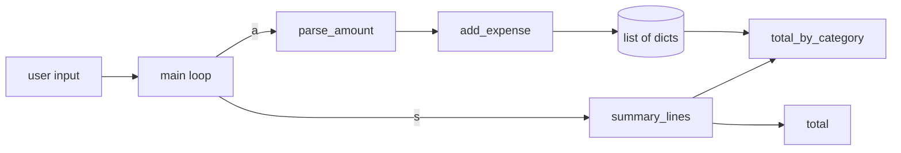

**Goal:** combine the whole first week into one tool you actually use.

#### What you're building

```
[a]dd  [l]ist  [s]ummary  [q]uit > a
Amount: £12.50
Category: food
Note: lunch

[a]dd  [l]ist  [s]ummary  [q]uit > s
transport   £40.00
food        £20.00
TOTAL       £60.00
```

#### Data model: a list of dicts

```python
expenses = [
    {"amount": 12.5, "category": "food", "note": "lunch"},
    {"amount": 40.0, "category": "transport", "note": ""},
]
```

A list of dicts is a mini database. Pandas DataFrames (Day 36) are the grown-up version of exactly this.

#### Separate logic from input/output

Every function in `day07.py` takes data and **returns** a result — no `input()`, no `print()`. Only `main()` talks to the user. That split is why the checker can test your code, and it's how all real software is structured.

#### Plan of attack

1. `parse_amount` — Day 2 string skills + Day 3 raising errors. `float("abc")` already raises `ValueError` for you.
2. `add_expense` — build a dict, append it, return it.
3. `total` — accumulator (Day 4).
4. `total_by_category` — counting pattern, but adding amounts instead of 1 (Day 6).
5. `biggest` — like `min_max` from Day 5.
6. `summary_lines` — f-string alignment: `f"{cat:<12}"` pads to 12 characters, `f"{x:.2f}"` gives 2 decimals.

Then run `python ai90.py check 7`, and once green, run `python day07.py` and use it.

#### Rounding note

`0.1 + 0.2` is `0.30000000000000004` in every language — floats are binary. Round money to 2 dp when you report it.

#### Sunday task

Start `DEVLOG.md` in your repo: what you built this week, what confused you, one thing to revisit. Keep one entry per week for all 90 days.

#### Your task — write `ai90/work/day07.py` with: `parse_amount`, `add_expense`, `total`, `total_by_category`, `biggest`, `summary_lines`

#### Tests

```python
# file: test_day07.py
import day07 as ex


def sample():
    data = []
    ex.add_expense(data, 12.5, " Food ", "lunch")
    ex.add_expense(data, 40, "transport")
    ex.add_expense(data, 7.5, "food", "coffee")
    return data


def test_parse_amount():
    assert ex.parse_amount("£12.50") == 12.5
    assert ex.parse_amount(" 3 ") == 3.0
    for bad in ("abc", "-4", "0", ""):
        try:
            ex.parse_amount(bad)
        except ValueError:
            continue
        raise AssertionError(f"parse_amount({bad!r}) should raise ValueError")


def test_add_expense():
    data = []
    item = ex.add_expense(data, 9.99, " Fun ")
    assert item == {"amount": 9.99, "category": "fun", "note": ""}
    assert data == [item]


def test_total():
    assert ex.total(sample()) == 60.0
    assert ex.total([]) == 0


def test_total_by_category():
    assert ex.total_by_category(sample()) == {"food": 20.0, "transport": 40.0}


def test_biggest():
    assert ex.biggest(sample())["category"] == "transport"
    assert ex.biggest([]) is None


def test_summary_lines():
    assert ex.summary_lines(sample()) == [
        "transport   £40.00",
        "food        £20.00",
        "TOTAL       £60.00",
    ]
```

<details><summary>Reference solution (try first!)</summary>

```python
# file: day07.py
"""Day 7 — weekend project: CLI expense tracker.

An expense is a dict: {"amount": 12.5, "category": "food", "note": "lunch"}.
The tracker is a list of those dicts. Get the functions passing first,
then run `python day07.py` to use it for real.
"""


def parse_amount(text):
    """'£12.50' / '12.5' / ' 3 ' -> float. Strip spaces and a leading '£'.
    Raise ValueError if it isn't a positive number."""
    cleaned = text.strip().lstrip("£")
    value = float(cleaned)  # raises ValueError on junk
    if value <= 0:
        raise ValueError("amount must be positive")
    return value


def add_expense(expenses, amount, category, note=""):
    """Append a new expense dict (category lowercased + stripped) and return it."""
    item = {"amount": amount, "category": category.strip().lower(), "note": note}
    expenses.append(item)
    return item


def total(expenses):
    """Sum of all amounts, rounded to 2 dp."""
    return round(sum(e["amount"] for e in expenses), 2)


def total_by_category(expenses):
    """{'food': 20.0, ...} rounded to 2 dp."""
    out = {}
    for e in expenses:
        out[e["category"]] = round(out.get(e["category"], 0) + e["amount"], 2)
    return out


def biggest(expenses):
    """The single largest expense dict, or None if there are none."""
    best = None
    for e in expenses:
        if best is None or e["amount"] > best["amount"]:
            best = e
    return best


def summary_lines(expenses):
    """Lines like 'food        £20.00', biggest category first, then 'TOTAL       £x.xx'.
    Category left-justified to 12 chars."""
    lines = [f"{cat:<12}£{amt:.2f}" for cat, amt in
             sorted(total_by_category(expenses).items(), key=lambda p: -p[1])]
    lines.append(f"{'TOTAL':<12}£{total(expenses):.2f}")
    return lines


def main():
    expenses = []
    menu = "\n[a]dd  [l]ist  [s]ummary  [q]uit > "
    while True:
        choice = input(menu).strip().lower()
        if choice == "a":
            try:
                amount = parse_amount(input("Amount: "))
            except ValueError:
                print("Not a valid amount.")
                continue
            add_expense(expenses, amount, input("Category: "), input("Note: "))
        elif choice == "l":
            for i, e in enumerate(expenses, 1):
                print(f"{i:>3}. £{e['amount']:.2f}  {e['category']}  {e['note']}")
        elif choice == "s":
            print("\n".join(summary_lines(expenses)))
        elif choice == "q":
            break


if __name__ == "__main__":
    main()
```

</details>

**Done when:** `python ai90.py check 7` is all green → tick Day 7 in the tracker.

---

### Day 8 — Functions in depth

**Dataset:** none — pure Python · **Time:** ~2 h

#### Visual

```text
 make_multiplier(3) ──▶ returns a function that remembers n=3
 triple = make_multiplier(3)
 triple(5) ─▶ 15           functions are values: pass them, return them
 apply_n_times(f, x, n):  x ─f─▶ ─f─▶ ─f─▶ result
```

**Goal:** write functions that are flexible and reusable. In Phase 5, a neural-network layer is just a function you call over and over.

#### 1. Defaults and keyword arguments

```python
def power(base, exp=2):
    return base ** exp

power(3)          # 9
power(2, 5)       # 32
power(2, exp=5)   # 32 — keyword: clearer at the call site
```

Never use a mutable default like `def f(items=[])` — the same list is shared between calls. Use `items=None` and create it inside.

#### 2. *args and **kwargs

```python
def mean(*nums):          # nums is a tuple of all positional args
    return sum(nums) / len(nums)

def show(**opts):         # opts is a dict of all keyword args
    for k, v in opts.items():
        print(k, v)

mean(1, 2, 3)
show(lr=0.01, epochs=5)
mean(*[4, 6])             # * unpacks a list into positional args
```

You'll see `**kwargs` everywhere in ML libraries — e.g. passing hyperparameters through.

#### 3. Return vs print, one more time

A function that prints can't be reused. Return the value; let the caller decide.

#### 4. Scope

Variables made inside a function stay inside it. A function can **read** outer variables but should get what it needs through parameters.

#### 5. Functions are values

You can pass a function into another, and return one from another.

```python
def apply_twice(f, x):
    return f(f(x))

apply_twice(str.upper, "hi")

def make_adder(n):
    def add(x):
        return x + n      # remembers n — this is a "closure"
    return add

add5 = make_adder(5)
add5(10)   # 15
```

Optimisers, activation functions and loss functions all get passed around like this.

#### 6. Docstrings

The first string inside a function documents it. `help(power)` shows it. Write one for every function from today on.

#### Exercises

`python ai90.py check 8`. Then refactor your Day 7 `main()` — pull each menu action into its own small function.

#### Your task — write `ai90/work/day08.py` with: `power`, `mean`, `build_url`, `make_multiplier`, `apply_n_times`, `safe_divide`

#### Tests

```python
# file: test_day08.py
import day08 as ex


def test_power():
    assert ex.power(3) == 9
    assert ex.power(2, exp=5) == 32
    assert ex.power(2, 0) == 1


def test_mean():
    assert ex.mean(1, 2, 3) == 2.0
    assert ex.mean() == 0.0
    assert ex.mean(*[10, 20]) == 15.0


def test_build_url():
    assert ex.build_url("https://x.com/s", q="ai", page=2) == "https://x.com/s?page=2&q=ai"
    assert ex.build_url("https://x.com") == "https://x.com"


def test_make_multiplier():
    triple = ex.make_multiplier(3)
    assert triple(5) == 15
    assert ex.make_multiplier(0)(99) == 0


def test_apply_n_times():
    assert ex.apply_n_times(lambda v: v * 2, 1, 3) == 8
    assert ex.apply_n_times(str.upper, "ai", 1) == "AI"
    assert ex.apply_n_times(lambda v: v + 1, 0, 0) == 0


def test_safe_divide():
    assert ex.safe_divide(6, 3) == 2.0
    assert ex.safe_divide(1, 0) is None
    assert ex.safe_divide(1, 0, default=0) == 0
```

<details><summary>Reference solution (try first!)</summary>

```python
# file: day08.py
"""Day 8 — functions in depth."""


def power(base, exp=2):
    """base ** exp, exp defaults to 2. power(3) -> 9, power(2, exp=5) -> 32"""
    return base ** exp


def mean(*nums):
    """Mean of any number of positional args; 0.0 if none. mean(1, 2, 3) -> 2.0"""
    return sum(nums) / len(nums) if nums else 0.0


def build_url(base, **params):
    """Append query params sorted by key. build_url('https://x.com/s', q='ai', page=2)
    -> 'https://x.com/s?page=2&q=ai'. No params -> base unchanged."""
    if not params:
        return base
    query = "&".join(f"{k}={params[k]}" for k in sorted(params))
    return f"{base}?{query}"


def make_multiplier(n):
    """Return a function that multiplies its input by n. make_multiplier(3)(5) -> 15"""
    def multiply(x):
        return x * n
    return multiply


def apply_n_times(f, x, n):
    """Apply f to x, n times. apply_n_times(lambda v: v * 2, 1, 3) -> 8"""
    for _ in range(n):
        x = f(x)
    return x


def safe_divide(a, b, default=None):
    """a / b, or `default` when b is 0."""
    return default if b == 0 else a / b
```

</details>

**Done when:** `python ai90.py check 8` is all green → tick Day 8 in the tracker.

---

### Day 9 — Files, CSV and JSON

**Dataset:** files you create · **Time:** ~2 h

#### Visual

```text
 people.csv                         read_csv()
 ┌───────────┐                      [{"name":"Asish","age":"24"},
 │name,age   │  ── DictReader ──▶    {"name":"Sam","age":"30"}]
 │Asish,24   │                      (values are STRINGS — convert!)
 │Sam,30     │
 └───────────┘
```

**Goal:** save and load data. Every dataset, config and model checkpoint you'll ever touch is a file.

#### 1. Opening files with `with`

```python
with open("notes.txt", "w", encoding="utf-8") as f:
    f.write("hello\n")

with open("notes.txt", encoding="utf-8") as f:
    for line in f:            # reads one line at a time — works on huge files
        print(line.strip())
```

`with` closes the file for you, even if something crashes. Modes: `"r"` read (default), `"w"` write (overwrites!), `"a"` append.

Always pass `encoding="utf-8"` — Windows otherwise defaults to something else and breaks on £ or Telugu text.

#### 2. pathlib — paths as objects

```python
from pathlib import Path

p = Path("data") / "raw" / "prices.csv"   # / joins paths on any OS
p.name        # 'prices.csv'
p.suffix      # '.csv'
p.stem        # 'prices'
p.exists()
p.parent.mkdir(parents=True, exist_ok=True)
p.write_text("hi", encoding="utf-8")
for child in Path("data").iterdir():
    ...
```

#### 3. CSV

```python
import csv

with open("people.csv", newline="", encoding="utf-8") as f:
    rows = list(csv.DictReader(f))     # [{'name': 'Asish', 'age': '24'}, ...]

with open("out.csv", "w", newline="", encoding="utf-8") as f:
    w = csv.DictWriter(f, fieldnames=["name", "age"])
    w.writeheader()
    w.writerows(rows)
```

CSV values come back as **strings** — convert with `int()` / `float()` yourself. `newline=""` stops blank lines appearing on Windows.

#### 4. JSON

JSON maps straight onto dicts and lists — perfect for configs and API responses.

```python
import json
text = json.dumps({"lr": 0.01}, indent=2)   # dict -> str
data = json.loads(text)                     # str -> dict
```

#### Exercises

`python ai90.py check 9`. Tests write to a temporary folder, so nothing in your project gets touched.

**Apply it:** make your Day 7 tracker load `expenses.json` on start and save on quit.

#### Your task — write `ai90/work/day09.py` with: `write_lines`, `count_lines`, `read_csv`, `write_csv`, `save_json`, `load_json`, `list_files`

#### Tests

```python
# file: test_day09.py
import tempfile
from pathlib import Path

import day09 as ex


def tmp():
    return Path(tempfile.mkdtemp())


def test_write_and_count_lines():
    p = tmp() / "notes.txt"
    ex.write_lines(p, ["one", "", "three"])
    assert p.read_text(encoding="utf-8") == "one\n\nthree\n"
    assert ex.count_lines(p) == 2


def test_csv_round_trip():
    p = tmp() / "people.csv"
    rows = [{"name": "Asish", "age": "24"}, {"name": "Sam", "age": "30"}]
    ex.write_csv(p, rows)
    assert p.read_text(encoding="utf-8").splitlines()[0] == "name,age"
    assert ex.read_csv(p) == rows


def test_json_round_trip():
    p = tmp() / "cfg.json"
    ex.save_json(p, {"lr": 0.01, "layers": [64, 32]})
    assert ex.load_json(p) == {"lr": 0.01, "layers": [64, 32]}
    assert "\n  " in p.read_text(encoding="utf-8"), "use indent=2"


def test_load_json_missing():
    assert ex.load_json(tmp() / "nope.json", default={}) == {}


def test_list_files():
    d = tmp()
    for name in ["b.CSV", "a.csv", "c.txt"]:
        (d / name).write_text("x")
    (d / "sub.csv").mkdir()
    assert ex.list_files(d, ".csv") == ["a.csv", "b.CSV"]
```

<details><summary>Reference solution (try first!)</summary>

```python
# file: day09.py
"""Day 9 — files, CSV and JSON."""
import csv
import json
from pathlib import Path


def write_lines(path, lines):
    """Write each string in `lines` on its own line (UTF-8). Overwrites the file."""
    with open(path, "w", encoding="utf-8") as f:
        for line in lines:
            f.write(line + "\n")


def count_lines(path):
    """Number of non-empty lines in a text file."""
    with open(path, encoding="utf-8") as f:
        return sum(1 for line in f if line.strip())


def read_csv(path):
    """Read a CSV with a header row into a list of dicts (all values stay strings)."""
    with open(path, newline="", encoding="utf-8") as f:
        return list(csv.DictReader(f))


def write_csv(path, rows):
    """Write a list of dicts to CSV, header taken from the first row's keys. Empty rows -> empty file."""
    with open(path, "w", newline="", encoding="utf-8") as f:
        if not rows:
            return
        writer = csv.DictWriter(f, fieldnames=list(rows[0]))
        writer.writeheader()
        writer.writerows(rows)


def save_json(path, data):
    """Save data as pretty JSON (indent=2)."""
    Path(path).write_text(json.dumps(data, indent=2), encoding="utf-8")


def load_json(path, default=None):
    """Load JSON; return `default` if the file doesn't exist."""
    p = Path(path)
    if not p.exists():
        return default
    return json.loads(p.read_text(encoding="utf-8"))


def list_files(folder, ext):
    """Sorted file NAMES (not paths) in `folder` ending with `ext`, case-insensitive."""
    return sorted(p.name for p in Path(folder).iterdir()
                  if p.is_file() and p.name.lower().endswith(ext.lower()))
```

</details>

**Done when:** `python ai90.py check 9` is all green → tick Day 9 in the tracker.

---

### Day 10 — Errors and debugging

**Dataset:** none — pure Python · **Time:** ~2 h

#### Visual

```text
 Traceback (most recent call last):     ← read BOTTOM-UP
   File "app.py", line 8, in <module>   ← where
     total += int(row["age"])           ← the line
 ValueError: invalid literal ... 'old'  ← what + which value
 retry: try ✗ ─wait 1s─ try ✗ ─wait 2s─ try ✓
```

**Goal:** stop scripts crashing on bad data, and find bugs fast. Automation that runs while you sleep must survive junk input.

#### 1. Reading a traceback

Read it **bottom-up**: the last line is the error type and message; the lines above show where it happened, most recent call last.

```
Traceback (most recent call last):
  File "app.py", line 8, in <module>
    total += int(row["age"])
ValueError: invalid literal for int() with base 10: 'old'
```

→ line 8, `int()` got `'old'`.

#### 2. try / except

```python
try:
    age = int(text)
except ValueError:
    age = None
```

Catch the **specific** error you expect. A bare `except:` hides real bugs.

Several at once: `except (ValueError, TypeError):`

#### 3. else and finally

```python
try:
    f = open(path)
except FileNotFoundError:
    print("missing")
else:
    data = f.read()     # only runs if no error
finally:
    print("always runs")  # cleanup
```

#### 4. Raising your own errors

```python
if age < 0:
    raise ValueError(f"age can't be negative: {age}")
```

A good message says **what** was wrong and **what value** caused it. `{x!r}` shows the value with quotes, so blanks and spaces are visible.

#### 5. The retry pattern

Networks fail. Automation retries:

```python
for attempt in range(3):
    try:
        return fetch()
    except ConnectionError:
        time.sleep(2 ** attempt)   # back off: 1s, 2s, 4s
```

You'll use this on Day 19 with real APIs.

#### 6. Debugging toolkit

- `print(f"{x=}")` prints `x=42` — quick and fine.
- `breakpoint()` drops you into the debugger: `n` next line, `s` step in, `p x` print, `c` continue.
- VS Code: click left of a line number to set a breakpoint, then F5.

#### Exercises

`python ai90.py check 10`.

#### Your task — write `ai90/work/day10.py` with: `to_number`, `safe_get`, `parse_record`, `average_valid`, `retry`

#### Tests

```python
# file: test_day10.py
import day10 as ex


def raises(func, exc=ValueError):
    try:
        func()
    except exc as e:
        return e
    raise AssertionError(f"expected {exc.__name__}")


def test_to_number():
    assert ex.to_number("3") == 3 and isinstance(ex.to_number("3"), int)
    assert ex.to_number("2.5") == 2.5
    assert ex.to_number("abc") is None
    assert ex.to_number(None, default=0) == 0


def test_safe_get():
    assert ex.safe_get([1, 2, 3], 1) == 2
    assert ex.safe_get([1, 2, 3], 10) is None
    assert ex.safe_get([], 0, default="x") == "x"


def test_parse_record_ok():
    assert ex.parse_record("Asish, 24") == {"name": "Asish", "age": 24}


def test_parse_record_errors():
    assert "2 fields" in str(raises(lambda: ex.parse_record("a,b,c")))
    assert "blank" in str(raises(lambda: ex.parse_record(" ,24")))
    assert "whole number" in str(raises(lambda: ex.parse_record("Sam,old")))
    assert "range" in str(raises(lambda: ex.parse_record("Sam,200")))


def test_average_valid():
    assert ex.average_valid(["1", "2", "x", None, "3"]) == (2.0, 2)
    assert ex.average_valid(["?"]) == (None, 1)


def test_retry():
    calls = []

    def flaky():
        calls.append(1)
        if len(calls) < 3:
            raise ConnectionError("down")
        return "ok"

    assert ex.retry(flaky, 5) == "ok"
    assert len(calls) == 3
    calls.clear()
    raises(lambda: ex.retry(flaky, 2), ConnectionError)
```

<details><summary>Reference solution (try first!)</summary>

```python
# file: day10.py
"""Day 10 — errors and debugging."""


def to_number(text, default=None):
    """int if it looks like an int, else float, else `default`. to_number('3') -> 3, to_number('2.5') -> 2.5"""
    try:
        return int(text)
    except (ValueError, TypeError):
        pass
    try:
        return float(text)
    except (ValueError, TypeError):
        return default


def safe_get(items, index, default=None):
    """items[index], or default if the index is out of range."""
    try:
        return items[index]
    except IndexError:
        return default


def parse_record(line):
    """'name,age' -> {'name': 'Asish', 'age': 24}. Raise ValueError with a helpful message
    if there aren't exactly 2 fields, the name is blank, or age isn't a whole number 0-150."""
    parts = [p.strip() for p in line.split(",")]
    if len(parts) != 2:
        raise ValueError(f"expected 2 fields, got {len(parts)}: {line!r}")
    name, age_text = parts
    if not name:
        raise ValueError("name is blank")
    try:
        age = int(age_text)
    except ValueError:
        raise ValueError(f"age is not a whole number: {age_text!r}") from None
    if not 0 <= age <= 150:
        raise ValueError(f"age out of range: {age}")
    return {"name": name, "age": age}


def average_valid(values):
    """Average of entries that convert to float; return (average or None, count of bad entries)."""
    good, bad = [], 0
    for v in values:
        try:
            good.append(float(v))
        except (ValueError, TypeError):
            bad += 1
    return (sum(good) / len(good) if good else None, bad)


def retry(func, attempts):
    """Call func() up to `attempts` times; return the first success. If every try raises,
    re-raise the last exception."""
    last = None
    for _ in range(attempts):
        try:
            return func()
        except Exception as e:  # noqa: BLE001
            last = e
    raise last
```

</details>

**Done when:** `python ai90.py check 10` is all green → tick Day 10 in the tracker.

---

### Day 11 — Modules and the standard library

**Dataset:** none — pure Python · **Time:** ~2 h

#### Visual

```text
 expenses/              python -m expenses
 ├── __init__.py
 ├── core.py      ◀── import expenses.core
 ├── storage.py
 └── __main__.py  ◀── runs on python -m
 .venv/  ← isolated packages per project (never commit it)
```

**Goal:** split code across files, use the standard library instead of reinventing it, and install packages cleanly.

#### 1. Importing

```python
import math                       # use as math.sqrt(2)
from pathlib import Path          # use as Path(...)
from collections import Counter
import numpy as np                # alias (Phase 3)
```

Any `.py` file is a module. If you have `helpers.py` next to `app.py`, then `import helpers` works.

#### 2. `if __name__ == "__main__":`

```python
def main():
    ...

if __name__ == "__main__":
    main()
```

Code under that line runs only when you execute the file directly, not when another file imports it. Every script you write from now on gets this.

#### 3. Packages

A folder of modules is a package:

```
expenses/
    __init__.py
    core.py        # add_expense, total ...
    storage.py     # load / save JSON
    __main__.py    # the CLI — run with: python -m expenses
```

#### 4. Virtual environments

Each project gets its own isolated set of packages:

```bash
python -m venv .venv
source .venv/bin/activate        # Windows: .venv\Scripts\activate
pip install requests
pip freeze > requirements.txt
```

`uv` does the same, much faster: `uv venv`, `uv pip install requests`. Add `.venv/` to `.gitignore`.

#### 5. Standard-library tour (no install needed)

| Module | Use it for |
| --- | --- |
| `math` | `sqrt`, `ceil`, `log`, `exp`, `dist` |
| `random` | `random.Random(seed)` — reproducible randomness, vital in ML |
| `collections` | `Counter`, `defaultdict`, `deque` |
| `datetime` | dates, durations, `fromisoformat` |
| `pathlib` | paths |
| `json`, `csv` | data files |
| `itertools` | `chain`, `combinations`, `islice` |

#### Exercises

`python ai90.py check 11`. Each function should be 1–3 lines — the point is knowing which tool to grab.

**Apply it:** turn your expense tracker into the package layout above.

#### Your task — write `ai90/work/day11.py` with: `top_words`, `days_between`, `distance`, `seeded_sample`, `split_path`, `ceil_div`

#### Tests

```python
# file: test_day11.py
import day11 as ex


def test_top_words():
    assert ex.top_words(["a", "b", "a", "c", "a", "b"], 2) == [("a", 3), ("b", 2)]


def test_days_between():
    assert ex.days_between("2026-11-16", "2027-02-14") == 90
    assert ex.days_between("2026-01-02", "2026-01-01") == -1


def test_distance():
    assert ex.distance((0, 0), (3, 4)) == 5.0
    assert ex.distance((1, 1, 1), (2, 2, 2)) == 1.7321


def test_seeded_sample():
    items = list(range(100))
    a = ex.seeded_sample(items, 5, seed=42)
    assert a == ex.seeded_sample(items, 5, seed=42)
    assert len(set(a)) == 5


def test_split_path():
    assert ex.split_path("data/raw/prices.csv") == ("data/raw", "prices", ".csv")
    assert ex.split_path("README") == (".", "README", "")


def test_ceil_div():
    assert ex.ceil_div(10, 3) == 4
    assert ex.ceil_div(9, 3) == 3
```

<details><summary>Reference solution (try first!)</summary>

```python
# file: day11.py
"""Day 11 — modules and the standard library. Use the imports below; don't reinvent them."""
import math
import random
from collections import Counter
from datetime import date
from pathlib import PurePosixPath


def top_words(words, n):
    """Most common n words as (word, count) pairs using collections.Counter."""
    return Counter(words).most_common(n)


def days_between(a, b):
    """Days from ISO date string a to b. days_between('2026-11-16', '2027-02-14') -> 90"""
    return (date.fromisoformat(b) - date.fromisoformat(a)).days


def distance(p, q):
    """Euclidean distance between two points (tuples), rounded to 4 dp. Use math."""
    return round(math.dist(p, q), 4)


def seeded_sample(items, k, seed):
    """k items chosen with random.Random(seed).sample — same seed, same result."""
    return random.Random(seed).sample(items, k)


def split_path(path):
    """'data/raw/prices.csv' -> ('data/raw', 'prices', '.csv') using PurePosixPath."""
    p = PurePosixPath(path)
    return (str(p.parent), p.stem, p.suffix)


def ceil_div(a, b):
    """How many batches of size b to cover a items. ceil_div(10, 3) -> 4"""
    return math.ceil(a / b)
```

</details>

**Done when:** `python ai90.py check 11` is all green → tick Day 11 in the tracker.

---

### Day 12 — Comprehensions, generators, lambda

**Dataset:** none — pure Python · **Time:** ~2 h

#### Visual

```text
 [x*x for x in nums if x % 2 == 0]
   │        │            └── filter
   │        └── loop
   └── output
 generator: yields one batch at a time → memory stays flat
 list:   ████████████████ all in RAM
 gen:    █ → █ → █ → █
```

**Goal:** write data transformations in one clear line, and stream data without loading it all into memory.

#### 1. List comprehensions

```python
squares = [x * x for x in range(5)]               # [0, 1, 4, 9, 16]
evens   = [x for x in nums if x % 2 == 0]          # filter
labels  = ["pos" if s > 0 else "neg" for s in scores]   # if/else goes BEFORE for
```

Read it as: *"give me `x * x`, for each `x` in range(5)"*. Same result as a loop with `append`, in one line.

#### 2. Dict and set comprehensions

```python
lengths = {w: len(w) for w in words}
vocab   = {w.lower() for w in words}           # set — unique
index   = {w: i for i, w in enumerate(sorted(vocab))}   # word -> id: a tokenizer vocab!
```

#### 3. When NOT to use one

If it needs more than one `if` or nested loops, write a normal loop. Readability wins.

#### 4. Generators and `yield`

A generator produces values one at a time, on demand:

```python
def read_big_file(path):
    with open(path, encoding="utf-8") as f:
        for line in f:
            yield line.strip()

for line in read_big_file("huge.txt"):   # never holds the whole file in memory
    ...
```

Generator expression: `sum(x * x for x in range(10**6))` — round brackets, no list built.

PyTorch's DataLoader is a generator of batches. Today's `batches()` exercise is your own version.

#### 5. lambda and key functions

```python
sorted(words, key=len)                         # by length
sorted(people, key=lambda p: p["age"])         # by a field
sorted(people, key=lambda p: (-p["age"], p["name"]))   # age desc, then name
max(scores.items(), key=lambda kv: kv[1])      # dict entry with highest value
```

A tuple key sorts by the first item, then breaks ties with the next. Negating a number flips its order.

#### Exercises

`python ai90.py check 12`. `min_max_scale` is real ML preprocessing — you'll write the NumPy version on Day 34.

#### Your task — write `ai90/work/day12.py` with: `squares_of_evens`, `word_lengths`, `min_max_scale`, `batches`, `sort_people`, `clean_tokens`

#### Tests

```python
# file: test_day12.py
import inspect

import day12 as ex


def test_squares_of_evens():
    assert ex.squares_of_evens([1, 2, 3, 4]) == [4, 16]
    assert ex.squares_of_evens([]) == []


def test_word_lengths():
    assert ex.word_lengths(["ai", "robot"]) == {"ai": 2, "robot": 5}


def test_min_max_scale():
    assert ex.min_max_scale([10, 20, 30]) == [0.0, 0.5, 1.0]
    assert ex.min_max_scale([1, 2, 4]) == [0.0, 0.333, 1.0]
    assert ex.min_max_scale([5, 5]) == [0.0, 0.0]


def test_batches_is_generator():
    gen = ex.batches([1, 2, 3, 4, 5], 2)
    assert inspect.isgenerator(gen), "use yield"
    assert list(gen) == [[1, 2], [3, 4], [5]]


def test_sort_people():
    people = [{"name": "Zed", "age": 30}, {"name": "Amy", "age": 25}, {"name": "Bob", "age": 30}]
    assert [p["name"] for p in ex.sort_people(people)] == ["Bob", "Zed", "Amy"]


def test_clean_tokens():
    assert ex.clean_tokens("The AI is 2 smart, ok? Robots rule") == ["the", "robots", "rule"]
```

<details><summary>Reference solution (try first!)</summary>

```python
# file: day12.py
"""Day 12 — comprehensions, generators, lambda. Aim for one line each where it stays readable."""


def squares_of_evens(nums):
    """[x*x for even x]. squares_of_evens([1, 2, 3, 4]) -> [4, 16]"""
    return [x * x for x in nums if x % 2 == 0]


def word_lengths(words):
    """{word: len(word)} using a dict comprehension."""
    return {w: len(w) for w in words}


def min_max_scale(nums):
    """Scale to 0..1: (x - min) / (max - min), rounded to 3 dp. All-equal input -> all 0.0."""
    lo, hi = min(nums), max(nums)
    if lo == hi:
        return [0.0 for _ in nums]
    return [round((x - lo) / (hi - lo), 3) for x in nums]


def batches(items, size):
    """GENERATOR yielding lists of `size` items (last may be shorter). Must use `yield`."""
    for i in range(0, len(items), size):
        yield items[i:i + size]


def sort_people(people):
    """List of dicts with 'name' and 'age': sort by age descending, then name ascending."""
    return sorted(people, key=lambda p: (-p["age"], p["name"]))


def clean_tokens(text):
    """Lowercase words longer than 2 letters, alphabetic only, in order. Use a comprehension."""
    return [w.lower() for w in text.split() if w.isalpha() and len(w) > 2]
```

</details>

**Done when:** `python ai90.py check 12` is all green → tick Day 12 in the tracker.

---

### Day 13 — Classes: a Vector

**Dataset:** none — pure Python · **Time:** ~2 h

#### Visual

```text
       y
       │    v=(3,4)
     4 ┤      ●        norm(v) = √(3²+4²) = 5
       │    ／          dot(a,b) = Σ aᵢbᵢ   ← every neuron computes this
       │  ／
       │／____________ x
       0      3
```

**Goal:** bundle data with the functions that work on it. PyTorch's `nn.Module`, your Phase 5 `Value` autograd class and your Matrix library are all classes.

#### 1. A minimal class

```python
class Dog:
    def __init__(self, name, age):     # runs when you create one
        self.name = name               # attributes live on self
        self.age = age

    def describe(self):                # a method — always takes self first
        return f"{self.name} is {self.age}"

rex = Dog("Rex", 3)    # calls __init__
rex.describe()         # 'Rex is 3'
rex.age                # 3
```

`self` is the specific object the method was called on.

#### 2. Dunder ("double underscore") methods

These hook your class into Python's syntax:

| You write | Python calls |
| --- | --- |
| `repr(v)` / shown in REPL | `v.__repr__()` |
| `len(v)` | `v.__len__()` |
| `v[0]` | `v.__getitem__(0)` |
| `a == b` | `a.__eq__(b)` |
| `a + b` | `a.__add__(b)` |
| `a - b` | `a.__sub__(b)` |
| `a * 3` | `a.__mul__(3)` |

Implement `__add__` and suddenly `Vector(1, 2) + Vector(3, 4)` just works. That's exactly how NumPy arrays and PyTorch tensors support `+`.

#### 3. Returning new objects

`__add__` should **return a new Vector**, not change `self`. Vectors behave like numbers: `a + b` doesn't modify `a`.

```python
def __add__(self, other):
    return Vector(*(x + y for x, y in zip(self.components, other.components)))
```

`Vector(*something)` unpacks the generator into positional arguments — `*args` from Day 8.

#### 4. Private helpers

A leading underscore (`_check`) means "internal — not part of the public API". Put shared validation there instead of repeating it.

#### 5. The maths

- **dot product:** `(1,2,3)·(4,5,6) = 1·4 + 2·5 + 3·6 = 32`
- **norm (length):** `√(v·v)` → `(3,4)` has length 5

Every neuron computes a dot product. You're writing the core of ML today.

#### Exercises

`python ai90.py check 13`.

#### Your task — write `ai90/work/day13.py` with: `Vector`

#### Tests

```python
# file: test_day13.py
from day13 import Vector


def raises(func, exc=ValueError):
    try:
        func()
    except exc:
        return
    raise AssertionError(f"expected {exc.__name__}")


def test_create_and_repr():
    v = Vector(1, 2)
    assert v.components == (1.0, 2.0)
    assert repr(v) == "Vector(1.0, 2.0)"
    raises(lambda: Vector())


def test_len_getitem_eq():
    v = Vector(3, 4, 5)
    assert len(v) == 3
    assert v[0] == 3.0 and v[-1] == 5.0
    assert v == Vector(3, 4, 5)
    assert v != Vector(3, 4)
    assert v != (3, 4, 5)


def test_add_sub():
    assert Vector(1, 2) + Vector(3, 4) == Vector(4, 6)
    assert Vector(5, 5) - Vector(1, 2) == Vector(4, 3)
    raises(lambda: Vector(1, 2) + Vector(1, 2, 3))


def test_scalar_mul():
    assert Vector(1, -2) * 3 == Vector(3, -6)


def test_dot_norm():
    assert Vector(1, 2, 3).dot(Vector(4, 5, 6)) == 32.0
    assert Vector(3, 4).norm() == 5.0
    raises(lambda: Vector(1).dot(Vector(1, 2)))
```

<details><summary>Reference solution (try first!)</summary>

```python
# file: day13.py
"""Day 13 — classes. Build a Vector you'll reuse in Phase 3."""
import math


class Vector:
    """An n-dimensional vector. Vector(1, 2, 3)"""

    def __init__(self, *components):
        """Store components as a tuple of floats. Vector() with no components raises ValueError."""
        if not components:
            raise ValueError("a vector needs at least one component")
        self.components = tuple(float(c) for c in components)

    def __repr__(self):
        """Vector(1.0, 2.0)"""
        return f"Vector({', '.join(str(c) for c in self.components)})"

    def __len__(self):
        """Number of components."""
        return len(self.components)

    def __getitem__(self, i):
        """v[i] -> component i."""
        return self.components[i]

    def __eq__(self, other):
        """Equal if both are Vectors with the same components."""
        return isinstance(other, Vector) and self.components == other.components

    def _check(self, other):
        if len(self) != len(other):
            raise ValueError(f"length mismatch: {len(self)} vs {len(other)}")

    def __add__(self, other):
        """Element-wise sum. Different lengths raise ValueError."""
        self._check(other)
        return Vector(*(a + b for a, b in zip(self.components, other.components)))

    def __sub__(self, other):
        """Element-wise difference. Different lengths raise ValueError."""
        self._check(other)
        return Vector(*(a - b for a, b in zip(self.components, other.components)))

    def __mul__(self, scalar):
        """v * 3 -> each component times 3."""
        return Vector(*(c * scalar for c in self.components))

    def dot(self, other):
        """Sum of products of components. Different lengths raise ValueError."""
        self._check(other)
        return sum(a * b for a, b in zip(self.components, other.components))

    def norm(self):
        """Length: square root of v.dot(v)."""
        return math.sqrt(self.dot(self))
```

</details>

**Done when:** `python ai90.py check 13` is all green → tick Day 13 in the tracker.

---

### Day 14 — Dataclasses, type hints, testing

**Dataset:** none — pure Python · **Time:** ~2 h

#### Visual

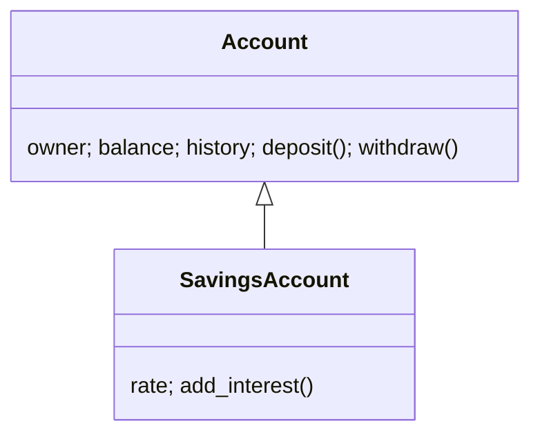

**Goal:** write classes with less boilerplate, document types, and prove your code works with your own tests.

#### 1. @dataclass

For classes that mainly hold data, `@dataclass` writes `__init__`, `__repr__` and `__eq__` for you:

```python
from dataclasses import dataclass, field

@dataclass
class Config:
    lr: float = 0.01
    epochs: int = 10
    layers: list = field(default_factory=list)   # mutable default: ALWAYS this way

cfg = Config(lr=0.001)
cfg               # Config(lr=0.001, epochs=10, layers=[])
```

You still add methods normally.

#### 2. Type hints

```python
def total(prices: list[float], tax: float = 0.2) -> float:
    ...
```

Python doesn't enforce them at runtime, but your editor uses them to catch mistakes and autocomplete. Use them from now on.

#### 3. Inheritance

A subclass gets everything from its parent and adds or changes behaviour:

```python
@dataclass
class SavingsAccount(Account):
    rate: float = 0.0
    def add_interest(self): ...
```

`isinstance(s, Account)` is `True`. In PyTorch, every model you write is `class MyNet(nn.Module)`.

Note: with dataclass inheritance, new fields with defaults must come after the parent's fields — which is why `rate` has a default.

#### 4. Testing

A test is a function that calls your code and `assert`s the answer:

```python
def test_deposit():
    a = Account("Asish")
    assert a.deposit(100) == 100
```

Test the normal case, the edge case (zero, empty, one item) and the error case. To test an error:

```python
import pytest
def test_overdraft():
    with pytest.raises(ValueError):
        Account("x").withdraw(5)
```

Install and run: `pip install pytest`, then `pytest` — it finds every `test_*.py` file. The `check.py` you've been using is a tiny version of pytest.

#### Exercises

1. `python ai90.py check 14`.
2. Write **three tests of your own** in a new file `test_mine.py` (e.g. withdrawing the exact balance, interest on zero, many deposits) and run them with `pytest`.

#### Your task — write `ai90/work/day14.py` with: `Account`, `SavingsAccount`, `total_balance`

#### Tests

```python
# file: test_day14.py
from day14 import Account, SavingsAccount, total_balance


def raises(func, exc=ValueError):
    try:
        func()
    except exc:
        return
    raise AssertionError(f"expected {exc.__name__}")


def test_dataclass_basics():
    a = Account("Asish")
    assert a.balance == 0.0 and a.history == []
    assert Account("Sam", 10.0) == Account("Sam", 10.0)
    assert Account("A").history is not Account("B").history, "use field(default_factory=list)"


def test_deposit_withdraw():
    a = Account("Asish")
    assert a.deposit(100) == 100
    assert a.withdraw(30) == 70
    assert a.history == [("deposit", 100), ("withdraw", 30)]


def test_rejects_bad_amounts():
    a = Account("Asish", 50.0)
    raises(lambda: a.deposit(0))
    raises(lambda: a.withdraw(-5))
    raises(lambda: a.withdraw(51))
    assert a.balance == 50.0


def test_savings_inherits():
    s = SavingsAccount("Asish", 200.0, rate=0.05)
    assert isinstance(s, Account)
    s.deposit(100)
    assert s.add_interest() == 315.0
    assert s.history[-1] == ("interest", 15.0)


def test_total_balance():
    assert total_balance([Account("a", 10.004), Account("b", 0.003)]) == 10.01
```

<details><summary>Reference solution (try first!)</summary>

```python
# file: day14.py
"""Day 14 — dataclasses, type hints, inheritance."""
from dataclasses import dataclass, field


@dataclass
class Account:
    """A bank account. history records ('deposit'|'withdraw'|'interest', amount) tuples."""
    owner: str
    balance: float = 0.0
    history: list = field(default_factory=list)

    def deposit(self, amount: float) -> float:
        """Add a positive amount, record it, return the new balance. Non-positive -> ValueError."""
        if amount <= 0:
            raise ValueError("deposit must be positive")
        self.balance += amount
        self.history.append(("deposit", amount))
        return self.balance

    def withdraw(self, amount: float) -> float:
        """Remove a positive amount if funds allow, record it, return the new balance.
        Non-positive or more than the balance -> ValueError."""
        if amount <= 0:
            raise ValueError("withdrawal must be positive")
        if amount > self.balance:
            raise ValueError("insufficient funds")
        self.balance -= amount
        self.history.append(("withdraw", amount))
        return self.balance


@dataclass
class SavingsAccount(Account):
    """An Account with an interest rate (0.05 = 5%)."""
    rate: float = 0.0

    def add_interest(self) -> float:
        """Add balance * rate (rounded to 2 dp), record ('interest', amount), return the new balance."""
        interest = round(self.balance * self.rate, 2)
        self.balance = round(self.balance + interest, 2)
        self.history.append(("interest", interest))
        return self.balance


def total_balance(accounts: list[Account]) -> float:
    """Sum of balances, rounded to 2 dp."""
    return round(sum(a.balance for a in accounts), 2)
```

</details>

**Done when:** `python ai90.py check 14` is all green → tick Day 14 in the tracker.

---

### Day 15 — Capstone: Matrix library

**Dataset:** none — pure Python · **Time:** ~2 h

#### Visual

```text
  x (1×3)        W (3×2)            x@W (1×2)     ReLU
 [1, -2, .5]  @ [[ .2, .5],    =  [-0.9, 1.15]  → [0.0, 1.15]
                [ .4,-.1],
                [-.6, .9]]
 shape rule: (a×b) @ (b×c) → (a×c)   ← a neural-network layer
```

**Goal:** build the data structure every neural network runs on, using only what you learned in Phase 1. When you finish, you've written a working neural-network layer in pure Python.

#### Why matrices?

A layer of a neural network takes an input row and multiplies it by a weight matrix:

```
inputs (1 x 3)  @  weights (3 x 2)  =  outputs (1 x 2)
```

Each output is a dot product (Day 13) of the input with one column of weights. Do that for many neurons at once and you have matrix multiplication.

#### Shapes

A matrix with 2 rows and 3 columns has shape `(2, 3)`. The rule for `A @ B`:

```
(a x b) @ (b x c) -> (a x c)     inner sizes must match
```

Getting shapes right is 80% of debugging in deep learning. Your library must raise a clear `ValueError` when they don't match.

#### The operations

**Transpose** — rows become columns. `zip(*rows)` does it in one line: it pairs up the 1st items of each row, then the 2nd items, and so on.

**Matmul** — element `[i, j]` of the result = row `i` of A · column `j` of B:

```
[1 2]   [5 6]   [1·5+2·7  1·6+2·8]   [19 22]
[3 4] @ [7 8] = [3·5+4·7  3·6+4·8] = [43 50]
```

Trick: transpose B first, so its columns become easy-to-loop rows.

**apply** — run a function on every element. With `relu = lambda x: max(0, x)` that's an activation function.

#### Python features you'll use

- `@classmethod` — `Matrix.identity(3)` builds a new matrix without an existing one. `cls` is the class itself.
- `@property` — `m.shape` looks like an attribute but runs a method.
- `__matmul__` — makes the `@` operator work (exactly what NumPy uses).
- `__getitem__` with a tuple — `m[1, 0]` passes `(1, 0)` as one argument.
- Copy the input rows in `__init__` so outside changes can't corrupt your matrix.

#### Steps

1. `__init__` + validation + `shape` → run `python ai90.py check 15`, watch the first tests go green.
2. `__repr__`, `__eq__`, `__getitem__`.
3. `zeros`, `identity`, `transpose`.
4. `__add__`, `__mul__`.
5. `__matmul__` — the big one.
6. `apply`, then look at `test_tiny_neural_layer`: that's a real forward pass.

#### Finish Phase 1

- Push `ai-90` to GitHub with a README: what's in Phase 1 and a screenshot of all checks green.
- DEVLOG: Phase 1 retro — hardest day, what clicked, what to revisit.
- Run `python check.py` with no number — every day 1–15 should be green.

Next: Phase 2, automation — making Python do real work on its own.

#### Your task — write `ai90/work/day15.py` with: `Matrix`

#### Tests

```python
# file: test_day15.py
from day15 import Matrix


def raises(func, exc=ValueError):
    try:
        func()
    except exc:
        return
    raise AssertionError(f"expected {exc.__name__}")


A = [[1, 2], [3, 4]]


def test_create_and_validate():
    m = Matrix(A)
    assert m.rows == [[1.0, 2.0], [3.0, 4.0]]
    assert m.shape == (2, 2)
    assert Matrix([[1, 2, 3]]).shape == (1, 3)
    raises(lambda: Matrix([]))
    raises(lambda: Matrix([[1, 2], [3]]))


def test_does_not_share_input():
    src = [[1, 2]]
    m = Matrix(src)
    src[0][0] = 99
    assert m[0, 0] == 1.0


def test_repr_eq_getitem():
    m = Matrix(A)
    assert repr(m) == "Matrix([[1.0, 2.0], [3.0, 4.0]])"
    assert m == Matrix(A) and m != Matrix([[1, 2]])
    assert m[1, 0] == 3.0


def test_zeros_identity():
    assert Matrix.zeros(2, 3).rows == [[0.0] * 3] * 2
    assert Matrix.identity(3)[1, 1] == 1.0 and Matrix.identity(3)[0, 2] == 0.0


def test_transpose():
    assert Matrix([[1, 2, 3], [4, 5, 6]]).transpose() == Matrix([[1, 4], [2, 5], [3, 6]])


def test_add_and_scale():
    assert Matrix(A) + Matrix(A) == Matrix(A) * 2
    raises(lambda: Matrix(A) + Matrix([[1, 2, 3]]))


def test_matmul():
    m = Matrix(A)
    assert m @ Matrix([[5, 6], [7, 8]]) == Matrix([[19, 22], [43, 50]])
    assert m @ Matrix.identity(2) == m
    assert (Matrix([[1, 2, 3]]) @ Matrix([[1], [1], [1]])).rows == [[6.0]]
    raises(lambda: m @ Matrix([[1, 2, 3]]))


def test_apply_relu():
    relu = lambda x: max(0.0, x)  # noqa: E731
    assert Matrix([[-1, 2], [3, -4]]).apply(relu) == Matrix([[0, 2], [3, 0]])


def test_tiny_neural_layer():
    # one dense layer: inputs (1x3) @ weights (3x2), then ReLU — a real neural-network forward pass
    x = Matrix([[1.0, -2.0, 0.5]])
    w = Matrix([[0.2, 0.5], [0.4, -0.1], [-0.6, 0.9]])
    out = (x @ w).apply(lambda v: round(max(0.0, v), 4))
    assert out.shape == (1, 2)
    assert out == Matrix([[0.0, 1.15]])  # neuron 1 is switched off by ReLU, neuron 2 fires
```

<details><summary>Reference solution (try first!)</summary>

```python
# file: day15.py
"""Day 15 — Capstone: a pure-Python Matrix library.

This is the same maths NumPy and PyTorch do — just slower. On Day 27 you'll extend
it and on Day 28 race it against NumPy.
"""


class Matrix:
    """A 2-D matrix stored as a list of row lists. Matrix([[1, 2], [3, 4]])"""

    def __init__(self, rows):
        """Copy rows as floats. Empty matrices or ragged rows (different lengths) raise ValueError."""
        if not rows or not rows[0]:
            raise ValueError("matrix must have at least one row and column")
        width = len(rows[0])
        if any(len(r) != width for r in rows):
            raise ValueError("all rows must have the same length")
        self.rows = [[float(x) for x in r] for r in rows]

    @property
    def shape(self):
        """(number of rows, number of columns)"""
        return (len(self.rows), len(self.rows[0]))

    def __repr__(self):
        """Matrix([[1.0, 2.0], [3.0, 4.0]])"""
        return f"Matrix({self.rows})"

    def __eq__(self, other):
        """Equal if other is a Matrix with identical rows."""
        return isinstance(other, Matrix) and self.rows == other.rows

    def __getitem__(self, ij):
        """m[i, j] -> the element at row i, column j."""
        i, j = ij
        return self.rows[i][j]

    @classmethod
    def zeros(cls, n_rows, n_cols):
        """An n_rows x n_cols matrix of 0.0."""
        return cls([[0.0] * n_cols for _ in range(n_rows)])

    @classmethod
    def identity(cls, n):
        """n x n identity: 1.0 on the diagonal, 0.0 elsewhere."""
        return cls([[1.0 if i == j else 0.0 for j in range(n)] for i in range(n)])

    def transpose(self):
        """Rows become columns."""
        return Matrix([list(col) for col in zip(*self.rows)])

    def __add__(self, other):
        """Element-wise sum. Different shapes raise ValueError."""
        if self.shape != other.shape:
            raise ValueError(f"shape mismatch: {self.shape} vs {other.shape}")
        return Matrix([[a + b for a, b in zip(r1, r2)] for r1, r2 in zip(self.rows, other.rows)])

    def __mul__(self, scalar):
        """m * 2 -> every element times 2."""
        return Matrix([[x * scalar for x in r] for r in self.rows])

    def __matmul__(self, other):
        """Matrix product self @ other. (a x b) @ (b x c) -> (a x c); inner sizes must match
        or raise ValueError."""
        if self.shape[1] != other.shape[0]:
            raise ValueError(f"cannot multiply {self.shape} by {other.shape}")
        cols = other.transpose().rows
        return Matrix([[sum(a * b for a, b in zip(row, col)) for col in cols] for row in self.rows])

    def apply(self, func):
        """New matrix with func applied to every element (e.g. an activation function)."""
        return Matrix([[func(x) for x in r] for r in self.rows])
```

</details>

**Done when:** `python ai90.py check 15` is all green → tick Day 15 in the tracker.

---

### Day 16 — CLI tools: argparse and logging

**Dataset:** none · **Time:** ~2 h

#### Visual

```text
$ python day16.py add 12.50 food --note lunch
$ python day16.py total
          │      │    │      │
       script  sub-  positional  optional flag
              command   args
logging levels:  DEBUG < INFO < WARNING < ERROR < CRITICAL
                 (set level=INFO → DEBUG lines hidden)
```

#### Notes

- `argparse` turns `sys.argv` into a typed object. Subcommands (`add`, `list`, `total`) = `add_subparsers(dest="cmd")`.
- Positional args are required (`amount`), options start with `--` and can have defaults.
- `type=float` converts for you and errors nicely on junk.
- Design trick: put logic in `run(argv)` that **returns** a string; `main()` just prints it. Now the CLI is testable.
- `logging` beats `print` for tools: timestamps, levels, can go to a file. `logging.basicConfig(level=logging.INFO, format="%(asctime)s %(levelname)s %(message)s")`.

#### Worked example

```python
import argparse
p = argparse.ArgumentParser(prog="greet")
p.add_argument("name")
p.add_argument("--shout", action="store_true")
args = p.parse_args(["asish", "--shout"])
print(args.name.upper() if args.shout else args.name)   # ASISH
```

#### Your task — `day16.py`

- `build_parser()` → parser with subcommands `add AMOUNT CATEGORY [--note NOTE]`, `list`, `total`.
- `run(argv, store)` → executes against `store` (a list of dicts) and returns the output text. `add` reuses Day 7's `add_expense`; `total` returns `"TOTAL £x.xx"`; `list` returns one line per expense `"£12.50 food lunch"` (no trailing space when note is empty).

#### Tests

```python
# file: test_day16.py
import day16 as ex


def test_parser():
    args = ex.build_parser().parse_args(["add", "12.5", "Food", "--note", "lunch"])
    assert (args.cmd, args.amount, args.category, args.note) == ("add", 12.5, "Food", "lunch")


def test_run_add_list_total():
    store = []
    assert ex.run(["add", "12.5", "Food", "--note", "lunch"], store) == "added £12.50 food"
    ex.run(["add", "7.5", "transport"], store)
    assert ex.run(["list"], store) == "£12.50 food lunch\n£7.50 transport"
    assert ex.run(["total"], store) == "TOTAL £20.00"


def test_bad_amount_exits():
    try:
        ex.build_parser().parse_args(["add", "abc", "food"])
    except SystemExit:
        return
    raise AssertionError("argparse should reject a non-number amount")
```

<details><summary>Reference solution (try first!)</summary>

```python
# file: day16.py
import argparse
import logging
import sys

from day07 import add_expense, total

log = logging.getLogger("expenses")


def build_parser():
    p = argparse.ArgumentParser(prog="expenses", description="Track spending")
    sub = p.add_subparsers(dest="cmd", required=True)
    a = sub.add_parser("add", help="add an expense")
    a.add_argument("amount", type=float)
    a.add_argument("category")
    a.add_argument("--note", default="")
    sub.add_parser("list", help="list expenses")
    sub.add_parser("total", help="total spent")
    return p


def run(argv, store):
    args = build_parser().parse_args(argv)
    if args.cmd == "add":
        item = add_expense(store, args.amount, args.category, args.note)
        log.info("added %s", item)
        return f"added £{item['amount']:.2f} {item['category']}"
    if args.cmd == "list":
        return "\n".join(f"£{e['amount']:.2f} {e['category']} {e['note']}".rstrip() for e in store)
    return f"TOTAL £{total(store):.2f}"


def main():
    logging.basicConfig(level=logging.INFO, format="%(asctime)s %(levelname)s %(message)s")
    print(run(sys.argv[1:], []))


if __name__ == "__main__":
    main()
```

</details>

**Done when:** `python ai90.py check 16` green and `python day16.py --help` prints usage.

---

### Day 17 — File automation: the folder organiser

**Dataset:** a messy test folder (made by the tests) · **Time:** ~2 h

#### Visual

```text
 Downloads/                         Downloads/
 ├── cv.pdf                         ├── documents/  cv.pdf, notes.txt
 ├── IMG_01.JPG       organise()    ├── images/     IMG_01.JPG
 ├── notes.txt       ──────────▶    ├── code/       train.py
 ├── train.py                       └── other/      song.mp3
 └── song.mp3
 dry_run=True → returns the plan, moves NOTHING
```

#### Notes

- `pathlib.Path.iterdir()` lists a folder; `p.is_file()` skips subfolders.
- `shutil.move(src, dst)` moves; `dst.parent.mkdir(parents=True, exist_ok=True)` creates folders safely.
- **Never overwrite**: if `documents/cv.pdf` exists, use `cv_1.pdf`, `cv_2.pdf`…
- **Dry run first** — every destructive script gets a `--dry-run` flag. Return the plan, print it, only then act.
- Reuse Day 3's `file_category` — your own code is now a library.

#### Your task — `day17.py`

- `unique_path(path)` → `path` if free, else `stem_1.ext`, `stem_2.ext`…
- `organise(folder, dry_run=False)` → sorted list of `(filename, category)`; moves each file into a subfolder named by `FOLDER = {"image": "images", "document": "documents", "code": "code", "other": "other"}` unless `dry_run`. Never overwrite (use `unique_path`).

#### Tests

```python
# file: test_day17.py
import tempfile
from pathlib import Path

import day17 as ex


def make():
    d = Path(tempfile.mkdtemp())
    for n in ["cv.pdf", "IMG_01.JPG", "notes.txt", "train.py", "song.mp3"]:
        (d / n).write_text(n)
    (d / "already_a_folder").mkdir()
    return d


def test_dry_run_moves_nothing():
    d = make()
    plan = ex.organise(d, dry_run=True)
    assert plan == [("IMG_01.JPG", "images"), ("cv.pdf", "documents"), ("notes.txt", "documents"),
                    ("song.mp3", "other"), ("train.py", "code")]
    assert (d / "cv.pdf").exists() and not (d / "documents").exists()


def test_organise_moves():
    d = make()
    ex.organise(d)
    assert (d / "documents" / "cv.pdf").read_text() == "cv.pdf"
    assert (d / "images" / "IMG_01.JPG").exists()
    assert not (d / "train.py").exists()
    assert (d / "already_a_folder").is_dir()


def test_no_overwrite():
    d = make()
    (d / "documents").mkdir()
    (d / "documents" / "cv.pdf").write_text("old")
    ex.organise(d)
    assert (d / "documents" / "cv.pdf").read_text() == "old"
    assert (d / "documents" / "cv_1.pdf").read_text() == "cv.pdf"


def test_unique_path():
    d = Path(tempfile.mkdtemp())
    assert ex.unique_path(d / "a.txt") == d / "a.txt"
    (d / "a.txt").write_text("x"); (d / "a_1.txt").write_text("x")
    assert ex.unique_path(d / "a.txt") == d / "a_2.txt"
```

<details><summary>Reference solution (try first!)</summary>

```python
# file: day17.py
import shutil
from pathlib import Path

from day03 import file_category

FOLDER = {"image": "images", "document": "documents", "code": "code", "other": "other"}


def unique_path(path):
    path = Path(path)
    i, candidate = 1, path
    while candidate.exists():
        candidate = path.with_name(f"{path.stem}_{i}{path.suffix}")
        i += 1
    return candidate


def organise(folder, dry_run=False):
    folder = Path(folder)
    plan = sorted((p.name, FOLDER[file_category(p.name)]) for p in folder.iterdir() if p.is_file())
    if not dry_run:
        for name, sub in plan:
            dest_dir = folder / sub
            dest_dir.mkdir(exist_ok=True)
            shutil.move(str(folder / name), str(unique_path(dest_dir / name)))
    return plan
```

</details>

**Done when:** tests green, then run it with `dry_run=True` on a COPY of your real Downloads folder.

---

### Day 18 — Regular expressions: log parser

**Dataset:** web-server access logs (Common Log Format). Real one to try after: the NASA-HTTP July 1995 log (search "NASA HTTP access log 1995"). · **Time:** ~2 h

#### Visual

```text
 83.149.9.216 - - [17/Nov/2026:10:05:03 +0000] "GET /index.html HTTP/1.1" 200 3041
 └────┬─────┘      └──────────┬─────────┘        └┬┘ └────┬────┘            └┬┘ └─┬┘
     ip                     time              method   path              status bytes
 regex groups:  (?P<ip>\S+) ... \[(?P<time>[^\]]+)\] "(?P<method>\w+) (?P<path>\S+) ..." (?P<status>\d{3})
```

#### Notes

- `re.compile(pattern)` once, reuse many times. `m = PAT.match(line)`; `m.group("ip")` or `m.groupdict()`.
- Core syntax: `\d` digit, `\w` word char, `\S` non-space, `+` one or more, `*` zero or more, `?` optional, `[^\]]` anything but `]`, `(?P<name>...)` named group, `^`/`$` anchors.
- Always use raw strings `r"..."` so backslashes survive.
- `datetime.strptime("17/Nov/2026:10:05:03", "%d/%b/%Y:%H:%M:%S")` parses the time.
- Test patterns at regex101.com (pick Python flavour).

#### Your task — `day18.py`

- `parse_line(line)` → dict `ip, time, method, path, status (int), bytes (int, '-' → 0)`, or `None` if it doesn't match.
- `errors_per_hour(lines)` → `{"2026-11-17 10": n}` counting status ≥ 400, ignoring bad lines.
- `top_paths(lines, n)` → most requested paths `[(path, count)]`, ties alphabetical.

#### Tests

```python
# file: test_day18.py
import day18 as ex

LOG = [
    '83.149.9.216 - - [17/Nov/2026:10:05:03 +0000] "GET /index.html HTTP/1.1" 200 3041',
    '10.0.0.5 - - [17/Nov/2026:10:17:44 +0000] "GET /missing HTTP/1.1" 404 -',
    '10.0.0.5 - - [17/Nov/2026:10:59:59 +0000] "POST /api/login HTTP/1.1" 500 12',
    'garbage line',
    '10.0.0.9 - - [17/Nov/2026:11:00:00 +0000] "GET /index.html HTTP/1.1" 503 0',
]


def test_parse_line():
    assert ex.parse_line(LOG[0]) == {"ip": "83.149.9.216", "time": "17/Nov/2026:10:05:03 +0000",
                                     "method": "GET", "path": "/index.html", "status": 200, "bytes": 3041}
    assert ex.parse_line(LOG[1])["bytes"] == 0
    assert ex.parse_line("garbage line") is None


def test_errors_per_hour():
    assert ex.errors_per_hour(LOG) == {"2026-11-17 10": 2, "2026-11-17 11": 1}


def test_top_paths():
    assert ex.top_paths(LOG, 2) == [("/index.html", 2), ("/api/login", 1)]
```

<details><summary>Reference solution (try first!)</summary>

```python
# file: day18.py
import re
from collections import Counter
from datetime import datetime

PAT = re.compile(r'(?P<ip>\S+) \S+ \S+ \[(?P<time>[^\]]+)\] "(?P<method>\w+) (?P<path>\S+) [^"]*" '
                 r'(?P<status>\d{3}) (?P<bytes>\d+|-)')


def parse_line(line):
    m = PAT.match(line)
    if not m:
        return None
    d = m.groupdict()
    d["status"] = int(d["status"])
    d["bytes"] = 0 if d["bytes"] == "-" else int(d["bytes"])
    return d


def errors_per_hour(lines):
    out = {}
    for line in lines:
        d = parse_line(line)
        if d and d["status"] >= 400:
            t = datetime.strptime(d["time"].split()[0], "%d/%b/%Y:%H:%M:%S")
            key = t.strftime("%Y-%m-%d %H")
            out[key] = out.get(key, 0) + 1
    return out


def top_paths(lines, n):
    c = Counter(d["path"] for d in map(parse_line, lines) if d)
    return sorted(c.items(), key=lambda kv: (-kv[1], kv[0]))[:n]
```

</details>

**Done when:** green, plus you've written one regex of your own (e.g. pull UK postcodes or emails out of a text file).

---

### Day 19 — HTTP APIs and JSON: live weather

**Dataset:** Open-Meteo live forecast API (free, no key): `https://api.open-meteo.com/v1/forecast?latitude=52.08&longitude=0.01&hourly=temperature_2m` · **Time:** ~2 h

#### Visual

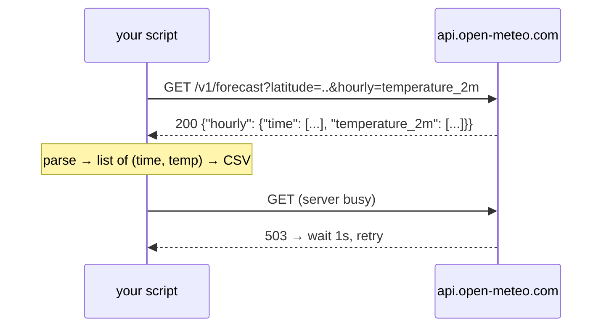

#### Notes

- HTTP = method (`GET` read, `POST` send) + URL + headers → status code + body. 2xx ok, 4xx your fault, 5xx server's fault (retry those).
- `requests.get(url, params={...}, timeout=10)`; `r.raise_for_status()`; `r.json()`.
- **Always** set a timeout. Never hard-code API keys — read them from env vars (Day 23).
- Testability trick: pass the `get` function in as a parameter (dependency injection). Real code uses `requests.get`; tests pass a fake. No network in tests.

#### Worked example (real call)

```python
import requests
r = requests.get("https://api.open-meteo.com/v1/forecast",
                 params={"latitude": 52.08, "longitude": 0.01, "hourly": "temperature_2m"}, timeout=10)
data = r.json()
print(data["hourly"]["time"][:3], data["hourly"]["temperature_2m"][:3])
```

#### Your task — `day19.py`

- `build_url(base, **params)` — reuse Day 8's `build_url`, then re-export it.
- `parse_forecast(data)` → list of `(time, temp)` tuples from the JSON dict.
- `fetch_json(url, get, retries=3, sleep=lambda s: None)` → calls `get(url, timeout=10)`; returns `.json()` on status 200; on 5xx or `ConnectionError` retries with sleeps 1, 2, 4…; on 4xx raises `ValueError` immediately; after all retries raises `RuntimeError`.

#### Tests

```python
# file: test_day19.py
import day19 as ex


class Resp:
    def __init__(self, status, payload=None):
        self.status_code, self._p = status, payload

    def json(self):
        return self._p


def fake_get(responses):
    calls = []

    def get(url, timeout):
        calls.append(url)
        r = responses.pop(0)
        if isinstance(r, Exception):
            raise r
        return r
    return get, calls


DATA = {"hourly": {"time": ["2026-11-17T00:00", "2026-11-17T01:00"], "temperature_2m": [6.1, 5.8]}}


def test_parse_forecast():
    assert ex.parse_forecast(DATA) == [("2026-11-17T00:00", 6.1), ("2026-11-17T01:00", 5.8)]


def test_fetch_ok_after_retries():
    get, calls = fake_get([Resp(503), ConnectionError("x"), Resp(200, DATA)])
    waits = []
    assert ex.fetch_json("u", get, sleep=waits.append) == DATA
    assert waits == [1, 2] and len(calls) == 3


def test_fetch_4xx_no_retry():
    get, calls = fake_get([Resp(404)])
    try:
        ex.fetch_json("u", get)
    except ValueError:
        assert len(calls) == 1
        return
    raise AssertionError("404 should raise ValueError")


def test_fetch_gives_up():
    get, _ = fake_get([Resp(500)] * 3)
    try:
        ex.fetch_json("u", get, retries=3)
    except RuntimeError:
        return
    raise AssertionError("should raise RuntimeError after 3 failures")


def test_build_url():
    assert ex.build_url("https://a.io/f", latitude=52.08, hourly="t") == "https://a.io/f?hourly=t&latitude=52.08"
```

<details><summary>Reference solution (try first!)</summary>

```python
# file: day19.py
from day08 import build_url  # noqa: F401  (re-exported)


def parse_forecast(data):
    h = data["hourly"]
    return list(zip(h["time"], h["temperature_2m"]))


def fetch_json(url, get, retries=3, sleep=lambda s: None):
    for attempt in range(retries):
        try:
            r = get(url, timeout=10)
        except ConnectionError:
            r = None
        if r is not None:
            if r.status_code == 200:
                return r.json()
            if 400 <= r.status_code < 500:
                raise ValueError(f"client error {r.status_code} for {url}")
        if attempt < retries - 1:
            sleep(2 ** attempt)
    raise RuntimeError(f"gave up on {url} after {retries} tries")


if __name__ == "__main__":
    import requests
    url = build_url("https://api.open-meteo.com/v1/forecast", latitude=52.08, longitude=0.01, hourly="temperature_2m")
    for t, temp in parse_forecast(fetch_json(url, requests.get))[:5]:
        print(t, temp)
```

</details>

**Done when:** green + `python day19.py` prints real temperatures.

---

### Day 20 — Web scraping

**Dataset:** books.toscrape.com (a site built for scraping practice) · **Time:** ~2 h

#### Visual

```text
 <table>                                   [{"Title": "A Light in the Attic",
   <tr><th>Title</th><th>Price</th></tr>     "Price": "£51.77"},
   <tr><td>A Light…</td><td>£51.77</td></tr>  ...]
 </table>
 HTML tree:  html → body → table → tr → td      soup.select("table tr")
 relative link "catalogue/page-2.html"  + base  →  absolute URL (urljoin)
```

#### Notes

- Check `robots.txt` and terms first. Add a delay (`time.sleep(1)`) between pages. Identify yourself with a `User-Agent`.
- `BeautifulSoup(html, "html.parser")` → `soup.select("css selector")`, `tag.get_text(strip=True)`, `tag["href"]`.
- `urllib.parse.urljoin(base, href)` turns relative links into full URLs.
- Parse functions take **HTML strings** — easy to test, then plug in `requests.get(url).text`.

#### Your task — `day20.py`

- `extract_table(html)` → list of dicts from the first `<table>`, header cells from `<th>`.
- `extract_links(html, base)` → absolute URLs of all `<a href>`, deduped, in page order.
- `parse_books(html)` → list of `(title, price_float)` from books.toscrape.com product cards (`article.product_pod`, title in `h3 a[title]`, price in `p.price_color`).

#### Tests

```python
# file: test_day20.py
import day20 as ex

TABLE = """<html><body><table>
<tr><th>Title</th><th>Price</th></tr>
<tr><td> A Light in the Attic </td><td>£51.77</td></tr>
<tr><td>Tipping the Velvet</td><td>£53.74</td></tr>
</table></body></html>"""

CARDS = """<ol><li><article class="product_pod"><h3><a href="a/index.html" title="A Light in the Attic">A Light…</a></h3>
<p class="price_color">£51.77</p></article></li>
<li><article class="product_pod"><h3><a href="b/index.html" title="Soumission">Soum…</a></h3>
<p class="price_color">£50.10</p></article></li></ol><a href="a/index.html">dup</a>"""


def test_extract_table():
    assert ex.extract_table(TABLE) == [{"Title": "A Light in the Attic", "Price": "£51.77"},
                                       {"Title": "Tipping the Velvet", "Price": "£53.74"}]


def test_extract_links():
    assert ex.extract_links(CARDS, "https://books.toscrape.com/catalogue/") == [
        "https://books.toscrape.com/catalogue/a/index.html", "https://books.toscrape.com/catalogue/b/index.html"]


def test_parse_books():
    assert ex.parse_books(CARDS) == [("A Light in the Attic", 51.77), ("Soumission", 50.10)]
```

<details><summary>Reference solution (try first!)</summary>

```python
# file: day20.py
import re
from urllib.parse import urljoin

from bs4 import BeautifulSoup


def extract_table(html):
    table = BeautifulSoup(html, "html.parser").find("table")
    rows = table.find_all("tr")
    headers = [th.get_text(strip=True) for th in rows[0].find_all("th")]
    return [dict(zip(headers, (td.get_text(strip=True) for td in r.find_all("td")))) for r in rows[1:]]


def extract_links(html, base):
    seen, out = set(), []
    for a in BeautifulSoup(html, "html.parser").find_all("a", href=True):
        url = urljoin(base, a["href"])
        if url not in seen:
            seen.add(url)
            out.append(url)
    return out


def parse_books(html):
    out = []
    for card in BeautifulSoup(html, "html.parser").select("article.product_pod"):
        title = card.select_one("h3 a")["title"]
        price = float(re.sub(r"[^\d.]", "", card.select_one("p.price_color").get_text()))
        out.append((title, price))
    return out


if __name__ == "__main__":
    import time
    import requests
    url = "https://books.toscrape.com/catalogue/page-1.html"
    books = []
    for page in range(1, 4):
        html = requests.get(url.replace("page-1", f"page-{page}"), timeout=10).text
        books += parse_books(html)
        time.sleep(1)
    print(len(books), "books; cheapest:", min(books, key=lambda b: b[1]))
```

</details>

**Done when:** green + `python day20.py` scrapes 3 real pages (60 books) into a list.

---

### Day 21 — Scheduling and idempotent jobs

**Dataset:** your Day 19 weather data, appended hourly · **Time:** ~2 h

#### Visual

```text
 cron:  ┌─ minute (0-59)
        │ ┌─ hour (0-23)
        │ │ ┌─ day of month
        │ │ │ ┌─ month
        │ │ │ │ ┌─ day of week (0=Sun)
        0 * * * *   python day19.py     → every hour on the hour
        30 6 * * 1-5                    → 06:30 on weekdays
 idempotent: run it twice → same result as once (no duplicate rows)
```

#### Notes

- Schedulers: Linux/macOS `crontab -e`; Windows Task Scheduler; in-Python `schedule` library; in the cloud GitHub Actions (Day 28).
- Jobs crash, re-run, and overlap. Make them **idempotent**: dedupe on a key (e.g. timestamp) before appending.
- Keep a `last_run` timestamp so a job knows if it's due.
- Log every run to a file — when it fails at 3am, the log is all you have.

#### Your task — `day21.py`

- `is_due(last_run_iso, now_iso, every_minutes)` → `True` if never run (`None`) or enough minutes passed.
- `append_unique(csv_path, rows, key)` → appends dict rows whose `key` value isn't in the file yet (creates file + header if missing); returns number added.

#### Tests

```python
# file: test_day21.py
import csv
import tempfile
from pathlib import Path

import day21 as ex


def test_is_due():
    assert ex.is_due(None, "2026-11-17T10:00", 60) is True
    assert ex.is_due("2026-11-17T09:30", "2026-11-17T10:00", 60) is False
    assert ex.is_due("2026-11-17T09:00", "2026-11-17T10:00", 60) is True


def test_append_unique_is_idempotent():
    p = Path(tempfile.mkdtemp()) / "weather.csv"
    rows = [{"time": "T00", "temp": "6.1"}, {"time": "T01", "temp": "5.8"}]
    assert ex.append_unique(p, rows, "time") == 2
    assert ex.append_unique(p, rows, "time") == 0
    assert ex.append_unique(p, rows + [{"time": "T02", "temp": "5.5"}], "time") == 1
    with open(p, newline="") as f:
        got = list(csv.DictReader(f))
    assert [r["time"] for r in got] == ["T00", "T01", "T02"]
```

<details><summary>Reference solution (try first!)</summary>

```python
# file: day21.py
import csv
from datetime import datetime
from pathlib import Path


def is_due(last_run_iso, now_iso, every_minutes):
    if last_run_iso is None:
        return True
    gap = datetime.fromisoformat(now_iso) - datetime.fromisoformat(last_run_iso)
    return gap.total_seconds() >= every_minutes * 60


def append_unique(csv_path, rows, key):
    p = Path(csv_path)
    seen = set()
    if p.exists():
        with open(p, newline="", encoding="utf-8") as f:
            seen = {r[key] for r in csv.DictReader(f)}
    new = []
    for r in rows:
        if r[key] not in seen:
            seen.add(r[key])
            new.append(r)
    if new:
        write_header = not p.exists()
        with open(p, "a", newline="", encoding="utf-8") as f:
            w = csv.DictWriter(f, fieldnames=list(new[0]))
            if write_header:
                w.writeheader()
            w.writerows(new)
    return len(new)
```

</details>

**Done when:** green + a cron/Task Scheduler entry runs your weather fetch every hour and the CSV grows without duplicates.

---

### Day 22 — Real dataset #1: Titanic, by hand

**Dataset:** Titanic passengers (891 rows) — `https://raw.githubusercontent.com/mwaskom/seaborn-data/master/titanic.csv` · **Time:** ~2 h

#### Visual

```text
 survival rate by sex (full dataset)
 female │████████████████████████████████████████▌ 0.74
 male   │███████████▍                             0.19
        └──────────────────────────────────────────
 ascii_bar(0.74, width=40) → "█" * round(0.74*40)
```

#### Notes

- This file builds your **dataset downloader with a cache** — every later day loads data through it.
- Pattern: if `data/titanic.csv` exists, use it; else download once and save. Never re-download on every run.
- Before pandas, do it by hand with `csv.DictReader`: everything is a string, blanks are `""`.
- Group → rate: count survivors and totals per group, divide.

#### Your task — `day22.py`

- `DATASETS` dict: `titanic`, `flights`, `sms`, `shakespeare`, `names`, `mpg`, `penguins` → `(url, filename)` (see solution).
- `download(name, folder="data", get=None)` → `Path`; uses cache; `get` defaults to `requests.get`.
- `survival_rate_by(rows, column)` → `{value: rate rounded to 3}` skipping blank values.
- `ascii_bar(fraction, width=40)` → `"█"` repeated `round(fraction*width)`.

#### Tests

```python
# file: test_day22.py
import csv
import io
import tempfile
from pathlib import Path

import day22 as ex

SAMPLE = """survived,pclass,sex,age
1,1,female,38
0,3,male,22
1,3,female,26
0,1,male,
1,2,male,4
"""


def rows():
    return list(csv.DictReader(io.StringIO(SAMPLE)))


def test_survival_rate_by():
    assert ex.survival_rate_by(rows(), "sex") == {"female": 1.0, "male": 0.333}
    assert ex.survival_rate_by(rows(), "pclass") == {"1": 0.5, "3": 0.5, "2": 1.0}


def test_ascii_bar():
    assert ex.ascii_bar(0.5, 10) == "█████"
    assert ex.ascii_bar(0, 10) == ""


def test_download_uses_cache():
    folder = Path(tempfile.mkdtemp())
    calls = []

    class R:
        text = SAMPLE
        def raise_for_status(self): pass

    def get(url, timeout):
        calls.append(url)
        return R()

    p1 = ex.download("titanic", folder, get=get)
    p2 = ex.download("titanic", folder, get=get)
    assert p1 == p2 == folder / "titanic.csv"
    assert len(calls) == 1 and p1.read_text().startswith("survived")
    assert set(ex.DATASETS) >= {"titanic", "flights", "sms", "shakespeare", "names"}
```

<details><summary>Reference solution (try first!)</summary>

```python
# file: day22.py
from pathlib import Path

GH = "https://raw.githubusercontent.com"
DATASETS = {
    "titanic": (f"{GH}/mwaskom/seaborn-data/master/titanic.csv", "titanic.csv"),
    "flights": (f"{GH}/mwaskom/seaborn-data/master/flights.csv", "flights.csv"),
    "sms": (f"{GH}/justmarkham/pycon-2016-tutorial/master/data/sms.tsv", "sms.tsv"),
    "shakespeare": (f"{GH}/karpathy/char-rnn/master/data/tinyshakespeare/input.txt", "shakespeare.txt"),
    "names": (f"{GH}/karpathy/makemore/master/names.txt", "names.txt"),
    "mpg": (f"{GH}/mwaskom/seaborn-data/master/mpg.csv", "mpg.csv"),
    "penguins": (f"{GH}/mwaskom/seaborn-data/master/penguins.csv", "penguins.csv"),
}


def download(name, folder="data", get=None):
    url, filename = DATASETS[name]
    path = Path(folder) / filename
    if path.exists():
        return path
    if get is None:
        import requests
        get = requests.get
    r = get(url, timeout=30)
    r.raise_for_status()
    path.parent.mkdir(parents=True, exist_ok=True)
    path.write_text(r.text, encoding="utf-8")
    return path


def survival_rate_by(rows, column):
    tot, surv = {}, {}
    for r in rows:
        v = r[column]
        if v == "":
            continue
        tot[v] = tot.get(v, 0) + 1
        surv[v] = surv.get(v, 0) + int(r["survived"])
    return {k: round(surv[k] / tot[k], 3) for k in tot}


def ascii_bar(fraction, width=40):
    return "█" * round(fraction * width)


if __name__ == "__main__":
    import csv
    with open(download("titanic"), newline="", encoding="utf-8") as f:
        data = list(csv.DictReader(f))
    for col in ("sex", "pclass", "embarked"):
        print(f"\nsurvival by {col}")
        for k, v in sorted(survival_rate_by(data, col).items()):
            print(f"  {k:8} {ascii_bar(v)} {v}")
```

</details>

**Done when:** green + `python day22.py` prints real Titanic bars (female ≈ 0.742, male ≈ 0.189).

---

### Day 23 — NumPy on a real dataset: Iris

**Dataset:** Iris (150 flowers × 4 measurements, 3 species) — bundled: `sklearn.datasets.load_iris()` · **Time:** ~2 h

#### Visual

```text
 X shape (150, 4)        y shape (150,)
 ┌ sepal_len sepal_w petal_len petal_w ┐      [0 0 … 1 1 … 2 2]
 │   5.1      3.5      1.4      0.2    │ ← one flower = one row
 │   …                                 │
 └                                     ┘
 axis=0 ↓ (down the rows → per-column stats)   axis=1 → (across a row)
 nearest centroid:  ● new flower → distance to each class mean → pick closest
```

#### Notes

- `np.array`, `.shape`, `.dtype`; `X.mean(axis=0)` = one mean per column.
- **Broadcasting:** `(150,4) - (4,)` subtracts the column means from every row — no loop.
- Boolean masks: `X[y == 0]` = all rows of class 0.
- Distances to many centroids at once: `((X[:, None, :] - C[None, :, :]) ** 2).sum(-1)` → shape `(n_samples, n_classes)`; then `argmin(axis=1)`.
- This is your first classifier — no ML library, ~95% accuracy.

#### Your task — `day23.py`

- `load_iris_xy()` → `(X, y)` NumPy arrays.
- `standardize(X)` → zero-mean, unit-std columns.
- `class_means(X, y)` → array `(n_classes, n_features)`.
- `nearest_centroid_predict(X, centroids)` → predicted class per row.
- `accuracy(y_true, y_pred)` → float.

#### Tests

```python
# file: test_day23.py
import numpy as np

import day23 as ex


def test_load():
    X, y = ex.load_iris_xy()
    assert X.shape == (150, 4) and y.shape == (150,) and set(y) == {0, 1, 2}


def test_standardize():
    Z = ex.standardize(np.array([[1.0, 10], [3, 30]]))
    assert np.allclose(Z.mean(0), 0) and np.allclose(Z.std(0), 1)


def test_class_means():
    X = np.array([[0.0, 0], [2, 2], [10, 10]]); y = np.array([0, 0, 1])
    assert np.allclose(ex.class_means(X, y), [[1, 1], [10, 10]])


def test_nearest_centroid_on_real_iris():
    X, y = ex.load_iris_xy()
    pred = ex.nearest_centroid_predict(X, ex.class_means(X, y))
    assert pred.shape == (150,)
    assert ex.accuracy(y, pred) > 0.9
```

<details><summary>Reference solution (try first!)</summary>

```python
# file: day23.py
import numpy as np
from sklearn.datasets import load_iris


def load_iris_xy():
    d = load_iris()
    return d.data, d.target


def standardize(X):
    return (X - X.mean(axis=0)) / X.std(axis=0)


def class_means(X, y):
    return np.array([X[y == c].mean(axis=0) for c in np.unique(y)])


def nearest_centroid_predict(X, centroids):
    d2 = ((X[:, None, :] - centroids[None, :, :]) ** 2).sum(axis=-1)
    return d2.argmin(axis=1)


def accuracy(y_true, y_pred):
    return float((np.asarray(y_true) == np.asarray(y_pred)).mean())
```

</details>

**Done when:** green. Print the accuracy — you just built a classifier from scratch on real data.

---

### Day 24 — Pandas on real data: cleaning Titanic

**Dataset:** Titanic (via Day 22's `download`) · **Time:** ~2 h

#### Visual

```text
 df.isna().sum()          before       after clean_titanic()
 age        177  ─────▶  median fill   0
 embarked     2  ─────▶  mode fill     0
 deck       688  ─────▶  column dropped
 duplicates 107  ─────▶  dropped
 survival_table(df):        pclass   1     2     3
                     sex  female   0.97  0.92  0.47
                          male     0.37  0.18  0.16      (real run)
```

#### Notes

- `pd.read_csv(path)`, `df.head()`, `df.info()`, `df.describe()`, `df.isna().sum()`.
- Select: `df["age"]`, `df[["age","sex"]]`, filter `df[df.age > 30]`, `df.loc[rows, cols]`.
- Fill missing: `df["age"] = df["age"].fillna(df["age"].median())` — assign back (pandas 3 is copy-on-write; `inplace` on a column won't stick).
- Group: `df.groupby(["sex","pclass"])["survived"].mean().unstack()`.
- Return a **new** cleaned frame (`df = df.copy()` first) — never mutate the caller's data.

#### Your task — `day24.py`

- `load_titanic(folder="data")` → DataFrame (uses `day22.download`).
- `clean_titanic(df)` → copy with: duplicates dropped, `deck` dropped if present, `age` NaN → median, `embarked` NaN → mode, index reset.
- `survival_table(df)` → sex × pclass mean survival, rounded to 2.

#### Tests

```python
# file: test_day24.py
import numpy as np
import pandas as pd

import day24 as ex


def frame():
    return pd.DataFrame({
        "survived": [1, 0, 1, 0, 0, 0],
        "pclass": [1, 3, 3, 1, 3, 3],
        "sex": ["female", "male", "female", "male", "male", "male"],
        "age": [38.0, 22.0, np.nan, 54.0, 22.0, 22.0],
        "embarked": ["C", "S", None, "S", "S", "S"],
        "deck": ["C", None, None, "E", None, None],
    })


def test_clean():
    raw = frame()
    df = ex.clean_titanic(raw)
    assert "deck" not in df.columns
    assert df["age"].isna().sum() == 0 and df["embarked"].isna().sum() == 0
    assert len(df) == 4, "duplicates (rows 1, 4, 5 are identical) must go"
    assert df.loc[2, "age"] == 38.0  # median of the ages left after dedupe: 38, 22, 54
    assert df.loc[2, "embarked"] == "S"  # mode of C, S, S
    assert raw["age"].isna().sum() == 1, "don't modify the input"


def test_survival_table():
    t = ex.survival_table(ex.clean_titanic(frame()))
    assert t.loc["female", 1] == 1.0 and t.loc["male", 3] == 0.0
```

<details><summary>Reference solution (try first!)</summary>

```python
# file: day24.py
import pandas as pd

from day22 import download


def load_titanic(folder="data"):
    return pd.read_csv(download("titanic", folder))


def clean_titanic(df):
    df = df.copy().drop_duplicates()
    if "deck" in df.columns:
        df = df.drop(columns="deck")
    df["age"] = df["age"].fillna(df["age"].median())
    df["embarked"] = df["embarked"].fillna(df["embarked"].mode()[0])
    return df.reset_index(drop=True)


def survival_table(df):
    return df.groupby(["sex", "pclass"])["survived"].mean().unstack().round(2)


if __name__ == "__main__":
    raw = load_titanic()
    print(raw.isna().sum(), "\n")
    print(survival_table(clean_titanic(raw)))
```

</details>

**Done when:** green + `python day24.py` shows the real sex × class table.

---

### Day 25 — Visualising data with Matplotlib

**Dataset:** Iris + Titanic · **Time:** ~2 h

#### Visual

```text
 hist (age)              scatter (petal length vs width, coloured by species)
  ▇                       width │            ▲▲▲
  ▇▇▇                          │       ■■■■ ▲▲
 ▁▇▇▇▇▅▃▁                      │ ●●       
 0  20  40  60 80              └──────────── length
 fig, ax = plt.subplots()  →  ONE figure, ONE axes.  Always label axes + title.
```

#### Notes

- Use the object API: `fig, ax = plt.subplots()`, then `ax.hist`, `ax.scatter`, `ax.plot`, `ax.set_xlabel`, `ax.set_title`, `ax.legend()`.
- In scripts/servers use `matplotlib.use("Agg")` (no window) and `fig.savefig("out.png", dpi=120)`.
- Return the `Figure` from functions — callers decide to show or save; tests can inspect it.
- One chart, one message. Label axes with units.

#### Your task — `day25.py`

- `plot_hist(values, bins, title, xlabel)` → Figure with one axes.
- `plot_classes(X2, y, names, xlabel, ylabel)` → scatter, one `ax.scatter` per class, legend with `names`.
- `plot_bars(mapping, title)` → bar chart of a dict (e.g. survival rate by group).
- `save(fig, path)` → saves PNG, returns path.

#### Tests

```python
# file: test_day25.py
import tempfile
from pathlib import Path

import matplotlib
matplotlib.use("Agg")
import numpy as np  # noqa: E402

import day25 as ex  # noqa: E402


def test_hist():
    fig = ex.plot_hist([1, 2, 2, 3, 3, 3], 3, "Ages", "age (years)")
    ax = fig.axes[0]
    assert len(fig.axes) == 1 and ax.get_title() == "Ages" and ax.get_xlabel() == "age (years)"
    assert len(ax.patches) == 3


def test_classes():
    X = np.array([[1, 1], [2, 2], [5, 5]]); y = np.array([0, 0, 1])
    ax = ex.plot_classes(X, y, ["a", "b"], "x", "y").axes[0]
    assert len(ax.collections) == 2
    assert [t.get_text() for t in ax.get_legend().get_texts()] == ["a", "b"]


def test_bars_and_save():
    fig = ex.plot_bars({"female": 0.74, "male": 0.19}, "Survival")
    assert len(fig.axes[0].patches) == 2
    p = ex.save(fig, Path(tempfile.mkdtemp()) / "s.png")
    assert p.exists() and p.stat().st_size > 1000
```

<details><summary>Reference solution (try first!)</summary>

```python
# file: day25.py
from pathlib import Path

import matplotlib
matplotlib.use("Agg")
import matplotlib.pyplot as plt  # noqa: E402
import numpy as np  # noqa: E402


def plot_hist(values, bins, title, xlabel):
    fig, ax = plt.subplots()
    ax.hist(values, bins=bins, edgecolor="white")
    ax.set_title(title); ax.set_xlabel(xlabel); ax.set_ylabel("count")
    return fig


def plot_classes(X2, y, names, xlabel, ylabel):
    fig, ax = plt.subplots()
    for c, name in enumerate(names):
        pts = X2[np.asarray(y) == c]
        ax.scatter(pts[:, 0], pts[:, 1], label=name, s=18)
    ax.set_xlabel(xlabel); ax.set_ylabel(ylabel); ax.legend()
    return fig


def plot_bars(mapping, title):
    fig, ax = plt.subplots()
    ax.bar(list(map(str, mapping)), list(mapping.values()))
    ax.set_title(title)
    return fig


def save(fig, path):
    path = Path(path)
    path.parent.mkdir(parents=True, exist_ok=True)
    fig.savefig(path, dpi=120, bbox_inches="tight")
    plt.close(fig)
    return path


if __name__ == "__main__":
    from day23 import load_iris_xy
    from day24 import clean_titanic, load_titanic
    X, y = load_iris_xy()
    save(plot_classes(X[:, 2:4], y, ["setosa", "versicolor", "virginica"], "petal length (cm)", "petal width (cm)"),
         "plots/iris.png")
    df = clean_titanic(load_titanic())
    save(plot_hist(df["age"], 30, "Titanic passenger ages", "age (years)"), "plots/titanic_age.png")
    save(plot_bars(df.groupby("sex")["survived"].mean().round(2).to_dict(), "Survival by sex"), "plots/survival.png")
    print("saved plots/")
```

</details>

**Done when:** green + three real PNGs in `plots/`. Open them — what's the clearest story in each?

---

### Day 26 — Spreadsheet automation: Excel reports

**Dataset:** Flights — monthly airline passengers 1949–1960 (`download("flights")`) · **Time:** ~2 h

#### Visual

```text
 flights.csv (long)              pivot_flights() (wide)            → report.xlsx
 year  month  passengers         month  1949 1950 … 1960           ┌──────────────┐
 1949  Jan    112       ──────▶  Jan     112  115 … 417            │ bold header  │
 1949  Feb    118                Feb     118  126 … 391            │ widths fit   │
 …                               … (12 rows × 12 years)            └──────────────┘
```

#### Notes

- Long vs wide: `df.pivot(index="month", columns="year", values="passengers")`.
- Keep month order: `pd.Categorical(df.month, categories=[...], ordered=True)` or reindex with a month list.
- Write: `with pd.ExcelWriter(path, engine="openpyxl") as w: df.to_excel(w, sheet_name="...")`.
- Style with openpyxl after writing: `ws["A1"].font = Font(bold=True)`, `ws.column_dimensions["A"].width = 12`.
- This is the "weekly report nobody has to make by hand" pattern — useful at any job.

#### Your task — `day26.py`

- `MONTHS` list Jan…Dec.
- `pivot_flights(df)` → months (in calendar order) × years table of passengers.
- `yearly_totals(df)` → Series year → total passengers.
- `write_report(sheets, path)` → writes a dict `{sheet_name: DataFrame}` to xlsx with bold header row; returns path.

#### Tests

```python
# file: test_day26.py
import tempfile
from pathlib import Path

import pandas as pd
from openpyxl import load_workbook

import day26 as ex


def frame():
    rows = [(y, m, 100 + i + 10 * (y - 1949)) for y in (1949, 1950) for i, m in enumerate(ex.MONTHS)]
    return pd.DataFrame(rows, columns=["year", "month", "passengers"]).sample(frac=1, random_state=0)


def test_pivot_order():
    p = ex.pivot_flights(frame())
    assert list(p.index) == ex.MONTHS and list(p.columns) == [1949, 1950]
    assert p.loc["Jan", 1949] == 100 and p.loc["Dec", 1950] == 121


def test_yearly_totals():
    t = ex.yearly_totals(frame())
    assert t[1949] == sum(range(100, 112))


def test_write_report():
    path = Path(tempfile.mkdtemp()) / "r.xlsx"
    ex.write_report({"pivot": ex.pivot_flights(frame()), "totals": ex.yearly_totals(frame()).to_frame()}, path)
    wb = load_workbook(path)
    assert wb.sheetnames == ["pivot", "totals"]
    assert wb["pivot"]["B1"].font.bold
```

<details><summary>Reference solution (try first!)</summary>

```python
# file: day26.py
from pathlib import Path

import pandas as pd
from openpyxl.styles import Font

MONTHS = ["Jan", "Feb", "Mar", "Apr", "May", "Jun", "Jul", "Aug", "Sep", "Oct", "Nov", "Dec"]


def pivot_flights(df):
    p = df.pivot(index="month", columns="year", values="passengers")
    return p.reindex(MONTHS)


def yearly_totals(df):
    return df.groupby("year")["passengers"].sum()


def write_report(sheets, path):
    path = Path(path)
    path.parent.mkdir(parents=True, exist_ok=True)
    with pd.ExcelWriter(path, engine="openpyxl") as w:
        for name, frame in sheets.items():
            frame.to_excel(w, sheet_name=name)
            ws = w.sheets[name]
            for cell in ws[1]:
                cell.font = Font(bold=True)
            ws.column_dimensions["A"].width = 12
    return path


if __name__ == "__main__":
    from day22 import download
    df = pd.read_csv(download("flights"))
    print(write_report({"by month": pivot_flights(df), "yearly": yearly_totals(df).to_frame()}, "reports/flights.xlsx"))
```

</details>

**Done when:** green + open `reports/flights.xlsx` and spot the summer peak every year.

---

### Day 27 — A reusable data-cleaning pipeline

**Dataset:** Titanic (raw) · **Time:** ~2 h

#### Visual

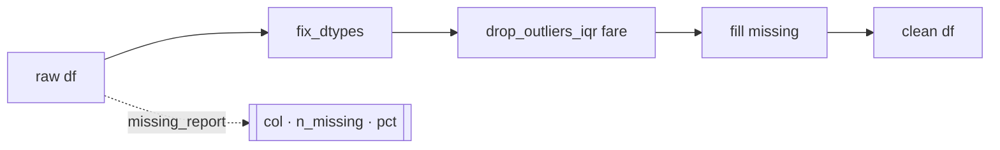

#### Notes

- Real data is messy: numbers stored as text, outliers, blanks. Write **small functions that each take a df and return a df**, then chain them.
- `pd.to_numeric(s, errors="coerce")` turns junk into NaN instead of crashing.
- IQR rule: outlier if value < Q1 − 1.5·IQR or > Q3 + 1.5·IQR, where IQR = Q3 − Q1.
- A pipeline = list of functions applied in order: `for step in steps: df = step(df)`. sklearn's `Pipeline` (Day 50) is the same idea.

#### Your task — `day27.py`

- `missing_report(df)` → DataFrame with columns `column, n_missing, pct` (pct rounded 1), only columns with missing, sorted by n_missing desc.
- `fix_dtypes(df, numeric_cols)` → copy with those columns coerced to numbers.
- `drop_outliers_iqr(df, col, k=1.5)` → rows within the IQR fences (NaN rows kept).
- `pipeline(df, steps)` → apply each function in order.

#### Tests

```python
# file: test_day27.py
import numpy as np
import pandas as pd

import day27 as ex


def frame():
    return pd.DataFrame({"fare": ["7.25", "71.3", "8.05", "oops", "7.9", "8.5", "512.3"],
                         "age": [22, np.nan, 26, 35, np.nan, 30, 40], "name": list("abcdefg")})


def test_missing_report():
    r = ex.missing_report(frame())
    assert list(r["column"]) == ["age"] and r.iloc[0]["n_missing"] == 2 and r.iloc[0]["pct"] == 28.6


def test_fix_dtypes():
    df = ex.fix_dtypes(frame(), ["fare"])
    assert df["fare"].dtype.kind == "f" and np.isnan(df.loc[3, "fare"])


def test_outliers():
    df = ex.drop_outliers_iqr(ex.fix_dtypes(frame(), ["fare"]), "fare")
    assert 512.3 not in df["fare"].values and 71.3 in df["fare"].values  # fences ≈ [-63.5, 127.1]
    assert df["fare"].isna().sum() == 1, "keep NaN rows"


def test_pipeline():
    out = ex.pipeline(frame(), [lambda d: ex.fix_dtypes(d, ["fare"]), lambda d: ex.drop_outliers_iqr(d, "fare")])
    assert len(out) == 6
```

<details><summary>Reference solution (try first!)</summary>

```python
# file: day27.py
import pandas as pd


def missing_report(df):
    n = df.isna().sum()
    n = n[n > 0].sort_values(ascending=False)
    return pd.DataFrame({"column": n.index, "n_missing": n.values,
                         "pct": (n.values / len(df) * 100).round(1)}).reset_index(drop=True)


def fix_dtypes(df, numeric_cols):
    df = df.copy()
    for c in numeric_cols:
        df[c] = pd.to_numeric(df[c], errors="coerce")
    return df


def drop_outliers_iqr(df, col, k=1.5):
    q1, q3 = df[col].quantile([0.25, 0.75])
    iqr = q3 - q1
    keep = df[col].between(q1 - k * iqr, q3 + k * iqr) | df[col].isna()
    return df[keep].copy()


def pipeline(df, steps):
    for step in steps:
        df = step(df)
    return df


if __name__ == "__main__":
    from day24 import load_titanic
    raw = load_titanic()
    print(missing_report(raw))
    clean = pipeline(raw, [lambda d: fix_dtypes(d, ["fare", "age"]), lambda d: drop_outliers_iqr(d, "fare")])
    print(len(raw), "->", len(clean), "rows after removing fare outliers")
```

</details>

**Done when:** green + run on real Titanic: how many fare outliers did you drop? Were they real people? (Yes — first class. Outlier ≠ error. Write that thought in your dev log.)

---

### Day 28 — Git + GitHub Actions: run jobs in the cloud

**Dataset:** none · **Time:** ~2 h

#### Visual

```text
 local                      GitHub                         Actions runner (cron)
 git add/commit ──push──▶   repo  ──schedule: "0 * * * *"──▶  checkout → pip install
                                                              → python collect.py
                             ◀────────── git commit data/ + push ───────┘
```

#### Notes

- Daily git loop: `git status` → `git add -A` → `git commit -m "day 28: actions"` → `git push`.
- A workflow lives in `.github/workflows/name.yml`. `on: schedule: - cron: "0 * * * *"` plus `workflow_dispatch:` (manual button).
- Secrets: repo Settings → Secrets → use as `${{ secrets.API_KEY }}`. Never in code.
- Cron in Actions is UTC and can be delayed a few minutes. Fine for data collection.
- Generating the YAML from Python avoids indentation mistakes — that's today's exercise.

#### Your task — `day28.py`

- `valid_cron(expr)` → `True` for 5 space-separated fields each made of digits, `*`, `/`, `,`, `-`.
- `make_workflow(name, cron, script, requirements="requirements.txt")` → YAML string: runs on schedule + manual, sets up Python 3.13, installs requirements, runs the script, commits `data/` if changed. Raise `ValueError` on invalid cron.

#### Tests

```python
# file: test_day28.py
import day28 as ex


def test_valid_cron():
    assert ex.valid_cron("0 * * * *") and ex.valid_cron("*/15 6-18 * * 1-5")
    assert not ex.valid_cron("0 * * *") and not ex.valid_cron("0 * * * mon")


def test_make_workflow():
    y = ex.make_workflow("collect", "0 * * * *", "day29.py")
    for needle in ['name: collect', 'cron: "0 * * * *"', "workflow_dispatch:", "actions/checkout@v4",
                   "python-version: \"3.13\"", "pip install -r requirements.txt", "python day29.py",
                   "git add data"]:
        assert needle in y, needle
    try:
        ex.make_workflow("x", "bad", "a.py")
    except ValueError:
        return
    raise AssertionError("bad cron should raise ValueError")
```

<details><summary>Reference solution (try first!)</summary>

```python
# file: day28.py
import re

TEMPLATE = """name: {name}
on:
  schedule:
    - cron: "{cron}"
  workflow_dispatch:
permissions:
  contents: write
jobs:
  run:
    runs-on: ubuntu-latest
    steps:
      - uses: actions/checkout@v4
      - uses: actions/setup-python@v5
        with:
          python-version: "3.13"
      - run: pip install -r {requirements}
      - run: python {script}
      - name: commit data
        run: |
          git config user.name "bot"
          git config user.email "bot@users.noreply.github.com"
          git add data
          git diff --cached --quiet || (git commit -m "data: automated update" && git push)
"""


def valid_cron(expr):
    parts = expr.split()
    return len(parts) == 5 and all(re.fullmatch(r"[\d*/,\-]+", p) for p in parts)


def make_workflow(name, cron, script, requirements="requirements.txt"):
    if not valid_cron(cron):
        raise ValueError(f"invalid cron: {cron!r}")
    return TEMPLATE.format(name=name, cron=cron, script=script, requirements=requirements)
```

</details>

**Done when:** green + write the YAML to `.github/workflows/collect.yml` in your repo and trigger it once with the manual button.

---

### Day 29 — The data-collector bot

**Dataset:** live weather (Day 19) appended over days → your own growing time series · **Time:** ~2 h

#### Visual

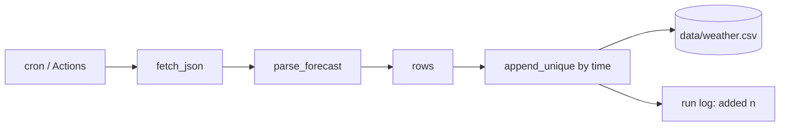

#### Notes

- Combine Days 19 + 21 + 28: fetch → transform → idempotent store → log.
- Inject the fetcher (`fetch=`) so the bot is testable offline.
- Return stats (`fetched`, `added`) — that's what the log line and alerts use.
- After a week this CSV is **your own real dataset** — you'll forecast it in Block 2 (Day 54).

#### Your task — `day29.py`

- `collect(fetch, csv_path, log_path, now_iso)` → `fetch()` returns forecast JSON; convert to rows `{"time", "temp"}`; `append_unique` by `time`; append one log line `"<now> fetched=<n> added=<k>"`; return `{"fetched": n, "added": k}`.

#### Tests

```python
# file: test_day29.py
import tempfile
from pathlib import Path

import day29 as ex


def fake(times, temps):
    return lambda: {"hourly": {"time": times, "temperature_2m": temps}}


def test_collect_idempotent_and_logs():
    d = Path(tempfile.mkdtemp())
    csv_p, log_p = d / "data" / "weather.csv", d / "run.log"
    s1 = ex.collect(fake(["T0", "T1"], [6.1, 5.8]), csv_p, log_p, "2026-11-17T10:00")
    s2 = ex.collect(fake(["T1", "T2"], [5.8, 5.5]), csv_p, log_p, "2026-11-17T11:00")
    assert s1 == {"fetched": 2, "added": 2} and s2 == {"fetched": 2, "added": 1}
    assert csv_p.read_text().splitlines() == ["time,temp", "T0,6.1", "T1,5.8", "T2,5.5"]
    assert log_p.read_text().splitlines() == ["2026-11-17T10:00 fetched=2 added=2",
                                              "2026-11-17T11:00 fetched=2 added=1"]
```

<details><summary>Reference solution (try first!)</summary>

```python
# file: day29.py
from datetime import datetime
from pathlib import Path

from day19 import parse_forecast
from day21 import append_unique


def collect(fetch, csv_path, log_path, now_iso):
    rows = [{"time": t, "temp": temp} for t, temp in parse_forecast(fetch())]
    Path(csv_path).parent.mkdir(parents=True, exist_ok=True)
    added = append_unique(csv_path, rows, "time")
    with open(log_path, "a", encoding="utf-8") as f:
        f.write(f"{now_iso} fetched={len(rows)} added={added}\n")
    return {"fetched": len(rows), "added": added}


if __name__ == "__main__":
    import requests
    from day08 import build_url
    from day19 import fetch_json
    url = build_url("https://api.open-meteo.com/v1/forecast", latitude=52.08, longitude=0.01,
                    hourly="temperature_2m", past_days=1)
    print(collect(lambda: fetch_json(url, requests.get), "data/weather.csv", "data/run.log",
                  datetime.now().isoformat(timespec="minutes")))
```

</details>

**Done when:** green + the bot runs on GitHub Actions (Day 28 workflow with `script="day29.py"`) for 3+ days.

---

### Day 30 — Block 1 capstone: automatic EDA report generator

**Dataset:** run it on Titanic, Iris and Flights — any CSV · **Time:** ~3 h

#### Visual

```text
 any.csv ──▶ eda_report() ──▶ reports/titanic/
                                ├── report.md   ← shape, dtypes, missing, stats, top values
                                ├── hist_age.png
                                ├── hist_fare.png
                                └── …one histogram per numeric column
```

#### Notes

- Exploratory Data Analysis = the first hour with any new dataset. Automate it once, use it forever.
- Markdown tables: `df.to_markdown()` needs `tabulate`; build simple tables yourself to stay dependency-free.
- Reuse: Day 25 `plot_hist` + `save`, Day 27 `missing_report`.
- Block 1 retro: you can now fetch, scrape, schedule, clean, plot and report on real data. Block 2 makes predictions from it.

#### Your task — `day30.py`

- `md_table(rows, headers)` → Markdown table string.
- `eda_report(df, title)` → Markdown string containing: `# <title>`, `Rows: n · Columns: m`, a dtypes table, a missing-values section (or `No missing values.`), numeric summary (mean/std/min/max, 2 dp), top 3 values for each text column.
- `save_eda(df, title, out_dir)` → writes `report.md` + `hist_<col>.png` per numeric column; returns list of written paths.

#### Tests

```python
# file: test_day30.py
import tempfile
from pathlib import Path

import numpy as np
import pandas as pd

import day30 as ex


def frame():
    return pd.DataFrame({"age": [22.0, 38, np.nan, 35], "fare": [7.25, 71.28, 7.92, 53.1],
                         "sex": ["male", "female", "female", "female"]})


def test_md_table():
    assert ex.md_table([["a", 1]], ["k", "v"]) == "| k | v |\n| --- | --- |\n| a | 1 |"


def test_report_content():
    r = ex.eda_report(frame(), "Mini Titanic")
    assert r.startswith("# Mini Titanic")
    assert "Rows: 4 · Columns: 3" in r
    assert "| age | 1 | 25.0 |" in r          # missing row: column, n, pct
    assert "| fare | 34.89 |" in r            # numeric summary starts with the mean
    assert "female (3)" in r


def test_no_missing_message():
    assert "No missing values." in ex.eda_report(frame().dropna(), "x")


def test_save_eda():
    out = Path(tempfile.mkdtemp()) / "eda"
    paths = ex.save_eda(frame(), "t", out)
    assert {p.name for p in paths} == {"report.md", "hist_age.png", "hist_fare.png"}
    assert all(p.exists() for p in paths)
```

<details><summary>Reference solution (try first!)</summary>

```python
# file: day30.py
from pathlib import Path

from day25 import plot_hist, save
from day27 import missing_report


def md_table(rows, headers):
    lines = ["| " + " | ".join(map(str, headers)) + " |", "| " + " | ".join("---" for _ in headers) + " |"]
    lines += ["| " + " | ".join(map(str, r)) + " |" for r in rows]
    return "\n".join(lines)


def eda_report(df, title):
    out = [f"# {title}", "", f"Rows: {len(df)} · Columns: {df.shape[1]}", "", "## Types", "",
           md_table([[c, str(t)] for c, t in df.dtypes.items()], ["column", "dtype"]), "", "## Missing values", ""]
    miss = missing_report(df)
    out.append(md_table(miss.values.tolist(), ["column", "n_missing", "pct"]) if len(miss) else "No missing values.")
    num = df.select_dtypes("number")
    if num.shape[1]:
        rows = [[c, *(round(float(v), 2) for v in (num[c].mean(), num[c].std(), num[c].min(), num[c].max()))]
                for c in num.columns]
        out += ["", "## Numeric summary", "", md_table(rows, ["column", "mean", "std", "min", "max"])]
    text = df.select_dtypes(exclude="number")
    if text.shape[1]:
        out += ["", "## Top values", ""]
        for c in text.columns:
            top = df[c].value_counts().head(3)
            out.append(f"- **{c}**: " + ", ".join(f"{k} ({v})" for k, v in top.items()))
    return "\n".join(out) + "\n"


def save_eda(df, title, out_dir):
    out = Path(out_dir)
    out.mkdir(parents=True, exist_ok=True)
    (out / "report.md").write_text(eda_report(df, title), encoding="utf-8")
    paths = [out / "report.md"]
    for c in df.select_dtypes("number").columns:
        paths.append(save(plot_hist(df[c].dropna(), 20, f"{title}: {c}", c), out / f"hist_{c}.png"))
    return paths


if __name__ == "__main__":
    import pandas as pd
    from day22 import download
    for name in ("titanic", "flights"):
        print(save_eda(pd.read_csv(download(name)), name.title(), f"reports/{name}"))
```

</details>

**Done when:** green + `python day30.py` writes real reports for Titanic and Flights. **Block 1 complete — run `python ai90.py progress`.**

---


## BLOCK 2 — MACHINE LEARNING FROM SCRATCH, ON REAL DATA (Days 31–60)

Rule for this block: **build each algorithm in NumPy first, then check it against scikit-learn.** Every model has `fit(X, y)` and `predict(X)`. Datasets: Iris, Wine, Breast Cancer, Diabetes, Digits (bundled with scikit-learn — no download), plus Titanic, Flights, SMS Spam and Car MPG through your Day 22 downloader.

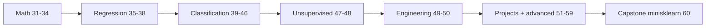

---

### Day 31 — Vectors and matrices for ML

**Dataset:** Iris (bundled) · **Time:** ~2 h

#### Visual

```text
 cosine similarity = how much two vectors point the same way
        b                     cos = a·b / (|a||b|)
       ／  θ small → cos ≈ 1    1 = same direction, 0 = unrelated, -1 = opposite
      ／___ a
 projection of b onto a:  (a·b / a·a) · a        ← the core of linear regression + PCA
 X (n×d) @ w (d,) → predictions (n,)              ← every linear model in one line
```

#### Notes

- A data row is a vector; a dataset is a matrix `X` with shape `(n_samples, n_features)`.
- Dot product `a @ b`; norm `np.linalg.norm(a)`; matrix product `X @ W` (Day 15, now 100× faster).
- Cosine similarity compares direction, ignoring length — used for search, embeddings and RAG (Day 86).
- `np.linalg.solve(A, b)` solves `A x = b`; never compute `inv(A) @ b` yourself (slower, less stable).

#### Your task — `day31.py`

- `cosine_similarity(a, b)` → float.
- `most_similar(X, query, k)` → indices of the k rows of `X` most cosine-similar to `query`, best first.
- `project(b, a)` → projection of `b` onto `a`.
- `linear_predict(X, w, b)` → `X @ w + b`.

#### Tests

```python
# file: test_day31.py
import numpy as np

import day31 as ex
from day23 import load_iris_xy


def test_cosine():
    assert ex.cosine_similarity([1, 0], [5, 0]) == 1.0
    assert abs(ex.cosine_similarity([1, 0], [0, 3])) < 1e-12
    assert np.isclose(ex.cosine_similarity([1, 1], [-1, -1]), -1)


def test_most_similar_on_iris():
    X, y = load_iris_xy()
    idx = ex.most_similar(X, X[0], 5)
    assert idx[0] == 0 and len(idx) == 5
    assert (y[idx] == 0).all(), "the flowers closest to a setosa are setosas"


def test_project():
    assert np.allclose(ex.project(np.array([2.0, 3]), np.array([1.0, 0])), [2, 0])


def test_linear_predict():
    X = np.array([[1.0, 2], [3, 4]])
    assert np.allclose(ex.linear_predict(X, np.array([1.0, -1]), 0.5), [-0.5, -0.5])
```

<details><summary>Reference solution (try first!)</summary>

```python
# file: day31.py
import numpy as np


def cosine_similarity(a, b):
    a, b = np.asarray(a, float), np.asarray(b, float)
    return float(a @ b / (np.linalg.norm(a) * np.linalg.norm(b)))


def most_similar(X, query, k):
    X, q = np.asarray(X, float), np.asarray(query, float)
    sims = X @ q / (np.linalg.norm(X, axis=1) * np.linalg.norm(q))
    return np.argsort(-sims, kind="stable")[:k]


def project(b, a):
    return (a @ b) / (a @ a) * a


def linear_predict(X, w, b):
    return X @ w + b
```

</details>

**Done when:** green. Explain to yourself why cosine is better than raw distance for comparing documents of different lengths.

---

### Day 32 — Derivatives and gradients

**Dataset:** none (functions) · **Time:** ~2 h

#### Visual

```text
 f(x) = x²            slope at x = how fast f changes
   │ ╲         ╱      numerical:  f'(x) ≈ (f(x+h) − f(x−h)) / 2h     (h = 1e-5)
   │  ╲       ╱ ← slope 4 at x=2
   │   ╲_____╱
 gradient of f(x, y) = [∂f/∂x, ∂f/∂y]  → points uphill; ML walks the OTHER way
 chain rule: d/dx f(g(x)) = f'(g(x)) · g'(x)    ← backprop is just this, repeated
```

#### Notes

- Derivative = slope = sensitivity of output to input.
- Rules you need: `(xⁿ)' = n·xⁿ⁻¹`, `(eˣ)' = eˣ`, `(ln x)' = 1/x`, sum rule, product rule, chain rule.
- **Numerical gradient** (central difference) is slow but always right — you'll use it forever to check hand-written gradients ("gradient checking", Day 63).
- Partial derivative: wiggle one input, hold the others still. Gradient = vector of all partials.

#### Your task — `day32.py`

- `numerical_derivative(f, x, h=1e-5)` (central difference).
- `numerical_grad(f, x, h=1e-5)` → gradient array for `f` taking a 1-D array.
- `mse_grad(w, X, y)` → analytic gradient of `mean((X@w − y)²)` = `2/n · Xᵀ(Xw − y)`.
- `sigmoid(z)` and `sigmoid_grad(z)` = `σ(z)(1 − σ(z))`.

#### Tests

```python
# file: test_day32.py
import numpy as np

import day32 as ex


def test_derivative():
    assert abs(ex.numerical_derivative(lambda x: x ** 2, 2.0) - 4) < 1e-6
    assert abs(ex.numerical_derivative(np.sin, 0.0) - 1) < 1e-6


def test_grad():
    f = lambda v: v[0] ** 2 + 3 * v[0] * v[1]  # noqa: E731
    assert np.allclose(ex.numerical_grad(f, np.array([1.0, 2.0])), [8, 3], atol=1e-5)


def test_mse_grad_matches_numeric():
    rng = np.random.default_rng(0)
    X, y, w = rng.normal(size=(20, 3)), rng.normal(size=20), rng.normal(size=3)
    numeric = ex.numerical_grad(lambda v: np.mean((X @ v - y) ** 2), w)
    assert np.allclose(ex.mse_grad(w, X, y), numeric, atol=1e-6)


def test_sigmoid_grad():
    z = np.linspace(-4, 4, 9)
    assert np.allclose(ex.sigmoid_grad(z), [ex.numerical_derivative(ex.sigmoid, v) for v in z], atol=1e-8)
    assert ex.sigmoid(0) == 0.5
```

<details><summary>Reference solution (try first!)</summary>

```python
# file: day32.py
import numpy as np


def numerical_derivative(f, x, h=1e-5):
    return (f(x + h) - f(x - h)) / (2 * h)


def numerical_grad(f, x, h=1e-5):
    x = np.asarray(x, float)
    g = np.zeros_like(x)
    for i in range(x.size):
        e = np.zeros_like(x); e.flat[i] = h
        g.flat[i] = (f(x + e) - f(x - e)) / (2 * h)
    return g


def mse_grad(w, X, y):
    return 2 / len(y) * X.T @ (X @ w - y)


def sigmoid(z):
    return 1 / (1 + np.exp(-z))


def sigmoid_grad(z):
    s = sigmoid(z)
    return s * (1 - s)
```

</details>

**Done when:** green. On paper: derive `d/dw (wx − y)²` with the chain rule.

---

### Day 33 — Gradient descent

**Dataset:** none (a 2-D bowl), then real data from Day 37 on · **Time:** ~2 h

#### Visual

```text
 contour of f(x,y) = x² + 10y²          lr too small: crawls
        ╭─────────────╮                  lr good:      ●→●→●→◎
     ╭──┤  ╭───────╮  ├──╮               lr too big:   ●↗ ↙● ↗  ↙ diverges
     │  │  │   ◎   │  │  │  ◎ = minimum
     ╰──┤  ╰───────╯  ├──╯
        ╰─────────────╯     update rule:  x ← x − lr · ∇f(x)
```

#### Notes

- Gradient descent: start somewhere, step against the gradient, repeat. Every neural net trains this way.
- Learning rate `lr`: too small = slow; too big = overshoot / diverge. Diagnose with a loss curve.
- Stop when the gradient is tiny (`‖∇f‖ < tol`) or after `max_steps`.
- Elongated bowls (very different curvature per direction) make GD zig-zag → why we standardise features (Day 34) and why Adam exists (Day 69).

#### Your task — `day33.py`

- `gradient_descent(grad, x0, lr, steps, tol=1e-8)` → `(x_final, path)` where `path` is a list of arrays including `x0`; stop early when `‖grad‖ < tol`.
- `bowl(v)` = `v[0]**2 + 10*v[1]**2` and `bowl_grad(v)`.
- `plot_path(path)` → Matplotlib Figure: contour of `bowl` plus the path.

#### Tests

```python
# file: test_day33.py
import matplotlib
matplotlib.use("Agg")
import numpy as np  # noqa: E402

import day33 as ex  # noqa: E402


def test_converges():
    x, path = ex.gradient_descent(ex.bowl_grad, np.array([3.0, 2.0]), lr=0.05, steps=500)
    assert np.allclose(x, 0, atol=1e-3)
    assert np.allclose(path[0], [3, 2]) and len(path) > 2


def test_early_stop():
    x, path = ex.gradient_descent(ex.bowl_grad, np.array([0.0, 0.0]), lr=0.05, steps=100)
    assert len(path) == 1


def test_diverges_with_big_lr():
    x, _ = ex.gradient_descent(ex.bowl_grad, np.array([1.0, 1.0]), lr=0.2, steps=50)
    assert ex.bowl(x) > 1e6


def test_plot():
    _, path = ex.gradient_descent(ex.bowl_grad, np.array([3.0, 2.0]), lr=0.05, steps=50)
    fig = ex.plot_path(path)
    assert len(fig.axes) >= 1 and len(fig.axes[0].lines) >= 1
```

<details><summary>Reference solution (try first!)</summary>

```python
# file: day33.py
import matplotlib
matplotlib.use("Agg")
import matplotlib.pyplot as plt  # noqa: E402
import numpy as np  # noqa: E402


def bowl(v):
    return v[0] ** 2 + 10 * v[1] ** 2


def bowl_grad(v):
    return np.array([2 * v[0], 20 * v[1]])


def gradient_descent(grad, x0, lr, steps, tol=1e-8):
    x = np.asarray(x0, float).copy()
    path = [x.copy()]
    for _ in range(steps):
        g = grad(x)
        if np.linalg.norm(g) < tol:
            break
        x = x - lr * g
        path.append(x.copy())
    return x, path


def plot_path(path):
    P = np.array(path)
    xs, ys = np.meshgrid(np.linspace(-3.5, 3.5, 200), np.linspace(-2.5, 2.5, 200))
    fig, ax = plt.subplots()
    ax.contour(xs, ys, xs ** 2 + 10 * ys ** 2, levels=20, linewidths=0.6)
    ax.plot(P[:, 0], P[:, 1], "o-", ms=3)
    ax.set_title(f"gradient descent: {len(P) - 1} steps"); ax.set_xlabel("x"); ax.set_ylabel("y")
    return fig


if __name__ == "__main__":
    from day25 import save
    for lr in (0.01, 0.05, 0.095):
        _, path = gradient_descent(bowl_grad, np.array([3.0, 2.0]), lr=lr, steps=60)
        save(plot_path(path), f"plots/gd_lr{lr}.png")
```

</details>

**Done when:** green + three plots for different learning rates. Which lr zig-zags?

---

### Day 34 — Probability and statistics for ML

**Dataset:** Wine (bundled) · **Time:** ~2 h

#### Visual

```text
 normal distribution                 standardise each feature:
         ▁▄█▄▁                        z = (x − mean) / std
       ▁▄█████▄▁                      alcohol  (≈13)   →  ≈0 ± 1
 ────▁▄█████████▄▁────               proline (≈750)   →  ≈0 ± 1   ← now comparable
     μ−2σ  μ  μ+2σ   (95% inside)
 fit on TRAIN only → transform train AND test (no peeking at test data)
```

#### Notes

- Mean, variance, standard deviation; the normal pdf `1/(σ√2π)·exp(−(x−μ)²/2σ²)`.
- Features on wildly different scales break GD and distance-based models → **standardise**.
- `fit` learns parameters (mean, std) from training data; `transform` applies them. Fitting on test data = **data leakage**, the most common ML mistake.
- Constant columns have std 0 → divide by 1 instead.

#### Your task — `day34.py`

- `class StandardScaler` with `fit(X)` (stores `mean_`, `scale_`), `transform(X)`, `fit_transform(X)`, `inverse_transform(Z)`.
- `normal_pdf(x, mu, sigma)`.
- `sample_stats(x)` → dict `mean, var, std` (population: divide by n).

#### Tests

```python
# file: test_day34.py
import numpy as np
from sklearn.datasets import load_wine
from sklearn.preprocessing import StandardScaler as SkScaler

import day34 as ex


def test_scaler_matches_sklearn_on_wine():
    X = load_wine().data
    ours, theirs = ex.StandardScaler().fit_transform(X), SkScaler().fit_transform(X)
    assert np.allclose(ours, theirs)


def test_constant_column_and_inverse():
    X = np.array([[1.0, 5], [3, 5]])
    s = ex.StandardScaler().fit(X)
    Z = s.transform(X)
    assert np.allclose(Z[:, 1], 0) and np.allclose(s.inverse_transform(Z), X)


def test_fit_on_train_only():
    s = ex.StandardScaler().fit(np.array([[0.0], [2.0]]))
    assert np.allclose(s.transform(np.array([[4.0]])), [[3.0]])


def test_normal_pdf_and_stats():
    assert np.isclose(ex.normal_pdf(0, 0, 1), 0.3989422804)
    assert ex.sample_stats([2, 4, 4, 4, 5, 5, 7, 9]) == {"mean": 5.0, "var": 4.0, "std": 2.0}
```

<details><summary>Reference solution (try first!)</summary>

```python
# file: day34.py
import numpy as np


class StandardScaler:
    def fit(self, X):
        X = np.asarray(X, float)
        self.mean_ = X.mean(axis=0)
        std = X.std(axis=0)
        self.scale_ = np.where(std == 0, 1.0, std)
        return self

    def transform(self, X):
        return (np.asarray(X, float) - self.mean_) / self.scale_

    def fit_transform(self, X):
        return self.fit(X).transform(X)

    def inverse_transform(self, Z):
        return np.asarray(Z) * self.scale_ + self.mean_


def normal_pdf(x, mu, sigma):
    return float(np.exp(-((x - mu) ** 2) / (2 * sigma ** 2)) / (sigma * np.sqrt(2 * np.pi)))


def sample_stats(x):
    x = np.asarray(x, float)
    return {"mean": float(x.mean()), "var": float(x.var()), "std": float(x.std())}
```

</details>

**Done when:** green — your scaler equals scikit-learn's on real wine data.

---

### Day 35 — The ML workflow: splits, baselines, metrics

**Dataset:** Diabetes progression (442 patients, 10 features) — bundled `load_diabetes` · **Time:** ~2 h

#### Visual

```text
 all data (442) ──shuffle(seed)──▶ ┌──────── train 80% ────────┐┌─ test 20% ─┐
                                   fit models here               score ONCE at the end
 baseline = predict the train mean for everyone → any real model must beat this
 MSE = mean((y − ŷ)²)   MAE = mean|y − ŷ|   R² = 1 − SSE/SST  (1 perfect, 0 = baseline)
```

#### Notes

- **Always** hold out a test set and touch it last. Seeds make splits reproducible.
- A baseline tells you if your model learned anything. Regression: predict the mean. Classification: predict the most common class.
- MSE punishes big errors; MAE is in the target's units; R² is unitless.

#### Your task — `day35.py`

- `train_test_split(X, y, test_size=0.2, seed=0)` → `X_train, X_test, y_train, y_test` (shuffled with `np.random.default_rng(seed).permutation`).
- `mse`, `mae`, `r2` functions.
- `class MeanBaseline` with `fit(X, y)` and `predict(X)`.
- `load_diabetes_xy()`.

#### Tests

```python
# file: test_day35.py
import numpy as np
from sklearn.metrics import r2_score

import day35 as ex


def test_split():
    X, y = np.arange(20).reshape(10, 2), np.arange(10)
    a = ex.train_test_split(X, y, 0.3, seed=1)
    b = ex.train_test_split(X, y, 0.3, seed=1)
    assert [len(p) for p in a] == [7, 3, 7, 3]
    assert all(np.array_equal(p, q) for p, q in zip(a, b))
    assert np.array_equal(a[0][:, 0] // 2, a[2]), "rows and labels must stay paired"
    assert sorted(np.concatenate([a[2], a[3]])) == list(range(10))


def test_metrics():
    y, p = np.array([3.0, -0.5, 2, 7]), np.array([2.5, 0.0, 2, 8])
    assert ex.mse(y, p) == 0.375 and ex.mae(y, p) == 0.5
    assert np.isclose(ex.r2(y, p), r2_score(y, p))


def test_baseline_on_diabetes():
    X, y = ex.load_diabetes_xy()
    Xtr, Xte, ytr, yte = ex.train_test_split(X, y, seed=0)
    pred = ex.MeanBaseline().fit(Xtr, ytr).predict(Xte)
    assert pred.shape == yte.shape and np.allclose(pred, ytr.mean())
    assert ex.r2(yte, pred) < 0.01
```

<details><summary>Reference solution (try first!)</summary>

```python
# file: day35.py
import numpy as np
from sklearn.datasets import load_diabetes


def load_diabetes_xy():
    d = load_diabetes()
    return d.data, d.target


def train_test_split(X, y, test_size=0.2, seed=0):
    X, y = np.asarray(X), np.asarray(y)
    idx = np.random.default_rng(seed).permutation(len(y))
    n_test = int(round(len(y) * test_size))
    te, tr = idx[:n_test], idx[n_test:]
    return X[tr], X[te], y[tr], y[te]


def mse(y, p):
    return float(np.mean((np.asarray(y) - np.asarray(p)) ** 2))


def mae(y, p):
    return float(np.mean(np.abs(np.asarray(y) - np.asarray(p))))


def r2(y, p):
    y, p = np.asarray(y, float), np.asarray(p, float)
    return float(1 - ((y - p) ** 2).sum() / ((y - y.mean()) ** 2).sum())


class MeanBaseline:
    def fit(self, X, y):
        self.mean_ = float(np.mean(y))
        return self

    def predict(self, X):
        return np.full(len(X), self.mean_)
```

</details>

**Done when:** green. Write the baseline test MSE on diabetes in your dev log — tomorrow you beat it.

---

### Day 36 — Linear regression: the closed-form solution

**Dataset:** Diabetes · **Time:** ~2 h

#### Visual

```text
 y │      ●   ╱          fit the line that minimises Σ(residual²)
   │   ●   ╱ ●            residual = vertical gap ● ↕ line
   │ ●  ╱●
   │  ╱ ●                 normal equation:  (XᵀX) w = Xᵀy
   └──────────── x        add a column of 1s to X → the bias comes for free
```

#### Notes

- Model: `ŷ = Xw + b`. Loss: MSE. Setting the gradient (Day 32) to zero gives `XᵀX w = Xᵀy`.
- Bias trick: prepend a column of ones; the first weight becomes the intercept.
- Solve with `np.linalg.lstsq` (robust even when `XᵀX` is nearly singular).
- Coefficients tell you how the prediction moves per unit of each feature.

#### Your task — `day36.py`

- `add_bias(X)` → ones column prepended.
- `class LinearRegressionClosed` with `fit` (stores `coef_`, `intercept_`) and `predict`.

#### Tests

```python
# file: test_day36.py
import numpy as np
from sklearn.linear_model import LinearRegression

import day36 as ex
from day35 import load_diabetes_xy, mse, r2, train_test_split


def test_add_bias():
    assert np.array_equal(ex.add_bias(np.array([[2.0], [3.0]])), [[1, 2], [1, 3]])


def test_exact_line():
    X = np.array([[0.0], [1], [2]]); y = 3 * X[:, 0] + 1
    m = ex.LinearRegressionClosed().fit(X, y)
    assert np.isclose(m.intercept_, 1) and np.allclose(m.coef_, [3])


def test_matches_sklearn_on_diabetes():
    X, y = load_diabetes_xy()
    Xtr, Xte, ytr, yte = train_test_split(X, y, seed=0)
    ours = ex.LinearRegressionClosed().fit(Xtr, ytr)
    sk = LinearRegression().fit(Xtr, ytr)
    assert np.allclose(ours.coef_, sk.coef_, atol=1e-6) and np.isclose(ours.intercept_, sk.intercept_)
    assert r2(yte, ours.predict(Xte)) > 0.35
    assert mse(yte, ours.predict(Xte)) < mse(yte, np.full_like(yte, ytr.mean()))
```

<details><summary>Reference solution (try first!)</summary>

```python
# file: day36.py
import numpy as np


def add_bias(X):
    X = np.asarray(X, float)
    return np.hstack([np.ones((len(X), 1)), X])


class LinearRegressionClosed:
    def fit(self, X, y):
        w, *_ = np.linalg.lstsq(add_bias(X), np.asarray(y, float), rcond=None)
        self.intercept_, self.coef_ = float(w[0]), w[1:]
        return self

    def predict(self, X):
        return np.asarray(X, float) @ self.coef_ + self.intercept_


if __name__ == "__main__":
    from sklearn.datasets import load_diabetes
    from day35 import r2, train_test_split
    d = load_diabetes()
    Xtr, Xte, ytr, yte = train_test_split(d.data, d.target)
    m = LinearRegressionClosed().fit(Xtr, ytr)
    print("test R²:", round(r2(yte, m.predict(Xte)), 3))
    for name, c in sorted(zip(d.feature_names, m.coef_), key=lambda t: -abs(t[1])):
        print(f"{name:5} {c:9.1f}")
```

</details>

**Done when:** green — identical coefficients to scikit-learn. Which feature matters most for diabetes progression?

---

### Day 37 — Linear regression with gradient descent (mini-batch)

**Dataset:** Diabetes (standardised) · **Time:** ~2 h

#### Visual

```text
 loss │╲
      │ ╲_                    epoch = one pass over the training data
      │   ╲___                batch = a chunk of rows used for one update (Day 5's chunk!)
      │       ╲______________
      └────────────────────── epochs
 per step:  ŷ = Xb w + b;  dw = 2/m Xbᵀ(ŷ−yb);  db = 2/m Σ(ŷ−yb);  w −= lr·dw
```

#### Notes

- Closed form doesn't scale to millions of rows or to neural nets. Gradient descent does.
- Mini-batch: shuffle each epoch, update on batches of e.g. 32 rows — faster and slightly noisy (which helps).
- Standardise features first or GD crawls (Day 33).
- Record the full-data loss each epoch → `loss_history_` for plotting.

#### Your task — `day37.py`

- `class LinearRegressionGD(lr=0.05, epochs=200, batch_size=32, seed=0)` with `fit`, `predict`, `coef_`, `intercept_`, `loss_history_` (MSE per epoch).

#### Tests

```python
# file: test_day37.py
import numpy as np

import day37 as ex
from day34 import StandardScaler
from day35 import load_diabetes_xy, train_test_split
from day36 import LinearRegressionClosed


def data():
    X, y = load_diabetes_xy()
    Xtr, Xte, ytr, yte = train_test_split(X, y, seed=0)
    s = StandardScaler().fit(Xtr)
    return s.transform(Xtr), s.transform(Xte), ytr, yte


def test_loss_decreases():
    Xtr, _, ytr, _ = data()
    m = ex.LinearRegressionGD(epochs=50).fit(Xtr, ytr)
    h = m.loss_history_
    assert len(h) == 50 and h[-1] < h[0]
    assert h[-1] < 3400, "baseline MSE on this split is ~5800"


def test_close_to_closed_form():
    Xtr, Xte, ytr, yte = data()
    gd = ex.LinearRegressionGD(lr=0.02, epochs=400, batch_size=32).fit(Xtr, ytr)
    cf = LinearRegressionClosed().fit(Xtr, ytr)
    mse = lambda m: np.mean((m.predict(Xte) - yte) ** 2)  # noqa: E731
    assert mse(gd) < mse(cf) * 1.05
    assert abs(gd.intercept_ - cf.intercept_) < 2
```

<details><summary>Reference solution (try first!)</summary>

```python
# file: day37.py
import numpy as np


class LinearRegressionGD:
    def __init__(self, lr=0.05, epochs=200, batch_size=32, seed=0):
        self.lr, self.epochs, self.batch_size, self.seed = lr, epochs, batch_size, seed

    def fit(self, X, y):
        X, y = np.asarray(X, float), np.asarray(y, float)
        rng = np.random.default_rng(self.seed)
        self.coef_, self.intercept_ = np.zeros(X.shape[1]), float(y.mean())
        self.loss_history_ = []
        for _ in range(self.epochs):
            idx = rng.permutation(len(y))
            for start in range(0, len(y), self.batch_size):
                b = idx[start:start + self.batch_size]
                err = X[b] @ self.coef_ + self.intercept_ - y[b]
                self.coef_ -= self.lr * 2 / len(b) * X[b].T @ err
                self.intercept_ -= self.lr * 2 * err.mean()
            self.loss_history_.append(float(np.mean((self.predict(X) - y) ** 2)))
        return self

    def predict(self, X):
        return np.asarray(X, float) @ self.coef_ + self.intercept_
```

</details>

**Done when:** green + plot `loss_history_` with Day 25's tools.

---

### Day 38 — Overfitting: polynomial features and ridge regression

**Dataset:** Car MPG (`download("mpg")`) for the real run; synthetic sine for tests · **Time:** ~2 h

#### Visual

```text
 degree 1 (underfit)    degree 4 (good)       degree 15 (overfit)
   ●   ●  ___●            ● ╭─●─╮               ●╮╭●╮ ╭●
 ●___──●   ●            ●─╯     ╰─●            ●╯╰╯ ╰─╯╰●
 train err high          train ok, test ok     train ≈ 0, test HUGE
 ridge:  loss = MSE + α·‖w‖²   → shrinks wild weights;  w = (XᵀX + αI)⁻¹ Xᵀy  (don't penalise bias)
```

#### Notes

- More capacity → lower train error, but test error eventually rises: **overfitting**.
- Fixes: more data, simpler model, **regularisation**. L2 (ridge) shrinks weights smoothly; L1 (lasso) pushes some to exactly zero.
- Polynomial features turn a linear model into a curve fitter: `[x, x², x³, …]`.
- Always standardise before regularising (penalty should treat features fairly).

#### Your task — `day38.py`

- `poly_features(x, degree)` → columns `x¹…x^degree` for 1-D `x`.
- `class Ridge(alpha)` → closed form with unpenalised intercept (centre X and y, solve, recover intercept).

#### Tests

```python
# file: test_day38.py
import numpy as np
from sklearn.linear_model import Ridge as SkRidge

import day38 as ex
from day35 import mse


def test_poly():
    assert np.array_equal(ex.poly_features(np.array([2.0, 3.0]), 3), [[2, 4, 8], [3, 9, 27]])


def test_ridge_matches_sklearn():
    rng = np.random.default_rng(0)
    X, y = rng.normal(size=(40, 5)), rng.normal(size=40)
    ours, sk = ex.Ridge(alpha=3.0).fit(X, y), SkRidge(alpha=3.0).fit(X, y)
    assert np.allclose(ours.coef_, sk.coef_) and np.isclose(ours.intercept_, sk.intercept_)


def test_ridge_tames_overfitting():
    rng = np.random.default_rng(1)
    x = rng.uniform(-1, 1, 30); xt = np.linspace(-1, 1, 200)
    f = lambda v: np.sin(3 * v)  # noqa: E731
    y = f(x) + rng.normal(0, 0.2, 30)
    Xp, Xtp = ex.poly_features(x, 15), ex.poly_features(xt, 15)
    plain = ex.Ridge(alpha=0.0).fit(Xp, y)
    ridge = ex.Ridge(alpha=1e-3).fit(Xp, y)
    assert mse(f(xt), ridge.predict(Xtp)) < mse(f(xt), plain.predict(Xtp))
```

<details><summary>Reference solution (try first!)</summary>

```python
# file: day38.py
import numpy as np


def poly_features(x, degree):
    x = np.asarray(x, float)
    return np.column_stack([x ** d for d in range(1, degree + 1)])


class Ridge:
    def __init__(self, alpha=1.0):
        self.alpha = alpha

    def fit(self, X, y):
        X, y = np.asarray(X, float), np.asarray(y, float)
        xm, ym = X.mean(0), y.mean()
        Xc, yc = X - xm, y - ym
        A = Xc.T @ Xc + self.alpha * np.eye(X.shape[1])
        self.coef_ = np.linalg.lstsq(A, Xc.T @ yc, rcond=None)[0]
        self.intercept_ = float(ym - xm @ self.coef_)
        return self

    def predict(self, X):
        return np.asarray(X, float) @ self.coef_ + self.intercept_


if __name__ == "__main__":
    import pandas as pd
    from day22 import download
    from day34 import StandardScaler
    from day35 import r2, train_test_split
    df = pd.read_csv(download("mpg")).dropna()
    X, y = df[["horsepower", "weight", "displacement", "acceleration", "model_year"]].values, df["mpg"].values
    Xtr, Xte, ytr, yte = train_test_split(X, y)
    s = StandardScaler().fit(Xtr)
    for a in (0, 1, 10, 100):
        m = Ridge(a).fit(s.transform(Xtr), ytr)
        print(f"alpha={a:<4} test R²={r2(yte, m.predict(s.transform(Xte))):.3f}")
```

</details>

**Done when:** green + run on real car MPG. Plot degree 1/4/15 fits on the sine data — that picture is overfitting.

---

### Day 39 — Logistic regression

**Dataset:** Breast Cancer Wisconsin (569 tumours, 30 features) — bundled `load_breast_cancer` · **Time:** ~2 h

#### Visual

```text
 σ(z) = 1/(1+e^-z)            p(malignant)
 1 ┤          ______           z = Xw + b
   │        ╱                  predict 1 if p ≥ 0.5
 .5┤ - - - ●                   loss = binary cross-entropy:
   │  ____╱                     −mean( y·log p + (1−y)·log(1−p) )
 0 ┼──────────── z             grad: dw = Xᵀ(p − y)/n   ← same shape as linear regression!
```

#### Notes

- Classification needs probabilities between 0 and 1 → squash the linear score with the sigmoid.
- MSE is a bad loss here; **cross-entropy** is convex for logistic regression and punishes confident mistakes.
- Clip probabilities (`1e-12…1−1e-12`) before `log` to avoid `log(0)`.
- Optional L2 term `λ‖w‖²` keeps weights sane on separable data.

#### Your task — `day39.py`

- `bce(y, p)` → binary cross-entropy (clipped).
- `class LogisticRegression(lr=0.1, epochs=1000, l2=0.0)` with `fit` (full-batch GD), `predict_proba` (P(y=1)), `predict(threshold=0.5)`, `loss_history_`.

#### Tests

```python
# file: test_day39.py
import numpy as np
from sklearn.datasets import load_breast_cancer
from sklearn.linear_model import LogisticRegression as SkLR

import day39 as ex
from day34 import StandardScaler
from day35 import train_test_split


def test_bce():
    assert np.isclose(ex.bce(np.array([1, 0]), np.array([0.9, 0.1])), -np.log(0.9))
    assert np.isfinite(ex.bce(np.array([1]), np.array([0.0])))


def test_breast_cancer():
    d = load_breast_cancer()
    Xtr, Xte, ytr, yte = train_test_split(d.data, d.target, seed=0)
    s = StandardScaler().fit(Xtr)
    m = ex.LogisticRegression(lr=0.1, epochs=1000, l2=0.01).fit(s.transform(Xtr), ytr)
    acc = (m.predict(s.transform(Xte)) == yte).mean()
    sk = SkLR(max_iter=5000).fit(s.transform(Xtr), ytr).score(s.transform(Xte), yte)
    assert acc > 0.95 and acc >= sk - 0.03
    assert m.loss_history_[-1] < m.loss_history_[0]
    p = m.predict_proba(s.transform(Xte))
    assert p.min() >= 0 and p.max() <= 1
```

<details><summary>Reference solution (try first!)</summary>

```python
# file: day39.py
import numpy as np

from day32 import sigmoid


def bce(y, p):
    p = np.clip(p, 1e-12, 1 - 1e-12)
    return float(-np.mean(y * np.log(p) + (1 - y) * np.log(1 - p)))


class LogisticRegression:
    def __init__(self, lr=0.1, epochs=1000, l2=0.0):
        self.lr, self.epochs, self.l2 = lr, epochs, l2

    def fit(self, X, y):
        X, y = np.asarray(X, float), np.asarray(y, float)
        n, d = X.shape
        self.coef_, self.intercept_ = np.zeros(d), 0.0
        self.loss_history_ = []
        for _ in range(self.epochs):
            p = self.predict_proba(X)
            self.coef_ -= self.lr * (X.T @ (p - y) / n + 2 * self.l2 * self.coef_)
            self.intercept_ -= self.lr * float(np.mean(p - y))
            self.loss_history_.append(bce(y, p))
        return self

    def predict_proba(self, X):
        return sigmoid(np.asarray(X, float) @ self.coef_ + self.intercept_)

    def predict(self, X, threshold=0.5):
        return (self.predict_proba(X) >= threshold).astype(int)
```

</details>

**Done when:** green — >95% on real tumour data with ~25 lines of your own code.

---

### Day 40 — Classification metrics

**Dataset:** Breast Cancer predictions from Day 39 · **Time:** ~2 h

#### Visual

```text
                  predicted
                  0        1
 actual  0  │  TN   │  FP   │   precision = TP/(TP+FP)  "when I say 1, am I right?"
         1  │  FN   │  TP   │   recall    = TP/(TP+FN)  "did I find all the 1s?"
 F1 = 2PR/(P+R)    accuracy lies when classes are imbalanced (99% healthy → predict "healthy" = 99%)
 ROC: sweep threshold 1→0, plot TPR vs FPR; AUC = area (0.5 random, 1.0 perfect)
```

#### Notes

- For cancer screening a false negative (missed cancer) is far worse than a false positive → care about **recall**.
- AUC = probability a random positive gets a higher score than a random negative — threshold-free.
- Compute AUC with the rank method (Mann–Whitney): count pairs where positive score > negative score (ties = 0.5).

#### Your task — `day40.py`

- `confusion_matrix(y, p)` → 2×2 array `[[TN, FP], [FN, TP]]`.
- `precision`, `recall`, `f1` (return 0.0 when undefined).
- `roc_auc(y, scores)` (rank method).
- `report(y, p)` → dict of accuracy, precision, recall, f1 rounded to 3.

#### Tests

```python
# file: test_day40.py
import numpy as np
from sklearn.metrics import f1_score, roc_auc_score

import day40 as ex

Y = np.array([1, 0, 1, 1, 0, 0, 1, 0])
P = np.array([1, 0, 0, 1, 1, 0, 1, 0])


def test_confusion():
    assert ex.confusion_matrix(Y, P).tolist() == [[3, 1], [1, 3]]


def test_prf():
    assert ex.precision(Y, P) == 0.75 and ex.recall(Y, P) == 0.75
    assert np.isclose(ex.f1(Y, P), f1_score(Y, P))
    assert ex.precision([0, 0], [0, 0]) == 0.0


def test_auc():
    s = np.array([0.9, 0.1, 0.4, 0.8, 0.6, 0.2, 0.7, 0.3])
    assert np.isclose(ex.roc_auc(Y, s), roc_auc_score(Y, s))
    assert ex.roc_auc([0, 1], [0.5, 0.5]) == 0.5


def test_report():
    assert ex.report(Y, P) == {"accuracy": 0.75, "precision": 0.75, "recall": 0.75, "f1": 0.75}
```

<details><summary>Reference solution (try first!)</summary>

```python
# file: day40.py
import numpy as np


def confusion_matrix(y, p):
    y, p = np.asarray(y), np.asarray(p)
    return np.array([[np.sum((y == 0) & (p == 0)), np.sum((y == 0) & (p == 1))],
                     [np.sum((y == 1) & (p == 0)), np.sum((y == 1) & (p == 1))]])


def precision(y, p):
    (tn, fp), (fn, tp) = confusion_matrix(y, p)
    return float(tp / (tp + fp)) if tp + fp else 0.0


def recall(y, p):
    (tn, fp), (fn, tp) = confusion_matrix(y, p)
    return float(tp / (tp + fn)) if tp + fn else 0.0


def f1(y, p):
    pr, rc = precision(y, p), recall(y, p)
    return 2 * pr * rc / (pr + rc) if pr + rc else 0.0


def roc_auc(y, scores):
    y, s = np.asarray(y), np.asarray(scores, float)
    pos, neg = s[y == 1], s[y == 0]
    diff = pos[:, None] - neg[None, :]
    return float(((diff > 0) + 0.5 * (diff == 0)).mean())


def report(y, p):
    acc = float(np.mean(np.asarray(y) == np.asarray(p)))
    return {k: round(v, 3) for k, v in
            {"accuracy": acc, "precision": precision(y, p), "recall": recall(y, p), "f1": f1(y, p)}.items()}
```

</details>

**Done when:** green + print `report` and `roc_auc` for your Day 39 model on real tumour data.

---

### Day 41 — Softmax regression (multi-class)

**Dataset:** Wine (178 wines, 3 cultivars, 13 chemical features) · **Time:** ~2 h

#### Visual

```text
 logits z = XW + b  (n × K)       softmax: p_k = e^{z_k} / Σ_j e^{z_j}
 [2.0, 1.0, 0.1]  ──softmax──▶  [0.66, 0.24, 0.10]   sums to 1
 one-hot y=2 → [0, 0, 1]
 loss = −mean Σ_k y_k log p_k     grad: dW = Xᵀ(P − Y)/n   ← SAME pattern as Days 37 & 39
 stable softmax: subtract max(z) first (e^1000 overflows; e^0 doesn't)
```

#### Notes

- Logistic regression generalises to K classes with a weight **matrix** `W (d×K)`.
- Always subtract the row max before `exp` — same answer, no overflow. You'll reuse this softmax in your GPT.
- The gradient `P − Y` is the most important line in deep learning: it's the output-layer gradient of every classifier, including language models.

#### Your task — `day41.py`

- `softmax(Z)` (row-wise, stable), `one_hot(y, k)`, `cross_entropy(Y, P)`.
- `class SoftmaxRegression(lr=0.1, epochs=500)` with `fit`, `predict_proba`, `predict`.

#### Tests

```python
# file: test_day41.py
import numpy as np
from sklearn.datasets import load_wine

import day41 as ex
from day34 import StandardScaler
from day35 import train_test_split


def test_softmax():
    P = ex.softmax(np.array([[2.0, 1.0, 0.1], [1000, 1000, 1000]]))
    assert np.allclose(P.sum(1), 1) and np.allclose(P[1], 1 / 3)
    assert np.allclose(P[0], [0.659, 0.242, 0.099], atol=1e-3)


def test_one_hot_ce():
    Y = ex.one_hot(np.array([0, 2]), 3)
    assert Y.tolist() == [[1, 0, 0], [0, 0, 1]]
    assert np.isclose(ex.cross_entropy(Y, np.array([[0.5, 0.25, 0.25], [0.1, 0.1, 0.8]])),
                      -(np.log(0.5) + np.log(0.8)) / 2)


def test_wine():
    d = load_wine()
    Xtr, Xte, ytr, yte = train_test_split(d.data, d.target, seed=0)
    s = StandardScaler().fit(Xtr)
    m = ex.SoftmaxRegression().fit(s.transform(Xtr), ytr)
    assert (m.predict(s.transform(Xte)) == yte).mean() > 0.94
    assert np.allclose(m.predict_proba(s.transform(Xte)).sum(1), 1)
```

<details><summary>Reference solution (try first!)</summary>

```python
# file: day41.py
import numpy as np


def softmax(Z):
    Z = np.asarray(Z, float)
    e = np.exp(Z - Z.max(axis=1, keepdims=True))
    return e / e.sum(axis=1, keepdims=True)


def one_hot(y, k):
    Y = np.zeros((len(y), k))
    Y[np.arange(len(y)), y] = 1
    return Y


def cross_entropy(Y, P):
    return float(-np.mean(np.sum(Y * np.log(np.clip(P, 1e-12, 1)), axis=1)))


class SoftmaxRegression:
    def __init__(self, lr=0.1, epochs=500):
        self.lr, self.epochs = lr, epochs

    def fit(self, X, y):
        X = np.asarray(X, float)
        self.k_ = int(np.max(y)) + 1
        Y = one_hot(y, self.k_)
        self.W_, self.b_ = np.zeros((X.shape[1], self.k_)), np.zeros(self.k_)
        for _ in range(self.epochs):
            G = (self.predict_proba(X) - Y) / len(X)
            self.W_ -= self.lr * X.T @ G
            self.b_ -= self.lr * G.sum(0)
        return self

    def predict_proba(self, X):
        return softmax(np.asarray(X, float) @ self.W_ + self.b_)

    def predict(self, X):
        return self.predict_proba(X).argmax(1)
```

</details>

**Done when:** green — >94% on real wine.

---

### Day 42 — Cross-validation

**Dataset:** Wine + Diabetes · **Time:** ~2 h

#### Visual

```text
 5-fold CV — every row is in the test fold exactly once
 fold 1: [TEST][train][train][train][train]
 fold 2: [train][TEST][train][train][train]
 fold 3: [train][train][TEST][train][train]   score = mean ± std of the 5
 fold 4: [train][train][train][TEST][train]
 fold 5: [train][train][train][train][TEST]
```

#### Notes

- One split is noisy: you might get lucky. K-fold gives a mean and a spread.
- Use CV to **choose** settings (alpha, k, depth). Keep the final test set for one last check.
- Preprocessing (scaling) must be fit **inside** each fold — otherwise you leak. Pass a factory that builds a fresh model each fold.

#### Your task — `day42.py`

- `kfold_indices(n, k, seed=0)` → list of `(train_idx, test_idx)`; shuffled; folds differ in size by at most 1; every index in exactly one test fold.
- `cross_val_score(make_model, X, y, k=5, metric=None, seed=0)` → array of k scores; `make_model()` returns a new unfitted model; default metric = accuracy.

#### Tests

```python
# file: test_day42.py
import numpy as np
from sklearn.datasets import load_wine

import day42 as ex
from day36 import LinearRegressionClosed
from day35 import load_diabetes_xy, r2
from day41 import SoftmaxRegression


def test_folds():
    folds = ex.kfold_indices(11, 3, seed=0)
    tests = np.concatenate([t for _, t in folds])
    assert sorted(tests) == list(range(11)) and sorted(len(t) for _, t in folds) == [3, 4, 4]
    for tr, te in folds:
        assert not set(tr) & set(te) and len(tr) + len(te) == 11


class ScaledSoftmax:
    def fit(self, X, y):
        self.m, self.s = X.mean(0), X.std(0)
        self.model = SoftmaxRegression().fit((X - self.m) / self.s, y)
        return self

    def predict(self, X):
        return self.model.predict((X - self.m) / self.s)


def test_cv_wine():
    d = load_wine()
    scores = ex.cross_val_score(ScaledSoftmax, d.data, d.target, k=5)
    assert len(scores) == 5 and scores.mean() > 0.94


def test_cv_regression_metric():
    X, y = load_diabetes_xy()
    scores = ex.cross_val_score(LinearRegressionClosed, X, y, k=5, metric=r2)
    assert 0.3 < scores.mean() < 0.6
```

<details><summary>Reference solution (try first!)</summary>

```python
# file: day42.py
import numpy as np


def kfold_indices(n, k, seed=0):
    idx = np.random.default_rng(seed).permutation(n)
    folds = np.array_split(idx, k)
    return [(np.concatenate(folds[:i] + folds[i + 1:]), folds[i]) for i in range(k)]


def cross_val_score(make_model, X, y, k=5, metric=None, seed=0):
    X, y = np.asarray(X), np.asarray(y)
    metric = metric or (lambda t, p: float(np.mean(t == p)))
    scores = []
    for tr, te in kfold_indices(len(y), k, seed):
        model = make_model().fit(X[tr], y[tr])
        scores.append(metric(y[te], model.predict(X[te])))
    return np.array(scores)
```

</details>

**Done when:** green. Report "mean ± std" from now on, never a single split.

---

### Day 43 — k-Nearest Neighbours

**Dataset:** Iris + Wine · **Time:** ~2 h

#### Visual

```text
   ■ ■         ? ← new point, k=3 → nearest: ●, ●, ■  → vote "●"
 ■   ■   ●  ●
       ● ? ●       no training at all — just remember the data
         ●         cost moves to prediction: distance to EVERY training row
 distances all at once:  ‖a−b‖² = ‖a‖² + ‖b‖² − 2a·b   (one matrix product)
```

#### Notes

- kNN is "lazy": `fit` stores the data; `predict` finds the k closest rows and votes.
- Small k = wiggly boundary (overfit); large k = smooth (underfit). Pick k with CV.
- Scale features first — distance is dominated by the biggest-scale feature otherwise.
- Vectorised distances via the expansion above; clip tiny negatives to 0.

#### Your task — `day43.py`

- `pairwise_sq_dists(A, B)` → `(len(A), len(B))` squared distances.
- `class KNNClassifier(k=5)` with `fit`, `predict` (majority vote; ties → smallest label).
- `best_k(X, y, ks, folds=5)` → the k with highest mean CV accuracy (uses Day 42).

#### Tests

```python
# file: test_day43.py
import numpy as np
from sklearn.datasets import load_wine
from sklearn.neighbors import KNeighborsClassifier

import day43 as ex
from day34 import StandardScaler
from day35 import train_test_split


def test_dists():
    A, B = np.array([[0.0, 0], [1, 1]]), np.array([[3.0, 4]])
    assert np.allclose(ex.pairwise_sq_dists(A, B), [[25], [13]])


def test_matches_sklearn_on_wine():
    d = load_wine()
    Xtr, Xte, ytr, yte = train_test_split(d.data, d.target, seed=0)
    s = StandardScaler().fit(Xtr)
    a, b = s.transform(Xtr), s.transform(Xte)
    ours = ex.KNNClassifier(5).fit(a, ytr).predict(b)
    sk = KNeighborsClassifier(5).fit(a, ytr).predict(b)
    assert (ours == sk).mean() > 0.97 and (ours == yte).mean() > 0.9


def test_best_k():
    X = np.vstack([np.zeros((10, 2)), np.ones((10, 2)) * 5])
    y = np.array([0] * 10 + [1] * 10)
    assert ex.best_k(X, y, [1, 3, 5]) == 1
```

<details><summary>Reference solution (try first!)</summary>

```python
# file: day43.py
import numpy as np

from day42 import cross_val_score


def pairwise_sq_dists(A, B):
    A, B = np.asarray(A, float), np.asarray(B, float)
    d = (A ** 2).sum(1)[:, None] + (B ** 2).sum(1)[None, :] - 2 * A @ B.T
    return np.maximum(d, 0)


class KNNClassifier:
    def __init__(self, k=5):
        self.k = k

    def fit(self, X, y):
        self.X_, self.y_ = np.asarray(X, float), np.asarray(y)
        return self

    def predict(self, X):
        nn = np.argsort(pairwise_sq_dists(X, self.X_), axis=1, kind="stable")[:, :self.k]
        votes = self.y_[nn]
        return np.array([np.bincount(v).argmax() for v in votes])


def best_k(X, y, ks, folds=5):
    means = [cross_val_score(lambda: KNNClassifier(k), X, y, k=folds).mean() for k in ks]
    return ks[int(np.argmax(means))]
```

</details>

**Done when:** green. Use `best_k` on real wine — what k wins?

---

### Day 44 — Naive Bayes: an SMS spam filter

**Dataset:** SMS Spam Collection (5,572 real texts) — `download("sms")` (tab-separated: label, message) · **Time:** ~2 h

#### Visual

```text
 P(spam | words) ∝ P(spam) · Π P(word | spam)          ← "naive": words assumed independent
 "WIN a FREE prize now"          log-space (no underflow):
   spam  score: log P(spam) + log P(win|spam) + log P(free|spam) + …   = −21.3  ◀ higher
   ham   score: log P(ham)  + log P(win|ham)  + …                      = −30.8
 Laplace smoothing: (count + 1) / (total + |vocab|)  → unseen words don't zero everything
```

#### Notes

- Bag of words: a message becomes word counts; order ignored.
- Multiply many small probabilities → underflow. Add logs instead.
- Smoothing: never let a probability be 0.
- Fast, tiny, strong baseline for text — still used in production filters.

#### Your task — `day44.py`

- `tokenize(text)` → lowercase words of letters/digits (regex `[a-z0-9']+`).
- `class NaiveBayesText(alpha=1.0)` with `fit(texts, labels)`, `predict_log_scores(text)` → `{label: score}`, `predict(texts)`.
- `load_sms(folder="data")` → `(texts, labels)` from the real file.

#### Tests

```python
# file: test_day44.py
import day44 as ex

TEXTS = ["win a free prize now", "free entry win cash", "call me when you get home",
         "are we still on for lunch", "urgent claim your free cash prize", "see you at home tonight"]
LABELS = ["spam", "spam", "ham", "ham", "spam", "ham"]


def test_tokenize():
    assert ex.tokenize("WIN a £1000 prize!! Don't wait") == ["win", "a", "1000", "prize", "don't", "wait"]


def test_predict():
    m = ex.NaiveBayesText().fit(TEXTS, LABELS)
    assert m.predict(["free cash prize", "lunch at home"]) == ["spam", "ham"]


def test_unseen_words_ok():
    m = ex.NaiveBayesText().fit(TEXTS, LABELS)
    s = m.predict_log_scores("zxqv blorp")
    assert set(s) == {"spam", "ham"} and all(v > -1e9 for v in s.values())
```

<details><summary>Reference solution (try first!)</summary>

```python
# file: day44.py
import csv
import math
import re
from collections import Counter

from day22 import download


def tokenize(text):
    return re.findall(r"[a-z0-9']+", text.lower())


class NaiveBayesText:
    def __init__(self, alpha=1.0):
        self.alpha = alpha

    def fit(self, texts, labels):
        self.classes_ = sorted(set(labels))
        self.prior_ = {c: math.log(labels.count(c) / len(labels)) for c in self.classes_}
        self.counts_ = {c: Counter() for c in self.classes_}
        for t, c in zip(texts, labels):
            self.counts_[c].update(tokenize(t))
        self.vocab_ = set().union(*self.counts_.values())
        self.totals_ = {c: sum(self.counts_[c].values()) for c in self.classes_}
        return self

    def predict_log_scores(self, text):
        V = len(self.vocab_)
        out = {}
        for c in self.classes_:
            s = self.prior_[c]
            for w in tokenize(text):
                s += math.log((self.counts_[c][w] + self.alpha) / (self.totals_[c] + self.alpha * V))
            out[c] = s
        return out

    def predict(self, texts):
        return [max((s, c) for c, s in self.predict_log_scores(t).items())[1] for t in texts]


def load_sms(folder="data"):
    with open(download("sms", folder), encoding="utf-8") as f:
        rows = [r for r in csv.reader(f, delimiter="\t") if len(r) == 2]
    return [r[1] for r in rows], [r[0] for r in rows]


if __name__ == "__main__":
    import numpy as np
    from day35 import train_test_split
    texts, labels = load_sms()
    Xtr, Xte, ytr, yte = train_test_split(np.array(texts, dtype=object), np.array(labels), seed=0)
    m = NaiveBayesText().fit(list(Xtr), list(ytr))
    pred = np.array(m.predict(list(Xte)))
    print("accuracy:", round(float((pred == yte).mean()), 4))
```

</details>

**Done when:** green + `python day44.py` on the real 5,572 texts (expect ~98% accuracy).

---

### Day 45 — Decision trees

**Dataset:** Iris, then Titanic · **Time:** ~2.5 h

#### Visual

```text
                 petal_len ≤ 2.45 ?
                 ╱ yes          ╲ no
          [setosa 50]       petal_wid ≤ 1.75 ?
                             ╱ yes        ╲ no
                      [versicolor 49,   [virginica 45,
                       virginica 5]      versicolor 1]
 Gini(node) = 1 − Σ p_k²     pure node → 0      best split = biggest drop in weighted Gini
```

#### Notes

- A tree asks yes/no questions on one feature at a time, chosen greedily to make children purer.
- For each feature, try thresholds at midpoints between sorted unique values.
- Stop at `max_depth`, at `min_samples_split`, or when a node is pure. Leaf predicts majority class.
- Recursion: `build(X, y, depth)` calls itself on the left and right subsets.
- Trees overfit easily → limit depth, or average many trees (Day 46).

#### Your task — `day45.py`

- `gini(y)` → impurity.
- `best_split(X, y)` → `(feature, threshold, gain)` or `None` if no split helps.
- `class DecisionTree(max_depth=5, min_samples_split=2)` with `fit`, `predict`, `depth()`; nodes are dicts `{"leaf": label}` or `{"f", "t", "left", "right"}`.

#### Tests

```python
# file: test_day45.py
import numpy as np
from sklearn.tree import DecisionTreeClassifier

import day45 as ex
from day23 import load_iris_xy
from day35 import train_test_split


def test_gini():
    assert ex.gini(np.array([0, 0, 0])) == 0.0 and ex.gini(np.array([0, 1])) == 0.5


def test_best_split_iris_root():
    X, y = load_iris_xy()
    f, t, gain = ex.best_split(X, y)
    assert f in (2, 3) and gain > 0.3   # a petal feature isolates setosa


def test_no_split_when_pure():
    assert ex.best_split(np.array([[1.0], [2.0]]), np.array([1, 1])) is None


def test_iris_accuracy_and_depth():
    X, y = load_iris_xy()
    Xtr, Xte, ytr, yte = train_test_split(X, y, seed=0)
    t = ex.DecisionTree(max_depth=3).fit(Xtr, ytr)
    sk = DecisionTreeClassifier(max_depth=3, random_state=0).fit(Xtr, ytr).score(Xte, yte)
    acc = (t.predict(Xte) == yte).mean()
    assert t.depth() <= 3 and acc > 0.85 and abs(acc - sk) < 0.07
```

<details><summary>Reference solution (try first!)</summary>

```python
# file: day45.py
import numpy as np


def gini(y):
    if len(y) == 0:
        return 0.0
    p = np.bincount(y) / len(y)
    return float(1 - (p ** 2).sum())


def best_split(X, y):
    parent, n = gini(y), len(y)
    best = None
    for f in range(X.shape[1]):
        vals = np.unique(X[:, f])
        for t in (vals[:-1] + vals[1:]) / 2:
            left = X[:, f] <= t
            g = parent - (left.sum() * gini(y[left]) + (~left).sum() * gini(y[~left])) / n
            if g > 1e-12 and (best is None or g > best[2]):
                best = (f, float(t), float(g))
    return best


class DecisionTree:
    def __init__(self, max_depth=5, min_samples_split=2):
        self.max_depth, self.min_samples_split = max_depth, min_samples_split

    def _build(self, X, y, depth):
        majority = int(np.bincount(y).argmax())
        if depth >= self.max_depth or len(y) < self.min_samples_split or gini(y) == 0:
            return {"leaf": majority}
        split = best_split(X, y)
        if split is None:
            return {"leaf": majority}
        f, t, _ = split
        m = X[:, f] <= t
        return {"f": f, "t": t, "left": self._build(X[m], y[m], depth + 1),
                "right": self._build(X[~m], y[~m], depth + 1)}

    def fit(self, X, y):
        self.root_ = self._build(np.asarray(X, float), np.asarray(y), 0)
        return self

    def _one(self, x, node):
        while "leaf" not in node:
            node = node["left"] if x[node["f"]] <= node["t"] else node["right"]
        return node["leaf"]

    def predict(self, X):
        return np.array([self._one(x, self.root_) for x in np.asarray(X, float)])

    def depth(self, node=None):
        node = node or self.root_
        return 0 if "leaf" in node else 1 + max(self.depth(node["left"]), self.depth(node["right"]))
```

</details>

**Done when:** green. Print your tree's root question on iris — does it match the visual?

---


### Day 46 — Random forests

**Dataset:** Breast Cancer · **Time:** ~2 h

#### Visual

```text
 bootstrap sample 1 ──▶ 🌳 tree 1 (random features) ─┐
 bootstrap sample 2 ──▶ 🌳 tree 2 (random features) ─┼─▶ majority vote ─▶ prediction
 bootstrap sample 3 ──▶ 🌳 tree 3 (random features) ─┘
 one deep tree = high variance.  Average many DIFFERENT trees → variance drops, bias stays low.
```

#### Notes

- **Bagging** = train each model on a bootstrap sample (draw n rows *with replacement*).
- **Random features** make the trees disagree more, so averaging helps more. Each split only looks at a random √d of the features (subclass your Day 45 tree and override `_build`).
- Out-of-bag rows (~37% not drawn) give a free validation estimate.
- Forests are a strong default for tabular data. Gradient boosting (Day 52) is the other one.

#### Your task — `day46.py`

- `bootstrap(n, rng)` → index array of size n drawn with replacement.
- `class ForestTree(DecisionTree)` — same as Day 45 but each split searches a random subset of `m` features.
- `class RandomForest(n_trees=25, max_depth=6, max_features="sqrt", seed=0)` → `trees_` list; `predict` = majority vote.

#### Tests

```python
# file: test_day46.py
import numpy as np
from sklearn.datasets import load_breast_cancer

import day46 as ex
from day35 import train_test_split
from day45 import DecisionTree


def test_bootstrap():
    idx = ex.bootstrap(1000, np.random.default_rng(0))
    assert len(idx) == 1000 and 0.55 < len(set(idx)) / 1000 < 0.70  # ≈ 63% unique


def test_forest_beats_or_matches_tree():
    d = load_breast_cancer()
    Xtr, Xte, ytr, yte = train_test_split(d.data, d.target, seed=2)
    forest = ex.RandomForest(n_trees=25, max_depth=6, seed=0).fit(Xtr, ytr)
    tree = DecisionTree(max_depth=6).fit(Xtr, ytr)
    f_acc, t_acc = (forest.predict(Xte) == yte).mean(), (tree.predict(Xte) == yte).mean()
    assert len(forest.trees_) == 25 and f_acc > 0.93 and f_acc >= t_acc - 0.01
```

<details><summary>Reference solution (try first!)</summary>

```python
# file: day46.py
import numpy as np

from day45 import DecisionTree, best_split


def bootstrap(n, rng):
    return rng.integers(0, n, size=n)


class ForestTree(DecisionTree):
    """A Day 45 tree that only looks at a random subset of m features at each split."""

    def __init__(self, max_depth, m, rng):
        super().__init__(max_depth)
        self.m, self.rng = m, rng

    def _build(self, X, y, depth):
        majority = int(np.bincount(y).argmax())
        if depth >= self.max_depth or len(y) < self.min_samples_split or np.all(y == y[0]):
            return {"leaf": majority}
        feats = np.sort(self.rng.choice(X.shape[1], self.m, replace=False))
        split = best_split(X[:, feats], y)
        if split is None:
            return {"leaf": majority}
        f, t = int(feats[split[0]]), split[1]
        mask = X[:, f] <= t
        return {"f": f, "t": t, "left": self._build(X[mask], y[mask], depth + 1),
                "right": self._build(X[~mask], y[~mask], depth + 1)}


class RandomForest:
    def __init__(self, n_trees=25, max_depth=6, max_features="sqrt", seed=0):
        self.n_trees, self.max_depth, self.max_features, self.seed = n_trees, max_depth, max_features, seed

    def fit(self, X, y):
        X, y = np.asarray(X, float), np.asarray(y)
        rng = np.random.default_rng(self.seed)
        d = X.shape[1]
        m = max(1, int(np.sqrt(d))) if self.max_features == "sqrt" else d
        self.trees_ = []
        for _ in range(self.n_trees):
            rows = bootstrap(len(y), rng)
            self.trees_.append(ForestTree(self.max_depth, m, rng).fit(X[rows], y[rows]))
        return self

    def predict(self, X):
        votes = np.array([t.predict(X) for t in self.trees_])
        return np.array([np.bincount(col).argmax() for col in votes.T])
```

</details>

**Done when:** green. Try `n_trees` = 1, 5, 25, 100 and plot test accuracy vs number of trees.

---

### Day 47 — k-means clustering

**Dataset:** Iris without labels (then check against the real species) · **Time:** ~2 h

#### Visual

```text
 1 pick k centres (k-means++: spread out)      inertia vs k ("elbow")
 2 assign each point to nearest centre           │●
 3 move each centre to the mean of its points    │ ╲
 4 repeat until nothing changes                  │  ●╲_
   ✕   ● ●            ✕ = centre                 │     ●──●──●   ← elbow at k=3
 ● ● ✕ ●    ▲ ✕ ▲                                └────────────── k
```

#### Notes

- Unsupervised: no labels. The algorithm finds groups by distance.
- Result depends on the start → k-means++ initialisation + several restarts (`n_init`), keep the lowest **inertia** (sum of squared distances to assigned centre).
- Choose k with the elbow plot (or domain knowledge).
- Reuse Day 43's `pairwise_sq_dists`.

#### Your task — `day47.py`

- `kmeans_pp_init(X, k, rng)` → k initial centres.
- `class KMeans(k=3, n_init=5, max_iter=100, seed=0)` with `fit` (`centers_`, `labels_`, `inertia_`) and `predict`.
- `purity(labels, y)` → fraction of points whose cluster's majority true label matches theirs.

#### Tests

```python
# file: test_day47.py
import numpy as np

import day47 as ex
from day23 import load_iris_xy


def test_obvious_blobs():
    rng = np.random.default_rng(0)
    X = np.vstack([rng.normal(0, 0.1, (20, 2)), rng.normal(5, 0.1, (20, 2))])
    km = ex.KMeans(k=2, seed=0).fit(X)
    assert len(set(km.labels_[:20])) == 1 and km.labels_[0] != km.labels_[-1]
    assert np.array_equal(km.predict(X), km.labels_)


def test_iris_purity_and_elbow():
    X, y = load_iris_xy()
    km = ex.KMeans(k=3, seed=0).fit(X)
    assert ex.purity(km.labels_, y) > 0.85
    inertias = [ex.KMeans(k=k, seed=0).fit(X).inertia_ for k in (1, 2, 3, 4)]
    assert all(a > b for a, b in zip(inertias, inertias[1:]))
```

<details><summary>Reference solution (try first!)</summary>

```python
# file: day47.py
import numpy as np

from day43 import pairwise_sq_dists


def kmeans_pp_init(X, k, rng):
    centers = [X[rng.integers(len(X))]]
    for _ in range(1, k):
        d2 = pairwise_sq_dists(X, np.array(centers)).min(1)
        centers.append(X[rng.choice(len(X), p=d2 / d2.sum())])
    return np.array(centers)


class KMeans:
    def __init__(self, k=3, n_init=5, max_iter=100, seed=0):
        self.k, self.n_init, self.max_iter, self.seed = k, n_init, max_iter, seed

    def _run(self, X, rng):
        C = kmeans_pp_init(X, self.k, rng)
        for _ in range(self.max_iter):
            labels = pairwise_sq_dists(X, C).argmin(1)
            newC = np.array([X[labels == j].mean(0) if np.any(labels == j) else C[j] for j in range(self.k)])
            if np.allclose(newC, C):
                break
            C = newC
        labels = pairwise_sq_dists(X, C).argmin(1)
        return C, labels, float(pairwise_sq_dists(X, C).min(1).sum())

    def fit(self, X):
        X = np.asarray(X, float)
        rng = np.random.default_rng(self.seed)
        self.centers_, self.labels_, self.inertia_ = min((self._run(X, rng) for _ in range(self.n_init)),
                                                         key=lambda r: r[2])
        return self

    def predict(self, X):
        return pairwise_sq_dists(X, self.centers_).argmin(1)


def purity(labels, y):
    labels, y = np.asarray(labels), np.asarray(y)
    return float(sum(np.bincount(y[labels == c]).max() for c in np.unique(labels)) / len(y))
```

</details>

**Done when:** green + elbow plot for iris k = 1…8.

---

### Day 48 — PCA: compressing 64 pixels into 2

**Dataset:** Digits (1,797 handwritten 8×8 images) — bundled `load_digits` · **Time:** ~2 h

#### Visual

```text
 64-D pixel space ──PCA──▶ 2-D map you can plot
          ▲ PC2                 ■ 0s    ● 1s    ▲ 7s   …  similar digits cluster together
        ■■■   ●●                PC1 = direction of MOST variance
       ■■      ●●●  ▲▲          PC2 = most remaining variance, ⟂ PC1
             ▲▲▲     ─▶ PC1     X_centered = U S Vᵀ   →  components = rows of Vᵀ
```

#### Notes

- Centre the data, take the SVD; principal directions are the rows of `Vt`; variance explained ∝ `S²`.
- `transform(X) = (X − mean) @ Vt[:k].T`; `inverse_transform(Z) = Z @ Vt[:k] + mean` (lossy reconstruction).
- Uses: visualisation, compression, denoising, speeding up other models.
- Signs of components are arbitrary — compare with sklearn using absolute values.

#### Your task — `day48.py`

- `class PCA(n_components)` with `fit` (`mean_`, `components_`, `explained_variance_ratio_`), `transform`, `inverse_transform`.
- `n_for_variance(X, target)` → smallest k explaining ≥ `target` of variance.

#### Tests

```python
# file: test_day48.py
import numpy as np
from sklearn.datasets import load_digits
from sklearn.decomposition import PCA as SkPCA

import day48 as ex


def test_matches_sklearn_on_digits():
    X = load_digits().data
    ours, sk = ex.PCA(5).fit(X), SkPCA(5).fit(X)
    assert np.allclose(ours.explained_variance_ratio_, sk.explained_variance_ratio_)
    assert np.allclose(np.abs(ours.components_), np.abs(sk.components_), atol=1e-6)


def test_reconstruction_improves_with_k():
    X = load_digits().data
    err = [np.mean((X - (p := ex.PCA(k).fit(X)).inverse_transform(p.transform(X))) ** 2) for k in (2, 10, 40)]
    assert err[0] > err[1] > err[2]


def test_n_for_variance():
    X = load_digits().data
    k = ex.n_for_variance(X, 0.9)
    assert 15 <= k <= 30
```

<details><summary>Reference solution (try first!)</summary>

```python
# file: day48.py
import numpy as np


class PCA:
    def __init__(self, n_components):
        self.n_components = n_components

    def fit(self, X):
        X = np.asarray(X, float)
        self.mean_ = X.mean(0)
        _, S, Vt = np.linalg.svd(X - self.mean_, full_matrices=False)
        var = S ** 2
        self.components_ = Vt[:self.n_components]
        self.explained_variance_ratio_ = var[:self.n_components] / var.sum()
        return self

    def transform(self, X):
        return (np.asarray(X, float) - self.mean_) @ self.components_.T

    def inverse_transform(self, Z):
        return Z @ self.components_ + self.mean_


def n_for_variance(X, target):
    ratios = PCA(min(np.shape(X))).fit(X).explained_variance_ratio_
    return int(np.searchsorted(np.cumsum(ratios), target) + 1)


if __name__ == "__main__":
    from sklearn.datasets import load_digits
    from day25 import plot_classes, save
    d = load_digits()
    Z = PCA(2).fit(d.data).transform(d.data)
    save(plot_classes(Z, d.target, [str(i) for i in range(10)], "PC1", "PC2"), "plots/digits_pca.png")
```

</details>

**Done when:** green + `plots/digits_pca.png` — which digits overlap?

---

### Day 49 — Feature engineering: Titanic → model-ready matrix

**Dataset:** Titanic · **Time:** ~2 h

#### Visual

```text
 raw row:  sex="female" pclass=1 age=NaN fare=71.3 embarked="C" sibsp=1 parch=0
     │ fill age (median)  │ one-hot categoricals │ new features
     ▼                     ▼                        ▼
 [age=28, fare=71.3, family=1, alone=0, sex_female=1, sex_male=0, pclass_1=1, pclass_2=0, pclass_3=0, emb_C=1, …]
```

#### Notes

- Models need numbers. Categorical → **one-hot** (a 0/1 column per category). Don't encode categories as 1, 2, 3 — that invents an order.
- Create features that carry meaning: `family = sibsp + parch`, `alone = family == 0`.
- Fit-time statistics (median age, the category list) must come from **train** only; store them and reuse for test.
- Keep `feature_names_` — you'll need them to explain models (Day 59).

#### Your task — `day49.py`

- `class TitanicFeatures` with `fit(df)` (stores median age, categories for `sex`, `pclass`, `embarked`), `transform(df)` → `(X float array, feature_names list)`. Numeric columns first: `age, fare, family, alone`, then one-hot columns named like `sex_female`, `pclass_1`, `embarked_C` (sorted category order). Unseen categories → all zeros.

#### Tests

```python
# file: test_day49.py
import numpy as np
import pandas as pd

import day49 as ex


def frame():
    return pd.DataFrame({"sex": ["male", "female", "female"], "pclass": [3, 1, 2], "age": [22.0, np.nan, 30.0],
                         "fare": [7.25, 71.3, 13.0], "embarked": ["S", "C", "S"], "sibsp": [1, 1, 0], "parch": [0, 0, 0]})


def test_names_and_values():
    f = ex.TitanicFeatures().fit(frame())
    X, names = f.transform(frame())
    assert names == ["age", "fare", "family", "alone", "sex_female", "sex_male",
                     "pclass_1", "pclass_2", "pclass_3", "embarked_C", "embarked_S"]
    assert X.shape == (3, 11) and X.dtype == float
    assert X[1].tolist() == [26.0, 71.3, 1, 0, 1, 0, 1, 0, 0, 1, 0]


def test_unseen_category_and_train_stats():
    f = ex.TitanicFeatures().fit(frame())
    test = frame().iloc[:1].assign(embarked="Q", age=np.nan)
    X, names = f.transform(test)
    assert X[0, names.index("age")] == 26.0
    assert X[0, names.index("embarked_C")] == 0 and X[0, names.index("embarked_S")] == 0
```

<details><summary>Reference solution (try first!)</summary>

```python
# file: day49.py
import numpy as np

CATS = ["sex", "pclass", "embarked"]


class TitanicFeatures:
    def fit(self, df):
        self.age_median_ = float(df["age"].median())
        self.categories_ = {c: sorted(df[c].dropna().unique().tolist()) for c in CATS}
        return self

    def transform(self, df):
        family = (df["sibsp"] + df["parch"]).to_numpy(float)
        cols = [df["age"].fillna(self.age_median_).to_numpy(float), df["fare"].fillna(0).to_numpy(float),
                family, (family == 0).astype(float)]
        names = ["age", "fare", "family", "alone"]
        for c in CATS:
            for v in self.categories_[c]:
                cols.append((df[c] == v).to_numpy(float))
                names.append(f"{c}_{v}")
        return np.column_stack(cols).astype(float), names


if __name__ == "__main__":
    from day24 import load_titanic
    df = load_titanic()
    X, names = TitanicFeatures().fit(df).transform(df)
    print(X.shape, names)
```

</details>

**Done when:** green + the real Titanic becomes an 891 × 13 matrix.

---

### Day 50 — scikit-learn pipelines and grid search

**Dataset:** Titanic · **Time:** ~2 h

#### Visual

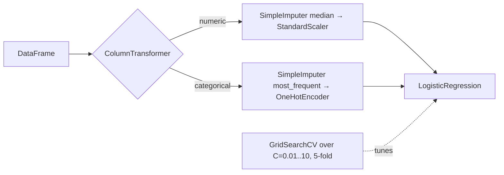

#### Notes

- Now you know what each piece does inside, use the real tools. A `Pipeline` bundles preprocessing + model so CV never leaks.
- `ColumnTransformer` routes columns to different preprocessing.
- `GridSearchCV(pipe, {"model__C": [...]}, cv=5)` — parameter names are `step__param`.
- `OneHotEncoder(handle_unknown="ignore")` = your Day 49 "unseen → zeros".

#### Your task — `day50.py`

- `NUMERIC = ["age", "fare", "sibsp", "parch"]`, `CATEGORICAL = ["sex", "pclass", "embarked"]`.
- `make_pipeline()` → `Pipeline([("prep", ColumnTransformer(...)), ("model", LogisticRegression(max_iter=1000))])`.
- `tune(df, y, Cs)` → fitted `GridSearchCV` (5-fold, accuracy).

#### Tests

```python
# file: test_day50.py
import numpy as np
import pandas as pd

import day50 as ex


def synthetic(n=200, seed=0):
    rng = np.random.default_rng(seed)
    sex = rng.choice(["male", "female"], n)
    df = pd.DataFrame({"sex": sex, "pclass": rng.choice([1, 2, 3], n), "age": rng.uniform(1, 70, n),
                       "fare": rng.uniform(5, 100, n), "sibsp": rng.integers(0, 3, n), "parch": rng.integers(0, 3, n),
                       "embarked": rng.choice(["S", "C", "Q"], n)})
    df.loc[::10, "age"] = np.nan
    y = ((sex == "female") ^ (rng.random(n) < 0.1)).astype(int)
    return df, y


def test_pipeline_steps():
    p = ex.make_pipeline()
    assert [name for name, _ in p.steps] == ["prep", "model"]


def test_fit_handles_nan_and_learns():
    df, y = synthetic()
    p = ex.make_pipeline().fit(df, y)
    assert p.score(df, y) > 0.85


def test_tune():
    df, y = synthetic()
    gs = ex.tune(df, y, [0.01, 1.0])
    assert gs.best_params_["model__C"] in (0.01, 1.0) and gs.best_score_ > 0.8
```

<details><summary>Reference solution (try first!)</summary>

```python
# file: day50.py
from sklearn.compose import ColumnTransformer
from sklearn.impute import SimpleImputer
from sklearn.linear_model import LogisticRegression
from sklearn.model_selection import GridSearchCV
from sklearn.pipeline import Pipeline
from sklearn.preprocessing import OneHotEncoder, StandardScaler

NUMERIC = ["age", "fare", "sibsp", "parch"]
CATEGORICAL = ["sex", "pclass", "embarked"]


def make_pipeline():
    num = Pipeline([("impute", SimpleImputer(strategy="median")), ("scale", StandardScaler())])
    cat = Pipeline([("impute", SimpleImputer(strategy="most_frequent")),
                    ("onehot", OneHotEncoder(handle_unknown="ignore"))])
    prep = ColumnTransformer([("num", num, NUMERIC), ("cat", cat, CATEGORICAL)])
    return Pipeline([("prep", prep), ("model", LogisticRegression(max_iter=1000))])


def tune(df, y, Cs):
    gs = GridSearchCV(make_pipeline(), {"model__C": list(Cs)}, cv=5, scoring="accuracy")
    return gs.fit(df, y)


if __name__ == "__main__":
    from day24 import load_titanic
    df = load_titanic()
    gs = tune(df[NUMERIC + CATEGORICAL], df["survived"], [0.01, 0.1, 1, 10])
    print("best C:", gs.best_params_, "CV accuracy:", round(gs.best_score_, 3))
```

</details>

**Done when:** green + real Titanic CV accuracy (expect ≈ 0.80).

---

### Day 51 — Project: Titanic, your models vs scikit-learn

**Dataset:** Titanic · **Time:** ~3 h

#### Visual

```text
 model                       CV accuracy (5-fold)
 ─────────────────────────── ────────────────────
 RandomForest (yours)        0.816 ± 0.024  ████████████████▎
 DecisionTree d=4 (yours)    0.800 ± 0.010  ████████████████
 LogisticRegression (yours)  0.797 ± 0.031  ███████████████▉
 kNN k=7 (yours)             0.793 ± 0.004  ███████████████▊
 always "died" baseline      0.616          ████████████▎      (real run of this day's script)
```

#### Notes

- Project rhythm: features (Day 49) → several models → same CV folds for all → table → pick → final test once.
- Scale inside each fold for distance/gradient models. Wrap "scaler + model" in a small class.
- Write up what you'd try next (feature ideas: title from name, cabin deck, fare per person).

#### Your task — `day51.py`

- `class Scaled(model_factory)` → `fit` standardises (Day 34) then fits; `predict` transforms then predicts.
- `compare(models, X, y, k=5)` → list of `(name, mean, std)` sorted by mean desc (rounded 3), using Day 42's `cross_val_score` with the same seed for every model.

#### Tests

```python
# file: test_day51.py
import numpy as np

import day51 as ex
from day39 import LogisticRegression
from day43 import KNNClassifier
from day45 import DecisionTree


def blobs(seed=0):
    rng = np.random.default_rng(seed)
    X = np.vstack([rng.normal(0, 1, (60, 3)), rng.normal(2.5, 1, (60, 3))]) * [1, 100, 0.01]
    return X, np.array([0] * 60 + [1] * 60)


def test_scaled_helps_knn():
    X, y = blobs()
    raw = ex.compare({"knn": lambda: KNNClassifier(5)}, X, y)[0][1]
    scaled = ex.compare({"knn": lambda: ex.Scaled(lambda: KNNClassifier(5))}, X, y)[0][1]
    assert scaled > raw


def test_compare_sorted():
    X, y = blobs()
    table = ex.compare({"tree": lambda: DecisionTree(3), "logreg": lambda: ex.Scaled(LogisticRegression)}, X, y)
    assert [len(r) for r in table] == [3, 3] and table[0][1] >= table[1][1]
    assert {r[0] for r in table} == {"tree", "logreg"}
```

<details><summary>Reference solution (try first!)</summary>

```python
# file: day51.py
import numpy as np

from day34 import StandardScaler
from day42 import cross_val_score


class Scaled:
    def __init__(self, model_factory):
        self.model_factory = model_factory

    def fit(self, X, y):
        self.scaler_ = StandardScaler().fit(X)
        self.model_ = self.model_factory().fit(self.scaler_.transform(X), y)
        return self

    def predict(self, X):
        return self.model_.predict(self.scaler_.transform(X))


def compare(models, X, y, k=5):
    rows = []
    for name, factory in models.items():
        s = cross_val_score(factory, X, y, k=k, seed=0)
        rows.append((name, round(float(s.mean()), 3), round(float(s.std()), 3)))
    return sorted(rows, key=lambda r: -r[1])


if __name__ == "__main__":
    from day24 import load_titanic
    from day39 import LogisticRegression
    from day43 import KNNClassifier
    from day45 import DecisionTree
    from day46 import RandomForest
    from day49 import TitanicFeatures
    df = load_titanic()
    X, names = TitanicFeatures().fit(df).transform(df)
    y = df["survived"].to_numpy()
    table = compare({"logreg": lambda: Scaled(lambda: LogisticRegression(l2=0.01)),
                     "knn7": lambda: Scaled(lambda: KNNClassifier(7)),
                     "tree4": lambda: DecisionTree(4), "forest": lambda: RandomForest(50, 6)}, X, y)
    for name, m, s in table:
        print(f"{name:8} {m:.3f} ± {s:.3f}")
```

</details>

**Done when:** green + your real Titanic table in the dev log.

---

### Day 52 — Gradient boosting from scratch

**Dataset:** Diabetes · **Time:** ~2.5 h

#### Visual

```text
 F0 = mean(y)
 residuals r = y − F0 ──▶ fit small tree h1 to r ──▶ F1 = F0 + lr·h1
 residuals r = y − F1 ──▶ fit small tree h2 to r ──▶ F2 = F1 + lr·h2   … 200 times
 each tree fixes what the previous ones got wrong.   (XGBoost / LightGBM = this, heavily optimised)
```

#### Notes

- Boosting builds trees **in sequence**, each on the current residuals (for MSE, residual = negative gradient).
- Small learning rate + many shallow trees generalises best.
- You need a regression tree: split to minimise squared error, leaves predict the mean. A depth-limited version is ~30 lines.

#### Your task — `day52.py`

- `class RegressionTree(max_depth=2, min_leaf=5)` with `fit`, `predict` (variance-reduction splits).
- `class GradientBoostingRegressor(n_estimators=200, lr=0.05, max_depth=2)` with `fit`, `predict`, `train_loss_` (MSE after each tree).

#### Tests

```python
# file: test_day52.py
import numpy as np

import day52 as ex
from day35 import load_diabetes_xy, r2, train_test_split


def test_tree_fits_step():
    X = np.arange(20, dtype=float)[:, None]; y = (X[:, 0] >= 10) * 5.0
    t = ex.RegressionTree(max_depth=1, min_leaf=1).fit(X, y)
    assert np.allclose(t.predict(X), y)


def test_boosting_on_diabetes():
    X, y = load_diabetes_xy()
    Xtr, Xte, ytr, yte = train_test_split(X, y, seed=0)
    gb = ex.GradientBoostingRegressor(n_estimators=150, lr=0.05, max_depth=2).fit(Xtr, ytr)
    assert gb.train_loss_[-1] < gb.train_loss_[0]
    assert r2(yte, gb.predict(Xte)) > 0.35
```

<details><summary>Reference solution (try first!)</summary>

```python
# file: day52.py
import numpy as np


class RegressionTree:
    def __init__(self, max_depth=2, min_leaf=5):
        self.max_depth, self.min_leaf = max_depth, min_leaf

    def _build(self, X, y, depth):
        if depth == self.max_depth or len(y) < 2 * self.min_leaf:
            return {"leaf": float(y.mean())}
        best, base = None, ((y - y.mean()) ** 2).sum()
        for f in range(X.shape[1]):
            order = np.argsort(X[:, f], kind="stable")
            xs, ys = X[order, f], y[order]
            csum, csq = np.cumsum(ys), np.cumsum(ys ** 2)
            for i in range(self.min_leaf, len(y) - self.min_leaf + 1):
                if xs[i - 1] == xs[i]:
                    continue
                nl, nr = i, len(y) - i
                sl, sr = csum[i - 1], csum[-1] - csum[i - 1]
                sse = (csq[i - 1] - sl ** 2 / nl) + (csq[-1] - csq[i - 1] - sr ** 2 / nr)
                if best is None or sse < best[0]:
                    best = (sse, f, (xs[i - 1] + xs[i]) / 2)
        if best is None or best[0] >= base:
            return {"leaf": float(y.mean())}
        _, f, t = best
        m = X[:, f] <= t
        return {"f": f, "t": t, "left": self._build(X[m], y[m], depth + 1), "right": self._build(X[~m], y[~m], depth + 1)}

    def fit(self, X, y):
        self.root_ = self._build(np.asarray(X, float), np.asarray(y, float), 0)
        return self

    def predict(self, X):
        out = []
        for x in np.asarray(X, float):
            n = self.root_
            while "leaf" not in n:
                n = n["left"] if x[n["f"]] <= n["t"] else n["right"]
            out.append(n["leaf"])
        return np.array(out)


class GradientBoostingRegressor:
    def __init__(self, n_estimators=200, lr=0.05, max_depth=2):
        self.n_estimators, self.lr, self.max_depth = n_estimators, lr, max_depth

    def fit(self, X, y):
        X, y = np.asarray(X, float), np.asarray(y, float)
        self.f0_ = float(y.mean())
        F = np.full(len(y), self.f0_)
        self.trees_, self.train_loss_ = [], []
        for _ in range(self.n_estimators):
            t = RegressionTree(self.max_depth).fit(X, y - F)
            F += self.lr * t.predict(X)
            self.trees_.append(t)
            self.train_loss_.append(float(np.mean((y - F) ** 2)))
        return self

    def predict(self, X):
        return self.f0_ + self.lr * sum(t.predict(X) for t in self.trees_)
```

</details>

**Done when:** green. Plot `train_loss_` — boosting's loss curve looks like a neural net's.

---

### Day 53 — Imbalanced data and decision thresholds

**Dataset:** Breast Cancer, artificially made rare (keep 10% of malignant cases) · **Time:** ~2 h

#### Visual

```text
 threshold  precision  recall   F1          moving the threshold trades precision ↔ recall
   0.9        0.95      0.40    0.56        ┌ high threshold: few alarms, misses cases
   0.5        0.85      0.70    0.77        │
   0.2        0.60      0.92    0.73 ◀ best recall for screening
 class weights: errors on the rare class cost MORE in the loss
```

#### Notes

- With 5% positives, "always negative" scores 95% accuracy and is useless. Use precision/recall/F1/AUC.
- Fixes: tune the threshold, weight classes in the loss, resample (over/under-sample).
- Pick the threshold on **validation** data for the metric you care about, then freeze it.

#### Your task — `day53.py`

- `make_imbalanced(X, y, keep_frac, seed=0)` → keep all class-0 rows and `keep_frac` of class-1 rows.
- `best_threshold(y, scores, metric)` → threshold (from the unique scores) maximising `metric(y, scores >= t)`.
- `class WeightedLogisticRegression(class_weight="balanced", lr=0.1, epochs=1000)` → logistic regression where each sample's gradient is multiplied by `n / (2·n_class)`.

#### Tests

```python
# file: test_day53.py
import numpy as np
from sklearn.datasets import load_breast_cancer

import day53 as ex
from day34 import StandardScaler
from day35 import train_test_split
from day39 import LogisticRegression
from day40 import f1, recall


def data():
    d = load_breast_cancer()
    y = 1 - d.target  # 1 = malignant
    X, y = ex.make_imbalanced(d.data, y, 0.1, seed=0)
    Xtr, Xte, ytr, yte = train_test_split(X, y, seed=3)
    s = StandardScaler().fit(Xtr)
    return s.transform(Xtr), s.transform(Xte), ytr, yte


def test_make_imbalanced():
    X, y = ex.make_imbalanced(np.zeros((10, 1)), np.array([0] * 5 + [1] * 5), 0.4)
    assert (y == 0).sum() == 5 and (y == 1).sum() == 2


def test_best_threshold():
    y = np.array([0, 0, 1, 1]); s = np.array([0.1, 0.4, 0.35, 0.8])
    assert ex.best_threshold(y, s, f1) == 0.35


def test_weighting_raises_recall():
    Xtr, Xte, ytr, yte = data()
    plain = LogisticRegression(epochs=300).fit(Xtr, ytr).predict(Xte)
    weighted = ex.WeightedLogisticRegression(epochs=300).fit(Xtr, ytr).predict(Xte)
    assert recall(yte, weighted) >= recall(yte, plain)
    assert 0.03 < ytr.mean() < 0.1
```

<details><summary>Reference solution (try first!)</summary>

```python
# file: day53.py
import numpy as np

from day39 import LogisticRegression


def make_imbalanced(X, y, keep_frac, seed=0):
    X, y = np.asarray(X), np.asarray(y)
    rng = np.random.default_rng(seed)
    pos = np.flatnonzero(y == 1)
    keep = np.concatenate([np.flatnonzero(y == 0), rng.choice(pos, int(round(len(pos) * keep_frac)), replace=False)])
    keep.sort()
    return X[keep], y[keep]


def best_threshold(y, scores, metric):
    scores = np.asarray(scores)
    return float(max(np.unique(scores), key=lambda t: (metric(y, (scores >= t).astype(int)), -t)))


class WeightedLogisticRegression(LogisticRegression):
    def __init__(self, class_weight="balanced", lr=0.1, epochs=1000):
        super().__init__(lr=lr, epochs=epochs)
        self.class_weight = class_weight

    def fit(self, X, y):
        X, y = np.asarray(X, float), np.asarray(y, float)
        n = len(y)
        w = np.where(y == 1, n / (2 * max(y.sum(), 1)), n / (2 * max(n - y.sum(), 1)))
        self.coef_, self.intercept_, self.loss_history_ = np.zeros(X.shape[1]), 0.0, []
        for _ in range(self.epochs):
            g = w * (self.predict_proba(X) - y)
            self.coef_ -= self.lr * X.T @ g / n
            self.intercept_ -= self.lr * float(g.mean())
        return self
```

</details>

**Done when:** green. For a cancer screen, which threshold would you ship and why? Write it down.

---

### Day 54 — Time series: forecasting airline passengers

**Dataset:** Flights 1949–1960 (144 months) — and later your own Day 29 weather CSV · **Time:** ~2 h

#### Visual

```text
 passengers                                            ╱╲
 600 ┤                                      ╱╲  ╱╲  ╱  ╲
 400 ┤                     ╱╲  ╱╲  ╱╲  ╱╲ ╱  ╲╱  ╲╱
 200 ┤ ╱╲╱╲╱╲╱╲╱╲╱╲╱╲╱╲╱╲╱  ╲╱  ╲╱  ╲╱    trend ↑ + yearly season
     └─────────────────────────────────────────────── month
 NEVER shuffle a time series:  [──── train (past) ────][─ test (future) ─]
 lag features: predict y_t from y_{t-1}, y_{t-12}, …   seasonal naive: ŷ_t = y_{t-12}
```

#### Notes

- Random splits leak the future into training. Split by time.
- Baselines: naive (`last value`) and seasonal naive (`same month last year`). Beat both or don't bother.
- Turn forecasting into regression with **lag features**; any model from this block can then forecast.
- Multiplicative growth → model `log(y)` and exponentiate back.

#### Your task — `day54.py`

- `make_lags(series, lags)` → `(X, y)` where row t holds `series[t-l]` for each lag, starting at `max(lags)`.
- `time_split(X, y, test_size)` → last `test_size` rows as test.
- `seasonal_naive(series, season, horizon)` → last `horizon` predictions `series[t-season]`.
- `mape(y, p)` → mean absolute percentage error (%).

#### Tests

```python
# file: test_day54.py
import numpy as np

import day54 as ex
from day36 import LinearRegressionClosed


def series():
    t = np.arange(144)
    return 100 + 2 * t + 30 * np.sin(2 * np.pi * t / 12)


def test_make_lags():
    X, y = ex.make_lags(np.arange(10.0), [1, 3])
    assert X.shape == (7, 2) and y[0] == 3 and X[0].tolist() == [2, 0]


def test_time_split():
    Xtr, Xte, ytr, yte = ex.time_split(np.arange(10)[:, None], np.arange(10), 3)
    assert yte.tolist() == [7, 8, 9] and ytr[-1] == 6


def test_lag_model_beats_seasonal_naive():
    s = series()
    X, y = ex.make_lags(s, [1, 2, 12])
    Xtr, Xte, ytr, yte = ex.time_split(X, y, 24)
    lin = LinearRegressionClosed().fit(Xtr, ytr).predict(Xte)
    naive = ex.seasonal_naive(s, 12, 24)
    assert ex.mape(yte, lin) < ex.mape(yte, naive)
    assert np.isclose(ex.mape([100, 200], [110, 180]), 10.0)
```

<details><summary>Reference solution (try first!)</summary>

```python
# file: day54.py
import numpy as np


def make_lags(series, lags):
    s = np.asarray(series, float)
    start = max(lags)
    X = np.column_stack([s[start - l:len(s) - l] for l in lags])
    return X, s[start:]


def time_split(X, y, test_size):
    return X[:-test_size], X[-test_size:], y[:-test_size], y[-test_size:]


def seasonal_naive(series, season, horizon):
    s = np.asarray(series, float)
    return s[len(s) - horizon - season:len(s) - season]


def mape(y, p):
    y, p = np.asarray(y, float), np.asarray(p, float)
    return float(np.mean(np.abs((y - p) / y)) * 100)


if __name__ == "__main__":
    import pandas as pd
    from day22 import download
    from day36 import LinearRegressionClosed
    s = pd.read_csv(download("flights"))["passengers"].to_numpy(float)
    X, y = make_lags(np.log(s), [1, 2, 12])
    Xtr, Xte, ytr, yte = time_split(X, y, 24)
    pred = np.exp(LinearRegressionClosed().fit(Xtr, ytr).predict(Xte))
    print("lag model MAPE:", round(mape(np.exp(yte), pred), 2), "%")
    print("seasonal naive MAPE:", round(mape(s[-24:], seasonal_naive(s, 12, 24)), 2), "%")
```

</details>

**Done when:** green + real flights MAPE for both models (reference run: lag model 3.3%, seasonal naive 10.5%).

---

### Day 55 — Text as numbers: bag-of-words and TF-IDF

**Dataset:** SMS Spam · **Time:** ~2 h

#### Visual

```text
 docs: d1 "free cash now"   d2 "call me now"
 vocab:  call cash free me now
 BoW d1: [0,   1,   1,   0,  1]
 idf(t) = ln((1+N)/(1+df(t))) + 1   → common words ("now") get LOW weight, rare ones HIGH
 tf-idf = count × idf, then each row scaled to length 1 (L2)
```

#### Notes

- Text → vectors is step one of every NLP system. Tokens → vocabulary (word→index dict, Day 6!) → vectors.
- TF-IDF down-weights words that appear everywhere.
- Match scikit-learn's defaults so you can verify: tokens = 2+ word characters, lowercase, smooth idf, L2 rows.
- These vectors + logistic regression = a strong text classifier. Embeddings (Block 3) are the learned, dense version.

#### Your task — `day55.py`

- `tokens(text)` → `re.findall(r"(?u)\b\w\w+\b", text.lower())`.
- `class TfidfVectorizer` with `fit(docs)` (`vocabulary_` sorted alphabetically → index, `idf_`), `transform(docs)` → dense array, `fit_transform`.

#### Tests

```python
# file: test_day55.py
import numpy as np
from sklearn.feature_extraction.text import TfidfVectorizer as SkTfidf

import day55 as ex

DOCS = ["Free cash now!", "Call me now", "free free entry, win cash", "see you at home"]


def test_tokens():
    assert ex.tokens("Win £1000 a FREE prize") == ["win", "1000", "free", "prize"]


def test_matches_sklearn():
    ours = ex.TfidfVectorizer().fit(DOCS)
    sk = SkTfidf().fit(DOCS)
    assert ours.vocabulary_ == sk.vocabulary_
    assert np.allclose(ours.idf_, sk.idf_)
    assert np.allclose(ours.transform(DOCS), sk.transform(DOCS).toarray())


def test_unknown_words_ignored():
    v = ex.TfidfVectorizer().fit(DOCS)
    assert np.allclose(v.transform(["zzz qqq"]), 0)
```

<details><summary>Reference solution (try first!)</summary>

```python
# file: day55.py
import re
from collections import Counter

import numpy as np


def tokens(text):
    return re.findall(r"(?u)\b\w\w+\b", text.lower())


class TfidfVectorizer:
    def fit(self, docs):
        toks = [tokens(d) for d in docs]
        self.vocabulary_ = {w: i for i, w in enumerate(sorted({w for t in toks for w in t}))}
        df = np.zeros(len(self.vocabulary_))
        for t in toks:
            for w in set(t):
                df[self.vocabulary_[w]] += 1
        self.idf_ = np.log((1 + len(docs)) / (1 + df)) + 1
        return self

    def transform(self, docs):
        M = np.zeros((len(docs), len(self.vocabulary_)))
        for i, d in enumerate(docs):
            for w, c in Counter(tokens(d)).items():
                if w in self.vocabulary_:
                    M[i, self.vocabulary_[w]] = c
        M *= self.idf_
        norms = np.linalg.norm(M, axis=1, keepdims=True)
        return M / np.where(norms == 0, 1, norms)

    def fit_transform(self, docs):
        return self.fit(docs).transform(docs)


if __name__ == "__main__":
    from day35 import train_test_split
    from day39 import LogisticRegression
    from day44 import load_sms
    texts, labels = load_sms()
    y = np.array([1 if l == "spam" else 0 for l in labels])
    tr_t, te_t, ytr, yte = train_test_split(np.array(texts, dtype=object), y, seed=0)
    v = TfidfVectorizer().fit(list(tr_t))
    m = LogisticRegression(lr=20.0, epochs=500).fit(  # sparse unit-length rows need a big lr
        v.transform(list(tr_t)), ytr)
    print("tf-idf + your logistic regression accuracy:", round(float((m.predict(v.transform(list(te_t))) == yte).mean()), 4))
```

</details>

**Done when:** green + real SMS accuracy (≈ 98.3%; the always-ham baseline is 87.3%). Compare with Day 44's Naive Bayes (≈ 97.9%).

---

### Day 56 — Saving models and serving predictions

**Dataset:** your Day 39 breast-cancer model · **Time:** ~2 h

#### Visual

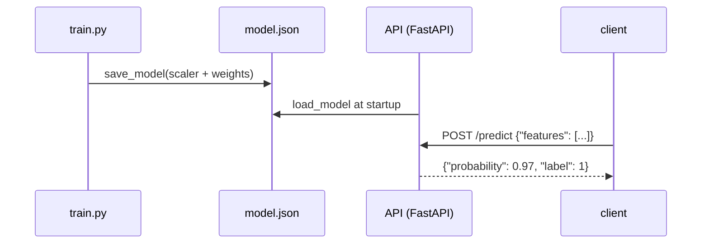

#### Notes

- Training happens once; predicting happens many times somewhere else. Save **everything** prediction needs: scaler stats, weights, feature order, threshold, version.
- JSON is readable, diff-able and safe (unlike pickle, which can run code when loaded).
- NumPy arrays → `.tolist()` to save; `np.array(...)` to load.
- A FastAPI endpoint is ~10 lines (below). Install with `pip install fastapi uvicorn`; run `uvicorn day56:app`.

#### Worked example (serving)

```python
from fastapi import FastAPI
from pydantic import BaseModel

app = FastAPI()
MODEL = load_model("models/cancer.json")

class Req(BaseModel):
    features: list[float]

@app.post("/predict")
def predict(req: Req):
    return predict_one(MODEL, req.features)
```

#### Your task — `day56.py`

- `save_model(path, scaler, model, feature_names, threshold=0.5)` → JSON with `mean, scale, coef, intercept, feature_names, threshold, version=1`.
- `load_model(path)` → dict with NumPy arrays restored.
- `predict_one(m, features)` → `{"probability": p rounded to 4, "label": 0|1}`; raise `ValueError` if the feature count is wrong.

#### Tests

```python
# file: test_day56.py
import json
import tempfile
from pathlib import Path

import numpy as np
from sklearn.datasets import load_breast_cancer

import day56 as ex
from day34 import StandardScaler
from day39 import LogisticRegression


def test_round_trip_same_predictions():
    d = load_breast_cancer()
    s = StandardScaler().fit(d.data)
    m = LogisticRegression(epochs=200).fit(s.transform(d.data), d.target)
    path = Path(tempfile.mkdtemp()) / "m.json"
    ex.save_model(path, s, m, list(d.feature_names))
    assert json.loads(path.read_text())["version"] == 1
    loaded = ex.load_model(path)
    for row in d.data[:20]:
        out = ex.predict_one(loaded, row.tolist())
        p = m.predict_proba(s.transform(row[None]))[0]
        assert np.isclose(out["probability"], round(p, 4)) and out["label"] == int(p >= 0.5)


def test_wrong_length():
    path = Path(tempfile.mkdtemp()) / "m.json"
    s = StandardScaler().fit(np.array([[0.0, 1], [1, 0]]))
    m = LogisticRegression(epochs=5).fit(s.transform(np.array([[0.0, 1], [1, 0]])), np.array([0, 1]))
    ex.save_model(path, s, m, ["a", "b"])
    try:
        ex.predict_one(ex.load_model(path), [1.0])
    except ValueError:
        return
    raise AssertionError("expected ValueError")
```

<details><summary>Reference solution (try first!)</summary>

```python
# file: day56.py
import json
from pathlib import Path

import numpy as np

from day32 import sigmoid


def save_model(path, scaler, model, feature_names, threshold=0.5):
    path = Path(path)
    path.parent.mkdir(parents=True, exist_ok=True)
    path.write_text(json.dumps({
        "version": 1, "feature_names": list(feature_names), "threshold": threshold,
        "mean": scaler.mean_.tolist(), "scale": scaler.scale_.tolist(),
        "coef": model.coef_.tolist(), "intercept": float(model.intercept_)}, indent=1))
    return path


def load_model(path):
    m = json.loads(Path(path).read_text())
    for k in ("mean", "scale", "coef"):
        m[k] = np.array(m[k])
    return m


def predict_one(m, features):
    x = np.asarray(features, float)
    if x.shape != m["mean"].shape:
        raise ValueError(f"expected {len(m['mean'])} features, got {x.size}")
    p = float(sigmoid(((x - m["mean"]) / m["scale"]) @ m["coef"] + m["intercept"]))
    return {"probability": round(p, 4), "label": int(p >= m["threshold"])}
```

</details>

**Done when:** green + (optional) serve it with FastAPI and `curl` a prediction.

---

### Day 57 — Learning curves: diagnosing bias vs variance

**Dataset:** Digits · **Time:** ~2 h

#### Visual

```text
 accuracy                     HIGH BIAS (underfit)        HIGH VARIANCE (overfit)
 1.0 ┤ train ───────          train ────┐                 train ━━━━━━━━━━━━ 1.0
     │        ╲___                       ↓ both low          gap ↕ big
     │ val ___╱‾‾‾  converge   val ─────┘ → bigger model   val ────── → more data / regularise
     └──────────── training-set size
```

#### Notes

- Train on growing subsets; record train and validation scores.
- Both low and close → **high bias**: more features, bigger model.
- Train high, validation much lower → **high variance**: more data, regularisation, simpler model.
- This plot tells you what to do next — far better than guessing.

#### Your task — `day57.py`

- `learning_curve(make_model, X, y, sizes, seed=0)` → `(train_scores, val_scores)` lists; holds out a fixed 25% validation set (seeded), trains on the first `size` rows of the shuffled training part.
- `diagnose(train_score, val_score, target=0.9, gap=0.05)` → `"high bias"` if train < target; elif train − val > gap → `"high variance"`; else `"ok"`.

#### Tests

```python
# file: test_day57.py
from sklearn.datasets import load_digits

import day57 as ex
from day43 import KNNClassifier
from day45 import DecisionTree


def test_curve_shapes_and_trend():
    d = load_digits()
    tr, va = ex.learning_curve(lambda: KNNClassifier(3), d.data, d.target, [50, 200, 800])
    assert len(tr) == len(va) == 3 and va[-1] > va[0]


def test_diagnose():
    assert ex.diagnose(0.7, 0.68) == "high bias"
    assert ex.diagnose(1.0, 0.8) == "high variance"
    assert ex.diagnose(0.95, 0.93) == "ok"


def test_deep_tree_overfits_digits():
    d = load_digits()
    tr, va = ex.learning_curve(lambda: DecisionTree(max_depth=12), d.data, d.target, [600])
    assert ex.diagnose(tr[0], va[0]) == "high variance"
```

<details><summary>Reference solution (try first!)</summary>

```python
# file: day57.py
import numpy as np


def learning_curve(make_model, X, y, sizes, seed=0):
    X, y = np.asarray(X), np.asarray(y)
    idx = np.random.default_rng(seed).permutation(len(y))
    n_val = len(y) // 4
    va, tr = idx[:n_val], idx[n_val:]
    train_scores, val_scores = [], []
    for s in sizes:
        part = tr[:s]
        m = make_model().fit(X[part], y[part])
        train_scores.append(float(np.mean(m.predict(X[part]) == y[part])))
        val_scores.append(float(np.mean(m.predict(X[va]) == y[va])))
    return train_scores, val_scores


def diagnose(train_score, val_score, target=0.9, gap=0.05):
    if train_score < target:
        return "high bias"
    if train_score - val_score > gap:
        return "high variance"
    return "ok"
```

</details>

**Done when:** green + plot the kNN and deep-tree curves on digits side by side.

---

### Day 58 — Project: predicting car fuel efficiency

**Dataset:** Car MPG (398 cars, 1970–82) — `download("mpg")` · **Time:** ~3 h

#### Visual

```text
 mpg vs weight                 model           CV R² (real run)
 45 ┤●                         ─────────────── ─────────────
    │ ●●●                      GBoost (yours)  0.867 ± 0.012
 30 ┤   ●●●●●                  Linear (yours)  0.844 ± 0.031
    │       ●●●●●●●            Ridge  (yours)  0.842 ± 0.032
 10 ┤            ●●●●●●●●      Mean baseline   0.000
    └──────────────────── weight
```

#### Notes

- Full project, regression this time: clean (horsepower has missing values), engineer (one-hot `origin`, `log(weight)`), compare models with CV R², explain results.
- Keep the whole thing in one reproducible script — someone else should get your numbers.

#### Your task — `day58.py`

- `mpg_features(df)` → `(X, names, y)`: drop rows with missing horsepower; numeric `cylinders, displacement, horsepower, weight, acceleration, model_year`, plus `log_weight`, plus one-hot `origin_europe, origin_japan, origin_usa` (sorted).
- `run(df, k=5)` → Day 51-style table for `linear`, `ridge` (alpha 1, scaled), `gboost` using R² (`metric=r2`).

#### Tests

```python
# file: test_day58.py
import numpy as np
import pandas as pd

import day58 as ex


def frame(n=80, seed=0):
    rng = np.random.default_rng(seed)
    w = rng.uniform(1600, 5000, n)
    df = pd.DataFrame({"cylinders": rng.choice([4, 6, 8], n), "displacement": w / 15, "horsepower": w / 30,
                       "weight": w, "acceleration": rng.uniform(8, 24, n), "model_year": rng.integers(70, 83, n),
                       "origin": rng.choice(["usa", "japan", "europe"], n)})
    df["mpg"] = 60 - 0.008 * w + 0.3 * (df.model_year - 70) + rng.normal(0, 1, n)
    df.loc[3, "horsepower"] = np.nan
    return df


def test_features():
    X, names, y = ex.mpg_features(frame())
    assert X.shape == (79, 10) and len(y) == 79
    assert names[-4:] == ["log_weight", "origin_europe", "origin_japan", "origin_usa"]


def test_run():
    table = ex.run(frame())
    assert {r[0] for r in table} == {"linear", "ridge", "gboost"} and table[0][1] > 0.8
```

<details><summary>Reference solution (try first!)</summary>

```python
# file: day58.py
import numpy as np

from day35 import r2
from day36 import LinearRegressionClosed
from day38 import Ridge
from day42 import cross_val_score
from day51 import Scaled
from day52 import GradientBoostingRegressor

NUM = ["cylinders", "displacement", "horsepower", "weight", "acceleration", "model_year"]


def mpg_features(df):
    df = df.dropna(subset=["horsepower"])
    cols = [df[c].to_numpy(float) for c in NUM] + [np.log(df["weight"].to_numpy(float))]
    names = NUM + ["log_weight"]
    for o in sorted(df["origin"].unique()):
        cols.append((df["origin"] == o).to_numpy(float))
        names.append(f"origin_{o}")
    return np.column_stack(cols), names, df["mpg"].to_numpy(float)


def run(df, k=5):
    X, _, y = mpg_features(df)
    models = {"linear": LinearRegressionClosed, "ridge": lambda: Scaled(lambda: Ridge(1.0)),
              "gboost": lambda: GradientBoostingRegressor(150, 0.05, 2)}
    rows = []
    for name, f in models.items():
        s = cross_val_score(f, X, y, k=k, metric=r2, seed=0)
        rows.append((name, round(float(s.mean()), 3), round(float(s.std()), 3)))
    return sorted(rows, key=lambda r: -r[1])


if __name__ == "__main__":
    import pandas as pd
    from day22 import download
    for row in run(pd.read_csv(download("mpg"))):
        print(row)
```

</details>

**Done when:** green + real MPG table + a 5-line write-up.

---

### Day 59 — Explaining models: permutation importance

**Dataset:** Car MPG / Titanic · **Time:** ~2 h

#### Visual

```text
 shuffle ONE column → how much does the score drop?
 weight        ████████████████████  0.41   ← model relies on it heavily
 model_year    ████████▌             0.17
 horsepower    ███                   0.06
 acceleration  ▏                     0.00   ← shuffling it changes nothing
```

#### Notes

- Model-agnostic: works for any model with `predict`.
- Shuffling breaks the link between that feature and the target while keeping its distribution.
- Measure on **validation** data. Repeat a few shuffles and average.
- Correlated features share importance (shuffling one, the model leans on its twin).

#### Your task — `day59.py`

- `permutation_importance(model, X, y, metric, n_repeats=5, seed=0)` → array of mean score drops per feature.
- `rank_features(importances, names)` → list of `(name, importance rounded 3)` sorted desc.

#### Tests

```python
# file: test_day59.py
import numpy as np

import day59 as ex
from day35 import r2
from day36 import LinearRegressionClosed


def test_finds_the_real_feature():
    rng = np.random.default_rng(0)
    X = rng.normal(size=(300, 3))
    y = 5 * X[:, 0] + 0.5 * X[:, 2] + rng.normal(0, 0.1, 300)
    m = LinearRegressionClosed().fit(X, y)
    imp = ex.permutation_importance(m, X, y, r2)
    assert imp.argmax() == 0 and abs(imp[1]) < 0.01 and imp[2] > imp[1]
    assert ex.rank_features(imp, ["a", "b", "c"])[0][0] == "a"


def test_does_not_modify_input():
    X = np.arange(12, dtype=float).reshape(4, 3); y = X[:, 0]
    copy = X.copy()
    ex.permutation_importance(LinearRegressionClosed().fit(X, y), X, y, r2)
    assert np.array_equal(X, copy)
```

<details><summary>Reference solution (try first!)</summary>

```python
# file: day59.py
import numpy as np


def permutation_importance(model, X, y, metric, n_repeats=5, seed=0):
    X = np.asarray(X, float)
    rng = np.random.default_rng(seed)
    base = metric(y, model.predict(X))
    out = np.zeros(X.shape[1])
    for j in range(X.shape[1]):
        drops = []
        for _ in range(n_repeats):
            Xp = X.copy()
            Xp[:, j] = rng.permutation(Xp[:, j])
            drops.append(base - metric(y, model.predict(Xp)))
        out[j] = np.mean(drops)
    return out


def rank_features(importances, names):
    return sorted(((n, round(float(v), 3)) for n, v in zip(names, importances)), key=lambda t: -t[1])
```

</details>

**Done when:** green + importance ranking for your real MPG gradient-boosting model.

---

### Day 60 — Block 2 capstone: `minisklearn` benchmark

**Dataset:** Iris, Wine, Breast Cancer, Digits · **Time:** ~3 h

#### Visual

```text
 minisklearn/                       benchmark: yours vs scikit-learn (test accuracy)
 ├── linear.py   (Days 36-41)       dataset        model     yours   sklearn   Δ     (real run)
 ├── neighbors.py (43)              wine           softmax   0.972   0.972    0.000
 ├── tree.py     (45, 52)           digits         knn5      0.981   0.981    0.000
 ├── ensemble.py (46, 52)           digits         forest    0.972   0.978   -0.006
 ├── cluster.py  (47) decomp (48)   breast_cancer  forest    0.956   0.982   -0.026
 └── metrics.py  (35, 40)
```

#### Notes

- Collect your Block 2 classes into a package `minisklearn/` (copy the classes, keep tests).
- The benchmark proves it: same splits, same settings, yours vs the library.
- Write the README: what each model is, the table, what you learned. This repo is portfolio material.
- Block 3 starts tomorrow: from models you **fit** to networks you **train** — with your own autograd engine.

#### Your task — `day60.py`

- `DATASETS = {"iris": load_iris, "wine": load_wine, "breast_cancer": load_breast_cancer, "digits": load_digits}`.
- `benchmark(pairs, seed=0)` where `pairs` = list of `(dataset_name, model_name, ours_factory, sklearn_factory)` → list of dicts `{dataset, model, ours, sklearn, delta}` (accuracy on a seeded 80/20 split, features standardised on train, all rounded 3).
- `to_markdown(rows)` → table via Day 30's `md_table`.

#### Tests

```python
# file: test_day60.py
from sklearn.linear_model import LogisticRegression as SkLR
from sklearn.neighbors import KNeighborsClassifier

import day60 as ex
from day41 import SoftmaxRegression
from day43 import KNNClassifier


def test_benchmark():
    rows = ex.benchmark([("iris", "knn", lambda: KNNClassifier(5), lambda: KNeighborsClassifier(5)),
                         ("wine", "softmax", lambda: SoftmaxRegression(), lambda: SkLR(max_iter=2000))])
    assert [r["dataset"] for r in rows] == ["iris", "wine"]
    for r in rows:
        assert set(r) == {"dataset", "model", "ours", "sklearn", "delta"}
        assert r["ours"] >= 0.85 and abs(r["delta"]) <= 0.05 and r["delta"] == round(r["ours"] - r["sklearn"], 3)
    md = ex.to_markdown(rows)
    assert md.splitlines()[0] == "| dataset | model | ours | sklearn | delta |" and len(md.splitlines()) == 4
```

<details><summary>Reference solution (try first!)</summary>

```python
# file: day60.py
import numpy as np
from sklearn.datasets import load_breast_cancer, load_digits, load_iris, load_wine

from day30 import md_table
from day34 import StandardScaler
from day35 import train_test_split

DATASETS = {"iris": load_iris, "wine": load_wine, "breast_cancer": load_breast_cancer, "digits": load_digits}


def benchmark(pairs, seed=0):
    rows = []
    for ds, model, ours_f, sk_f in pairs:
        d = DATASETS[ds]()
        Xtr, Xte, ytr, yte = train_test_split(d.data, d.target, seed=seed)
        s = StandardScaler().fit(Xtr)
        a, b = s.transform(Xtr), s.transform(Xte)
        ours = round(float(np.mean(ours_f().fit(a, ytr).predict(b) == yte)), 3)
        sk = round(float(np.mean(sk_f().fit(a, ytr).predict(b) == yte)), 3)
        rows.append({"dataset": ds, "model": model, "ours": ours, "sklearn": sk, "delta": round(ours - sk, 3)})
    return rows


def to_markdown(rows):
    cols = ["dataset", "model", "ours", "sklearn", "delta"]
    return md_table([[r[c] for c in cols] for r in rows], cols)


if __name__ == "__main__":
    from sklearn.ensemble import RandomForestClassifier
    from sklearn.linear_model import LogisticRegression as SkLR
    from sklearn.neighbors import KNeighborsClassifier
    from sklearn.tree import DecisionTreeClassifier
    from day41 import SoftmaxRegression
    from day43 import KNNClassifier
    from day45 import DecisionTree
    from day46 import RandomForest
    pairs = []
    for ds in DATASETS:
        pairs += [(ds, "softmax", SoftmaxRegression, lambda: SkLR(max_iter=3000)),
                  (ds, "knn5", lambda: KNNClassifier(5), lambda: KNeighborsClassifier(5)),
                  (ds, "tree5", lambda: DecisionTree(5), lambda: DecisionTreeClassifier(max_depth=5, random_state=0)),
                  (ds, "forest", lambda: RandomForest(30, 8), lambda: RandomForestClassifier(30, max_depth=8, random_state=0))]
    print(to_markdown(benchmark(pairs)))
```

</details>

**Done when:** green + the full real benchmark table in your `minisklearn` README. **Block 2 complete — `python ai90.py progress`.**

---


## BLOCK 3 — BUILD AN AI FROM SCRATCH (Days 61–90)

You build a deep-learning engine yourself, in NumPy, then grow it into a GPT language model that trains on Shakespeare, generates text, chats, retrieves documents and calls tools. **Every day adds one piece, and the "System after today" line tracks what your AI can do.** No PyTorch needed; a PyTorch/GPU path is given on Day 90 for scaling up.

```text
 Day 61 ─ neuron ─▶ 63 MLP + backprop ─▶ 64 scalar autograd ─▶ 66-67 TENSOR autograd ─▶ 68 nn.Module
   ─▶ 69 optimisers ─▶ 70 LayerNorm/Dropout ─▶ 71 trainer ─▶ 72 conv ─▶ 73-74 language models
   ─▶ 75 data ─▶ 76-78 attention + transformer block ─▶ 79 GPT ─▶ 80 TRAIN IT ─▶ 81 sampling
   ─▶ 82 BPE ─▶ 83-84 eval/checkpoints ─▶ 85 chat fine-tune ─▶ 86 RAG ─▶ 87 tools ─▶ 88 server ─▶ 89 eval ─▶ 90 demo
```

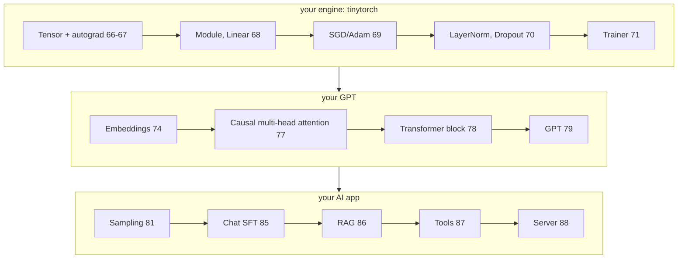

---

### Day 61 — The perceptron

**Dataset:** logic gates; then Iris setosa vs rest · **Time:** ~2 h
**Progress:** `[█░░░░░░░░░░░░░░░░░░░░░░░░░░░░░] 1/30` · **System after today:** one artificial neuron that learns linear rules.

#### Visual

```text
 x1 ──w1──╮
           Σ + b ──▶ step(z) ──▶ 0 / 1          update on a mistake:  w ← w + lr·(y − ŷ)·x
 x2 ──w2──╯
 AND, OR: separable by one line ✔          XOR:  (0,1)●  ○(1,1)     no single line splits ● from ○
                                                  (0,0)○  ●(1,0)     → need hidden layers (Day 62)
```

#### Notes

- Rosenblatt's perceptron (1958): weighted sum, threshold, learn only from mistakes.
- Converges when the data is linearly separable; never converges on XOR. That limit is why we stack layers.

#### Your task — `day61.py`

- `class Perceptron(lr=0.1, epochs=50)` with `fit(X, y)` (labels 0/1), `predict(X)`, `errors_` (mistakes per epoch).
- `GATES = {"AND": ..., "OR": ..., "XOR": ...}` → `(X, y)` for each.

#### Tests

```python
# file: test_day61.py
import numpy as np

import day61 as ex
from day23 import load_iris_xy


def test_and_or_learned():
    for g in ("AND", "OR"):
        X, y = ex.GATES[g]
        p = ex.Perceptron().fit(X, y)
        assert (p.predict(X) == y).all() and p.errors_[-1] == 0


def test_xor_impossible():
    X, y = ex.GATES["XOR"]
    p = ex.Perceptron(epochs=100).fit(X, y)
    assert (p.predict(X) == y).mean() < 1.0 and min(p.errors_) > 0


def test_setosa():
    X, y = load_iris_xy()
    yb = (y == 0).astype(int)
    assert (ex.Perceptron().fit(X, yb).predict(X) == yb).all()
```

<details><summary>Reference solution (try first!)</summary>

```python
# file: day61.py
import numpy as np

_X = np.array([[0, 0], [0, 1], [1, 0], [1, 1]], dtype=float)
GATES = {"AND": (_X, np.array([0, 0, 0, 1])), "OR": (_X, np.array([0, 1, 1, 1])), "XOR": (_X, np.array([0, 1, 1, 0]))}


class Perceptron:
    def __init__(self, lr=0.1, epochs=50):
        self.lr, self.epochs = lr, epochs

    def fit(self, X, y):
        X = np.asarray(X, float)
        self.w_, self.b_, self.errors_ = np.zeros(X.shape[1]), 0.0, []
        for _ in range(self.epochs):
            errs = 0
            for xi, yi in zip(X, y):
                update = self.lr * (yi - self.predict(xi[None])[0])
                self.w_ += update * xi
                self.b_ += update
                errs += int(update != 0)
            self.errors_.append(errs)
        return self

    def predict(self, X):
        return (np.asarray(X, float) @ self.w_ + self.b_ > 0).astype(int)
```

</details>

**Done when:** green. Write one sentence on why XOR fails — the answer motivates all of deep learning.

---

### Day 62 — Multi-layer networks: the forward pass

**Dataset:** XOR · **Time:** ~2 h
**Progress:** `[██░░░░░░░░░░░░░░░░░░░░░░░░░░░░] 2/30` · **System after today:** a network with hidden layers that CAN represent XOR (with hand-set weights).

#### Visual

```text
 input (2) ──W1 (2×2)──▶ hidden (2, tanh) ──W2 (2×1)──▶ output (1, sigmoid)
 shapes for a batch of n:  X (n,2) @ W1 (2,h) + b1 → (n,h) → tanh → @ W2 (h,1) + b2 → (n,1)
 XOR by hand: h1 = OR(x),  h2 = AND(x),  out = h1 AND NOT h2
```

#### Notes

- A layer = matrix multiply + bias + non-linearity. Without the non-linearity, stacked layers collapse into one linear layer.
- Keep a **cache** of every layer's input and output — backprop needs them tomorrow.
- Initialise weights small and random (`N(0,1)/√fan_in`), biases zero. All-zero weights → every neuron learns the same thing.

#### Your task — `day62.py`

- `init_mlp(sizes, seed=0)` → list of `(W, b)` with `W ~ N(0,1)/√fan_in`.
- `forward(params, X, hidden=np.tanh)` → `(output_probs, cache)`; hidden layers use `hidden`, the last layer uses sigmoid; `cache` = list of activations, input first.
- `XOR_PARAMS` → hand-made weights that solve XOR.

#### Tests

```python
# file: test_day62.py
import numpy as np

import day62 as ex
from day61 import GATES


def test_init_shapes():
    p = ex.init_mlp([4, 8, 3], seed=0)
    assert [w.shape for w, _ in p] == [(4, 8), (8, 3)] and [b.shape for _, b in p] == [(8,), (3,)]
    assert abs(p[0][0].std() - 0.5) < 0.2


def test_forward_shapes():
    p = ex.init_mlp([2, 5, 1])
    out, cache = ex.forward(p, np.zeros((7, 2)))
    assert out.shape == (7, 1) and len(cache) == 3 and cache[0].shape == (7, 2)


def test_hand_xor():
    X, y = GATES["XOR"]
    out, _ = ex.forward(ex.XOR_PARAMS, X)
    assert ((out[:, 0] > 0.5).astype(int) == y).all()
```

<details><summary>Reference solution (try first!)</summary>

```python
# file: day62.py
import numpy as np

from day32 import sigmoid


def init_mlp(sizes, seed=0):
    rng = np.random.default_rng(seed)
    return [(rng.normal(0, 1, (a, b)) / np.sqrt(a), np.zeros(b)) for a, b in zip(sizes, sizes[1:])]


def forward(params, X, hidden=np.tanh):
    a = np.asarray(X, float)
    cache = [a]
    for i, (W, b) in enumerate(params):
        z = a @ W + b
        a = sigmoid(z) if i == len(params) - 1 else hidden(z)
        cache.append(a)
    return a, cache


# hidden unit 1 ≈ OR, hidden unit 2 ≈ AND; output = h1 AND NOT h2
XOR_PARAMS = [(np.array([[10.0, 10.0], [10.0, 10.0]]), np.array([-5.0, -15.0])),
              (np.array([[10.0], [-10.0]]), np.array([-5.0]))]
```

</details>

**Done when:** green. Trace `[1, 0]` through `XOR_PARAMS` by hand.

---

### Day 63 — Backpropagation by hand

**Dataset:** XOR, then Breast Cancer · **Time:** ~2.5 h
**Progress:** `[███░░░░░░░░░░░░░░░░░░░░░░░░░░░] 3/30` · **System after today:** a network that LEARNS XOR by itself, gradients verified numerically.

#### Visual

```text
 forward  ──▶   X ─@W1+b1─▶ z1 ─tanh─▶ a1 ─@W2+b2─▶ z2 ─σ─▶ p ─BCE─▶ L
 backward ◀──   dz2 = p − y                       (sigmoid + BCE simplify beautifully)
                dW2 = a1ᵀ dz2 / n     db2 = mean(dz2)
                da1 = dz2 W2ᵀ
                dz1 = da1 · (1 − a1²)              (tanh' = 1 − tanh²)
                dW1 = Xᵀ dz1 / n      db1 = mean(dz1)
```

#### Notes

- Backprop = chain rule applied layer by layer from the loss backwards, reusing cached activations.
- Gradient checking: compare each analytic gradient with Day 32's numerical gradient. Relative error < 1e-6 → correct. **Always** do this when you write a backward pass by hand.
- Training loop: forward → loss → backward → update → repeat.

#### Your task — `day63.py`

- `bce_loss(params, X, y)` → scalar (uses Day 62 `forward`).
- `backward(params, cache, y)` → list of `(dW, db)` for a tanh-hidden, sigmoid-output network with BCE loss (any depth).
- `train(params, X, y, lr=0.5, epochs=2000)` → `(params, losses)`.

#### Tests

```python
# file: test_day63.py
import numpy as np

import day63 as ex
from day61 import GATES
from day62 import forward, init_mlp


def test_gradient_check():
    rng = np.random.default_rng(0)
    X, y = rng.normal(size=(6, 3)), rng.integers(0, 2, 6).astype(float)
    params = init_mlp([3, 4, 4, 1], seed=1)
    _, cache = forward(params, X)
    grads = ex.backward(params, cache, y)
    h = 1e-6
    for (W, b), (dW, db) in zip(params, grads):
        for M, dM in ((W, dW), (b, db)):
            for idx in [(0,) * M.ndim, tuple(s - 1 for s in M.shape)]:
                old = M[idx]
                M[idx] = old + h; lp = ex.bce_loss(params, X, y)
                M[idx] = old - h; lm = ex.bce_loss(params, X, y)
                M[idx] = old
                num = (lp - lm) / (2 * h)
                assert abs(num - dM[idx]) / max(1e-8, abs(num) + abs(dM[idx])) < 1e-5


def test_learns_xor():
    X, y = GATES["XOR"]
    params, losses = ex.train(init_mlp([2, 4, 1], seed=0), X, y.astype(float), lr=0.5, epochs=3000)
    out, _ = forward(params, X)
    assert ((out[:, 0] > 0.5).astype(int) == y).all() and losses[-1] < 0.1
```

<details><summary>Reference solution (try first!)</summary>

```python
# file: day63.py
import numpy as np

from day62 import forward


def bce_loss(params, X, y):
    p, _ = forward(params, X)
    p = np.clip(p[:, 0], 1e-12, 1 - 1e-12)
    return float(-np.mean(y * np.log(p) + (1 - y) * np.log(1 - p)))


def backward(params, cache, y):
    n = len(y)
    grads = [None] * len(params)
    dz = cache[-1] - np.asarray(y, float).reshape(-1, 1)
    for i in range(len(params) - 1, -1, -1):
        a_prev = cache[i]
        grads[i] = (a_prev.T @ dz / n, dz.mean(axis=0))
        if i > 0:
            da = dz @ params[i][0].T
            dz = da * (1 - a_prev ** 2)
    return grads


def train(params, X, y, lr=0.5, epochs=2000):
    params = [(W.copy(), b.copy()) for W, b in params]
    losses = []
    for _ in range(epochs):
        _, cache = forward(params, X)
        grads = backward(params, cache, y)
        params = [(W - lr * dW, b - lr * db) for (W, b), (dW, db) in zip(params, grads)]
        losses.append(bce_loss(params, X, y))
    return params, losses
```

</details>

**Done when:** green — your network discovered XOR on its own. Plot `losses`.

---

### Day 64 — Autograd, part 1: a scalar engine

**Dataset:** none · **Time:** ~2.5 h (follow along with Karpathy's "micrograd" lecture, Zero to Hero #1)
**Progress:** `[████░░░░░░░░░░░░░░░░░░░░░░░░░░] 4/30` · **System after today:** automatic differentiation — you never derive a gradient by hand again.

#### Visual

```text
 a=2 ─╮
       (*) ─▶ c=−6 ─╮
 b=−3 ─╯             (+) ─▶ e=4 ─▶ tanh ─▶ L
 d=10 ──────────────╯
 every Value remembers: data, grad, its parents, and a tiny _backward() for its op.
 L.backward(): topological sort, then call _backward() from L back to the leaves.
 a.grad = ∂L/∂a  — gradients ACCUMULATE (+=) when a value is used twice.
```

#### Notes

- Each operation creates a new `Value` and stores a closure that pushes gradient to its inputs (local derivative × output gradient).
- `+=` not `=` — a value used in two places receives gradient from both.
- Topological order guarantees a node's gradient is complete before it's passed on.

#### Your task — `day64.py`

- `class Value(data)` with `grad`, `+ - * / ** (number exponent)`, unary `-`, reversed ops (`2 * v`), `tanh()`, `exp()`, `relu()`, `backward()`.

#### Tests

```python
# file: test_day64.py
import math

from day64 import Value


def test_simple_graph():
    a, b, d = Value(2.0), Value(-3.0), Value(10.0)
    e = a * b + d
    L = e.tanh()
    L.backward()
    dt = 1 - math.tanh(4) ** 2
    assert math.isclose(L.data, math.tanh(4))
    assert math.isclose(a.grad, dt * -3) and math.isclose(b.grad, dt * 2) and math.isclose(d.grad, dt)


def test_reuse_accumulates():
    a = Value(3.0)
    (a * a + a).backward()
    assert a.grad == 7.0


def test_all_ops_vs_numeric():
    def f(x):
        return ((x * 2 + 1) ** 2 / (x - 5) - (-x).exp() + (x * 3).relu() + 2 - x / 4).tanh() * 3

    x = Value(0.7)
    f(x).backward()
    h = 1e-6
    num = (f(Value(0.7 + h)).data - f(Value(0.7 - h)).data) / (2 * h)
    assert abs(num - x.grad) < 1e-6
```

<details><summary>Reference solution (try first!)</summary>

```python
# file: day64.py
import math


class Value:
    def __init__(self, data, _children=(), _op=""):
        self.data, self.grad = float(data), 0.0
        self._backward, self._prev, self._op = (lambda: None), _children, _op

    def __repr__(self):
        return f"Value(data={self.data:.4f}, grad={self.grad:.4f})"

    @staticmethod
    def _v(x):
        return x if isinstance(x, Value) else Value(x)

    def __add__(self, other):
        other = Value._v(other)
        out = Value(self.data + other.data, (self, other), "+")

        def _backward():
            self.grad += out.grad
            other.grad += out.grad
        out._backward = _backward
        return out

    def __mul__(self, other):
        other = Value._v(other)
        out = Value(self.data * other.data, (self, other), "*")

        def _backward():
            self.grad += other.data * out.grad
            other.grad += self.data * out.grad
        out._backward = _backward
        return out

    def __pow__(self, k):
        out = Value(self.data ** k, (self,), f"**{k}")

        def _backward():
            self.grad += k * self.data ** (k - 1) * out.grad
        out._backward = _backward
        return out

    def tanh(self):
        t = math.tanh(self.data)
        out = Value(t, (self,), "tanh")

        def _backward():
            self.grad += (1 - t * t) * out.grad
        out._backward = _backward
        return out

    def exp(self):
        e = math.exp(self.data)
        out = Value(e, (self,), "exp")

        def _backward():
            self.grad += e * out.grad
        out._backward = _backward
        return out

    def relu(self):
        out = Value(max(0.0, self.data), (self,), "relu")

        def _backward():
            self.grad += (self.data > 0) * out.grad
        out._backward = _backward
        return out

    def __neg__(self):
        return self * -1

    def __sub__(self, other):
        return self + (-Value._v(other))

    def __truediv__(self, other):
        return self * Value._v(other) ** -1

    def __radd__(self, other):
        return self + other

    def __rmul__(self, other):
        return self * other

    def __rsub__(self, other):
        return Value._v(other) - self

    def __rtruediv__(self, other):
        return Value._v(other) * self ** -1

    def backward(self):
        topo, seen = [], set()

        def build(v):
            if v not in seen:
                seen.add(v)
                for c in v._prev:
                    build(c)
                topo.append(v)
        build(self)
        self.grad = 1.0
        for v in reversed(topo):
            v._backward()
```

</details>

**Done when:** green. Draw the graph for `test_simple_graph` with each node's grad written on it.

---

### Day 65 — A neural-net library on your scalar engine

**Dataset:** two moons (`sklearn.datasets.make_moons`, 100 points) · **Time:** ~2 h
**Progress:** `[█████░░░░░░░░░░░░░░░░░░░░░░░░░] 5/30` · **System after today:** neurons, layers and MLPs built on your autograd, classifying a non-linear dataset.

#### Visual

```text
  moons:   ○○○○○                     decision boundary learned by your MLP(2→16→16→1)
         ○       ○   ●●●              ░░░░░░░▓▓▓▓
        ○         ○ ●   ●             ░░░░▓▓▓▓░░░▓▓
                   ●     ●            ░░░▓▓░░░░░░░░▓
                    ●●●●●             a straight line can't do this; your net can
 loss = mean hinge: max(0, 1 − y·score)  + α‖w‖²       y ∈ {−1, +1}
```

#### Notes

- `Neuron(nin)`: weights + bias as `Value`s; `__call__(x) = act(Σ wᵢxᵢ + b)`.
- `Layer(nin, nout)` = list of neurons; `MLP(nin, [16, 16, 1])` = list of layers (last one linear).
- `parameters()` lists every `Value` so the training loop can update them: `p.data -= lr * p.grad`, then **zero the grads**.
- Scalar autograd is slow (one Python object per number) — tomorrow you vectorise it.

#### Your task — `day65.py`

- `Neuron`, `Layer`, `MLP` classes with `__call__` and `parameters()`; `MLP.zero_grad()`.
- `train_moons(steps=60, seed=0)` → `(model, accuracy)` on 100 moons points with hinge loss + L2, SGD lr decaying from 1.0 to 0.1.

#### Tests

```python
# file: test_day65.py
import day65 as ex
from day64 import Value


def test_param_counts():
    assert len(ex.Neuron(3).parameters()) == 4
    assert len(ex.MLP(2, [16, 16, 1]).parameters()) == 2 * 16 + 16 + 16 * 16 + 16 + 16 + 1


def test_forward_and_zero_grad():
    m = ex.MLP(3, [4, 1])
    out = m([1.0, -2.0, 0.5])
    assert isinstance(out, Value)
    out.backward()
    assert any(p.grad != 0 for p in m.parameters())
    m.zero_grad()
    assert all(p.grad == 0 for p in m.parameters())


def test_moons():
    _, acc = ex.train_moons(steps=60, seed=0)
    assert acc >= 0.9
```

<details><summary>Reference solution (try first!)</summary>

```python
# file: day65.py
import random

from day64 import Value


class Neuron:
    def __init__(self, nin, nonlin=True):
        self.w = [Value(random.uniform(-1, 1)) for _ in range(nin)]
        self.b = Value(0.0)
        self.nonlin = nonlin

    def __call__(self, x):
        act = sum((wi * xi for wi, xi in zip(self.w, x)), self.b)
        return act.relu() if self.nonlin else act

    def parameters(self):
        return self.w + [self.b]


class Layer:
    def __init__(self, nin, nout, nonlin=True):
        self.neurons = [Neuron(nin, nonlin) for _ in range(nout)]

    def __call__(self, x):
        out = [n(x) for n in self.neurons]
        return out[0] if len(out) == 1 else out

    def parameters(self):
        return [p for n in self.neurons for p in n.parameters()]


class MLP:
    def __init__(self, nin, nouts):
        sz = [nin] + nouts
        self.layers = [Layer(sz[i], sz[i + 1], nonlin=i != len(nouts) - 1) for i in range(len(nouts))]

    def __call__(self, x):
        for layer in self.layers:
            x = layer(x)
        return x

    def parameters(self):
        return [p for layer in self.layers for p in layer.parameters()]

    def zero_grad(self):
        for p in self.parameters():
            p.grad = 0.0


def train_moons(steps=60, seed=0):
    from sklearn.datasets import make_moons
    random.seed(seed)
    X, y = make_moons(n_samples=100, noise=0.1, random_state=seed)
    y = y * 2 - 1
    model = MLP(2, [16, 16, 1])
    for k in range(steps):
        scores = [model(list(map(float, x))) for x in X]
        losses = [(1 + -float(yi) * s).relu() for yi, s in zip(y, scores)]
        loss = sum(losses) * (1.0 / len(losses)) + 1e-4 * sum(p * p for p in model.parameters())
        model.zero_grad()
        loss.backward()
        lr = 1.0 - 0.9 * k / steps
        for p in model.parameters():
            p.data -= lr * p.grad
    scores = [model(list(map(float, x))) for x in X]
    acc = sum((s.data > 0) == (yi > 0) for yi, s in zip(y, scores)) / len(y)
    return model, acc
```

</details>

**Done when:** green (≥ 90% on moons). Time one training step — note how slow scalar autograd is.

---

### Day 66 — Autograd, part 2: the Tensor engine

**Dataset:** none (gradient checks) · **Time:** ~3 h
**Progress:** `[██████░░░░░░░░░░░░░░░░░░░░░░░░] 6/30` · **System after today:** `tinytorch` is born — a vectorised autograd engine, the foundation of everything after.

#### Visual

```text
 Value (Day 64): one Python object per NUMBER      →  slow
 Tensor (today): one object per ARRAY, numpy maths →  ~1000× faster, same idea
 broadcasting in backward:  x (4,3) + b (3,)  →  out (4,3)
                            b.grad = out.grad.sum(axis=0)   ← "unbroadcast": sum the dims that were stretched
 matmul backward:  C = A @ B     dA = dC @ Bᵀ     dB = Aᵀ @ dC
```

#### Notes

- Same design as `Value`, but `data` and `grad` are NumPy arrays (float64 for exact gradient checks).
- **Unbroadcast**: if an input was broadcast to a bigger shape in the forward pass, sum the gradient back to its original shape.
- `sum(axis)` backward: expand the gradient back over the summed axis. `mean` = sum × 1/n.
- Use an iterative topological sort (deep graphs overflow Python's recursion limit).
- `grad_check(f, inputs)` is your safety net for every new op from now on.

#### Your task — `day66.py`

- `unbroadcast(grad, shape)`.
- `class Tensor(data)` with `data, grad, shape`, ops `+ - * / ** (number) @`, unary `-`, reversed ops, `sum(axis=None, keepdims=False)`, `mean(...)`, `relu()`, `tanh()`, `exp()`, `log()`, `detach()`, `backward()`.
- `grad_check(f, tensors, eps=1e-6)` → max relative error between `backward()` grads and numerical grads of the scalar `f()`.

#### Tests

```python
# file: test_day66.py
import numpy as np

import day66 as ex
from day66 import Tensor


def rnd(*shape, seed=0):
    return Tensor(np.random.default_rng(seed).normal(size=shape))


def test_unbroadcast():
    g = np.ones((4, 3))
    assert ex.unbroadcast(g, (3,)).tolist() == [4, 4, 4]
    assert ex.unbroadcast(g, (4, 1)).shape == (4, 1)


def test_linear_layer_grads():
    x, W, b = rnd(5, 3, seed=1), rnd(3, 4, seed=2), rnd(4, seed=3)
    assert ex.grad_check(lambda: ((x @ W + b).tanh() ** 2).mean(), [x, W, b]) < 1e-6


def test_elementwise_and_reductions():
    a, c = Tensor(np.random.default_rng(4).uniform(0.5, 2, (3, 4))), rnd(1, 4, seed=5)
    f = lambda: ((a * c - c / a + 2 - a).exp().sum(axis=1, keepdims=True).log() + (a - 1).relu().sum(axis=0)).mean()  # noqa: E731
    assert ex.grad_check(f, [a, c]) < 1e-6


def test_batched_matmul_broadcast():
    x, W = rnd(2, 5, 3, seed=6), rnd(3, 4, seed=7)
    assert ex.grad_check(lambda: (x @ W).sum(), [x, W]) < 1e-6


def test_reuse_and_detach():
    a = Tensor([2.0, 3.0])
    (a * a + a.detach()).sum().backward()
    assert a.grad.tolist() == [4.0, 6.0]
```

<details><summary>Reference solution (try first!)</summary>

```python
# file: day66.py
"""tinytorch, part 1 — a NumPy tensor with reverse-mode autograd."""
import numpy as np


def unbroadcast(grad, shape):
    while grad.ndim > len(shape):
        grad = grad.sum(axis=0)
    for i, s in enumerate(shape):
        if s == 1 and grad.shape[i] != 1:
            grad = grad.sum(axis=i, keepdims=True)
    return grad


class Tensor:
    def __init__(self, data, _children=(), _op=""):
        self.data = np.asarray(data, dtype=np.float64)
        self.grad = np.zeros_like(self.data)
        self._backward, self._prev, self._op = (lambda: None), _children, _op

    shape = property(lambda self: self.data.shape)

    def __repr__(self):
        return f"Tensor(shape={self.data.shape}, op={self._op!r})"

    @staticmethod
    def ensure(x):
        return x if isinstance(x, Tensor) else Tensor(x)

    def __add__(self, other):
        other = Tensor.ensure(other)
        out = Tensor(self.data + other.data, (self, other), "+")

        def _backward():
            self.grad += unbroadcast(out.grad, self.data.shape)
            other.grad += unbroadcast(out.grad, other.data.shape)
        out._backward = _backward
        return out

    def __mul__(self, other):
        other = Tensor.ensure(other)
        out = Tensor(self.data * other.data, (self, other), "*")

        def _backward():
            self.grad += unbroadcast(other.data * out.grad, self.data.shape)
            other.grad += unbroadcast(self.data * out.grad, other.data.shape)
        out._backward = _backward
        return out

    def __matmul__(self, other):
        other = Tensor.ensure(other)
        out = Tensor(self.data @ other.data, (self, other), "@")

        def _backward():
            self.grad += unbroadcast(out.grad @ np.swapaxes(other.data, -1, -2), self.data.shape)
            other.grad += unbroadcast(np.swapaxes(self.data, -1, -2) @ out.grad, other.data.shape)
        out._backward = _backward
        return out

    def __pow__(self, k):
        out = Tensor(self.data ** k, (self,), f"**{k}")

        def _backward():
            self.grad += k * self.data ** (k - 1) * out.grad
        out._backward = _backward
        return out

    def sum(self, axis=None, keepdims=False):
        out = Tensor(self.data.sum(axis=axis, keepdims=keepdims), (self,), "sum")

        def _backward():
            g = out.grad
            if axis is not None and not keepdims:
                g = np.expand_dims(g, axis)
            self.grad += np.broadcast_to(g, self.data.shape)
        out._backward = _backward
        return out

    def mean(self, axis=None, keepdims=False):
        s = self.sum(axis=axis, keepdims=keepdims)
        return s * (s.data.size / self.data.size)

    def _unary(self, value, local_grad, op):
        out = Tensor(value, (self,), op)

        def _backward():
            self.grad += local_grad() * out.grad
        out._backward = _backward
        return out

    def relu(self):
        return self._unary(np.maximum(self.data, 0), lambda: (self.data > 0).astype(float), "relu")

    def tanh(self):
        t = np.tanh(self.data)
        return self._unary(t, lambda: 1 - t ** 2, "tanh")

    def exp(self):
        e = np.exp(self.data)
        return self._unary(e, lambda: e, "exp")

    def log(self):
        return self._unary(np.log(self.data), lambda: 1 / self.data, "log")

    def detach(self):
        return Tensor(self.data.copy())

    def __neg__(self):
        return self * -1.0

    def __sub__(self, other):
        return self + (-Tensor.ensure(other))

    def __truediv__(self, other):
        return self * Tensor.ensure(other) ** -1

    def __radd__(self, other):
        return self + other

    def __rmul__(self, other):
        return self * other

    def __rsub__(self, other):
        return Tensor.ensure(other) - self

    def __rtruediv__(self, other):
        return Tensor.ensure(other) * self ** -1

    def backward(self):
        topo, seen, stack = [], set(), [(self, False)]
        while stack:
            node, done = stack.pop()
            if done:
                topo.append(node)
                continue
            if id(node) in seen:
                continue
            seen.add(id(node))
            stack.append((node, True))
            stack.extend((c, False) for c in node._prev if id(c) not in seen)
        self.grad = np.ones_like(self.data)
        for node in reversed(topo):
            node._backward()


def grad_check(f, tensors, eps=1e-6):
    for t in tensors:
        t.grad = np.zeros_like(t.data)
    f().backward()
    analytic = [t.grad.copy() for t in tensors]
    worst = 0.0
    for t, a in zip(tensors, analytic):
        for idx in np.ndindex(t.data.shape):
            old = t.data[idx]
            t.data[idx] = old + eps; fp = float(f().data)
            t.data[idx] = old - eps; fm = float(f().data)
            t.data[idx] = old
            num = (fp - fm) / (2 * eps)
            worst = max(worst, abs(num - a[idx]) / max(1e-4, abs(num) + abs(a[idx])))  # floor: ignore noise on ~0 grads
    return worst
```

</details>

**Done when:** green — every gradient matches finite differences to 1e-6.

---

### Day 67 — Autograd, part 3: the ops a language model needs

**Dataset:** none (gradient checks) · **Time:** ~2.5 h
**Progress:** `[███████░░░░░░░░░░░░░░░░░░░░░░░] 7/30` · **System after today:** reshape, transpose, embedding lookup, softmax and cross-entropy — everything a GPT's maths needs.

#### Visual

```text
 embedding lookup = indexing:  E (vocab × C)   idx [[3, 1], [0, 3]]  →  E[idx]  (2 × 2 × C)
 backward: scatter-ADD rows back:  np.add.at(E.grad, idx, out.grad)   (row 3 used twice → gets both)
 fused cross-entropy (stable):  logp = z − max − log Σ e^{z−max};  loss = −mean logp[target]
 its gradient:  (softmax(z) − onehot(target)) / n         ignore_index rows → gradient 0
```

#### Notes

- Extend Day 66's `Tensor` by attaching new methods (`Tensor.reshape = ...`) — the engine grows day by day.
- `transpose(*axes)` backward = transpose by the inverse permutation (`np.argsort(axes)`).
- `__getitem__` backward uses `np.add.at` (plain `+=` with repeated indices would drop updates).
- Cross-entropy is implemented as **one fused op** — stable and fast. `ignore_index=-1` lets fine-tuning skip prompt tokens (Day 85).

#### Your task — `day67.py`

- Attach to `Tensor`: `reshape(*shape)`, `transpose(*axes)`, `__getitem__(idx)`.
- `softmax(x, axis=-1)` and `log_softmax(x, axis=-1)` built from existing ops (subtract the max as a constant).
- `cross_entropy(logits, targets, ignore_index=-1)` → scalar Tensor; logits `(N, C)`, targets int array `(N,)`.

#### Tests

```python
# file: test_day67.py
import numpy as np

import day67 as ex
from day66 import Tensor, grad_check


def rnd(*shape, seed=0):
    return Tensor(np.random.default_rng(seed).normal(size=shape))


def test_reshape_transpose():
    x = rnd(2, 3, 4)
    assert grad_check(lambda: (x.transpose(0, 2, 1).reshape(2, 12) * np.arange(24).reshape(2, 12)).sum(), [x]) < 1e-6


def test_embedding_lookup_accumulates():
    E = rnd(5, 3)
    idx = np.array([[3, 1], [0, 3]])
    out = E[idx]
    assert out.shape == (2, 2, 3)
    out.sum().backward()
    assert E.grad[3].tolist() == [2, 2, 2] and E.grad[2].tolist() == [0, 0, 0]


def test_softmax():
    x = rnd(3, 4)
    s = ex.softmax(x)
    assert np.allclose(s.data.sum(-1), 1)
    w = np.random.default_rng(9).normal(size=(3, 4))
    assert grad_check(lambda: (ex.softmax(x) * w).sum(), [x]) < 1e-6
    assert grad_check(lambda: (ex.log_softmax(x) * w).sum(), [x]) < 1e-6


def test_cross_entropy():
    logits = rnd(4, 5)
    t = np.array([1, 0, 4, -1])
    loss = ex.cross_entropy(logits, t)
    z = logits.data - logits.data.max(1, keepdims=True)
    logp = z - np.log(np.exp(z).sum(1, keepdims=True))
    assert np.isclose(loss.data, -(logp[0, 1] + logp[1, 0] + logp[2, 4]) / 3)
    assert grad_check(lambda: ex.cross_entropy(logits, t), [logits]) < 1e-6
    loss.backward()
    assert np.allclose(logits.grad[3], 0)
```

<details><summary>Reference solution (try first!)</summary>

```python
# file: day67.py
"""tinytorch, part 2 — shape ops, embedding lookup, softmax, cross-entropy."""
import numpy as np

from day66 import Tensor


def _reshape(self, *shape):
    if len(shape) == 1 and isinstance(shape[0], (tuple, list)):
        shape = tuple(shape[0])
    out = Tensor(self.data.reshape(shape), (self,), "reshape")

    def _backward():
        self.grad += out.grad.reshape(self.data.shape)
    out._backward = _backward
    return out


def _transpose(self, *axes):
    axes = axes or tuple(reversed(range(self.data.ndim)))
    out = Tensor(self.data.transpose(axes), (self,), "transpose")

    def _backward():
        self.grad += out.grad.transpose(np.argsort(axes))
    out._backward = _backward
    return out


def _getitem(self, idx):
    if isinstance(idx, Tensor):
        idx = idx.data.astype(int)
    out = Tensor(self.data[idx], (self,), "getitem")

    def _backward():
        np.add.at(self.grad, idx, out.grad)
    out._backward = _backward
    return out


Tensor.reshape, Tensor.transpose, Tensor.__getitem__ = _reshape, _transpose, _getitem


def softmax(x, axis=-1):
    e = (x - x.data.max(axis=axis, keepdims=True)).exp()
    return e / e.sum(axis=axis, keepdims=True)


def log_softmax(x, axis=-1):
    z = x - x.data.max(axis=axis, keepdims=True)
    return z - z.exp().sum(axis=axis, keepdims=True).log()


def cross_entropy(logits, targets, ignore_index=-1):
    t = np.asarray(targets).astype(int)
    z = logits.data - logits.data.max(axis=1, keepdims=True)
    logp = z - np.log(np.exp(z).sum(axis=1, keepdims=True))
    valid = t != ignore_index
    n = max(int(valid.sum()), 1)
    rows = np.arange(len(t))[valid]
    out = Tensor(-logp[rows, t[valid]].sum() / n, (logits,), "cross_entropy")

    def _backward():
        g = np.exp(logp)
        g[rows, t[valid]] -= 1
        g[~valid] = 0
        logits.grad += g / n * out.grad
    out._backward = _backward
    return out
```

</details>

**Done when:** green. Your engine can now compute a language model's loss.

---

### Day 68 — `nn.Module`: layers on your engine

**Dataset:** Digits (8×8 handwritten, 1,797 images) · **Time:** ~2.5 h
**Progress:** `[████████░░░░░░░░░░░░░░░░░░░░░░] 8/30` · **System after today:** a PyTorch-style layer library on your own engine — a digit classifier at >93%.

#### Visual

```text
 class Module                       Sequential(
   parameters()  → walks attributes   Linear(64, 64),   ← W (64×64), b (64)
   zero_grad()                         ReLU(),
   train() / eval()                    Linear(64, 10))   ← logits for 10 digits
   __call__ → forward                  → cross_entropy(logits, labels) → backward → step
 Linear init: W ~ N(0, 1/fan_in) keeps activations from exploding or vanishing
```

#### Notes

- `Module.parameters()` finds every `Tensor` attribute, and recurses into child `Module`s and lists.
- `Linear(in, out)`: `x @ W + b` — works for `(N, in)` and `(B, T, in)` thanks to batched matmul.
- One training step: `logits = model(Tensor(xb))` → `loss = cross_entropy(logits, yb)` → `model.zero_grad()` → `loss.backward()` → update.
- Same API as PyTorch on purpose — Day 90 ports it in minutes.

#### Your task — `day68.py`

- `class Module` (`parameters`, `zero_grad`, `train`, `eval`, `num_params`, `__call__`).
- `Linear(in_f, out_f, bias=True, seed=0)`, `ReLU`, `Tanh`, `Sequential(*layers)`.
- `train_digits(epochs=30, lr=0.1, seed=0)` → `(model, test_accuracy)` with an 80/20 split, standardised pixels, plain SGD on mini-batches of 64.

#### Tests

```python
# file: test_day68.py
import numpy as np

import day68 as ex
from day66 import Tensor


def test_params_and_counts():
    m = ex.Sequential(ex.Linear(64, 32), ex.ReLU(), ex.Linear(32, 10))
    assert len(m.parameters()) == 4 and m.num_params() == 64 * 32 + 32 + 32 * 10 + 10


def test_linear_3d_input():
    out = ex.Linear(5, 7)(Tensor(np.ones((2, 3, 5))))
    assert out.shape == (2, 3, 7)


def test_zero_grad_and_modes():
    m = ex.Sequential(ex.Linear(3, 2), ex.Tanh())
    m(Tensor(np.ones((4, 3)))).sum().backward()
    assert any(np.abs(p.grad).sum() > 0 for p in m.parameters())
    m.zero_grad()
    assert all(np.abs(p.grad).sum() == 0 for p in m.parameters())
    m.eval()
    assert m.training is False and m.layers[0].training is False


def test_digits():
    _, acc = ex.train_digits(epochs=30)
    assert acc > 0.93
```

<details><summary>Reference solution (try first!)</summary>

```python
# file: day68.py
"""tinytorch, part 3 — nn.Module, Linear, activations, Sequential."""
import numpy as np

from day66 import Tensor
from day67 import cross_entropy


class Module:
    training = True

    def _children(self):
        for v in vars(self).values():
            items = v if isinstance(v, (list, tuple)) else [v]
            for it in items:
                if isinstance(it, (Tensor, Module)):
                    yield it

    def parameters(self):
        out, seen = [], set()
        for c in self._children():
            for p in ([c] if isinstance(c, Tensor) else c.parameters()):
                if id(p) not in seen:
                    seen.add(id(p))
                    out.append(p)
        return out

    def zero_grad(self):
        for p in self.parameters():
            p.grad = np.zeros_like(p.data)

    def train(self, mode=True):
        self.training = mode
        for c in self._children():
            if isinstance(c, Module):
                c.train(mode)
        return self

    def eval(self):
        return self.train(False)

    def num_params(self):
        return sum(p.data.size for p in self.parameters())

    def __call__(self, *args, **kwargs):
        return self.forward(*args, **kwargs)


class Linear(Module):
    def __init__(self, in_f, out_f, bias=True, seed=0):
        rng = np.random.default_rng(seed)
        self.W = Tensor(rng.normal(0, 1, (in_f, out_f)) / np.sqrt(in_f))
        self.b = Tensor(np.zeros(out_f)) if bias else None

    def forward(self, x):
        out = x @ self.W
        return out + self.b if self.b is not None else out


class ReLU(Module):
    def forward(self, x):
        return x.relu()


class Tanh(Module):
    def forward(self, x):
        return x.tanh()


class Sequential(Module):
    def __init__(self, *layers):
        self.layers = list(layers)

    def forward(self, x):
        for layer in self.layers:
            x = layer(x)
        return x


def train_digits(epochs=30, lr=0.1, seed=0):
    from sklearn.datasets import load_digits
    from day34 import StandardScaler
    from day35 import train_test_split
    d = load_digits()
    Xtr, Xte, ytr, yte = train_test_split(d.data, d.target, seed=seed)
    s = StandardScaler().fit(Xtr)
    Xtr, Xte = s.transform(Xtr), s.transform(Xte)
    model = Sequential(Linear(64, 64, seed=seed), ReLU(), Linear(64, 10, seed=seed + 1))
    rng = np.random.default_rng(seed)
    for _ in range(epochs):
        idx = rng.permutation(len(ytr))
        for i in range(0, len(idx), 64):
            b = idx[i:i + 64]
            loss = cross_entropy(model(Tensor(Xtr[b])), ytr[b])
            model.zero_grad()
            loss.backward()
            for p in model.parameters():
                p.data -= lr * p.grad
    acc = float((model(Tensor(Xte)).data.argmax(1) == yte).mean())
    return model, acc
```

</details>

**Done when:** green — a neural network on your own engine reads handwriting.

---

### Day 69 — Optimisers: SGD, momentum, Adam

**Dataset:** a quadratic; Digits · **Time:** ~2 h
**Progress:** `[█████████░░░░░░░░░░░░░░░░░░░░░] 9/30` · **System after today:** the optimiser every modern LLM uses (AdamW), written by you.

#### Visual

```text
 SGD:      w ← w − lr·g
 Momentum: v ← μv + g;           w ← w − lr·v          (a ball rolling — keeps speed through flat bits)
 Adam:     m ← β1 m + (1−β1) g    (average direction)
           v ← β2 v + (1−β2) g²   (average size)
           w ← w − lr · m̂ / (√v̂ + ε)      m̂, v̂ = bias-corrected  → per-parameter step sizes
 AdamW: also w ← w − lr·λ·w  (weight decay, decoupled)
```

#### Notes

- Optimisers hold **state** per parameter (velocity, moments) — that's why they're objects.
- Adam's bias correction (`m / (1 − β1ᵗ)`) fixes the zero-initialised averages in early steps.
- Defaults that work: AdamW `lr=3e-4…1e-3, betas=(0.9, 0.999), weight_decay=0.01–0.1`.

#### Your task — `day69.py`

- `class SGD(params, lr, momentum=0.0)` with `step()` and `zero_grad()`.
- `class Adam(params, lr=1e-3, betas=(0.9, 0.999), eps=1e-8, weight_decay=0.0)` (AdamW-style decay).

#### Tests

```python
# file: test_day69.py
import numpy as np

import day69 as ex
from day66 import Tensor


def minimise(opt_cls, steps, **kw):
    w = Tensor(np.array([5.0, -3.0]))
    opt = opt_cls([w], **kw)
    for _ in range(steps):
        opt.zero_grad()
        ((w - np.array([1.0, 2.0])) ** 2).sum().backward()
        opt.step()
    return w.data


def test_sgd_and_momentum():
    assert np.allclose(minimise(ex.SGD, 200, lr=0.1), [1, 2], atol=1e-4)
    assert np.allclose(minimise(ex.SGD, 200, lr=0.05, momentum=0.9), [1, 2], atol=1e-3)


def test_adam():
    assert np.allclose(minimise(ex.Adam, 500, lr=0.1), [1, 2], atol=1e-3)


def test_adam_first_step_size():
    w = Tensor(np.array([1.0]))
    opt = ex.Adam([w], lr=0.01)
    w.grad = np.array([123.0])
    opt.step()
    assert np.isclose(w.data[0], 0.99, atol=1e-6)   # bias-corrected first step ≈ lr, whatever the gradient size


def test_weight_decay_shrinks():
    w = Tensor(np.array([10.0]))
    opt = ex.Adam([w], lr=0.1, weight_decay=0.5)
    w.grad = np.array([0.0])
    opt.step()
    assert w.data[0] < 10.0
```

<details><summary>Reference solution (try first!)</summary>

```python
# file: day69.py
"""tinytorch, part 4 — optimisers."""
import numpy as np


class SGD:
    def __init__(self, params, lr, momentum=0.0):
        self.params, self.lr, self.momentum = list(params), lr, momentum
        self.v = [np.zeros_like(p.data) for p in self.params]

    def zero_grad(self):
        for p in self.params:
            p.grad = np.zeros_like(p.data)

    def step(self):
        for p, v in zip(self.params, self.v):
            v *= self.momentum
            v += p.grad
            p.data -= self.lr * v


class Adam:
    def __init__(self, params, lr=1e-3, betas=(0.9, 0.999), eps=1e-8, weight_decay=0.0):
        self.params, self.lr, self.betas, self.eps, self.wd = list(params), lr, betas, eps, weight_decay
        self.m = [np.zeros_like(p.data) for p in self.params]
        self.v = [np.zeros_like(p.data) for p in self.params]
        self.t = 0

    def zero_grad(self):
        for p in self.params:
            p.grad = np.zeros_like(p.data)

    def step(self):
        self.t += 1
        b1, b2 = self.betas
        for p, m, v in zip(self.params, self.m, self.v):
            if self.wd:
                p.data -= self.lr * self.wd * p.data
            m[:] = b1 * m + (1 - b1) * p.grad
            v[:] = b2 * v + (1 - b2) * p.grad ** 2
            mhat, vhat = m / (1 - b1 ** self.t), v / (1 - b2 ** self.t)
            p.data -= self.lr * mhat / (np.sqrt(vhat) + self.eps)
```

</details>

**Done when:** green. Retrain Day 68's digits net with Adam(lr=1e-3) and compare loss curves.

---

### Day 70 — LayerNorm and Dropout

**Dataset:** none (gradient checks) · **Time:** ~2 h
**Progress:** `[██████████░░░░░░░░░░░░░░░░░░░░] 10/30` · **System after today:** the two layers that make deep transformers trainable.

#### Visual

```text
 LayerNorm over the LAST axis (each token's features):
   x = [2, 4, 6]  → mean 4, var 8/3 → x̂ = [−1.22, 0, 1.22] → γ·x̂ + β   (γ, β learned)
 Dropout(p=0.5) in TRAINING:  [a, b, c, d] → [2a, 0, 2c, 0]   (scale by 1/(1−p) so the mean is unchanged)
            in EVAL:          [a, b, c, d] → [a, b, c, d]
```

#### Notes

- LayerNorm keeps each token's activations at a steady scale, layer after layer. Built from ops you already have (`mean`, `**`), so autograd handles it for free.
- Dropout randomly zeroes activations while training → the network can't rely on any single unit. Must be **off** in `eval()`.
- Inverted dropout (scale at train time) means inference needs no change.

#### Your task — `day70.py`

- `class LayerNorm(Module)(dim, eps=1e-5)` with `gamma` (ones), `beta` (zeros).
- `class Dropout(Module)(p, seed=0)`.
- `def gelu(x)` → tanh approximation `0.5·x·(1 + tanh(√(2/π)·(x + 0.044715x³)))` from Tensor ops (used by the transformer on Day 78).

#### Tests

```python
# file: test_day70.py
import numpy as np

import day70 as ex
from day66 import Tensor, grad_check


def test_layernorm_stats_and_grad():
    x = Tensor(np.random.default_rng(0).normal(3, 5, (2, 4, 6)))
    ln = ex.LayerNorm(6)
    y = ln(x).data
    assert np.allclose(y.mean(-1), 0, atol=1e-7) and np.allclose(y.var(-1), 1, atol=1e-3)
    ln.gamma.data[:] = np.random.default_rng(1).normal(size=6)
    w = np.random.default_rng(2).normal(size=(2, 4, 6))
    assert grad_check(lambda: (ln(x) * w).sum(), [x, ln.gamma, ln.beta]) < 1e-5


def test_dropout_train_vs_eval():
    d = ex.Dropout(0.5, seed=0)
    x = Tensor(np.ones((1000,)))
    y = d(x).data
    assert set(np.unique(y)) <= {0.0, 2.0} and 0.4 < (y == 0).mean() < 0.6
    d.eval()
    assert np.array_equal(d(x).data, x.data)


def test_gelu():
    x = Tensor(np.array([-3.0, 0.0, 1.0, 3.0]))
    assert np.allclose(ex.gelu(x).data, [-0.00363739, 0.0, 0.84119199, 2.99636261], atol=1e-6)
    assert grad_check(lambda: ex.gelu(x).sum(), [x]) < 1e-6
```

<details><summary>Reference solution (try first!)</summary>

```python
# file: day70.py
"""tinytorch, part 5 — LayerNorm, Dropout, GELU."""
import numpy as np

from day66 import Tensor
from day68 import Module


class LayerNorm(Module):
    def __init__(self, dim, eps=1e-5):
        self.gamma, self.beta, self.eps = Tensor(np.ones(dim)), Tensor(np.zeros(dim)), eps

    def forward(self, x):
        mu = x.mean(axis=-1, keepdims=True)
        xc = x - mu
        var = (xc ** 2).mean(axis=-1, keepdims=True)
        return xc * (var + self.eps) ** -0.5 * self.gamma + self.beta


class Dropout(Module):
    def __init__(self, p, seed=0):
        self.p, self.rng = p, np.random.default_rng(seed)

    def forward(self, x):
        if not self.training or self.p == 0:
            return x
        mask = (self.rng.random(x.shape) >= self.p) / (1 - self.p)
        return x * mask


def gelu(x):
    return 0.5 * x * (1 + (np.sqrt(2 / np.pi) * (x + 0.044715 * x ** 3)).tanh())
```

</details>

**Done when:** green.

---

### Day 71 — A reusable trainer: batches, early stopping, checkpoints

**Dataset:** Digits · **Time:** ~2 h
**Progress:** `[███████████░░░░░░░░░░░░░░░░░░░] 11/30` · **System after today:** a training framework — load data, train, validate, stop early, save, reload.

#### Visual

```text
 epoch  train_loss  val_loss
   1      1.21       0.62
   2      0.41       0.31  ← best so far → save
   3      0.25       0.24  ← best → save
   4      0.17       0.25    patience 1/2
   5      0.12       0.27    patience 2/2 → STOP, restore best weights
```

#### Notes

- Every project repeats the same loop. Write it once: `DataLoader` (shuffled batches), `fit(...)` with validation each epoch.
- Early stopping: stop when validation loss hasn't improved for `patience` epochs; restore the best weights.
- Save parameters with `np.savez` (ordered list from `parameters()`); load back into an identically-built model.

#### Your task — `day71.py`

- `class DataLoader(X, y, batch_size=64, shuffle=True, seed=0)` — iterable of `(xb, yb)`; reshuffles each epoch.
- `fit(model, opt, train_loader, val_data, epochs, patience=3)` → history list of dicts `{epoch, train_loss, val_loss}`; restores the best weights.
- `save_params(model, path)` / `load_params(model, path)`.

#### Tests

```python
# file: test_day71.py
import tempfile
from pathlib import Path

import numpy as np
from sklearn.datasets import load_digits

import day71 as ex
from day34 import StandardScaler
from day35 import train_test_split
from day66 import Tensor
from day68 import Linear, ReLU, Sequential
from day69 import Adam


def test_loader():
    dl = ex.DataLoader(np.arange(10)[:, None], np.arange(10), batch_size=4, seed=0)
    batches = list(dl)
    assert [len(b[1]) for b in batches] == [4, 4, 2]
    assert sorted(np.concatenate([b[1] for b in batches])) == list(range(10))
    assert not np.array_equal(np.concatenate([b[1] for b in dl]), np.concatenate([b[1] for b in batches]))


def test_fit_early_stop_and_checkpoint():
    d = load_digits()
    Xtr, Xva, ytr, yva = train_test_split(d.data, d.target, seed=0)
    s = StandardScaler().fit(Xtr)
    model = Sequential(Linear(64, 64), ReLU(), Linear(64, 10, seed=1))
    hist = ex.fit(model, Adam(model.parameters(), lr=1e-2), ex.DataLoader(s.transform(Xtr), ytr),
                  (s.transform(Xva), yva), epochs=40, patience=2)
    assert len(hist) < 40, "should stop early"
    best = min(h["val_loss"] for h in hist)
    from day67 import cross_entropy
    assert np.isclose(cross_entropy(model(Tensor(s.transform(Xva))), yva).data, best)
    path = Path(tempfile.mkdtemp()) / "m.npz"
    ex.save_params(model, path)
    fresh = Sequential(Linear(64, 64, seed=5), ReLU(), Linear(64, 10, seed=6))
    ex.load_params(fresh, path)
    assert all(np.array_equal(a.data, b.data) for a, b in zip(model.parameters(), fresh.parameters()))
```

<details><summary>Reference solution (try first!)</summary>

```python
# file: day71.py
"""tinytorch, part 6 — DataLoader, fit loop with early stopping, checkpoints."""
import numpy as np

from day66 import Tensor
from day67 import cross_entropy


class DataLoader:
    def __init__(self, X, y, batch_size=64, shuffle=True, seed=0):
        self.X, self.y, self.bs, self.shuffle = np.asarray(X), np.asarray(y), batch_size, shuffle
        self.rng = np.random.default_rng(seed)

    def __iter__(self):
        idx = self.rng.permutation(len(self.y)) if self.shuffle else np.arange(len(self.y))
        for i in range(0, len(idx), self.bs):
            b = idx[i:i + self.bs]
            yield self.X[b], self.y[b]


def fit(model, opt, train_loader, val_data, epochs, patience=3):
    Xv, yv = val_data
    history, best, best_params, waited = [], np.inf, None, 0
    for epoch in range(1, epochs + 1):
        model.train()
        losses = []
        for xb, yb in train_loader:
            loss = cross_entropy(model(Tensor(xb)), yb)
            opt.zero_grad()
            loss.backward()
            opt.step()
            losses.append(float(loss.data))
        model.eval()
        val = float(cross_entropy(model(Tensor(Xv)), yv).data)
        history.append({"epoch": epoch, "train_loss": float(np.mean(losses)), "val_loss": val})
        if val < best:
            best, waited = val, 0
            best_params = [p.data.copy() for p in model.parameters()]
        else:
            waited += 1
            if waited >= patience:
                break
    for p, saved in zip(model.parameters(), best_params):
        p.data[...] = saved
    return history


def save_params(model, path):
    np.savez(path, *[p.data for p in model.parameters()])


def load_params(model, path):
    with np.load(path) as f:
        for i, p in enumerate(model.parameters()):
            p.data[...] = f[f"arr_{i}"]
```

</details>

**Done when:** green. Your engine now has the same training workflow as a real framework.

---

### Day 72 — Convolution from scratch

**Dataset:** Digits as 1×8×8 images · **Time:** ~2.5 h
**Progress:** `[████████████░░░░░░░░░░░░░░░░░░] 12/30` · **System after today:** your engine can see — a differentiable 2-D convolution layer.

#### Visual

```text
 image 8×8        kernel 3×3        feature map 6×6
 ┌─────────┐      ┌───┐
 │▒▒▒░     │  ✱   │1 0│ slide over every 3×3 patch:  out[i,j] = Σ patch · kernel
 │░▒▒▒░    │      │0 1│
 └─────────┘      └───┘
 im2col trick: unfold every patch into a column → convolution becomes ONE matrix multiply
   x (N,C,H,W) ─unfold─▶ cols (N, C·k·k, Ho·Wo);   W (F, C·k·k) @ cols → (N, F, Ho·Wo)
```

#### Notes

- A conv layer shares one small kernel across the whole image → far fewer weights than a Linear layer, and it detects a pattern wherever it appears.
- `unfold` (im2col) is the only new op; its backward "folds" gradients back, adding where patches overlap.
- `np.lib.stride_tricks.sliding_window_view` builds the patches without loops.
- Stride 1, no padding today: output size `H − k + 1`.

#### Your task — `day72.py`

- `unfold(x, k)` → Tensor `(N, C·k·k, Ho·Wo)` with a correct backward.
- `conv2d(x, w, b=None)` with `w (F, C, k, k)`, `b (F,)` → `(N, F, Ho, Wo)`.
- `class Conv2d(Module)(in_c, out_c, k, seed=0)`.

#### Tests

```python
# file: test_day72.py
import numpy as np

import day72 as ex
from day66 import Tensor, grad_check


def naive(x, w, b):
    N, C, H, W = x.shape; F, _, k, _ = w.shape
    out = np.zeros((N, F, H - k + 1, W - k + 1))
    for n in range(N):
        for f in range(F):
            for i in range(H - k + 1):
                for j in range(W - k + 1):
                    out[n, f, i, j] = (x[n, :, i:i + k, j:j + k] * w[f]).sum() + b[f]
    return out


def test_forward_matches_loops():
    rng = np.random.default_rng(0)
    x, w, b = rng.normal(size=(2, 3, 6, 5)), rng.normal(size=(4, 3, 3, 3)), rng.normal(size=4)
    out = ex.conv2d(Tensor(x), Tensor(w), Tensor(b))
    assert out.shape == (2, 4, 4, 3) and np.allclose(out.data, naive(x, w, b))


def test_gradients():
    rng = np.random.default_rng(1)
    x, w, b = Tensor(rng.normal(size=(1, 2, 4, 4))), Tensor(rng.normal(size=(2, 2, 3, 3))), Tensor(rng.normal(size=2))
    assert grad_check(lambda: (ex.conv2d(x, w, b) ** 2).sum(), [x, w, b]) < 1e-6


def test_module():
    layer = ex.Conv2d(1, 8, 3)
    assert layer(Tensor(np.zeros((5, 1, 8, 8)))).shape == (5, 8, 6, 6) and layer.num_params() == 8 * 9 + 8
```

<details><summary>Reference solution (try first!)</summary>

```python
# file: day72.py
"""tinytorch, part 7 — im2col convolution."""
import numpy as np

import day67  # noqa: F401  (adds reshape/transpose to Tensor)
from day66 import Tensor
from day68 import Module


def unfold(x, k):
    N, C, H, W = x.shape
    Ho, Wo = H - k + 1, W - k + 1
    win = np.lib.stride_tricks.sliding_window_view(x.data, (k, k), axis=(2, 3))  # N,C,Ho,Wo,k,k
    cols = win.transpose(0, 1, 4, 5, 2, 3).reshape(N, C * k * k, Ho * Wo)
    out = Tensor(cols, (x,), "unfold")

    def _backward():
        g = out.grad.reshape(N, C, k, k, Ho, Wo)
        for i in range(k):
            for j in range(k):
                x.grad[:, :, i:i + Ho, j:j + Wo] += g[:, :, i, j]
    out._backward = _backward
    return out


def conv2d(x, w, b=None):
    N, C, H, W = x.shape
    F, _, k, _ = w.shape
    out = (w.reshape(F, C * k * k) @ unfold(x, k)).reshape(N, F, H - k + 1, W - k + 1)
    return out + b.reshape(1, F, 1, 1) if b is not None else out


class Conv2d(Module):
    def __init__(self, in_c, out_c, k, seed=0):
        rng = np.random.default_rng(seed)
        self.w = Tensor(rng.normal(0, 1, (out_c, in_c, k, k)) / np.sqrt(in_c * k * k))
        self.b = Tensor(np.zeros(out_c))

    def forward(self, x):
        return conv2d(x, self.w, self.b)
```

</details>

**Done when:** green. Optional: a `Conv2d(1,8,3) → ReLU → reshape → Linear(288,10)` digit classifier with your trainer.

---

### Day 73 — Language model #1: bigram counts

**Dataset:** 32,033 real first names — `download("names")` · **Time:** ~2 h (Karpathy's makemore part 1)
**Progress:** `[█████████████░░░░░░░░░░░░░░░░░] 13/30` · **System after today:** your first text generator — it invents new names.

#### Visual

```text
 ".emma." → pairs: (.,e) (e,m) (m,m) (m,a) (a,.)      "." marks start AND end
 counts N[27×27]:  row = current char, column = next char
          .    a    b    …
   .   [  0  4410 1306 …]   ← names start with "a" most often
   a   [6640  556  541 …]
 P = (N + 1) / row sums        sample: start at ".", draw next char from P[row], repeat until "."
 quality = average negative log-likelihood (lower is better; uniform guessing = ln 27 ≈ 3.30)
```

#### Notes

- A language model assigns probabilities to the next token given the previous ones. Bigram = only the previous **one** character.
- Smoothing (`+1`) stops any probability being zero (which would make NLL infinite).
- NLL is the same cross-entropy you minimised in Day 41 — now you'll minimise it with networks.

#### Your task — `day73.py`

- `build_vocab(words)` → `(stoi, itos)` with `"."` at index 0 and letters sorted.
- `bigram_counts(words, stoi)` → int matrix.
- `probs(counts, smoothing=1)`, `nll(words, P, stoi)` → mean negative log-likelihood per character.
- `sample(P, itos, rng, max_len=30)` → one generated name.

#### Tests

```python
# file: test_day73.py
import numpy as np

import day73 as ex

WORDS = ["emma", "olivia", "ava", "isabella", "sophia", "mia", "amelia", "emily"]


def test_vocab():
    stoi, itos = ex.build_vocab(WORDS)
    assert itos[0] == "." and stoi["a"] == 1 and len(stoi) == len(set("".join(WORDS))) + 1


def test_counts():
    stoi, _ = ex.build_vocab(["ab"])
    N = ex.bigram_counts(["ab"], stoi)
    assert N[0, 1] == 1 and N[1, 2] == 1 and N[2, 0] == 1 and N.sum() == 3


def test_nll_and_sample():
    stoi, itos = ex.build_vocab(WORDS)
    P = ex.probs(ex.bigram_counts(WORDS, stoi))
    assert np.allclose(P.sum(1), 1)
    assert ex.nll(WORDS, P, stoi) < np.log(len(stoi))
    rng = np.random.default_rng(0)
    names = [ex.sample(P, itos, rng) for _ in range(20)]
    assert all(set(n) <= set(stoi) - {"."} for n in names)
```

<details><summary>Reference solution (try first!)</summary>

```python
# file: day73.py
import numpy as np


def build_vocab(words):
    chars = sorted(set("".join(words)))
    stoi = {".": 0, **{c: i + 1 for i, c in enumerate(chars)}}
    return stoi, {i: c for c, i in stoi.items()}


def bigram_counts(words, stoi):
    N = np.zeros((len(stoi), len(stoi)), dtype=int)
    for w in words:
        seq = ["."] + list(w) + ["."]
        for a, b in zip(seq, seq[1:]):
            N[stoi[a], stoi[b]] += 1
    return N


def probs(counts, smoothing=1):
    P = counts + smoothing
    return P / P.sum(axis=1, keepdims=True)


def nll(words, P, stoi):
    total, n = 0.0, 0
    for w in words:
        seq = ["."] + list(w) + ["."]
        for a, b in zip(seq, seq[1:]):
            total -= np.log(P[stoi[a], stoi[b]])
            n += 1
    return total / n


def sample(P, itos, rng, max_len=30):
    out, ix = [], 0
    for _ in range(max_len):
        ix = rng.choice(len(P), p=P[ix])
        if ix == 0:
            break
        out.append(itos[ix])
    return "".join(out)


if __name__ == "__main__":
    from day22 import download
    words = open(download("names")).read().split()
    stoi, itos = build_vocab(words)
    P = probs(bigram_counts(words, stoi))
    print("NLL:", round(nll(words, P, stoi), 3), "(uniform:", round(np.log(27), 3), ")")
    rng = np.random.default_rng(42)
    print([sample(P, itos, rng) for _ in range(10)])
```

</details>

**Done when:** green + real NLL on 32k names (≈ 2.45) + 10 invented names in your dev log.

---

### Day 74 — Language model #2: embeddings + MLP (Bengio 2003)

**Dataset:** names · **Time:** ~2.5 h (Karpathy's makemore part 2)
**Progress:** `[██████████████░░░░░░░░░░░░░░░░] 14/30` · **System after today:** a neural language model with learned embeddings, trained on your engine — beats the bigram.

#### Visual

```text
 context (3 chars)   ". e m"  →  ids [0, 5, 13]
 embedding table C (27 × 10):  each char → a learned 10-number vector
 C[ids] → (3 × 10) → flatten (30) → Linear(30, 128) → tanh → Linear(128, 27) → logits → next char "m"
 similar letters end up with similar vectors (vowels cluster) — the first glimpse of "meaning"
```

#### Notes

- Embeddings turn discrete tokens into trainable vectors. Lookup = your Day 67 `__getitem__`.
- More context than one char → much better predictions.
- `build_dataset` slides a window of `block_size` over each name padded with `"."`.
- Same training loop as Day 71, now on text.

#### Your task — `day74.py`

- `build_dataset(words, stoi, block_size=3)` → `X (n, block_size)` int, `Y (n,)` int.
- `class MLPLM(Module)(vocab, block_size=3, n_embd=10, n_hidden=128, seed=0)`; `forward(X)` → logits `(n, vocab)`.
- `train_lm(model, X, Y, steps, lr=1e-2, batch=64, seed=0)` → list of losses (Adam).

#### Tests

```python
# file: test_day74.py
import numpy as np

import day74 as ex
from day67 import cross_entropy
from day73 import bigram_counts, build_vocab, nll, probs

WORDS = ["emma", "olivia", "ava", "isabella", "sophia", "mia", "amelia", "emily", "harper", "evelyn",
         "abigail", "ella", "elizabeth", "camila", "luna", "sofia", "avery", "mila", "aria", "scarlett"]


def test_dataset():
    stoi, _ = build_vocab(["ab"])
    X, Y = ex.build_dataset(["ab"], stoi, 3)
    assert X.tolist() == [[0, 0, 0], [0, 0, 1], [0, 1, 2]] and Y.tolist() == [1, 2, 0]


def test_beats_bigram_after_training():
    stoi, _ = build_vocab(WORDS)
    X, Y = ex.build_dataset(WORDS, stoi, 3)
    model = ex.MLPLM(len(stoi), 3, 10, 64, seed=0)
    from day66 import Tensor  # noqa: F401
    losses = ex.train_lm(model, X, Y, steps=400, lr=1e-2)
    assert losses[0] > 3.0
    final = float(cross_entropy(model(X), Y).data)
    bigram = nll(WORDS, probs(bigram_counts(WORDS, stoi)), stoi)
    assert final < bigram
```

<details><summary>Reference solution (try first!)</summary>

```python
# file: day74.py
import numpy as np

import day67  # noqa: F401
from day66 import Tensor
from day67 import cross_entropy
from day68 import Linear, Module
from day69 import Adam


def build_dataset(words, stoi, block_size=3):
    X, Y = [], []
    for w in words:
        ctx = [0] * block_size
        for ch in w + ".":
            X.append(ctx)
            Y.append(stoi[ch])
            ctx = ctx[1:] + [stoi[ch]]
    return np.array(X), np.array(Y)


class MLPLM(Module):
    def __init__(self, vocab, block_size=3, n_embd=10, n_hidden=128, seed=0):
        rng = np.random.default_rng(seed)
        self.C = Tensor(rng.normal(0, 1, (vocab, n_embd)))
        self.hidden = Linear(block_size * n_embd, n_hidden, seed=seed + 1)
        self.out = Linear(n_hidden, vocab, seed=seed + 2)
        self.block_size, self.n_embd = block_size, n_embd

    def forward(self, X):
        emb = self.C[np.asarray(X)].reshape(len(X), self.block_size * self.n_embd)
        return self.out(self.hidden(emb).tanh())


def train_lm(model, X, Y, steps, lr=1e-2, batch=64, seed=0):
    rng = np.random.default_rng(seed)
    opt = Adam(model.parameters(), lr=lr)
    losses = []
    for _ in range(steps):
        b = rng.integers(0, len(Y), batch)
        loss = cross_entropy(model(X[b]), Y[b])
        opt.zero_grad()
        loss.backward()
        opt.step()
        losses.append(float(loss.data))
    return losses


if __name__ == "__main__":
    from day22 import download
    from day73 import build_vocab
    words = open(download("names")).read().split()
    stoi, itos = build_vocab(words)
    X, Y = build_dataset(words, stoi)
    m = MLPLM(len(stoi))
    losses = train_lm(m, X, Y, steps=3000, lr=3e-3, batch=128)
    print("final loss:", round(float(np.mean(losses[-200:])), 3), "(bigram ≈ 2.45)")
```

</details>

**Done when:** green + real names loss below 2.45 with `python day74.py`.

---

### Day 75 — Preparing text for a GPT: tokenizer and batches

**Dataset:** Tiny Shakespeare (1.1 M characters) — `download("shakespeare")` · **Time:** ~2 h
**Progress:** `[███████████████░░░░░░░░░░░░░░░] 15/30` · **System after today:** the data pipeline your GPT will eat — text → token ids → (input, target) batches.

#### Visual

```text
 text:     "First Citizen:\nBefore we proceed…"
 encode →  [18, 47, 56, 57, 58, 1, 15, 47, …]           (65 unique characters)
 block_size = 8 →  one training example holds 8 predictions:
   x = [18, 47, 56, 57, 58,  1, 15, 47]
   y = [47, 56, 57, 58,  1, 15, 47, 58]     ← x shifted left by one
   given "F" predict "i"; given "Fi" predict "r"; … given "First Ci" predict "t"
```

#### Notes

- Character-level tokenizer: vocabulary = sorted unique characters. Simple, no unknown tokens. (BPE on Day 82.)
- Split 90/10 by position (the end of the text is validation — no shuffling text).
- `get_batch` picks random start positions and returns `x (B, T)` and `y (B, T)` = `x` shifted by one.

#### Your task — `day75.py`

- `class CharTokenizer(text)` with `vocab_size`, `stoi`, `itos`, `encode(s)`, `decode(ids)`.
- `split(ids, frac=0.9)` → `(train, val)` arrays.
- `get_batch(data, block_size, batch_size, rng)` → `(x, y)`.

#### Tests

```python
# file: test_day75.py
import numpy as np

import day75 as ex

TEXT = "First Citizen:\nBefore we proceed any further, hear me speak.\n"


def test_tokenizer_round_trip():
    tok = ex.CharTokenizer(TEXT)
    assert tok.vocab_size == len(set(TEXT)) and tok.itos[0] == "\n"
    assert tok.decode(tok.encode("hear me")) == "hear me"


def test_split_and_batch():
    tok = ex.CharTokenizer(TEXT)
    ids = np.array(tok.encode(TEXT))
    tr, va = ex.split(ids, 0.9)
    assert len(tr) == int(len(ids) * 0.9) and np.array_equal(np.concatenate([tr, va]), ids)
    x, y = ex.get_batch(tr, 8, 4, np.random.default_rng(0))
    assert x.shape == y.shape == (4, 8)
    assert np.array_equal(x[:, 1:], y[:, :-1])
    for row in x:
        start = next(i for i in range(len(tr) - 8) if np.array_equal(tr[i:i + 8], row))
        assert start + 8 < len(tr)
```

<details><summary>Reference solution (try first!)</summary>

```python
# file: day75.py
import numpy as np


class CharTokenizer:
    def __init__(self, text):
        chars = sorted(set(text))
        self.stoi = {c: i for i, c in enumerate(chars)}
        self.itos = {i: c for i, c in enumerate(chars)}
        self.vocab_size = len(chars)

    def encode(self, s):
        return [self.stoi[c] for c in s]

    def decode(self, ids):
        return "".join(self.itos[int(i)] for i in ids)


def split(ids, frac=0.9):
    n = int(len(ids) * frac)
    return ids[:n], ids[n:]


def get_batch(data, block_size, batch_size, rng):
    starts = rng.integers(0, len(data) - block_size - 1, batch_size)
    x = np.stack([data[s:s + block_size] for s in starts])
    y = np.stack([data[s + 1:s + block_size + 1] for s in starts])
    return x, y


if __name__ == "__main__":
    from day22 import download
    text = open(download("shakespeare"), encoding="utf-8").read()
    tok = CharTokenizer(text)
    print(len(text), "chars,", tok.vocab_size, "tokens:", repr("".join(tok.itos.values())))
```

</details>

**Done when:** green. The data pipeline for your GPT is ready.

---


### Day 76 — Self-attention, step by step (NumPy)

**Dataset:** toy matrices · **Time:** ~2 h (Karpathy's "Let's build GPT", first hour)
**Progress:** `[████████████████░░░░░░░░░░░░░░] 16/30` · **System after today:** you understand the one mechanism behind every modern LLM.

#### Visual

```text
 each token makes: query q ("what am I looking for?"), key k ("what do I contain?"), value v ("what I'll share")
 scores = q·kᵀ / √d     →  causal mask (no peeking at the future)  →  softmax  →  weighted sum of v
              t1   t2   t3   t4                    weights after softmax
        t1 [ 2.1   ✗    ✗    ✗ ]                  t1 [1.00  0    0    0  ]
        t2 [ 0.3  1.7   ✗    ✗ ]       ──▶        t2 [0.20 0.80  0    0  ]
        t3 [ 1.2  0.1  0.9   ✗ ]                  t3 [0.46 0.15 0.39  0  ]
        t4 [ 0.4  0.8  0.2  1.5]                  t4 [0.15 0.23 0.12 0.50]   each row sums to 1
```

#### Notes

- Attention lets every token gather information from earlier tokens, weighted by relevance.
- Divide by `√d` so scores don't grow with dimension (which would make softmax too peaky).
- Causal mask: set future positions to `−∞` before softmax → weight 0. This is what makes it a *language model* (predict next, never see next).
- Today in plain NumPy (no autograd) so you can see every number; tomorrow it becomes a trainable layer.

#### Your task — `day76.py`

- `causal_mask(T)` → boolean lower-triangular `(T, T)`.
- `attention(q, k, v, causal=True)` → `(out, weights)`; works for `(T, d)` and batched `(..., T, d)`.

#### Tests

```python
# file: test_day76.py
import numpy as np

import day76 as ex


def test_mask():
    assert ex.causal_mask(3).tolist() == [[True, False, False], [True, True, False], [True, True, True]]


def test_causal_attention():
    rng = np.random.default_rng(0)
    q, k, v = rng.normal(size=(4, 8)), rng.normal(size=(4, 8)), rng.normal(size=(4, 8))
    out, w = ex.attention(q, k, v)
    assert np.allclose(w.sum(-1), 1) and np.allclose(np.triu(w, 1), 0)
    assert np.allclose(out[0], v[0]), "the first token can only attend to itself"
    s = q[2] @ k[:3].T / np.sqrt(8)
    p = np.exp(s - s.max()); p /= p.sum()
    assert np.allclose(out[2], p @ v[:3])


def test_batched_noncausal():
    rng = np.random.default_rng(1)
    q = rng.normal(size=(2, 3, 5, 4))
    out, w = ex.attention(q, q, q, causal=False)
    assert out.shape == (2, 3, 5, 4) and w.shape == (2, 3, 5, 5) and (w > 0).all()
```

<details><summary>Reference solution (try first!)</summary>

```python
# file: day76.py
import numpy as np


def causal_mask(T):
    return np.tril(np.ones((T, T), dtype=bool))


def attention(q, k, v, causal=True):
    d, T = q.shape[-1], q.shape[-2]
    scores = q @ np.swapaxes(k, -1, -2) / np.sqrt(d)
    if causal:
        scores = np.where(causal_mask(T), scores, -np.inf)
    w = np.exp(scores - scores.max(axis=-1, keepdims=True))
    w = w / w.sum(axis=-1, keepdims=True)
    return w @ v, w
```

</details>

**Done when:** green. Print the weights matrix for 4 random tokens and read it row by row.

---

### Day 77 — Causal multi-head attention as a trainable layer

**Dataset:** none (gradient checks) · **Time:** ~2.5 h
**Progress:** `[█████████████████░░░░░░░░░░░░░] 17/30` · **System after today:** a differentiable multi-head self-attention layer in your own engine.

#### Visual

```text
 x (B,T,C) ──Linear(C, 3C)──▶ q | k | v  each (B,T,C)
   split into h heads:  (B,T,C) → reshape (B,T,h,C/h) → transpose → (B,h,T,C/h)
   per head: softmax(q kᵀ/√d + mask) v         heads run in parallel (batched matmul)
   merge: (B,h,T,d) → transpose → (B,T,h,d) → reshape (B,T,C) ──Linear(C,C)──▶ out
 multiple heads = multiple "questions" asked at once (one tracks syntax, one tracks names, …)
```

#### Notes

- One `Linear(C, 3C)` computes q, k, v together; slice with `qkv[:, :, :C]` etc. (your `__getitem__` handles slices).
- Mask as an additive constant: `0` where allowed, `−1e9` where not (avoids `inf − inf = nan`).
- Test causality directly: change the last token; outputs for earlier positions must not change.
- Fun fact your gradient check will reveal: the **key** bias gets zero gradient — adding the same number to every score in a row doesn't change a softmax.

#### Your task — `day77.py`

- `class CausalSelfAttention(Module)(n_embd, n_head, seed=0)` with `qkv` and `proj` Linear layers; `forward(x)` for `x` of shape `(B, T, C)`.

#### Tests

```python
# file: test_day77.py
import numpy as np

import day77 as ex
from day66 import Tensor, grad_check


def test_shape_and_params():
    a = ex.CausalSelfAttention(16, 4)
    assert a(Tensor(np.zeros((2, 5, 16)))).shape == (2, 5, 16)
    assert a.num_params() == 16 * 48 + 48 + 16 * 16 + 16


def test_causal():
    a = ex.CausalSelfAttention(8, 2, seed=1)
    x = np.random.default_rng(0).normal(size=(1, 6, 8))
    y1 = a(Tensor(x)).data
    x2 = x.copy(); x2[0, -1] += 5.0
    y2 = a(Tensor(x2)).data
    assert np.allclose(y1[0, :-1], y2[0, :-1]) and not np.allclose(y1[0, -1], y2[0, -1])


def test_gradients():
    a = ex.CausalSelfAttention(4, 2, seed=2)
    x = Tensor(np.random.default_rng(3).normal(size=(1, 3, 4)))
    w = np.random.default_rng(4).normal(size=(1, 3, 4))
    assert grad_check(lambda: (a(x) * w).sum(), [x] + a.parameters()) < 1e-5
```

<details><summary>Reference solution (try first!)</summary>

```python
# file: day77.py
import numpy as np

import day67  # noqa: F401
from day67 import softmax
from day68 import Linear, Module


class CausalSelfAttention(Module):
    def __init__(self, n_embd, n_head, seed=0):
        assert n_embd % n_head == 0
        self.qkv = Linear(n_embd, 3 * n_embd, seed=seed)
        self.proj = Linear(n_embd, n_embd, seed=seed + 1)
        self.n_head = n_head

    def forward(self, x):
        B, T, C = x.shape
        h, d = self.n_head, C // self.n_head
        qkv = self.qkv(x)
        q, k, v = (qkv[:, :, i * C:(i + 1) * C].reshape(B, T, h, d).transpose(0, 2, 1, 3) for i in range(3))
        mask = np.where(np.tril(np.ones((T, T))) == 1, 0.0, -1e9)
        att = softmax((q @ k.transpose(0, 1, 3, 2)) * (d ** -0.5) + mask)
        y = (att @ v).transpose(0, 2, 1, 3).reshape(B, T, C)
        return self.proj(y)
```

</details>

**Done when:** green — gradients through attention verified to 1e-5.

---

### Day 78 — The transformer block

**Dataset:** none · **Time:** ~2 h
**Progress:** `[██████████████████░░░░░░░░░░░░] 18/30` · **System after today:** the full repeating unit of GPT.

#### Visual

```text
        x ─────────────────────┐                  pre-norm transformer block (GPT-2 style)
        │                      │
   LayerNorm → CausalSelfAttention ─(+)─▶ x'       "communicate": tokens exchange information
        x' ────────────────────┐
        │                      │
   LayerNorm → Linear(C,4C) → GELU → Linear(4C,C) ─(+)─▶ out    "compute": each token thinks alone
 the (+) residual paths let gradients flow straight through many stacked blocks
```

#### Notes

- Attention mixes information **across** tokens; the MLP processes each token **independently**.
- Residual connections (`x + f(x)`) are why 100-layer transformers train at all.
- Pre-norm (LayerNorm before each sub-layer) is the stable modern choice.
- Check every parameter receives a gradient — a common bug is a layer that's created but never used.

#### Your task — `day78.py`

- `class FeedForward(Module)(n_embd, seed=0)` → `Linear(C,4C) → gelu → Linear(4C,C)`.
- `class Block(Module)(n_embd, n_head, seed=0)` with `ln1, attn, ln2, mlp`.

#### Tests

```python
# file: test_day78.py
import numpy as np

import day78 as ex
from day66 import Tensor, grad_check


def test_shape_and_params():
    b = ex.Block(8, 2)
    assert b(Tensor(np.zeros((2, 4, 8)))).shape == (2, 4, 8)
    assert b.num_params() == 12 * 8 * 8 + 13 * 8


def test_every_param_gets_gradient():
    b = ex.Block(8, 2, seed=1)
    b(Tensor(np.random.default_rng(0).normal(size=(2, 4, 8)))).sum().backward()
    assert all(np.abs(p.grad).sum() > 0 for p in b.parameters())


def test_gradcheck_small():
    b = ex.Block(4, 2, seed=2)
    x = Tensor(np.random.default_rng(1).normal(size=(1, 2, 4)))
    w = np.random.default_rng(2).normal(size=(1, 2, 4))
    assert grad_check(lambda: (b(x) * w).sum(), [x] + b.parameters()) < 1e-4
```

<details><summary>Reference solution (try first!)</summary>

```python
# file: day78.py
from day68 import Linear, Module
from day70 import LayerNorm, gelu
from day77 import CausalSelfAttention


class FeedForward(Module):
    def __init__(self, n_embd, seed=0):
        self.fc = Linear(n_embd, 4 * n_embd, seed=seed)
        self.proj = Linear(4 * n_embd, n_embd, seed=seed + 1)

    def forward(self, x):
        return self.proj(gelu(self.fc(x)))


class Block(Module):
    def __init__(self, n_embd, n_head, seed=0):
        self.ln1, self.ln2 = LayerNorm(n_embd), LayerNorm(n_embd)
        self.attn = CausalSelfAttention(n_embd, n_head, seed=seed)
        self.mlp = FeedForward(n_embd, seed=seed + 2)

    def forward(self, x):
        x = x + self.attn(self.ln1(x))
        return x + self.mlp(self.ln2(x))
```

</details>

**Done when:** green.

---

### Day 79 — GPT: the whole model

**Dataset:** none (shape + initial-loss checks) · **Time:** ~2 h
**Progress:** `[███████████████████░░░░░░░░░░░] 19/30` · **System after today:** a complete GPT architecture — same design as GPT-2, at toy size, on your own engine.

#### Visual

```text
 idx (B,T) ──▶ token embedding (V×C)[idx]  +  position embedding (block×C)[0..T-1]
           ──▶ Block × n_layer
           ──▶ LayerNorm ──▶ Linear(C, V) ──▶ logits (B,T,V)  ──▶ cross-entropy vs targets (B,T)
 untrained model ≈ uniform guess → loss ≈ ln(V)   (V=65 chars → 4.17)  ← your first sanity check
 params = V·C + block·C + n_layer·(12C² + 13C) + 2C + C·V
```

#### Notes

- Position embeddings tell the model *where* each token is (attention itself is order-blind).
- Initialise embeddings small (`N(0, 0.02)`) and the output head small, so the starting loss is ≈ `ln V`. If it isn't, something is wrong — check before training.
- Reject sequences longer than `block_size` (there's no position embedding for them).

#### Your task — `day79.py`

- `class GPT(Module)(vocab_size, block_size, n_embd=32, n_head=4, n_layer=2, seed=0)`; `forward(idx, targets=None)` → `(logits, loss or None)`; raise `ValueError` if `T > block_size`.

#### Tests

```python
# file: test_day79.py
import numpy as np

import day79 as ex


def test_shapes_and_loss_at_init():
    V = 65
    m = ex.GPT(V, block_size=16, n_embd=32, n_head=4, n_layer=2)
    idx = np.random.default_rng(0).integers(0, V, (3, 16))
    logits, loss = m(idx, idx)
    assert logits.shape == (3, 16, V)
    assert abs(float(loss.data) - np.log(V)) < 0.3
    assert m(idx)[1] is None


def test_param_count():
    V, B, C, L = 20, 8, 16, 3
    m = ex.GPT(V, B, C, 2, L)
    assert m.num_params() == V * C + B * C + L * (12 * C * C + 13 * C) + 2 * C + C * V


def test_too_long():
    m = ex.GPT(10, 4, 8, 2, 1)
    try:
        m(np.zeros((1, 5), dtype=int))
    except ValueError:
        return
    raise AssertionError("expected ValueError for T > block_size")
```

<details><summary>Reference solution (try first!)</summary>

```python
# file: day79.py
import numpy as np

from day66 import Tensor
from day67 import cross_entropy
from day68 import Linear, Module
from day70 import LayerNorm
from day78 import Block


class GPT(Module):
    def __init__(self, vocab_size, block_size, n_embd=32, n_head=4, n_layer=2, seed=0):
        rng = np.random.default_rng(seed)
        self.vocab_size, self.block_size = vocab_size, block_size
        self.tok_emb = Tensor(rng.normal(0, 0.02, (vocab_size, n_embd)))
        self.pos_emb = Tensor(rng.normal(0, 0.02, (block_size, n_embd)))
        self.blocks = [Block(n_embd, n_head, seed=seed + 10 * (i + 1)) for i in range(n_layer)]
        self.ln_f = LayerNorm(n_embd)
        self.head = Linear(n_embd, vocab_size, bias=False, seed=seed + 1)
        self.head.W.data *= 0.1

    def forward(self, idx, targets=None):
        idx = np.asarray(idx)
        B, T = idx.shape
        if T > self.block_size:
            raise ValueError(f"sequence length {T} > block_size {self.block_size}")
        x = self.tok_emb[idx] + self.pos_emb[np.arange(T)]
        for block in self.blocks:
            x = block(x)
        logits = self.head(self.ln_f(x))
        if targets is None:
            return logits, None
        loss = cross_entropy(logits.reshape(B * T, self.vocab_size), np.asarray(targets).reshape(-1))
        return logits, loss
```

</details>

**Done when:** green — the starting loss is ≈ ln V, so the model is wired correctly.

---

### Day 80 — Train your GPT

**Dataset:** Tiny Shakespeare · **Time:** ~3 h (training runs in the background while you read)
**Progress:** `[████████████████████░░░░░░░░░░] 20/30` · **System after today:** **your own GPT, trained by your own engine, writing Shakespeare-ish text.** 🎯

#### Visual

```text
 REAL run of this day's script: 110,464 params, 1,500 steps, batch 16, ~0.075 s/step on a laptop CPU (~2 min)
 loss
 4.16 ┤●                      step    0: random characters
      │
 2.70 ┤  ●                    step  250: letters, spaces, line breaks
 2.34 ┤    ●
 2.18 ┤      ●                step 1000: words, names, speaker labels
 2.07 ┤        ●
 1.99 ┤          ●            step 1500: train 1.89 · val 1.99
      └────────────────── steps (×250)
 sample at temperature 0.8, top-k 20, prompt "ROMEO:":
   ROMEO:
   Hadgive wich this keared you, fare my hears, boke.
   I have a dand dreast withis slest.
```

#### Notes

- Loop: `get_batch` (Day 75) → `model(x, y)` → `zero_grad` → `backward` → `Adam.step` → log.
- Sanity check first: a model must be able to **memorise** a tiny repeated text. If it can't, there's a bug — don't train for hours.
- Expect ≈ 2.0 validation loss after 1,500 steps (~2 min on CPU) at this size; ~1.7 with 5,000+ steps and n_embd=128. Real GPTs are this exact loop with more data, parameters and GPUs (Day 90).
- Print a sample every few hundred steps — watching it learn spelling is the best moment of the course.

#### Your task — `day80.py`

- `train_gpt(model, data, steps, batch_size, lr=3e-3, seed=0, log_every=0, log=print)` → list of losses (Adam).
- `memorise_check(text, steps=150, seed=0)` → `(first_loss, last_loss)` for a tiny model on a repeated text.

#### Tests

```python
# file: test_day80.py
import numpy as np

import day80 as ex
from day75 import CharTokenizer
from day79 import GPT


def test_memorise_tiny_text():
    first, last = ex.memorise_check("hello world! " * 40, steps=150)
    assert first > 2.0 and last < first * 0.35


def test_train_returns_history():
    tok = CharTokenizer("abcabcabc abc")
    data = np.array(tok.encode("abcabcabc abc" * 10))
    m = GPT(tok.vocab_size, 8, 16, 2, 1)
    hist = ex.train_gpt(m, data, steps=20, batch_size=4)
    assert len(hist) == 20 and all(np.isfinite(hist))
```

<details><summary>Reference solution (try first!)</summary>

```python
# file: day80.py
import numpy as np

from day69 import Adam
from day75 import CharTokenizer, get_batch
from day79 import GPT


def train_gpt(model, data, steps, batch_size, lr=3e-3, seed=0, log_every=0, log=print):
    rng = np.random.default_rng(seed)
    opt = Adam(model.parameters(), lr=lr)
    model.train()
    history = []
    for step in range(steps):
        x, y = get_batch(data, model.block_size, batch_size, rng)
        _, loss = model(x, y)
        opt.zero_grad()
        loss.backward()
        opt.step()
        history.append(float(loss.data))
        if log_every and step % log_every == 0:
            log(f"step {step:5d}  loss {np.mean(history[-log_every:]):.3f}")
    return history


def memorise_check(text, steps=150, seed=0):
    tok = CharTokenizer(text)
    data = np.array(tok.encode(text))
    model = GPT(tok.vocab_size, block_size=8, n_embd=16, n_head=2, n_layer=1, seed=seed)
    h = train_gpt(model, data, steps, batch_size=8, lr=1e-2, seed=seed)
    return float(np.mean(h[:5])), float(np.mean(h[-10:]))


if __name__ == "__main__":
    from day22 import download
    from day71 import save_params
    from day75 import split
    text = open(download("shakespeare"), encoding="utf-8").read()
    tok = CharTokenizer(text)
    train, val = split(np.array(tok.encode(text)))
    model = GPT(tok.vocab_size, block_size=32, n_embd=64, n_head=4, n_layer=2)
    print(f"{model.num_params():,} parameters")
    train_gpt(model, train, steps=1500, batch_size=16, lr=3e-3, log_every=100)
    save_params(model, "models/gpt_shakespeare.npz")
```

</details>

**Done when:** green + `python day80.py` trains on real Shakespeare and saves `models/gpt_shakespeare.npz`. Log the loss curve in your dev log.

---

### Day 81 — Generating text: temperature, top-k, top-p

**Dataset:** your trained Shakespeare GPT · **Time:** ~2 h
**Progress:** `[█████████████████████░░░░░░░░░] 21/30` · **System after today:** your GPT **talks** — controllable text generation.

#### Visual

```text
 next-char probabilities after "To be or not to b":
   e ████████████████ 0.62     temperature 0.5 → sharper:  e ███████████████████████ 0.89
   a ████ 0.15                 temperature 1.5 → flatter:  e ██████████ 0.38, a █████ 0.20 …
   u ██ 0.08                   top-k=2  → only {e, a} can be picked
   … (62 more)                 top-p=0.8 → smallest set whose probabilities sum ≥ 0.8
 generation loop: ctx = last block_size ids → logits[-1] → filter → sample → append → repeat
```

#### Notes

- Temperature divides logits: `< 1` = safer/more repetitive; `> 1` = more creative/chaotic; `0` = greedy (always the most likely).
- Top-k and top-p (nucleus) cut off the long tail of unlikely tokens — they remove most nonsense.
- The context window slides: only the last `block_size` tokens are fed in.
- Switch the model to `eval()` before generating (turns dropout off).

#### Your task — `day81.py`

- `top_k_filter(logits, k)` → logits with all but the top k set to `-inf`.
- `top_p_filter(probs, p)` → probs zeroed outside the nucleus, renormalised (always keep the top token).
- `sample_next(logits, rng, temperature=1.0, top_k=None, top_p=None)` → int (temperature 0 → argmax).
- `generate(model, ids, max_new_tokens, rng, temperature=1.0, top_k=None, top_p=None)` → list of ids (prompt + new).

#### Tests

```python
# file: test_day81.py
import numpy as np

import day81 as ex
from day75 import CharTokenizer
from day79 import GPT
from day80 import train_gpt


def test_filters():
    z = np.array([1.0, 3.0, 2.0, 0.0])
    assert np.isinf(ex.top_k_filter(z, 2)[[0, 3]]).all() and ex.top_k_filter(z, 2)[1] == 3.0
    p = ex.top_p_filter(np.array([0.5, 0.3, 0.15, 0.05]), 0.75)
    assert np.allclose(p, [0.625, 0.375, 0, 0])
    assert ex.top_p_filter(np.array([0.9, 0.1]), 0.1).tolist() == [1.0, 0.0]


def test_sample_next():
    rng = np.random.default_rng(0)
    assert ex.sample_next(np.array([0.1, 5.0, 0.2]), rng, temperature=0) == 1
    picks = {ex.sample_next(np.array([5.0, 4.9, -9, -9]), rng, top_k=2) for _ in range(50)}
    assert picks == {0, 1}


def test_generate_continues_memorised_text():
    text = "hello world! " * 40
    tok = CharTokenizer(text)
    m = GPT(tok.vocab_size, 8, 16, 2, 1, seed=0)
    train_gpt(m, np.array(tok.encode(text)), steps=300, batch_size=8, lr=1e-2)
    out = ex.generate(m, tok.encode("hello"), 8, np.random.default_rng(0), temperature=0)
    assert len(out) == 13 and tok.decode(out).startswith("hello world")
```

<details><summary>Reference solution (try first!)</summary>

```python
# file: day81.py
import numpy as np


def top_k_filter(logits, k):
    logits = np.asarray(logits, float).copy()
    if k < len(logits):
        cut = np.sort(logits)[-k]
        logits[logits < cut] = -np.inf
    return logits


def top_p_filter(probs, p):
    probs = np.asarray(probs, float)
    order = np.argsort(-probs, kind="stable")
    keep_n = int(np.searchsorted(np.cumsum(probs[order]), p) + 1)
    out = np.zeros_like(probs)
    out[order[:keep_n]] = probs[order[:keep_n]]
    return out / out.sum()


def sample_next(logits, rng, temperature=1.0, top_k=None, top_p=None):
    logits = np.asarray(logits, float)
    if temperature == 0:
        return int(np.argmax(logits))
    z = logits / temperature
    if top_k:
        z = top_k_filter(z, top_k)
    probs = np.exp(z - z.max())
    probs /= probs.sum()
    if top_p:
        probs = top_p_filter(probs, top_p)
    return int(rng.choice(len(probs), p=probs))


def generate(model, ids, max_new_tokens, rng, temperature=1.0, top_k=None, top_p=None):
    ids = list(ids)
    model.eval()
    for _ in range(max_new_tokens):
        ctx = np.array([ids[-model.block_size:]])
        logits, _ = model(ctx)
        ids.append(sample_next(logits.data[0, -1], rng, temperature, top_k, top_p))
    model.train()
    return ids


if __name__ == "__main__":
    from day22 import download
    from day71 import load_params
    from day75 import CharTokenizer
    from day79 import GPT
    tok = CharTokenizer(open(download("shakespeare"), encoding="utf-8").read())
    model = GPT(tok.vocab_size, block_size=32, n_embd=64, n_head=4, n_layer=2)
    load_params(model, "models/gpt_shakespeare.npz")
    rng = np.random.default_rng(0)
    for t in (0.5, 0.8, 1.2):
        print(f"--- temperature {t} ---")
        print(tok.decode(generate(model, tok.encode("ROMEO:"), 200, rng, temperature=t, top_k=20)))
```

</details>

**Done when:** green + three real samples from your Shakespeare GPT at different temperatures.

---

### Day 82 — A BPE tokenizer from scratch

**Dataset:** Tiny Shakespeare; test with English + Telugu + emoji · **Time:** ~2.5 h (Karpathy's "Let's build the GPT Tokenizer")
**Progress:** `[██████████████████████░░░░░░░░] 22/30` · **System after today:** a GPT-style byte-pair-encoding tokenizer that handles any language.

#### Visual

```text
 start: UTF-8 bytes   "aaabdaaabac" → [97,97,97,98,100,97,97,97,98,97,99]
 merge 1: most common pair (97,97)="aa" → new token 256:  [256,97,98,100,256,97,98,97,99]
 merge 2: most common pair (256,97)="aaa"→ 257:           [257,98,100,257,98,97,99]
 merge 3: (257,98)="aaab" → 258:                          [258,100,258,97,99]
 vocab grows 256 → 259, sequence shrinks 11 → 5   (GPT-4 does ~100k merges)
 "నమస్కారం" is 24 bytes → never an unknown token, any language works
```

#### Notes

- Byte-level BPE: base vocabulary = 256 bytes, so every string is encodable.
- Training: repeatedly merge the most frequent adjacent pair into a new token id.
- Encoding new text: apply learned merges in the order they were learned (lowest new id first).
- Fewer tokens per text = longer effective context and faster training. Trade-off: bigger vocab = bigger embedding table.

#### Your task — `day82.py`

- `get_stats(ids)` → dict `{(a, b): count}`; `merge(ids, pair, new_id)`.
- `class BPETokenizer` with `train(text, vocab_size)`, `encode(text)`, `decode(ids)`, `merges`, `vocab` (id → bytes).

#### Tests

```python
# file: test_day82.py
import day82 as ex


def test_stats_and_merge():
    assert ex.get_stats([1, 2, 1, 2, 3]) == {(1, 2): 2, (2, 1): 1, (2, 3): 1}
    assert ex.merge([1, 2, 1, 2, 3], (1, 2), 9) == [9, 9, 3]


def test_classic_example():
    t = ex.BPETokenizer().train("aaabdaaabac", 259)
    assert len(t.merges) == 3 and t.encode("aaabdaaabac") == [258, 100, 258, 97, 99]
    assert t.vocab[258] == b"aaab"


def test_round_trip_any_language():
    corpus = "the cat sat on the mat. the cat ate. " * 20
    t = ex.BPETokenizer().train(corpus, 300)
    for s in ["the cat", "a brand new sentence!", "నమస్కారం Asish 👋", ""]:
        assert t.decode(t.encode(s)) == s
    assert len(t.encode(corpus)) < len(corpus.encode()) / 3
```

<details><summary>Reference solution (try first!)</summary>

```python
# file: day82.py
def get_stats(ids):
    counts = {}
    for pair in zip(ids, ids[1:]):
        counts[pair] = counts.get(pair, 0) + 1
    return counts


def merge(ids, pair, new_id):
    out, i = [], 0
    while i < len(ids):
        if i < len(ids) - 1 and (ids[i], ids[i + 1]) == pair:
            out.append(new_id)
            i += 2
        else:
            out.append(ids[i])
            i += 1
    return out


class BPETokenizer:
    def __init__(self):
        self.merges, self.vocab = {}, {i: bytes([i]) for i in range(256)}

    def train(self, text, vocab_size):
        ids = list(text.encode("utf-8"))
        for new_id in range(256, vocab_size):
            stats = get_stats(ids)
            if not stats:
                break
            pair = max(stats, key=stats.get)
            ids = merge(ids, pair, new_id)
            self.merges[pair] = new_id
            self.vocab[new_id] = self.vocab[pair[0]] + self.vocab[pair[1]]
        return self

    def encode(self, text):
        ids = list(text.encode("utf-8"))
        while len(ids) >= 2:
            pair = min(get_stats(ids), key=lambda p: self.merges.get(p, float("inf")))
            if pair not in self.merges:
                break
            ids = merge(ids, pair, self.merges[pair])
        return ids

    def decode(self, ids):
        return b"".join(self.vocab[i] for i in ids).decode("utf-8", errors="replace")


if __name__ == "__main__":
    from day22 import download
    text = open(download("shakespeare"), encoding="utf-8").read()[:200_000]
    t = BPETokenizer().train(text, 512)
    sample = text[:20000]
    print("bytes per token:", round(len(sample.encode()) / len(t.encode(sample)), 2))
    print([t.vocab[i] for i in range(256, 276)])
```

</details>

**Done when:** green + look at your first 20 learned merges on Shakespeare — which words got their own token?

---

### Day 83 — Training like the pros: evaluation, clipping, schedules

**Dataset:** Shakespeare train/val · **Time:** ~2 h
**Progress:** `[███████████████████████░░░░░░░] 23/30` · **System after today:** honest validation numbers and stable training (the tricks from real LLM training runs).

#### Visual

```text
 learning rate schedule (warmup + cosine decay)
 max_lr ┤     ╭──────╮
        │    ╱        ╲__
        │   ╱             ╲___
 min_lr ┤──╯                  ╲________
        └─warmup─┴───── cosine ──────┴── step
 gradient clipping:  if ‖g‖ > 1.0 → g ← g · 1.0/‖g‖   (stops one bad batch from wrecking training)
 perplexity = e^loss  ("the model is as unsure as choosing between N tokens")
```

#### Notes

- One batch's loss is noisy. `estimate_loss` averages many batches on train **and** val, with the model in eval mode.
- Train loss ≪ val loss → overfitting (more data, dropout, smaller model).
- Warmup avoids huge early updates while Adam's statistics settle; cosine decay finishes gently.
- Clip the **global** norm over all parameters, not each one separately.

#### Your task — `day83.py`

- `perplexity(loss)`.
- `estimate_loss(model, splits, iters, batch_size, rng)` → `{name: mean loss}` for each data array in `splits`.
- `clip_grad_norm(params, max_norm)` → total norm before clipping (scales grads in place).
- `lr_at(step, warmup, max_steps, max_lr, min_lr)` → linear warmup `(step+1)/warmup·max_lr`, cosine to `min_lr` at `max_steps`, `min_lr` after.

#### Tests

```python
# file: test_day83.py
import numpy as np

import day83 as ex
from day66 import Tensor
from day79 import GPT


def test_perplexity():
    assert np.isclose(ex.perplexity(np.log(65)), 65)


def test_clip():
    a, b = Tensor(np.zeros(2)), Tensor(np.zeros(1))
    a.grad, b.grad = np.array([3.0, 0.0]), np.array([4.0])
    assert ex.clip_grad_norm([a, b], 1.0) == 5.0
    assert np.isclose(np.sqrt((a.grad ** 2).sum() + (b.grad ** 2).sum()), 1.0)
    a.grad = np.array([0.3, 0.0]); b.grad = np.array([0.4])
    ex.clip_grad_norm([a, b], 1.0)
    assert np.allclose(a.grad, [0.3, 0])


def test_schedule():
    f = lambda s: ex.lr_at(s, warmup=10, max_steps=110, max_lr=1e-3, min_lr=1e-4)  # noqa: E731
    assert np.isclose(f(0), 1e-4) and np.isclose(f(9), 1e-3)
    assert np.isclose(f(60), 5.5e-4) and np.isclose(f(110), 1e-4) and np.isclose(f(500), 1e-4)
    assert all(f(s) >= f(s + 1) for s in range(10, 109))


def test_estimate_loss():
    m = GPT(10, 8, 16, 2, 1)
    data = np.random.default_rng(0).integers(0, 10, 500)
    out = ex.estimate_loss(m, {"train": data[:400], "val": data[400:]}, iters=3, batch_size=4, rng=np.random.default_rng(0))
    assert set(out) == {"train", "val"} and all(abs(v - np.log(10)) < 0.5 for v in out.values())
    assert m.training is True
```

<details><summary>Reference solution (try first!)</summary>

```python
# file: day83.py
import math

import numpy as np

from day75 import get_batch


def perplexity(loss):
    return float(np.exp(loss))


def estimate_loss(model, splits, iters, batch_size, rng):
    model.eval()
    out = {}
    for name, data in splits.items():
        losses = []
        for _ in range(iters):
            x, y = get_batch(data, model.block_size, batch_size, rng)
            losses.append(float(model(x, y)[1].data))
        out[name] = float(np.mean(losses))
    model.train()
    return out


def clip_grad_norm(params, max_norm):
    total = float(np.sqrt(sum((p.grad ** 2).sum() for p in params)))
    if total > max_norm:
        for p in params:
            p.grad *= max_norm / total
    return total


def lr_at(step, warmup, max_steps, max_lr, min_lr):
    if step < warmup:
        return max_lr * (step + 1) / warmup
    if step >= max_steps:
        return min_lr
    ratio = (step - warmup) / (max_steps - warmup)
    return min_lr + 0.5 * (1 + math.cos(math.pi * ratio)) * (max_lr - min_lr)
```

</details>

**Done when:** green. Add `estimate_loss` every 200 steps + clipping + the schedule to your Day 80 training script and re-train.

---

### Day 84 — Your own corpus, pretraining and checkpoints

**Dataset:** YOUR text — notes, dev log, lecture notes, public-domain books, or a Telugu–English mix · **Time:** ~3 h
**Progress:** `[████████████████████████░░░░░░] 24/30` · **System after today:** a GPT pretrained on a corpus you chose, with resumable checkpoints.

#### Visual

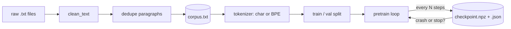

#### Notes

- Data quality beats model size at this scale: remove duplicates, boilerplate and broken encoding.
- Only use text you're allowed to use (your own writing, public domain, open licences).
- Checkpoint = parameters + step + config + tokenizer info. Save regularly; resume after interruptions.
- Keep a tiny held-out val set from the same distribution.

#### Your task — `day84.py`

- `clean_text(text)` → `\r\n`→`\n`, strip trailing spaces on each line, collapse 3+ newlines into 2, strip ends.
- `build_corpus(texts)` → cleaned texts split into paragraphs (`\n\n`), exact duplicates removed (first kept), rejoined with `\n\n`.
- `save_checkpoint(model, path, step, config)` → writes `path` (npz) and `path.with_suffix(".json")` (`step, config, n_params`).
- `load_checkpoint(model, path)` → `(step, config)`.

#### Tests

```python
# file: test_day84.py
import tempfile
from pathlib import Path

import numpy as np

import day84 as ex
from day79 import GPT


def test_clean_and_corpus():
    assert ex.clean_text("a  \r\nb\n\n\n\nc  ") == "a\nb\n\nc"
    corpus = ex.build_corpus(["Para one.\n\nPara two.", "Para two.\n\n\n\nPara three.  "])
    assert corpus == "Para one.\n\nPara two.\n\nPara three."


def test_checkpoint_round_trip():
    path = Path(tempfile.mkdtemp()) / "ckpt.npz"
    m = GPT(12, 8, 16, 2, 1, seed=0)
    ex.save_checkpoint(m, path, step=250, config={"n_embd": 16})
    fresh = GPT(12, 8, 16, 2, 1, seed=99)
    step, cfg = ex.load_checkpoint(fresh, path)
    assert step == 250 and cfg == {"n_embd": 16}
    assert all(np.array_equal(a.data, b.data) for a, b in zip(m.parameters(), fresh.parameters()))
    idx = np.zeros((1, 4), dtype=int)
    assert np.allclose(m(idx)[0].data, fresh(idx)[0].data)
```

<details><summary>Reference solution (try first!)</summary>

```python
# file: day84.py
import json
import re
from pathlib import Path

from day71 import load_params, save_params


def clean_text(text):
    text = text.replace("\r\n", "\n")
    text = "\n".join(line.rstrip() for line in text.split("\n"))
    return re.sub(r"\n{3,}", "\n\n", text).strip()


def build_corpus(texts):
    seen, paras = set(), []
    for t in texts:
        for p in clean_text(t).split("\n\n"):
            p = p.strip()
            if p and p not in seen:
                seen.add(p)
                paras.append(p)
    return "\n\n".join(paras)


def save_checkpoint(model, path, step, config):
    path = Path(path)
    path.parent.mkdir(parents=True, exist_ok=True)
    save_params(model, path)
    path.with_suffix(".json").write_text(json.dumps({"step": step, "config": config, "n_params": model.num_params()}))
    return path


def load_checkpoint(model, path):
    path = Path(path)
    load_params(model, path)
    meta = json.loads(path.with_suffix(".json").read_text())
    return meta["step"], meta["config"]
```

</details>

**Done when:** green + pretrain a GPT on your own corpus with checkpoints every 500 steps; stop it and resume once.

---

### Day 85 — Turning it into a chat model (supervised fine-tuning)

**Dataset:** a small chat set you write (≥ 50 Q&A pairs about Python/ML — you know the material now) · **Time:** ~2.5 h
**Progress:** `[█████████████████████████░░░░░] 25/30` · **System after today:** your model answers in turns — a (tiny) chatbot.

#### Visual

```text
 chat template (special marker characters):
   ␁ What is a tensor? ␂ An array with autograd. ␃
   └user┘               └──── assistant ─────┘└end
 x = tokens[:-1]     y = tokens[1:]
 y masked:  -1 -1 -1 … -1  A  n  … .  ␃     ← loss ONLY on the assistant's reply (+ end marker)
 the model learns HOW TO ANSWER, not to imitate questions
```

#### Notes

- Pretraining teaches language; SFT teaches a **format**: user turn → assistant turn → stop.
- Mask the prompt: targets `-1` are ignored by your Day 67 `cross_entropy(ignore_index=-1)`.
- The end marker teaches the model when to stop talking.
- Start SFT from your pretrained checkpoint (Day 84) with a lower learning rate.

#### Your task — `day85.py`

- `USER, ASSISTANT, END = "\x01", "\x02", "\x03"`.
- `format_chat(messages)` → string from `[{"role": "user"|"assistant", "content": str}, ...]`: user → `USER + content`, assistant → `ASSISTANT + content + END`.
- `make_sft_example(tok, messages, block_size)` → `(x, y)` int arrays of length `block_size`; `y` is `-1` except at assistant content + END positions; right-pad `x` with 0 and `y` with -1; truncate if too long.
- `chat_reply(model, tok, question, rng, max_new_tokens=100)` → generated assistant text (stops at END).

#### Tests

```python
# file: test_day85.py
import numpy as np

import day85 as ex
from day75 import CharTokenizer


def tok():
    return CharTokenizer("abcdefghijklmnopqrstuvwxyz ?." + ex.USER + ex.ASSISTANT + ex.END)


def test_format():
    msgs = [{"role": "user", "content": "hi"}, {"role": "assistant", "content": "yo"}]
    assert ex.format_chat(msgs) == "\x01hi\x02yo\x03"


def test_mask():
    t = tok()
    msgs = [{"role": "user", "content": "hi?"}, {"role": "assistant", "content": "ok."}]
    x, y = ex.make_sft_example(t, msgs, 12)
    assert x.shape == y.shape == (12,)
    trained = t.decode([v for v in y if v != -1])
    assert trained == "ok.\x03"
    text = ex.format_chat(msgs)
    assert t.decode(x[:len(text) - 1]) == text[:-1] and (y[len(text) - 1:] == -1).all()


def test_truncate():
    x, y = ex.make_sft_example(tok(), [{"role": "user", "content": "a" * 30}, {"role": "assistant", "content": "b"}], 8)
    assert len(x) == len(y) == 8
```

<details><summary>Reference solution (try first!)</summary>

```python
# file: day85.py
import numpy as np

from day81 import generate

USER, ASSISTANT, END = "\x01", "\x02", "\x03"


def format_chat(messages):
    out = []
    for m in messages:
        out.append(USER + m["content"] if m["role"] == "user" else ASSISTANT + m["content"] + END)
    return "".join(out)


def make_sft_example(tok, messages, block_size):
    ids, train_mask = [], []
    for m in messages:
        if m["role"] == "user":
            part = tok.encode(USER + m["content"])
            ids += part; train_mask += [False] * len(part)
        else:
            head, body = tok.encode(ASSISTANT), tok.encode(m["content"] + END)
            ids += head + body; train_mask += [False] * len(head) + [True] * len(body)
    x, y = ids[:-1], [t if keep else -1 for t, keep in zip(ids[1:], train_mask[1:])]
    x, y = x[:block_size], y[:block_size]
    pad = block_size - len(x)
    return np.array(x + [0] * pad), np.array(y + [-1] * pad)


def chat_reply(model, tok, question, rng, max_new_tokens=100):
    prompt = tok.encode(USER + question + ASSISTANT)
    out = generate(model, prompt, max_new_tokens, rng, temperature=0.7, top_k=10)
    reply = tok.decode(out[len(prompt):])
    return reply.split(END)[0]
```

</details>

**Done when:** green + fine-tune your Day 84 model on your Q&A set and chat with it via `chat_reply`.

---

### Day 86 — RAG from scratch: give your AI a memory

**Dataset:** this syllabus file + your dev log (chunked) · **Time:** ~2 h
**Progress:** `[██████████████████████████░░░░] 26/30` · **System after today:** your AI looks things up before answering.

#### Visual

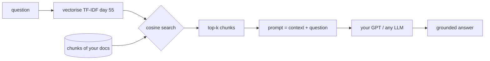

#### Notes

- Small models can't memorise everything. **Retrieval-Augmented Generation**: find relevant text, paste it into the prompt.
- Chunk with overlap so facts aren't cut in half at a boundary.
- Today's vectors are TF-IDF (Day 55) — real systems use learned embeddings, same cosine search (Day 31).
- Always show which chunks were used (citations) — it makes answers checkable.

#### Your task — `day86.py`

- `chunk_text(text, size=50, overlap=10)` → list of word chunks (`size` words, step `size − overlap`, last chunk may be shorter, no empty chunks).
- `class Retriever(chunks)` → `search(query, k=3)` → list of `(score, chunk)` best first, zero-score hits dropped.
- `build_prompt(question, hits)` → `"Context:\n[1] …\n[2] …\n\nQuestion: …\nAnswer:"`.

#### Tests

```python
# file: test_day86.py
import day86 as ex

DOCS = ["Day 66 builds the Tensor engine with autograd and gradient checks.",
        "Day 44 trains a Naive Bayes spam filter on real SMS messages.",
        "Day 82 builds a byte pair encoding tokenizer that handles Telugu and emoji.",
        "Day 22 downloads the Titanic dataset with a cache."]


def test_chunking():
    words = " ".join(f"w{i}" for i in range(23))
    chunks = ex.chunk_text(words, size=10, overlap=3)
    assert chunks[0].split()[-3:] == chunks[1].split()[:3]
    assert chunks[-1].split()[-1] == "w22" and all(chunks)
    assert len(ex.chunk_text("a b c", 10, 3)) == 1


def test_search():
    r = ex.Retriever(DOCS)
    hits = r.search("which day builds the tokenizer for telugu?", k=2)
    assert hits[0][1] == DOCS[2] and hits[0][0] > hits[1][0] > 0
    assert r.search("zzzz qqqq") == []


def test_prompt():
    p = ex.build_prompt("What is RAG?", [(0.9, "chunk A"), (0.5, "chunk B")])
    assert p == "Context:\n[1] chunk A\n[2] chunk B\n\nQuestion: What is RAG?\nAnswer:"
```

<details><summary>Reference solution (try first!)</summary>

```python
# file: day86.py
import numpy as np

from day55 import TfidfVectorizer


def chunk_text(text, size=50, overlap=10):
    words = text.split()
    step = size - overlap
    chunks = []
    for start in range(0, max(len(words) - overlap, 1), step):
        piece = words[start:start + size]
        if piece:
            chunks.append(" ".join(piece))
    return chunks


class Retriever:
    def __init__(self, chunks):
        self.chunks = list(chunks)
        self.vec = TfidfVectorizer().fit(self.chunks)
        self.M = self.vec.transform(self.chunks)

    def search(self, query, k=3):
        scores = self.M @ self.vec.transform([query])[0]
        order = np.argsort(-scores, kind="stable")[:k]
        return [(float(scores[i]), self.chunks[i]) for i in order if scores[i] > 0]


def build_prompt(question, hits):
    ctx = "\n".join(f"[{i}] {chunk}" for i, (_, chunk) in enumerate(hits, 1))
    return f"Context:\n{ctx}\n\nQuestion: {question}\nAnswer:"


if __name__ == "__main__":
    import sys
    text = open(sys.argv[1] if len(sys.argv) > 1 else "AI90_MASTER.md", encoding="utf-8").read()
    r = Retriever(chunk_text(text, 80, 20))
    for score, chunk in r.search("how does gradient clipping work", k=3):
        print(round(score, 3), chunk[:120], "…")
```

</details>

**Done when:** green + `python day86.py AI90_MASTER.md` answers questions about this course.

---

### Day 87 — Tool use: let the AI run your automations

**Dataset:** tools built from Blocks 1–2 (calculator, Titanic stats, dataset downloader) · **Time:** ~2 h
**Progress:** `[███████████████████████████░░░] 27/30` · **System after today:** an AI that can **act** — it calls functions you wrote on Days 1–60.

#### Visual

```text
 user:  "what's 17.5% of 2340?"
 model: <tool>{"name": "calc", "args": {"expr": "2340 * 0.175"}}</tool>      ← model writes a tool call
 app:   parse → registry["calc"](expr="2340 * 0.175") → 409.5                 ← YOUR code runs it, safely
 app:   <result>409.5</result>  → fed back to the model → "17.5% of 2340 is 409.5."
```

#### Notes

- The model only **writes text**; your program decides whether and how to run a tool. Never `eval` model output — parse it and allow-list.
- Tool calls are JSON inside tags. Bad JSON, unknown tool or wrong arguments → return an error message, never crash.
- A safe calculator walks the expression's AST and only allows numbers and `+ − × ÷ **`.
- Describe tools to the model in the prompt (`registry.describe()`).

#### Your task — `day87.py`

- `safe_calc(expr)` → number; only numeric literals, `+ - * / ** %`, unary minus and brackets; else `ValueError`.
- `parse_tool_call(text)` → `(name, args)` or `None`; malformed JSON → `ValueError`.
- `class ToolRegistry` with `register(name, description)` decorator, `describe()`, `call(name, args)` (errors returned as `"error: …"` strings).
- `handle(text, registry)` → `"<result>{json}</result>"` if text contains a tool call, else the text unchanged.

#### Tests

```python
# file: test_day87.py
import day87 as ex


def test_safe_calc():
    assert ex.safe_calc("2340 * 0.175") == 409.5 and ex.safe_calc("-(2 + 3) ** 2 % 7") == 3
    for bad in ["__import__('os')", "open('x')", "a + 1", "[1, 2]"]:
        try:
            ex.safe_calc(bad)
        except ValueError:
            continue
        raise AssertionError(f"should reject {bad}")


def test_parse():
    assert ex.parse_tool_call('ok <tool>{"name": "calc", "args": {"expr": "1+1"}}</tool>') == ("calc", {"expr": "1+1"})
    assert ex.parse_tool_call("no tools here") is None
    try:
        ex.parse_tool_call("<tool>{not json}</tool>")
    except ValueError:
        return
    raise AssertionError("bad JSON should raise ValueError")


def test_registry_and_handle():
    reg = ex.ToolRegistry()

    @reg.register("calc", "evaluate arithmetic")
    def calc(expr):
        return ex.safe_calc(expr)

    assert "calc: evaluate arithmetic" in reg.describe()
    assert reg.call("calc", {"expr": "6*7"}) == 42
    assert reg.call("nope", {}).startswith("error: unknown tool")
    assert reg.call("calc", {"wrong": 1}).startswith("error:")
    assert ex.handle('<tool>{"name": "calc", "args": {"expr": "2**10"}}</tool>', reg) == "<result>1024</result>"
    assert ex.handle("just chatting", reg) == "just chatting"
```

<details><summary>Reference solution (try first!)</summary>

```python
# file: day87.py
import ast
import json
import operator
import re

OPS = {ast.Add: operator.add, ast.Sub: operator.sub, ast.Mult: operator.mul, ast.Div: operator.truediv,
       ast.Pow: operator.pow, ast.Mod: operator.mod, ast.USub: operator.neg, ast.UAdd: operator.pos}
TOOL_RE = re.compile(r"<tool>(.*?)</tool>", re.S)


def safe_calc(expr):
    def ev(node):
        if isinstance(node, ast.Expression):
            return ev(node.body)
        if isinstance(node, ast.Constant) and isinstance(node.value, (int, float)):
            return node.value
        if isinstance(node, ast.BinOp) and type(node.op) in OPS:
            return OPS[type(node.op)](ev(node.left), ev(node.right))
        if isinstance(node, ast.UnaryOp) and type(node.op) in OPS:
            return OPS[type(node.op)](ev(node.operand))
        raise ValueError(f"not allowed: {ast.dump(node)[:40]}")
    try:
        tree = ast.parse(expr, mode="eval")
    except SyntaxError as e:
        raise ValueError(str(e)) from None
    return ev(tree)


def parse_tool_call(text):
    m = TOOL_RE.search(text)
    if not m:
        return None
    try:
        call = json.loads(m.group(1))
    except json.JSONDecodeError as e:
        raise ValueError(f"bad tool JSON: {e}") from None
    return call["name"], call.get("args", {})


class ToolRegistry:
    def __init__(self):
        self.tools = {}

    def register(self, name, description):
        def deco(fn):
            self.tools[name] = (fn, description)
            return fn
        return deco

    def describe(self):
        return "\n".join(f"{n}: {d}" for n, (_, d) in self.tools.items())

    def call(self, name, args):
        if name not in self.tools:
            return f"error: unknown tool {name!r}"
        try:
            return self.tools[name][0](**args)
        except Exception as e:  # noqa: BLE001 — errors go back to the model as text
            return f"error: {type(e).__name__}: {e}"


def handle(text, registry):
    try:
        call = parse_tool_call(text)
    except ValueError as e:
        return f"<result>{json.dumps('error: ' + str(e))}</result>"
    if call is None:
        return text
    return f"<result>{json.dumps(registry.call(*call))}</result>"
```

</details>

**Done when:** green + register two of your own Block 1–2 functions as tools (e.g. Day 22 `survival_rate_by`, Day 54 forecast).

---

### Day 88 — Serving your AI: an API and a chat page

**Dataset:** your chat model (Day 85) · **Time:** ~2.5 h
**Progress:** `[████████████████████████████░░] 28/30` · **System after today:** open a browser, type a message, **your** model replies.

#### Visual

```text
 browser ──GET /──────────▶ server ──▶ chat page (HTML + JS)
 browser ──POST /chat {"message": "hi"}──▶ handle() ──▶ generate_fn(message) ──▶ {"reply": "..."}
 status codes:  200 ok · 400 bad JSON / missing message · 404 unknown path · 413 message too long
```

#### Notes

- Keep request handling a **pure function** `handle(method, path, body, generate_fn)` → `(status, content_type, body)`. Test it without a network; the server is a thin wrapper.
- Validate everything from the outside world: JSON, required fields, sizes.
- Standard library `http.server` is enough for a demo. For production: FastAPI + uvicorn (Day 56), behind HTTPS.
- Generation is slow on CPU — cap `max_tokens`.

#### Your task — `day88.py`

- `CHAT_PAGE` — a minimal HTML chat page that POSTs to `/chat`.
- `handle(method, path, body, generate_fn, max_len=2000)` as above; `generate_fn(message, max_tokens)` returns the reply (default `max_tokens=100`, capped at 300).
- `serve(generate_fn, port=8000)` — `http.server` wrapper (not tested).

#### Tests

```python
# file: test_day88.py
import json

import day88 as ex


def echo(message, max_tokens):
    return f"echo:{message}:{max_tokens}"


def test_page():
    status, ctype, body = ex.handle("GET", "/", b"", echo)
    assert status == 200 and ctype.startswith("text/html") and b"/chat" in body


def test_chat():
    status, ctype, body = ex.handle("POST", "/chat", json.dumps({"message": "hi", "max_tokens": 999}).encode(), echo)
    assert status == 200 and ctype == "application/json"
    assert json.loads(body) == {"reply": "echo:hi:300"}
    assert json.loads(ex.handle("POST", "/chat", b'{"message": "x"}', echo)[2])["reply"] == "echo:x:100"


def test_errors():
    assert ex.handle("POST", "/chat", b"not json", echo)[0] == 400
    assert ex.handle("POST", "/chat", b'{"msg": "x"}', echo)[0] == 400
    assert ex.handle("POST", "/chat", json.dumps({"message": "x" * 3000}).encode(), echo)[0] == 413
    assert ex.handle("GET", "/nope", b"", echo)[0] == 404
```

<details><summary>Reference solution (try first!)</summary>

```python
# file: day88.py
import json
from http.server import BaseHTTPRequestHandler, HTTPServer

CHAT_PAGE = """<!doctype html><html><head><meta charset="utf-8"><title>My AI</title>
<meta name="viewport" content="width=device-width,initial-scale=1">
<style>body{font-family:system-ui;max-width:640px;margin:2rem auto;padding:0 1rem}
#log div{margin:.4rem 0;padding:.5rem .7rem;border-radius:10px}.u{background:#e8eefc}.a{background:#f2f2f2}
form{display:flex;gap:.5rem}input{flex:1;padding:.6rem}</style></head><body>
<h1>My AI (built from scratch)</h1><div id="log"></div>
<form id="f"><input id="m" autocomplete="off" placeholder="Say something"><button>Send</button></form>
<script>
const log=document.getElementById('log'),f=document.getElementById('f'),m=document.getElementById('m');
function add(cls,t){const d=document.createElement('div');d.className=cls;d.textContent=t;log.appendChild(d);}
f.onsubmit=async e=>{e.preventDefault();const t=m.value.trim();if(!t)return;add('u',t);m.value='';
 const r=await fetch('/chat',{method:'POST',headers:{'Content-Type':'application/json'},body:JSON.stringify({message:t})});
 const j=await r.json();add('a',j.reply||j.error);};
</script></body></html>"""


def _json(status, obj):
    return status, "application/json", json.dumps(obj).encode()


def handle(method, path, body, generate_fn, max_len=2000):
    if method == "GET" and path == "/":
        return 200, "text/html; charset=utf-8", CHAT_PAGE.encode()
    if method == "POST" and path == "/chat":
        try:
            req = json.loads(body or b"{}")
            message = req["message"]
        except (json.JSONDecodeError, KeyError, TypeError):
            return _json(400, {"error": "send JSON like {\"message\": \"hi\"}"})
        if not isinstance(message, str) or not message.strip():
            return _json(400, {"error": "message must be a non-empty string"})
        if len(message) > max_len:
            return _json(413, {"error": f"message longer than {max_len} characters"})
        max_tokens = min(int(req.get("max_tokens", 100)), 300)
        return _json(200, {"reply": generate_fn(message, max_tokens)})
    return _json(404, {"error": "not found"})


def serve(generate_fn, port=8000):
    class H(BaseHTTPRequestHandler):
        def _respond(self, method):
            n = int(self.headers.get("Content-Length", 0))
            status, ctype, out = handle(method, self.path, self.rfile.read(n), generate_fn)
            self.send_response(status)
            self.send_header("Content-Type", ctype)
            self.send_header("Content-Length", str(len(out)))
            self.end_headers()
            self.wfile.write(out)

        def do_GET(self):
            self._respond("GET")

        def do_POST(self):
            self._respond("POST")

    print(f"open http://localhost:{port}")
    HTTPServer(("127.0.0.1", port), H).serve_forever()


if __name__ == "__main__":
    serve(lambda msg, n: f"(demo) you said: {msg}")
```

</details>

**Done when:** green + `python day88.py`, open `http://localhost:8000`, then swap the demo lambda for your Day 85 `chat_reply`.

---

### Day 89 — Evaluation and the model card

**Dataset:** an eval set you write (30+ prompts with expected answers) · **Time:** ~2 h
**Progress:** `[█████████████████████████████░] 29/30` · **System after today:** your AI is measured honestly and documented responsibly.

#### Visual

```text
 eval set                                  results
 prompt                     expect   mode   ✔/✘
 "2+2="                     "4"      exact   ✔
 "capital of France?"       "Paris"  contains ✘  ← look at every failure
 "Day 66 builds the"        Tensor   regex   ✔
 score 21/30 = 0.70     (track it after EVERY change — no number, no progress)
 model card:  what it is · data · how it was evaluated · intended use · limitations & risks
```

#### Notes

- "It looks good" is not an evaluation. Fixed prompts + fixed expectations + a score, re-run after every change.
- Modes: exact match, contains, regex. Keep the failures list — that's your to-do list.
- A model card is standard practice: say what the model is for, what data it saw, how it scored, and where it fails. Small models hallucinate — say so.

#### Your task — `day89.py`

- `run_eval(generate_fn, cases)` → `{"score", "passed", "total", "failures"}`; each case `{"prompt", "expect", "mode"}` with mode `exact | contains | regex` (`contains` is case-insensitive).
- `model_card(info)` → Markdown with sections `# <name>`, `## Model`, `## Training data`, `## Evaluation`, `## Intended use`, `## Limitations`; missing keys raise `KeyError`.

#### Tests

```python
# file: test_day89.py
import day89 as ex

ANSWERS = {"2+2=": "4", "capital of France?": "It is Paris.", "Day 66 builds the": "Tensor engine"}


def gen(prompt):
    return ANSWERS.get(prompt, "")


def test_run_eval():
    cases = [{"prompt": "2+2=", "expect": "4", "mode": "exact"},
             {"prompt": "capital of France?", "expect": "paris", "mode": "contains"},
             {"prompt": "Day 66 builds the", "expect": r"^Tensor\b", "mode": "regex"},
             {"prompt": "unknown", "expect": "x", "mode": "exact"}]
    r = ex.run_eval(gen, cases)
    assert r == {"score": 0.75, "passed": 3, "total": 4, "failures": ["unknown"]}


def test_model_card():
    info = {"name": "tinyGPT-shakespeare", "model": "2-layer GPT, 110k params, own NumPy engine",
            "data": "Tiny Shakespeare (1.1M chars)", "evaluation": "val loss 1.95, eval score 0.70",
            "intended_use": "learning and demos", "limitations": "invents facts; English only; tiny context"}
    card = ex.model_card(info)
    for h in ["# tinyGPT-shakespeare", "## Model", "## Training data", "## Evaluation", "## Intended use", "## Limitations"]:
        assert h in card
    del info["limitations"]
    try:
        ex.model_card(info)
    except KeyError:
        return
    raise AssertionError("missing key should raise KeyError")
```

<details><summary>Reference solution (try first!)</summary>

```python
# file: day89.py
import re


def _ok(out, expect, mode):
    if mode == "exact":
        return out.strip() == expect
    if mode == "contains":
        return expect.lower() in out.lower()
    if mode == "regex":
        return re.search(expect, out) is not None
    raise ValueError(f"unknown mode {mode}")


def run_eval(generate_fn, cases):
    failures = [c["prompt"] for c in cases if not _ok(generate_fn(c["prompt"]), c["expect"], c["mode"])]
    passed = len(cases) - len(failures)
    return {"score": round(passed / len(cases), 3), "passed": passed, "total": len(cases), "failures": failures}


def model_card(info):
    sections = [("Model", "model"), ("Training data", "data"), ("Evaluation", "evaluation"),
                ("Intended use", "intended_use"), ("Limitations", "limitations")]
    parts = [f"# {info['name']}"]
    for title, key in sections:
        parts += ["", f"## {title}", "", info[key]]
    return "\n".join(parts) + "\n"
```

</details>

**Done when:** green + a real eval run on your chat model + `MODEL_CARD.md` in the repo.

---

### Day 90 — Demo day: ship it

**Dataset:** everything · **Time:** ~3 h
**Progress:** `[██████████████████████████████] 30/30` · **System after today:** a public repo, a working demo, a write-up — and the skills to build the next one.

#### Visual

```text
 ai-90/
 ├── block1_python/       Days 1-30  automation + real data
 ├── block2_ml/           Days 31-60 minisklearn + benchmarks
 ├── block3_ai/           Days 61-90 tinytorch + GPT + chat + RAG + tools + server
 ├── models/              checkpoints
 ├── reports/ plots/      generated outputs
 ├── MODEL_CARD.md
 └── README.md  ← progress bars, results tables, demo GIF, what you'd do next
```

#### Notes

- **Write-up structure:** what you built, one diagram, key numbers (benchmark table, GPT loss, eval score), what was hardest, what's next.
- **Record a 2-minute demo**: train → generate → chat in the browser → a tool call.
- **Scaling up (optional): port to PyTorch for a GPU.** Your engine maps 1:1:

| tinytorch (yours) | PyTorch |
| --- | --- |
| `Tensor(data)` + `.backward()` | `torch.tensor(data, requires_grad=True)` + `.backward()` |
| `Module`, `Linear`, `LayerNorm` | `torch.nn.Module`, `nn.Linear`, `nn.LayerNorm` |
| `cross_entropy(logits, t, ignore_index=-1)` | `F.cross_entropy(logits, t, ignore_index=-1)` |
| `Adam(params, lr, weight_decay)` | `torch.optim.AdamW(params, lr, weight_decay)` |
| `softmax(att + mask)` | `F.scaled_dot_product_attention(q, k, v, is_causal=True)` |
| `save_params / load_params` | `torch.save(model.state_dict()) / load_state_dict` |

  Then read karpathy/nanoGPT and karpathy/nanochat end to end — you'll recognise every line.

#### Your task — `day90.py`

- `summarize_progress(progress)` → from `{"day": "YYYY-MM-DD"}` (the `ai90/progress.json` format): `{"days_done", "blocks": {"Python + automation": n, "Machine learning": n, "AI from scratch": n}, "first", "last"}`.
- `bar(n, total=30, width=30)` → `"█"*filled + "░"*rest`.
- `demo_readme(title, summary, results)` → Markdown README: `# title`, a progress section with one bar line per block (`Python + automation  ███…  30/30`), a `## Results` table from the `results` dict, and a `## What's next` section.

#### Tests

```python
# file: test_day90.py
import day90 as ex


def test_summary():
    prog = {str(d): f"2026-12-{(d % 28) + 1:02d}" for d in list(range(1, 31)) + list(range(31, 41)) + [61, 62]}
    s = ex.summarize_progress(prog)
    assert s["days_done"] == 42
    assert s["blocks"] == {"Python + automation": 30, "Machine learning": 10, "AI from scratch": 2}
    assert s["first"] == "2026-12-01" and s["last"] == "2026-12-28"


def test_bar():
    assert ex.bar(15) == "█" * 15 + "░" * 15 and ex.bar(30, width=10) == "█" * 10


def test_readme():
    s = ex.summarize_progress({str(d): "2026-12-01" for d in range(1, 91)})
    md = ex.demo_readme("AI-90", s, {"GPT val loss": 1.95, "Titanic CV acc": 0.81})
    assert md.startswith("# AI-90")
    assert "AI from scratch" in md and "30/30" in md
    assert "| GPT val loss | 1.95 |" in md and "## What's next" in md
```

<details><summary>Reference solution (try first!)</summary>

```python
# file: day90.py
BLOCKS = [("Python + automation", 1, 30), ("Machine learning", 31, 60), ("AI from scratch", 61, 90)]


def summarize_progress(progress):
    days = {int(k) for k in progress}
    dates = sorted(progress.values())
    return {"days_done": len(days),
            "blocks": {name: len([d for d in days if lo <= d <= hi]) for name, lo, hi in BLOCKS},
            "first": dates[0] if dates else None, "last": dates[-1] if dates else None}


def bar(n, total=30, width=30):
    filled = round(n / total * width)
    return "█" * filled + "░" * (width - filled)


def demo_readme(title, summary, results):
    lines = [f"# {title}", "", "From Python basics to a GPT built on my own autograd engine, in 90 days.", "",
             "## Progress", "", "`" * 3 + "text"]
    for name, n in summary["blocks"].items():
        lines.append(f"{name:20} {bar(n)}  {n}/30")
    lines += ["`" * 3, "", f"{summary['days_done']}/90 days · {summary['first']} → {summary['last']}", "",
              "## Results", "", "| metric | value |", "| --- | --- |"]
    lines += [f"| {k} | {v} |" for k, v in results.items()]
    lines += ["", "## What's next", "", "- Port tinytorch models to PyTorch and train a bigger GPT on a GPU",
              "- Learned embeddings for RAG", "- Publish the minisklearn benchmark", ""]
    return "\n".join(lines)


if __name__ == "__main__":
    import json
    from pathlib import Path
    prog = json.loads(Path("ai90/progress.json").read_text()) if Path("ai90/progress.json").exists() else {}
    print(demo_readme("AI-90", summarize_progress(prog), {"fill in": "your numbers"}))
```

</details>

**Done when:** green + README published + demo recorded + `python ai90.py progress` shows 90/90. **You built an AI from scratch.** 🎓

---


## APPENDIX A — The runner (`ai90.py`)

Extract it with the one-liner in Section 1, or copy this block into `ai90.py`.

```python
# file: ai90.py
"""AI-90 runner — extracts code from AI90_MASTER.md, checks your work, tracks progress.

    python ai90.py extract AI90_MASTER.md   # writes ai90/solutions/, ai90/tests/, creates ai90/work/
    python ai90.py check 5                  # check Day 5 (your file: ai90/work/day05.py)
    python ai90.py check 31-40              # a range
    python ai90.py check                    # every day
    python ai90.py check --solutions        # verify the reference solutions
    python ai90.py progress                 # progress bars + streak

Your code goes in ai90/work/dayNN.py. If a later day imports an earlier day you
haven't written yet, the reference solution is used as a fallback.
Standard library only (the days themselves use numpy/pandas/sklearn/matplotlib).
"""
import json
import re
import subprocess
import sys
from datetime import date
from pathlib import Path

BASE = Path("ai90")
SOL, TESTS, WORK = BASE / "solutions", BASE / "tests", BASE / "work"
PROGRESS = BASE / "progress.json"
BLOCKS = [("Python + automation", 1, 30), ("Machine learning", 31, 60), ("AI from scratch", 61, 90)]
G, R, Y, D, E = "\033[92m", "\033[91m", "\033[93m", "\033[2m", "\033[0m"

HARNESS = r'''
import sys, json, traceback, importlib
sys.path[:0] = PATHS
mod = importlib.import_module(TEST)
out = []
for name in sorted(n for n in dir(mod) if n.startswith("test_")):
    try:
        getattr(mod, name)(); out.append([name, "pass", ""])
    except NotImplementedError:
        out.append([name, "todo", ""])
    except Exception as e:
        tb = traceback.extract_tb(e.__traceback__)[-1]
        out.append([name, "fail", f"{type(e).__name__}: {e} ({Path(tb.filename).name}:{tb.lineno})"])
print("@@" + json.dumps(out))
'''


def extract(md_path):
    text = Path(md_path).read_text(encoding="utf-8")
    fence = "`" * 3  # built at runtime so this file can live inside a Markdown code block
    blocks = re.findall(fence + r"python\n# file: (\S+)\n(.*?)" + fence, text, flags=re.S)
    for d in (SOL, TESTS, WORK):
        d.mkdir(parents=True, exist_ok=True)
    n = 0
    for name, code in blocks:
        if name == "ai90.py":
            continue
        dest = (TESTS if name.startswith("test_") else SOL) / name
        dest.write_text(code, encoding="utf-8")
        n += 1
    print(f"extracted {n} files -> {SOL} and {TESTS}. Write your code in {WORK}/dayNN.py")


def parse_days(args):
    days = set()
    for a in args:
        if re.fullmatch(r"\d+-\d+", a):
            lo, hi = map(int, a.split("-"))
            days |= set(range(lo, hi + 1))
        elif a.isdigit():
            days.add(int(a))
    return sorted(days) or list(range(1, 91))


def run_day(day, use_solutions):
    test = TESTS / f"test_day{day:02}.py"
    if not test.exists():
        return None
    paths = [str(TESTS.resolve()), str(SOL.resolve())] if use_solutions else \
        [str(TESTS.resolve()), str(WORK.resolve()), str(SOL.resolve())]
    if not use_solutions and not (WORK / f"day{day:02}.py").exists():
        return [[f"day{day:02}.py not written yet", "todo", ""]]
    code = "from pathlib import Path\nPATHS=%r\nTEST=%r\n" % (paths, test.stem) + HARNESS
    p = subprocess.run([sys.executable, "-c", code], capture_output=True, text=True, timeout=600, cwd=str(BASE))
    line = next((ln for ln in p.stdout.splitlines() if ln.startswith("@@")), None)
    if line is None:
        err = (p.stderr.strip().splitlines() or ["crashed"])[-1]
        return [["import / syntax error", "fail", err]]
    return json.loads(line[2:])


def check(args):
    use_solutions = "--solutions" in args
    prog = json.loads(PROGRESS.read_text()) if PROGRESS.exists() else {}
    totals = {"pass": 0, "todo": 0, "fail": 0}
    for day in parse_days(args):
        res = run_day(day, use_solutions)
        if res is None:
            continue
        print(f"\nDay {day}")
        for name, status, msg in res:
            totals[status] += 1
            col = {"pass": G, "todo": Y, "fail": R}[status]
            print(f"  {col}{status.upper():4}{E} {name} {D}{msg}{E}")
        if not use_solutions and res and all(s == "pass" for _, s, _ in res):
            prog.setdefault(str(day), date.today().isoformat())
    if not use_solutions:
        PROGRESS.write_text(json.dumps(prog, indent=1))
    print(f"\n{G}{totals['pass']} pass{E}  {Y}{totals['todo']} todo{E}  {R}{totals['fail']} fail{E}")
    return totals["fail"]


def progress():
    prog = json.loads(PROGRESS.read_text()) if PROGRESS.exists() else {}
    done = {int(k) for k in prog}
    for name, lo, hi in BLOCKS:
        n = len([d for d in done if lo <= d <= hi])
        bar = "#" * n + "." * (30 - n)
        print(f"{name:22} [{bar}] {n}/30")
    days = sorted({date.fromisoformat(v) for v in prog.values()}, reverse=True)
    streak = 0
    for i, d in enumerate(days):
        if (days[0] - d).days == i:
            streak += 1
    nxt = next((d for d in range(1, 91) if d not in done), None)
    print(f"\nDays complete: {len(done)}/90   streak: {streak} day(s)   next: Day {nxt}")


if __name__ == "__main__":
    cmd, rest = (sys.argv[1], sys.argv[2:]) if len(sys.argv) > 1 else ("progress", [])
    if cmd == "extract":
        extract(rest[0] if rest else "AI90_MASTER.md")
    elif cmd == "check":
        sys.exit(1 if check(rest) else 0)
    else:
        progress()
```

## APPENDIX B — Troubleshooting

| Symptom | Fix |
| --- | --- |
| `import / syntax error` in check output | run `python ai90/work/dayNN.py` directly to see the full traceback |
| `ModuleNotFoundError: dayNN` | you're running from the wrong folder — run `ai90.py` from the folder that contains `ai90/` |
| everything `todo` | your file still has `raise NotImplementedError`, or it's not saved as `ai90/work/dayNN.py` |
| download fails | check internet; the file is cached in `data/` after the first success |
| Block 3 test is slow | normal — gradient checks run the network hundreds of times; each day still finishes in seconds |
| `grad_check` error large | compare your op's backward with the reference solution; check `unbroadcast` and `+=` (never `=`) on grads |
| loss doesn't go down | try `memorise_check` (Day 80) first; check `zero_grad()` is called every step and the learning rate |

## APPENDIX C — Conventions cheat-sheet

```text
 X (n_samples, n_features)   y (n_samples,)     models: fit(X, y) → self,  predict(X)
 split → fit scaler on TRAIN → transform train + test → fit model → score once on test
 seeds everywhere: np.random.default_rng(seed)  → same results every run
 tinytorch:  Tensor(data) · ops record parents · loss.backward() · p.data -= lr * p.grad · zero_grad()
 shapes in Block 3:  (B, T, C) = batch, time (tokens), channels (embedding size)
```

*End of file. Built for Asish's AI-90 course — keep it, extend it, forward it.*
