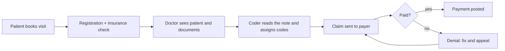

# AIM Biological path — Medical Coding (28 lessons)

The Biological path teaches **clinical (medical) coding** for US healthcare: turning what a doctor wrote into the
codes that go on a claim. It follows the outpatient/physician scope of the AAPC **CPC** exam, the credential most
coding employers in Hyderabad, Chennai and Bengaluru ask freshers for.

- **Code sets:** ICD-10-CM FY2026 (diagnoses, valid 1 Oct 2025 – 30 Sep 2026), CPT 2026 (procedures, AMA),
  HCPCS Level II (supplies, drugs, equipment), with an introduction to ICD-10-PCS (inpatient procedures).
- **Copyright note:** ICD-10-CM and HCPCS Level II are public US government code sets, and every ICD-10-CM code
  in these lessons is checked against the official FY2026 files by `tools/build_medcode.py`. CPT descriptions
  belong to the American Medical Association, so lessons teach CPT structure, rules and ranges in our own words
  and never reprint CPT descriptor text. Use your own current CPT book alongside these lessons (you need one
  for the CPC exam anyway).
- **No programming.** Each lesson ends with graded practice: real-style case notes where you type the codes,
  plus quick checks. Everything is graded instantly in your browser.

Format of every lesson: Goal · Visual · Notes · Practice (graded) · Done when.

## STAGE 1 — HEALTHCARE FOUNDATIONS (Lessons 1–7)

Before a single code: what coders do, the language of medicine, the body, and the rules that protect patients.
Every later lesson leans on the vocabulary built here, so take your time.

---

### Lesson 1 — What a medical coder does

**Dataset:** a day in a US physician practice · **Time:** ~1.5 h

**Goal:** Understand where coding sits in US healthcare, the four code sets, and the career path from fresher to certified coder.

#### Visual



#### Notes

- In the US, a doctor is paid by an **insurer (payer)** only after sending a **claim**. The claim cannot say "treated her diabetes and gave a flu shot"; it must say it in **codes**. A **medical coder** reads the doctor's documentation and assigns those codes.
- Two questions every claim answers:
  - **Why** was the patient seen? → **diagnosis codes**, from **ICD-10-CM** (about 74,700 billable codes in FY2026).
  - **What** was done? → **procedure codes**, from **CPT** (doctors' services, maintained by the AMA) and **HCPCS Level II** (supplies, drugs, ambulance, equipment, maintained by CMS). Hospitals code inpatient procedures with **ICD-10-PCS**.
- The diagnosis must **support** (justify) the procedure. A chest X-ray billed with a sprained ankle as the only reason gets denied. This link is called **medical necessity**.
- The whole money journey is the **revenue cycle** (diagram above). Coding sits in the middle: a wrong code means a denial, a delayed payment, or worse, an overpayment the practice must return.
- **Golden rule: code only what is documented.** Never guess, never "upgrade" to get paid more. If the note is unclear, you **query** the provider.
- **Career in India:** large RCM (revenue cycle management) companies code US charts remotely. Most hire freshers with **CPC** (AAPC) or **CCS** (AHIMA). Life-science, pharmacy and nursing graduates have a head start because of the terminology.
- **CPC exam:** 100 multiple-choice questions, 4 hours, open code book, 70% to pass. Surgery and E/M are the biggest parts. Lesson 28 is a timed mock.

#### Practice

```json
{"items": [
 {"type": "mcq", "q": "Which code set explains WHY the patient was seen?", "options": ["CPT", "ICD-10-CM", "HCPCS Level II", "ICD-10-PCS"], "answer": 1, "why": "ICD-10-CM holds diagnosis codes: the reasons for care. CPT, HCPCS and PCS describe what was done."},
 {"type": "mcq", "q": "A clinic gave a patient crutches to take home. Which code set describes the crutches?", "options": ["ICD-10-CM", "CPT", "HCPCS Level II", "ICD-10-PCS"], "answer": 2, "why": "Supplies and durable medical equipment such as crutches are HCPCS Level II codes (the E codes)."},
 {"type": "mcq", "q": "Which code set do hospitals use for procedures done during an inpatient stay?", "options": ["CPT", "HCPCS Level II", "ICD-10-PCS", "ICD-10-CM"], "answer": 2, "why": "ICD-10-PCS is the inpatient hospital procedure system. Physicians still report their own services with CPT."},
 {"type": "mcq", "q": "The note says 'possible pneumonia, waiting for X-ray'. The coder is unsure. What should the coder do?", "options": ["Code pneumonia anyway", "Pick the highest-paying code", "Query the provider or follow the uncertain-diagnosis rules", "Leave the claim blank"], "answer": 2, "why": "Coders never guess. Lesson 10 covers the outpatient rule for 'possible' diagnoses; when documentation is unclear, query the provider."},
 {"type": "mcq", "q": "What does 'medical necessity' mean on a claim?", "options": ["The visit was urgent", "The diagnosis justifies the service billed", "The patient has insurance", "The doctor signed the note"], "answer": 1, "why": "Payers pay for services that the reported diagnoses justify. Linking diagnosis to procedure is a core coder skill."},
 {"type": "mcq", "q": "How many questions and how long is the CPC exam?", "options": ["50 questions, 2 hours", "100 questions, 4 hours", "150 questions, 5 hours", "135 questions, 4 hours"], "answer": 1, "why": "100 multiple-choice questions in 4 hours, open book, 70% to pass."},
 {"type": "text", "q": "Fill the gap: the whole process from booking a visit to the practice being paid is called the ______ cycle.", "answer": ["revenue", "revenue cycle"], "why": "The revenue cycle: registration, documentation, coding, claim, payment, denials and appeals."}
]}
```

**Done when:** all checks green and you can draw the revenue cycle from memory.

---

### Lesson 2 — Medical terminology I: roots, prefixes, suffixes

**Dataset:** 60 common word parts · **Time:** ~2 h

**Goal:** Break any medical word into prefix + root + suffix and read its meaning.

#### Visual

```text
        peri    -   card   -   itis
       prefix      root       suffix
      "around"   "heart"  "inflammation"
   = inflammation of the sac AROUND the heart (pericarditis)

   gastr / o / enter / o / logy  → study of the stomach and intestines
   root  CV  root   CV  suffix      (o = combining vowel, joins parts)
```

#### Notes

- Most medical words come from Greek and Latin. Learn the parts once and you can read thousands of words.
- **Root** = the core (usually a body part). **Prefix** = in front, changes meaning (where, how many, how much). **Suffix** = at the end (condition, procedure, specialty). A **combining vowel**, usually **o**, links parts: cardi**o**logy.
- Drop the combining vowel before a suffix that starts with a vowel: gastr + itis = gastritis (not gastroitis).
- **Roots you will meet daily:** cardi (heart), pulmon / pneum (lung), hepat (liver), nephr / ren (kidney), gastr (stomach), enter (small intestine), col (colon), oste (bone), arthr (joint), my (muscle), neur (nerve), derm / cutane (skin), hem / hemat (blood), angi / vas (vessel), cyst (bladder), hyster (uterus), mast / mamm (breast), ophthalm (eye), ot (ear), rhin (nose), crani (skull), thorac (chest), lapar (abdomen).
- **Prefixes:** hyper- (above normal), hypo- (below), brady- (slow), tachy- (fast), a- / an- (without), dys- (painful, bad), peri- (around), endo- (within), epi- (upon), sub- (under), inter- (between), intra- (inside), poly- (many), hemi- (half), bi- (two), neo- (new).
- **Suffixes, conditions:** -itis (inflammation), -osis (abnormal condition), -algia (pain), -emia (blood condition), -megaly (enlargement), -oma (tumour), -pathy (disease), -plegia (paralysis), -rrhea (flow), -penia (deficiency).
- **Suffixes, procedures (these decide CPT sections later):** -ectomy (removal), -otomy (cutting into), -ostomy (making an opening), -plasty (surgical repair), -scopy (looking inside with a scope), -centesis (puncture to remove fluid), -rrhaphy (suture), -pexy (fixation), -gram / -graphy (record / recording an image).
- **Why coders care:** "appendectomy" vs "appendicitis" is a procedure vs a diagnosis. "Colostomy" vs "colotomy" are different operations with different codes.

#### Practice

```json
{"items": [
 {"type": "text", "q": "What does the suffix -ectomy mean? (one word)", "answer": ["removal", "excision", "surgical removal"], "why": "-ectomy = surgical removal, as in appendectomy."},
 {"type": "text", "q": "Build the term: inflammation of the liver.", "answer": ["hepatitis"], "why": "hepat (liver) + itis (inflammation)."},
 {"type": "text", "q": "Build the term: a slow heart rate (one word, starts with brady).", "answer": ["bradycardia"], "why": "brady (slow) + card (heart) + ia (condition)."},
 {"type": "text", "q": "Build the term: surgical removal of the uterus.", "answer": ["hysterectomy"], "why": "hyster (uterus) + ectomy (removal)."},
 {"type": "mcq", "q": "'Arthroscopy' means:", "options": ["Inflammation of a joint", "Looking inside a joint with a scope", "Surgical repair of a joint", "Pain in a joint"], "answer": 1, "why": "arthr (joint) + scopy (visual examination with a scope)."},
 {"type": "mcq", "q": "Which word describes making a new opening into the colon?", "options": ["Colectomy", "Colotomy", "Colostomy", "Coloplasty"], "answer": 2, "why": "-ostomy creates an opening; -otomy only cuts into; -ectomy removes."},
 {"type": "mcq", "q": "'Hypoglycemia' means:", "options": ["High blood sugar", "Low blood sugar", "Sugar in urine", "No blood"], "answer": 1, "why": "hypo (below normal) + glyc (sugar) + emia (blood condition)."},
 {"type": "text", "q": "What is the root for kidney that starts with n?", "answer": ["nephr", "nephro", "nephr/o"], "why": "nephr/o, as in nephritis and nephrectomy. The Latin root ren/o gives 'renal'."}
]}
```

**Done when:** all green and you can decode 10 words from a real operative note without a dictionary.

---

### Lesson 3 — Medical terminology II: directions, positions and abbreviations

**Dataset:** anatomical position diagrams + 40 chart abbreviations · **Time:** ~2 h

**Goal:** Read directional words and chart abbreviations that decide laterality, location and therefore the code.

#### Visual

```text
              superior (cranial)
                    ▲
        right  ◄────┼────►  left        ← the PATIENT's right and left,
      (lateral)  medial  (lateral)         not the reader's
                    ▼
              inferior (caudal)
   anterior (ventral) = front     posterior (dorsal) = back
   proximal = closer to the trunk   distal = farther (fingers are distal to the wrist)
   planes:  sagittal (left|right)   coronal/frontal (front|back)   transverse (top|bottom)
```

#### Notes

- **Anatomical position:** standing, facing forward, palms forward. All directions are from the **patient's** point of view. "Right" in a note always means the patient's right.
- **Laterality matters in ICD-10-CM:** many codes have separate right, left, bilateral and unspecified versions. Never code "unspecified side" when the note says the side.
- Pairs to know: superior / inferior, anterior / posterior, medial / lateral, proximal / distal, superficial / deep, supine (lying face up) / prone (face down), unilateral / bilateral.
- **Abbreviations seen every day:** Hx (history), Dx (diagnosis), Tx (treatment), Rx (prescription), Sx (symptoms), Fx (fracture), c/o (complains of), s/p (status post, after a procedure), r/o (rule out), SOB (shortness of breath), CP (chest pain), HTN (hypertension), DM (diabetes mellitus), CKD (chronic kidney disease), CHF (congestive heart failure), COPD, MI (myocardial infarction), UTI, URI, GERD, BMI, NPO (nothing by mouth), PRN (as needed), bid / tid / qid (2, 3, 4 times daily), PO (by mouth), IV, IM (intramuscular), SubQ, ED (emergency department), OR (operating room), RLQ (right lower quadrant), LUQ, ROM (range of motion), WNL (within normal limits), NKDA (no known drug allergies).
- **Watch the dangerous ones:** "r/o MI" is **not** a diagnosis of MI; it means they are checking. "Hx of MI" is a past event. "s/p appendectomy" means the appendix is already out.
- **Abdominal quadrants:** RUQ (liver, gallbladder), LUQ (stomach, spleen), RLQ (appendix), LLQ (sigmoid colon). Appendicitis classically causes RLQ pain.

#### Practice

```json
{"items": [
 {"type": "mcq", "q": "The note says 'pain in the patient's left forearm'. You are facing the patient. Which arm is it, from your view?", "options": ["Your left", "Your right", "Either", "Cannot tell"], "answer": 1, "why": "Directions are always the patient's. Facing them, their left is on your right. Code the patient's left."},
 {"type": "mcq", "q": "The wrist is ______ to the elbow.", "options": ["proximal", "distal", "medial", "superior"], "answer": 1, "why": "Distal = farther from where the limb joins the trunk."},
 {"type": "mcq", "q": "'r/o MI' in the assessment means:", "options": ["The patient had an MI", "The patient is being checked for MI", "History of MI", "MI ruled in"], "answer": 1, "why": "r/o = rule out: not confirmed. Outpatient coders code the symptoms instead (Lesson 10)."},
 {"type": "text", "q": "Expand the abbreviation s/p (two words).", "answer": ["status post"], "why": "s/p = status post: after a procedure or event."},
 {"type": "text", "q": "Expand HTN.", "answer": ["hypertension"], "why": "HTN = hypertension (high blood pressure)."},
 {"type": "mcq", "q": "A patient lying face down is:", "options": ["Supine", "Prone", "Lateral", "Fowler's"], "answer": 1, "why": "Prone = face down. Supine = face up."},
 {"type": "mcq", "q": "In which quadrant is the appendix?", "options": ["RUQ", "LUQ", "RLQ", "LLQ"], "answer": 2, "why": "Right lower quadrant. RLQ pain is the classic sign of appendicitis."},
 {"type": "mcq", "q": "'Medication tid PO' means:", "options": ["Three times a day by mouth", "Twice a day intravenously", "As needed by mouth", "Three times a day by injection"], "answer": 0, "why": "tid = three times daily; PO = per os, by mouth."}
]}
```

**Done when:** all green and you can read a SOAP note's abbreviations without looking them up.

---

### Lesson 4 — Anatomy I: skin, bones and muscles, heart, lungs, digestion

**Dataset:** body-system map · **Time:** ~2.5 h

**Goal:** Know the structures and common conditions of five body systems, and where each lives in ICD-10-CM and CPT.

#### Visual

```text
 SYSTEM            KEY STRUCTURES                         ICD-10-CM chapter   CPT surgery range
 Integumentary     skin layers, nails, breast             L00–L99 (skin)      10030–19499
 Musculoskeletal   bones, joints, muscles, tendons        M00–M99             20100–29999
 Respiratory       nose, larynx, trachea, lungs, pleura   J00–J99             30000–32999
 Cardiovascular    heart, valves, arteries, veins         I00–I99             33016–37799
 Digestive         mouth → oesophagus → stomach →         K00–K95             40490–49999
                   small + large intestine, liver, gb
```

#### Notes

- **Integumentary (skin):** epidermis (outer), dermis (blood vessels, nerves), subcutaneous tissue (fat). Depth matters for wound repair codes (Lesson 18): a cut through skin only is simple; into deeper layers is intermediate or complex. Breast procedures sit in this CPT subsection too.
- **Musculoskeletal:** 206 bones. Long bones have a shaft (diaphysis) and ends (epiphyses); fractures are coded by bone, part, side, displacement and open/closed. Joints: knee, hip, shoulder are the busiest. Osteoarthritis (wear) vs rheumatoid arthritis (autoimmune).
- **Cardiovascular:** four chambers (right atrium/ventricle send blood to the lungs; left side pumps to the body). Coronary arteries feed the heart muscle; blockage causes angina or **myocardial infarction (MI)**. **Hypertension** strains the heart and kidneys. **Heart failure** = the pump cannot keep up (systolic = weak squeeze, diastolic = stiff filling). **Atrial fibrillation** = irregular atrial rhythm.
- **Respiratory:** upper (nose, sinuses, pharynx, larynx) and lower (trachea, bronchi, lungs). Asthma (reversible airway narrowing), **COPD** (chronic obstruction: emphysema + chronic bronchitis), pneumonia (lung infection).
- **Digestive:** mouth → pharynx → oesophagus → stomach → small intestine (duodenum, jejunum, ileum) → large intestine (cecum with appendix, colon, rectum). Accessory organs: liver, gallbladder, pancreas. **GERD** = acid reflux; **cholecystitis** = gallbladder inflammation; endoscopy codes (Lesson 19) depend on how far the scope goes.
- **Coder habit:** when a note mentions an organ, ask "which system, which chapter, which CPT subsection?" The interactive body map below does exactly that.

#### Practice

```json
{"items": [
 {"type": "mcq", "q": "Which chamber pumps oxygen-rich blood out to the body?", "options": ["Right atrium", "Right ventricle", "Left atrium", "Left ventricle"], "answer": 3, "why": "The left ventricle pumps into the aorta and out to the body."},
 {"type": "mcq", "q": "Which ICD-10-CM chapter holds diseases of the circulatory system?", "options": ["J00–J99", "I00–I99", "K00–K95", "M00–M99"], "answer": 1, "why": "I codes: hypertension, heart failure, MI, atrial fibrillation."},
 {"type": "mcq", "q": "A repair of a laceration on the forearm is found in which CPT surgery subsection?", "options": ["Musculoskeletal", "Integumentary", "Cardiovascular", "Nervous"], "answer": 1, "why": "Skin wound repairs are in the Integumentary subsection (10030–19499)."},
 {"type": "mcq", "q": "The appendix is attached to the:", "options": ["Duodenum", "Cecum", "Sigmoid colon", "Stomach"], "answer": 1, "why": "The appendix hangs off the cecum, the first part of the large intestine (RLQ)."},
 {"type": "mcq", "q": "Which condition is a chronic, mostly irreversible airflow obstruction?", "options": ["Asthma", "COPD", "Pneumonia", "Pharyngitis"], "answer": 1, "why": "COPD is chronic obstructive pulmonary disease. Asthma is largely reversible."},
 {"type": "text", "q": "What is the medical term for a heart attack (two words)?", "answer": ["myocardial infarction"], "why": "Myocardial infarction (MI): death of heart muscle from blocked blood flow."},
 {"type": "mcq", "q": "Which skin layer is the deepest?", "options": ["Epidermis", "Dermis", "Subcutaneous tissue", "Stratum corneum"], "answer": 2, "why": "Epidermis → dermis → subcutaneous (fat). Depth decides repair complexity."}
]}
```

**Done when:** all green and you can name each system's ICD-10-CM chapter letter.

---

### Lesson 5 — Anatomy II: kidneys, reproduction, nerves, hormones, eyes and ears, blood

**Dataset:** body-system map (part 2) · **Time:** ~2.5 h

**Goal:** Cover the remaining systems and the conditions coders meet most in each.

#### Visual

```text
 SYSTEM               KEY STRUCTURES                       ICD-10-CM            CPT surgery range
 Urinary              kidneys → ureters → bladder → urethra N00–N39            50010–53899
 Male / female        prostate, testes / uterus, ovaries,   N40–N53 / N70–N98   54000–55899 / 56405–58999
 reproductive         fallopian tubes; pregnancy           O00–O9A (pregnancy) 59000–59899 (maternity)
 Endocrine            pituitary, thyroid, pancreas islets  E00–E89             60000–60699
 Nervous              brain, spinal cord, nerves           G00–G99             61000–64999
 Eye / ear            globe, retina, lens / middle ear     H00–H59 / H60–H95   65091–68899 / 69000–69979
 Blood + immune       red cells, white cells, platelets    D50–D89             38100–38999 (hemic/lymphatic)
```

#### Notes

- **Urinary:** the **nephron** filters blood. **Chronic kidney disease (CKD)** is staged 1–5 by filtration (eGFR); stage 5 on dialysis is **end-stage renal disease (ESRD)**. CKD links to diabetes and hypertension in ICD-10-CM (Lesson 11). **UTI** = urinary tract infection.
- **Reproductive:** female: ovaries, fallopian tubes, uterus, cervix, vagina. Pregnancy codes (chapter O) always come first when the patient is pregnant (Lesson 14). Male: testes, prostate (benign prostatic hyperplasia, BPH, is common in older men).
- **Endocrine:** glands release hormones. **Diabetes mellitus:** type 1 (no insulin made), type 2 (body resists insulin), gestational (in pregnancy), plus drug-induced and secondary types. Thyroid: hypo- (slow) vs hyper- (fast) thyroidism.
- **Nervous:** central (brain, spinal cord) and peripheral (nerves). Stroke (cerebral infarction), seizures/epilepsy, migraine, neuropathy (often diabetic). A **TIA** is a temporary stroke-like event.
- **Eye and ear:** cataract (cloudy lens), glaucoma (raised eye pressure), otitis media (middle-ear infection, common in children). Both chapters need **laterality**.
- **Blood:** anemia (low red cells or haemoglobin), thrombocytopenia (low platelets), leukaemia is coded as a neoplasm.
- Where a CPT range here and in Lesson 4 is shown, it is the **subsection range** you will tab in your CPT book; the descriptions themselves are in the book.

#### Practice

```json
{"items": [
 {"type": "mcq", "q": "CKD stage 5 requiring dialysis is called:", "options": ["Acute kidney injury", "End-stage renal disease", "Nephrotic syndrome", "Renal colic"], "answer": 1, "why": "ESRD. In ICD-10-CM it is N18.6, with Z99.2 for dialysis dependence."},
 {"type": "mcq", "q": "Which ICD-10-CM chapter letter holds pregnancy, childbirth and the puerperium?", "options": ["P", "O", "N", "Z"], "answer": 1, "why": "Chapter 15, O00–O9A. P codes are for conditions of the newborn."},
 {"type": "mcq", "q": "Diabetes mellitus codes sit in which chapter?", "options": ["Endocrine, nutritional and metabolic (E)", "Circulatory (I)", "Genitourinary (N)", "Nervous (G)"], "answer": 0, "why": "E08–E13 are the diabetes categories."},
 {"type": "text", "q": "Expand TIA (three words).", "answer": ["transient ischemic attack", "transient ischaemic attack"], "why": "A brief stroke-like event that resolves; a history of it is Z86.73."},
 {"type": "mcq", "q": "Otitis media affects the:", "options": ["Outer ear", "Middle ear", "Inner ear", "Eardrum only"], "answer": 1, "why": "Media = middle. Code laterality (right, left, bilateral)."},
 {"type": "mcq", "q": "Leukaemia is coded in which chapter?", "options": ["Blood diseases (D50–D89)", "Neoplasms (C00–D49)", "Immune disorders", "Infections"], "answer": 1, "why": "All malignancies, including blood cancers, are in the Neoplasms chapter."},
 {"type": "mcq", "q": "Which gland makes insulin?", "options": ["Thyroid", "Pituitary", "Pancreas", "Adrenal"], "answer": 2, "why": "The islet (beta) cells of the pancreas."}
]}
```

**Done when:** all green and you can tab every CPT surgery subsection range in your book.

---

### Lesson 6 — Pathology and pharmacology for coders

**Dataset:** 30 conditions + 25 drug classes · **Time:** ~2 h

**Goal:** Tell acute from chronic, benign from malignant, and link common medicines to the conditions they treat.

#### Visual

```text
  condition words that change the code
  acute ──► sudden, short          chronic ──► long-lasting, ongoing
  benign ─► does not spread        malignant ► invades, can spread (metastasis)
  primary ► where a cancer started  secondary ► where it spread to
  exacerbation ► flare-up of a chronic disease  (COPD with exacerbation = J44.1)

  medicine on the list  ──► condition it suggests ──► still needs the DOCTOR's diagnosis
  metformin               type 2 diabetes             (never code from drugs alone)
```

#### Notes

- **Acute vs chronic:** the same organ can have both. ICD-10-CM often has separate codes, and when both are documented and the Index lists both, code both with the **acute first** (Lesson 10).
- **Benign vs malignant:** malignant neoplasms are cancers. **Primary** = original site; **secondary** = metastasis. **In situ** = cancer not yet invading. **Uncertain behaviour** and **unspecified behaviour** are separate columns in the Neoplasm Table (Lesson 12).
- **Infections:** bacterial, viral, fungal. Many ICD-10-CM codes need a second code for the organism (for example B96.20 for E. coli).
- **Drug classes and what they treat:** antihypertensives (lisinopril, amlodipine, metoprolol) → hypertension; statins (atorvastatin) → high cholesterol; oral hypoglycemics (metformin, glipizide) and insulin → diabetes; bronchodilators (albuterol) and inhaled steroids → asthma/COPD; anticoagulants (warfarin, apixaban) → atrial fibrillation, clots; PPIs (omeprazole) → GERD; levothyroxine → hypothyroidism; analgesics (acetaminophen, ibuprofen, opioids) → pain; antibiotics → bacterial infections; SSRIs (sertraline) → depression/anxiety.
- **Rule:** a medication list helps you **understand** the chart and find **status codes** (for example long-term insulin use, Z79.4), but you **never** assign a disease code from the drug alone. The provider must document the condition.
- **Routes:** PO (oral), IV (intravenous), IM (intramuscular), SubQ, topical, inhaled. Routes matter for drug administration and HCPCS J-code units (Lesson 21).

#### Practice

```json
{"items": [
 {"type": "mcq", "q": "A tumour that has spread from the breast to the bone. The bone tumour is:", "options": ["Primary", "Secondary", "In situ", "Benign"], "answer": 1, "why": "The bone is the secondary (metastatic) site; the breast is primary."},
 {"type": "mcq", "q": "Metformin on the medication list, but the provider's note never mentions diabetes. Should you code diabetes?", "options": ["Yes, metformin proves it", "No, code only what the provider documents; query if needed", "Yes, but as unspecified", "Code Z79.84 and diabetes"], "answer": 1, "why": "Never code a disease from a drug alone. Ask the provider if it looks like a missed diagnosis."},
 {"type": "mcq", "q": "Which drug class treats GERD?", "options": ["Statins", "Proton pump inhibitors", "Anticoagulants", "SSRIs"], "answer": 1, "why": "PPIs such as omeprazole reduce stomach acid."},
 {"type": "mcq", "q": "Warfarin is most likely prescribed for:", "options": ["Hypothyroidism", "Atrial fibrillation", "Asthma", "Migraine"], "answer": 1, "why": "Anticoagulants prevent clots, common in atrial fibrillation."},
 {"type": "text", "q": "What one word means a sudden flare-up of a chronic disease, as in 'COPD with ______'?", "answer": ["exacerbation"], "why": "Exacerbation: J44.1 is COPD with (acute) exacerbation."},
 {"type": "mcq", "q": "A cancer that has not yet invaded nearby tissue is:", "options": ["Carcinoma in situ", "Metastatic", "Benign", "Uncertain behaviour"], "answer": 0, "why": "In situ = in its original place, not invasive. It has its own column in the Neoplasm Table."},
 {"type": "mcq", "q": "IM means a drug was given:", "options": ["By mouth", "Into a vein", "Into a muscle", "Under the tongue"], "answer": 2, "why": "Intramuscular."}
]}
```

**Done when:** all green and you can read a medication list and say which conditions to look for in the note.

---

### Lesson 7 — HIPAA, compliance and reading clinical documentation

**Dataset:** a SOAP note and an operative report · **Time:** ~2 h

**Goal:** Protect patient information, understand coding ethics, and find the codable facts in real documentation.

#### Visual

```text
  SOAP NOTE                           what the coder takes from it
  S  Subjective:  "c/o cough x5 days"   symptoms (code only if no diagnosis)
  O  Objective:   temp 38.4, crackles   supports the diagnosis
  A  Assessment:  community-acquired    ◄── DIAGNOSIS CODES come from here
                  pneumonia; HTN stable
  P  Plan:        chest X-ray, amoxicillin  ◄── services, orders, follow-up
```

#### Notes

- **HIPAA** (US, 1996) protects **PHI**: protected health information such as name, date of birth, address, phone, medical record number, Social Security number, photos and any diagnosis tied to a person. Coders see PHI all day.
  - **Minimum necessary:** look only at what you need for the job.
  - Never copy charts to personal devices, email, WhatsApp or screenshots. Offshore coding companies audit this strictly; a breach can end a career and bring large fines.
- **Compliance basics:** code only what is documented; never upcode (bill a higher level than done), never **unbundle** (split one service into many codes to get paid more). Lesson 25 covers fraud vs abuse and audits.
- **Query the provider** when documentation is conflicting, incomplete or unclear. A query asks a non-leading question; it never suggests the answer that pays more.
- **Documentation types:** SOAP / progress notes (office visits), history and physical (H&P), consultation reports, operative reports (pre-op and post-op diagnosis, procedure, findings), discharge summaries, pathology and radiology reports.
- **Operative reports:** code the **post-operative diagnosis**, and if the pathology report is back with a more definitive answer, use that. Read the body of the report, not just the heading: the procedure title can be incomplete.
- **Where diagnoses come from:** the provider's assessment/impression. Nurse notes, patient forms and radiology findings alone are not enough to code a diagnosis for a physician claim (a few exceptions exist, such as BMI).

#### Practice

```json
{"items": [
 {"type": "mcq", "q": "Which of these is PHI?", "options": ["A list of ICD-10-CM chapter titles", "A patient's date of birth with their diagnosis", "The CPT book", "A blank claim form"], "answer": 1, "why": "Any health detail tied to an identifier (name, date of birth, record number) is PHI."},
 {"type": "mcq", "q": "In a SOAP note, which section do diagnosis codes mainly come from?", "options": ["Subjective", "Objective", "Assessment", "Plan"], "answer": 2, "why": "The Assessment holds the provider's diagnoses."},
 {"type": "mcq", "q": "Billing a higher service level than was documented is called:", "options": ["Unbundling", "Upcoding", "Querying", "Bundling"], "answer": 1, "why": "Upcoding. Unbundling is splitting a bundled service into separate codes."},
 {"type": "mcq", "q": "For a surgery, which diagnosis should the coder use?", "options": ["Pre-operative diagnosis", "Post-operative diagnosis (or pathology if more definitive)", "The diagnosis on the appointment request", "The nurse's note"], "answer": 1, "why": "The post-op diagnosis reflects what the surgeon found; a final pathology report can confirm it."},
 {"type": "mcq", "q": "A coder may take work charts home on a personal USB stick if they are careful.", "options": ["True", "False"], "answer": 1, "why": "False. Charts stay inside the approved, secure systems. Minimum necessary, always."},
 {"type": "mcq", "q": "A good provider query:", "options": ["Suggests the diagnosis that pays more", "Asks a clear, non-leading question about unclear documentation", "Is sent only after the claim is paid", "Is not allowed"], "answer": 1, "why": "Queries clarify; they never lead the provider to a particular answer."},
 {"type": "text", "q": "What does the A in SOAP stand for?", "answer": ["assessment"], "why": "Subjective, Objective, Assessment, Plan."}
]}
```

**Done when:** all green and you can mark the codable facts in a SOAP note.

---

## STAGE 2 — DIAGNOSIS CODING: ICD-10-CM (Lessons 8–14)

ICD-10-CM answers "why was the patient seen?". You will learn how a code is built, how to find it the right way
(Index first, then always confirm in the Tabular List), the general rules, and the chapters that fill most real
charts. Use the **ICD-10-CM lookup** on these pages: it holds every billable FY2026 code (about 74,700).

---

### Lesson 8 — How an ICD-10-CM code is built

**Dataset:** the full FY2026 ICD-10-CM code set (about 74,700 billable codes) · **Time:** ~2 h

**Goal:** Read any code's structure: category, subcategory, laterality, 7th character, placeholder X, and know when a code is billable.

#### Visual

```text
   S   5   2   .   5   0   1   A
   └──category──┘  │   │   │   └ 7th character: encounter (A initial, D subsequent, S sequela)
   letter + 2 chars│   │   └──── 6th: laterality (1 right, 2 left)
   (always 3)      │   └──────── 5th: more detail (type of fracture)
                   └──────────── 4th: site within the bone (lower end of radius)

   T 3 9 . 1 X 1 A      the X is a PLACEHOLDER: the code needs a 7th character,
   W 1 9 . X X X A      so empty positions before it are filled with X
```

#### Notes

- A code is **3 to 7 characters**. Character 1 is a **letter** (every letter is used except U for routine work, which is reserved: U07.1 is COVID-19). Characters 2–3 complete the **category**; a **decimal point** follows the third character.
- Characters 4–6 add detail: cause, body site, severity, **laterality**. Character 7 is an **extension**, used mainly in injuries, poisonings, pregnancy-related fetal codes and some musculoskeletal codes.
- **Billable (valid) code = a code with no further subdivisions.** E11 is a category, E11.6 is a subcategory, E11.65 is billable. Submitting E11.6 gets the claim rejected. Always code to the **highest level of detail** documented.
- **Placeholder X:** when a code needs a 7th character but has fewer than 6 characters, fill the gaps with X. Unspecified fall, initial encounter = W19.XXXA.
- **22 chapters**, roughly by body system or type of problem: A–B infections, C–D49 neoplasms, D50–D89 blood, E endocrine, F mental, G nervous, H eye and ear, I circulatory, J respiratory, K digestive, L skin, M musculoskeletal, N genitourinary, O pregnancy, P newborn (perinatal), Q congenital, R symptoms and abnormal findings, S–T injury and poisoning, V–Y external causes, Z factors influencing health status, U special purposes.
- **Code set year:** ICD-10-CM updates every **1 October** (fiscal year). FY2026 is valid for dates of service 1 Oct 2025 – 30 Sep 2026; it added 487 codes (for example E11.A, type 2 diabetes in remission). Always code with the set valid on the **date of service**.

#### Practice

```json
{"items": [
 {"type": "mcq", "q": "Which of these is a billable ICD-10-CM code?", "options": ["E11", "E11.6", "E11.65", "E11.6X"], "answer": 2, "why": "E11.65 (type 2 diabetes with hyperglycemia) has no further subdivision. E11 and E11.6 are headers."},
 {"type": "mcq", "q": "What does the 7th character A mean on an injury code?", "options": ["Subsequent encounter", "Initial encounter (active treatment)", "Sequela", "Left side"], "answer": 1, "why": "A = initial encounter while the patient is receiving active treatment."},
 {"type": "mcq", "q": "Why is there an X in W19.XXXA?", "options": ["Unknown cause", "Placeholder so the 7th character sits in position 7", "It means unspecified", "It is a typo"], "answer": 1, "why": "W19 has no subdivisions, but the 7th character must be in the 7th position, so X fills positions 4–6."},
 {"type": "mcq", "q": "Which chapter holds symptoms, signs and abnormal findings?", "options": ["R", "S", "Z", "Q"], "answer": 0, "why": "Chapter 18, R00–R99."},
 {"type": "mcq", "q": "ICD-10-CM codes update every year on:", "options": ["1 January", "1 April", "1 October", "1 July"], "answer": 2, "why": "The fiscal-year update takes effect on 1 October (with occasional 1 April updates)."},
 {"type": "codes", "q": "Use the lookup: unspecified fall, initial encounter.", "answer": ["W19.XXXA"], "why": "W19 + placeholder XXX + 7th character A."},
 {"type": "codes", "q": "Use the lookup: essential (primary) hypertension.", "answer": ["I10"], "why": "I10 is a 3-character billable code: it has no subdivisions."},
 {"type": "codes", "q": "Use the lookup: COVID-19, confirmed.", "answer": ["U07.1"], "why": "U07.1 is assigned for a confirmed COVID-19 diagnosis."}
]}
```

**Done when:** all green and you can say what each character of S52.501A means.

---

### Lesson 9 — Finding the code: Alphabetic Index, Tabular List and conventions

**Dataset:** ICD-10-CM Index and Tabular conventions · **Time:** ~2.5 h

**Goal:** Use the two-step method (Index → Tabular) and obey the instructional notes that change which codes you report.

#### Visual

```text
 STEP 1  ALPHABETIC INDEX  — look up the CONDITION (not the body part)
         Pharyngitis (acute) ......... J02.9          ◄ (acute) in parentheses = nonessential word
           - streptococcal ........... J02.0          ◄ subterm, indented
 STEP 2  TABULAR LIST      — ALWAYS confirm the code and read every note
         J02 Acute pharyngitis
           Excludes1: chronic pharyngitis (J31.2)    ◄ never code these two together
           J02.0 Streptococcal pharyngitis
           J02.9 Acute pharyngitis, unspecified
```

#### Notes

- **Never code from the Index alone.** The Index points you to a code; the Tabular List tells you whether it needs more characters and which notes apply.
- **Main terms are conditions**, not anatomy: look up "Fracture, radius", "Infection, urinary tract", "Pain, chest". Anatomical sites appear as subterms.
- **Punctuation:** parentheses ( ) hold **nonessential modifiers** (words that may or may not be in the note without changing the code). Square brackets [ ] hold synonyms in the Tabular, and in the Index they show a **manifestation code** that must follow the underlying condition. A colon : ends a phrase that needs one of the words after it.
- **NEC** = not elsewhere classifiable: the note is specific but there is no specific code. **NOS** / **unspecified** = the note is not specific. Use unspecified codes only when the record truly lacks detail.
- **Includes / Excludes:**
  - **Excludes1** = NOT CODED HERE, never report both together (the two conditions cannot exist together), except when they are unrelated.
  - **Excludes2** = NOT INCLUDED HERE: the excluded condition is a different problem; you may report both if the patient has both.
- **Etiology / manifestation:** "**Code first** underlying condition" sits on manifestation codes; "**Use additional code**" sits on etiology codes. The underlying cause goes first.
- **"Code also"** = two codes may be needed; sequence depends on the circumstances.
- **"With" / "in"** in the Index or Tabular means the two conditions are **presumed linked** unless the provider says they are unrelated (diabetes with CKD → E11.22).
- **"See"** sends you to another term (follow it); **"see also"** offers another place to look.
- **Default code:** the code listed right after the main term is used when no further detail is documented.

#### Practice

```json
{"items": [
 {"type": "mcq", "q": "To code 'fracture of the right patella', which main term do you look up in the Index?", "options": ["Patella", "Right", "Fracture", "Knee"], "answer": 2, "why": "Main terms are conditions. Look up Fracture, then the subterm for patella."},
 {"type": "mcq", "q": "An Excludes1 note means:", "options": ["The two conditions are never coded together", "Code both if present", "Code the excluded one first", "It is a suggestion"], "answer": 0, "why": "Excludes1 = mutually exclusive (except when the conditions are unrelated). Excludes2 allows both."},
 {"type": "mcq", "q": "'Acute pharyngitis' — the word (acute) is shown in parentheses after the main term. That means:", "options": ["The code is only for acute cases", "The word may be present or absent without changing the code", "Ignore the main term", "You must query"], "answer": 1, "why": "Parentheses hold nonessential modifiers."},
 {"type": "mcq", "q": "A manifestation code has the note 'Code first underlying disease'. What goes first?", "options": ["The manifestation", "The underlying disease (etiology)", "Either", "Only the manifestation"], "answer": 1, "why": "Etiology first, manifestation second."},
 {"type": "mcq", "q": "NEC means:", "options": ["The record is vague", "The record is specific but no specific code exists", "Not an emergency case", "Never coded"], "answer": 1, "why": "Not elsewhere classifiable. NOS/unspecified is for vague documentation."},
 {"type": "codes", "q": "Code: acute pharyngitis due to streptococcus.", "answer": ["J02.0"], "why": "Index: Pharyngitis, streptococcal → J02.0. Confirmed in the Tabular."},
 {"type": "codes", "q": "Code: otitis media, right ear (no other detail).", "answer": ["H66.91"], "why": "Otitis, media → H66.9-, 6th character 1 = right ear."},
 {"type": "codes", "q": "Code: acute sinusitis, not further specified.", "answer": ["J01.90"], "why": "Sinusitis, acute → J01.90 (acute sinusitis, unspecified)."}
]}
```

**Done when:** all green and you look up three codes with the Index-then-Tabular method without skipping step 2.

---

### Lesson 10 — General coding guidelines

**Dataset:** ICD-10-CM Official Guidelines FY2026, Section I.B and Section IV (outpatient) · **Time:** ~2.5 h

**Goal:** Apply the rules that decide WHICH conditions to code and in WHAT order for outpatient and physician services.

#### Visual

```text
  provider writes...                         outpatient coder codes...
  "chest pain, r/o MI"                    →  R07.9 chest pain        (never code 'rule out')
  "RLQ pain due to acute appendicitis"    →  K35.80                  (pain is integral: not coded)
  "acute and chronic bronchitis"          →  acute first, then chronic (when both indexed)
  "COPD with acute exacerbation"          →  J44.1  one COMBINATION code covers both
  "DM2, HTN, here for BP check; DM stable" → I10 first (reason for visit), then E11.9
```

#### Notes

- **Signs and symptoms** (chapter R) are coded when the provider has **not** made a definitive diagnosis.
- **Symptoms that are a routine part of a diagnosis are not coded separately** (RLQ pain with appendicitis). Symptoms **not** routinely associated with the diagnosis can be added.
- **Uncertain diagnoses, outpatient:** never code "probable", "suspected", "questionable", "rule out", "compatible with", "consistent with" or "working diagnosis" as if confirmed. Code the condition **to the highest degree of certainty**: the symptoms, signs or abnormal findings. (Inpatient hospital coding is different: there, uncertain diagnoses at discharge are coded as if they existed. Lesson 26.)
- **First-listed diagnosis (outpatient):** the condition chiefly responsible for the encounter. Then code all **coexisting conditions that affect care**, and chronic conditions treated or managed. Do not code conditions that no longer exist.
- **Acute and chronic:** if both are documented and the Index lists separate subterms, code both, **acute first**.
- **Combination codes:** one code for two diagnoses, or a diagnosis with an associated complication. Use it whenever it fully describes the condition; do not add separate codes for what it already includes.
- **Sequela (late effects):** a residual effect after the acute phase is over. Code the residual condition first, then the sequela code (7th character S on injuries).
- **Laterality:** code the side documented; if both sides have the condition and there is no bilateral code, report right and left separately.
- **BMI, pressure ulcer stage and some social factors** may come from other clinicians' notes, but the associated diagnosis (obesity, for example) must come from the provider.
- **Chronic diseases** treated on an ongoing basis can be coded at every visit where they are addressed.

#### Practice

```json
{"items": [
 {"type": "codes", "q": "Outpatient: 'Chest pain, rule out myocardial infarction. Troponin pending.'", "answer": ["R07.9"], "why": "Rule-out diagnoses are not coded outpatient. Code the symptom: chest pain, unspecified."},
 {"type": "codes", "q": "Outpatient: 'Fever and cough. Suspected COVID-19, test sent.' Code fever first, then cough.", "answer": ["R50.9", "R05.9"], "order": true, "why": "Suspected COVID-19 is not coded in the outpatient setting; code the symptoms."},
 {"type": "codes", "q": "Emergency visit: 'Acute appendicitis, presenting with right lower quadrant pain.'", "answer": ["K35.80"], "why": "RLQ pain is integral to appendicitis, so it is not coded separately."},
 {"type": "codes", "q": "Office visit: 'COPD with acute exacerbation.'", "answer": ["J44.1"], "why": "A combination code: COPD with (acute) exacerbation."},
 {"type": "mcq", "q": "Outpatient note: 'probable pneumonia'. You should:", "options": ["Code pneumonia", "Code the symptoms documented", "Code nothing", "Code pneumonia and the symptoms"], "answer": 1, "why": "Outpatient uncertain diagnoses are not coded as confirmed."},
 {"type": "mcq", "q": "Both acute and chronic bronchitis are documented and the Index lists both. Order?", "options": ["Chronic first", "Acute first", "Only acute", "Only chronic"], "answer": 1, "why": "Code both; sequence the acute code first."},
 {"type": "codes", "q": "Office visit: 'Here for blood pressure follow-up. Essential hypertension, controlled. Hyperlipidemia also reviewed.' Hypertension first.", "answer": ["I10", "E78.5"], "order": true, "why": "The hypertension visit is the first-listed reason; the hyperlipidemia was also managed."}
]}
```

**Done when:** all green and you can explain why 'rule out' is never coded in the office.

---

### Lesson 11 — Diabetes, hypertension and chronic kidney disease

**Dataset:** guideline sections I.C.4 (diabetes), I.C.9 (hypertension), I.C.14 (CKD) · **Time:** ~3 h

**Goal:** Code the most common trio in US charts, including the presumed links between them.

#### Visual

```text
  HYPERTENSION +  ...            ICD-10-CM category      add
  nothing else                 → I10
  heart disease (e.g. failure) → I11.-   (presumed link)  + I50.- type of heart failure
  chronic kidney disease       → I12.-   (presumed link)  + N18.- CKD stage
  heart disease AND CKD        → I13.-                    + I50.- and N18.-

  DIABETES type 2 (E11) + 'with' complication → combination code, e.g.
  E11.22 diabetic CKD  → + N18.- stage       E11.42 diabetic polyneuropathy
  on insulin → + Z79.4      on oral drugs → + Z79.84     both → Z79.4 + Z79.84
```

#### Notes

- **Diabetes mellitus categories:** E08 (due to an underlying condition), E09 (drug or chemical induced), E10 (type 1), E11 (type 2), E13 (other specified). **If the type is not documented, the default is E11 (type 2).**
- Diabetes codes are **combination codes**: E11.22 = type 2 with diabetic CKD; E11.42 = with polyneuropathy; E11.649 = with hypoglycemia without coma; E11.65 = with hyperglycemia; E11.9 = without complications. Assign as many E11 codes as needed to describe all complications.
- **"With" presumes the link:** if the patient has diabetes and CKD, code E11.22 even if the provider did not write "diabetic CKD", unless the provider says the CKD has another cause.
- **Long-term drug status:** add Z79.4 for insulin, Z79.84 for oral hypoglycemics, Z79.85 for injectable non-insulin antidiabetics. If both insulin and oral drugs are used, report both Z79.4 and Z79.84. (Not for a temporary insulin use, and not for type 1, where insulin is implied.)
- **New in FY2026:** E11.A, type 2 diabetes without complications **in remission**, when the provider documents remission.
- **Diabetes in pregnancy** is coded in chapter O (O24.-), and gestational diabetes is O24.4-, not E11.
- **Hypertension:** I10 when there is no heart or kidney involvement. Hypertension with heart disease → I11; with CKD → I12; with both → I13. The link is **presumed** for heart failure and CKD, so use the combination category and add the code for the type of heart failure (I50.-) and the CKD stage (N18.-).
- **CKD stages:** N18.1–N18.5 by stage (stage 3 has N18.30/N18.31/N18.32), **N18.6 ESRD**. Add **Z99.2** for dialysis dependence.

#### Practice

```json
{"items": [
 {"type": "codes", "q": "Type 2 diabetes, no complications, takes insulin daily.", "answer": ["E11.9", "Z79.4"], "order": true, "why": "Diabetes first, then the long-term insulin status code."},
 {"type": "codes", "q": "Type 2 diabetes with diabetic chronic kidney disease, stage 4.", "answer": ["E11.22", "N18.4"], "order": true, "why": "E11.22 tells you to use an additional code for the CKD stage."},
 {"type": "codes", "q": "Hypertension and chronic kidney disease stage 3 (unspecified 3a/3b).", "answer": ["I12.9", "N18.30"], "order": true, "why": "Hypertension with CKD is presumed linked: I12.9 for stages 1–4, plus N18.30."},
 {"type": "codes", "q": "Hypertensive heart disease with chronic systolic heart failure.", "answer": ["I11.0", "I50.22"], "order": true, "why": "I11.0 says use an additional code for the type of heart failure."},
 {"type": "codes", "q": "Hypertension with end-stage renal disease, on dialysis.", "answer": ["I12.0", "N18.6", "Z99.2"], "order": true, "why": "I12.0 covers stage 5/ESRD, then N18.6 and the dialysis status Z99.2."},
 {"type": "codes", "q": "Diabetes (type not stated) without complications.", "answer": ["E11.9"], "why": "When the type is not documented, default to type 2."},
 {"type": "codes", "q": "Type 2 diabetes with diabetic polyneuropathy; treated with metformin (oral) and insulin.", "answer": ["E11.42", "Z79.4", "Z79.84"], "order": true, "why": "Both drug-status codes are reported when insulin and oral drugs are used together."},
 {"type": "codes", "q": "FY2026: type 2 diabetes without complications, documented as in remission.", "answer": ["E11.A"], "why": "E11.A was added on 1 Oct 2025 for type 2 diabetes in remission."}
]}
```

**Done when:** all green and you can draw the I10 / I11 / I12 / I13 decision from memory.

---

### Lesson 12 — Neoplasms and infections

**Dataset:** Table of Neoplasms + guideline sections I.C.2 and I.C.1 · **Time:** ~3 h

**Goal:** Pick the right Neoplasm Table column, sequence cancer treatment encounters, and code infections with their organism.

#### Visual

```text
 TABLE OF NEOPLASMS (site) │ Malignant │ Malignant │ Ca in │ Benign │ Uncertain │ Unspecified
                           │ Primary   │ Secondary │ situ  │        │ behaviour │ behaviour
 breast (female, right) .. │ C50.91-   │ C79.81    │ D05.9-│ D24.1  │ D48.61    │ D49.3
 lung, right ............. │ C34.91    │ C78.0-    │ ...                                 │
   1. look up the HISTOLOGY first in the Index ("Carcinoma" → see Neoplasm, malignant)
   2. then the SITE in the Table, in the right column        3. confirm in the Tabular
```

#### Notes

- **Start with the histology** in the Alphabetic Index (carcinoma, adenoma, lipoma...). The Index tells you which column (malignant, benign...) to use, or gives a code directly. Then find the **site** in the Table of Neoplasms.
- **Primary vs secondary:** "metastatic **from** the breast" = breast is primary. "Metastatic **to** the bone" = bone is secondary (C79.51). Code both primary and secondary when both are present.
- **Current cancer vs history:** if the primary was removed and there is **no further treatment** and no evidence of disease, use a **Z85** personal history code (Z85.3 for breast). If the patient is still treated, keep coding the cancer.
- **Encounters for treatment:** a visit solely for chemotherapy → **Z51.11** first, then the cancer. If the visit is for the cancer itself (for example surgery to remove it), the cancer goes first.
- **Female breast laterality:** C50.911 right, C50.912 left (unspecified site of breast).
- **Infections:** many codes need the **organism** as a second code ("use additional code"): UTI due to E. coli = N39.0 + B96.20. Some codes combine both (J02.0 streptococcal pharyngitis).
- **Sepsis:** code the systemic infection first (A41.9 unspecified organism, A41.51 due to E. coli), then the localized infection. **Severe sepsis** (with organ dysfunction) adds R65.20, or R65.21 with septic shock.
- **HIV:** the FY2026 guidelines rewrote the HIV section (I.C.1.a). Always read the current section before coding HIV; it is a high-risk, high-confidentiality area.
- **COVID-19:** confirmed = U07.1. Exposure without disease = Z20.822.

#### Practice

```json
{"items": [
 {"type": "codes", "q": "Malignant neoplasm of the left female breast (site within the breast not stated), with metastasis to bone. Primary first.", "answer": ["C50.912", "C79.51"], "order": true, "why": "Primary breast cancer, left; secondary malignancy of bone."},
 {"type": "codes", "q": "Patient had a right breast cancer removed 3 years ago, completed treatment, no evidence of disease. Seen today for an unrelated cough. Code only the cancer-related status.", "answer": ["Z85.3"], "why": "Excised, no treatment, no disease: personal history of malignant neoplasm of breast."},
 {"type": "codes", "q": "Encounter solely for antineoplastic chemotherapy for cancer of the colon (site not specified).", "answer": ["Z51.11", "C18.9"], "order": true, "why": "Z51.11 first when the encounter is only for chemotherapy, then the cancer."},
 {"type": "codes", "q": "Urinary tract infection due to E. coli.", "answer": ["N39.0", "B96.20"], "order": true, "why": "N39.0 says use an additional code to identify the organism."},
 {"type": "codes", "q": "Sepsis with a urinary tract infection; organism not identified; no organ dysfunction. Sepsis first.", "answer": ["A41.9", "N39.0"], "order": true, "why": "The systemic infection is sequenced first, then the localized infection."},
 {"type": "mcq", "q": "'Adenocarcinoma of the lung metastatic to the brain.' The brain is:", "options": ["Primary", "Secondary", "In situ", "Benign"], "answer": 1, "why": "Metastatic TO the brain: the brain is the secondary site."},
 {"type": "codes", "q": "Exposure to COVID-19 at work; no symptoms; test negative.", "answer": ["Z20.822"], "why": "Contact with and (suspected) exposure to COVID-19."}
]}
```

**Done when:** all green and you can find a code in the Table of Neoplasms starting from the histology.

---

### Lesson 13 — Injuries, poisonings and external causes

**Dataset:** chapters 19 (S–T) and 20 (V–Y) · **Time:** ~3 h

**Goal:** Choose the 7th character correctly, tell poisoning from adverse effect, and add external cause codes.

#### Visual

```text
  SAME FRACTURE, THREE VISITS                     7th character
  ED: closed fracture set, cast applied     →  S52.501A   initial (active treatment)
  week 3: cast check, healing normally      →  S52.501D   subsequent, routine healing
  1 year later: wrist stiffness from it     →  M25.631 + S52.501S   sequela (residual first)

  POISONING  (wrong drug / overdose / not prescribed)   T-code FIRST  → then the effects
  ADVERSE EFFECT (right drug, taken correctly)          effect FIRST  → then T-code '5'
```

#### Notes

- **7th character for most injuries:** A initial encounter (active treatment: ED, surgery, first evaluation), D subsequent encounter (routine healing or recovery: cast change, removal of sutures, follow-up), S sequela.
- **Fractures** add more letters for healing status: e.g. G delayed healing, K nonunion, P malunion, and B/C for open fractures in many categories. A fracture not documented as open is **closed**; not documented as displaced is **displaced**.
- Active treatment is about the **care**, not the provider: an orthopaedist's first visit after the ED, if still treating actively, is still A.
- **Multiple injuries:** list the most serious first.
- **Poisoning:** wrong substance, wrong dose, overdose, a drug taken with alcohol, or a non-prescribed drug. Code the T36–T65 poisoning code **first** (intent in the 6th character: 1 accidental, 2 intentional self-harm, 3 assault, 4 undetermined), then the manifestations.
- **Adverse effect:** a correctly prescribed drug, properly taken, causes a reaction. Code the **reaction first**, then the T code with **5** as the 6th character (adverse effect).
- **Underdosing** (taking less than prescribed) uses 6 in the 6th character.
- **External cause codes (V00–Y99):** how it happened (W01 slip/trip fall), where (Y92 place), what the patient was doing (Y93 activity), status (Y99). They are **never first-listed**, and you report the place, activity and status codes only once, at the initial encounter.

#### Practice

```json
{"items": [
 {"type": "codes", "q": "ED: closed fracture of the lower end of the right radius (type not specified), from tripping and falling at home (place in home not specified). Fracture first, then how, then where.", "answer": ["S52.501A", "W01.0XXA", "Y92.009"], "order": true, "why": "Injury first with A; external cause (fall from tripping) and place codes follow."},
 {"type": "codes", "q": "Week 4 follow-up for the same right radius fracture: cast changed, healing as expected.", "answer": ["S52.501D"], "why": "Subsequent encounter, routine healing: 7th character D."},
 {"type": "codes", "q": "Accidental overdose of acetaminophen causing nausea and vomiting. Poisoning first.", "answer": ["T39.1X1A", "R11.2"], "order": true, "why": "Poisoning code first (acetaminophen is a 4-aminophenol derivative; 6th character 1 = accidental), then the effect."},
 {"type": "codes", "q": "Hyperglycemia caused by prednisone taken exactly as prescribed (patient is not diabetic). Effect first.", "answer": ["R73.9", "T38.0X5A"], "order": true, "why": "Adverse effect: the reaction first, then the T code with 6th character 5."},
 {"type": "codes", "q": "Laceration of the right hand (no foreign body) from contact with broken glass, initial visit. Injury first.", "answer": ["S61.411A", "W25.XXXA"], "order": true, "why": "Injury, then external cause; W25 needs placeholders to reach the 7th character."},
 {"type": "mcq", "q": "A fracture note doesn't say open or closed. Code it as:", "options": ["Open", "Closed", "Query only", "Unspecified"], "answer": 1, "why": "Default to closed (and displaced when displacement isn't documented)."},
 {"type": "mcq", "q": "External cause codes can be the first-listed code.", "options": ["True", "False"], "answer": 1, "why": "False. They are always secondary, adding detail about how and where."}
]}
```

**Done when:** all green and you can explain poisoning vs adverse effect with one example each.

---

### Lesson 14 — Pregnancy, newborns and Z codes

**Dataset:** chapters 15 (O), 16 (P) and 21 (Z) · **Time:** ~2.5 h

**Goal:** Sequence pregnancy codes first, choose the trimester, and use Z codes for visits that aren't illnesses.

#### Visual

```text
  TRIMESTER (counted from the first day of the last menstrual period)
  1st  ─ less than 14 weeks 0 days
  2nd  ─ 14 weeks 0 days to less than 28 weeks 0 days
  3rd  ─ 28 weeks 0 days until delivery

  pregnant patient with any condition → O code FIRST  (+ Z3A weeks of gestation)
  not related to pregnancy at all     → condition first + Z33.1 pregnant state, incidental
  delivery: mother's chart → outcome Z37.-    baby's first chart → Z38.- (place of birth)
```

#### Notes

- **Chapter 15 (O) codes come first** on a pregnant patient's record and are used **only** on the mother's record. If the provider documents that the condition is **not** affecting the pregnancy, code the condition and add **Z33.1**.
- **Trimester:** most O codes end in the trimester at the time of the encounter. Add **Z3A.-** for the weeks of gestation when documented.
- **Routine prenatal care** with no complications: Z34.0- (first pregnancy) or Z34.8- (other). High-risk supervision uses O09.- (for example O09.513, elderly primigravida, third trimester).
- **Pre-existing conditions complicating pregnancy:** hypertension → O10.-; diabetes → O24.0–O24.3; gestational diabetes → O24.4- (diet-controlled, insulin-controlled, oral-drug-controlled). Gestational hypertension → O13.-.
- **Delivery:** a normal, uncomplicated full-term single delivery is **O80**, always with the outcome code **Z37.0** (single live birth) on the mother's record. Any complication means you code that complication instead of O80.
- **Newborn:** the baby's birth record starts with **Z38.-** (Z38.00 single, born vaginally in hospital), then any P or other codes.
- **Z codes** (factors influencing health status) can be first-listed or additional:
  - Encounters: Z00.00 / Z00.01 general adult exam without / with abnormal findings (add codes for the findings), Z23 immunization, Z12.31 screening mammogram, Z12.11 colon cancer screening, Z13.1 diabetes screening, Z09 follow-up after completed treatment.
  - Status and history: Z79.- long-term drugs, Z95.- presence of devices/grafts, Z99.2 dialysis, Z85.- / Z86.- / Z87.- personal history, Z80.- family history, Z68.- BMI (only with an associated condition such as obesity), Z72.0 tobacco use (F17.- is nicotine **dependence**).
- **Screening vs diagnostic:** screening is testing someone **without** symptoms (Z12/Z13 code). If there are symptoms, code the symptoms: it is a diagnostic test.

#### Practice

```json
{"items": [
 {"type": "codes", "q": "Prenatal visit at 32 weeks: gestational diabetes, controlled by diet. O code first.", "answer": ["O24.410", "Z3A.32"], "order": true, "why": "Gestational diabetes in pregnancy, diet controlled; then weeks of gestation."},
 {"type": "codes", "q": "Routine prenatal visit, first pregnancy, 10 weeks, no complications.", "answer": ["Z34.01", "Z3A.10"], "order": true, "why": "10 weeks is first trimester (less than 14 weeks)."},
 {"type": "codes", "q": "Full-term uncomplicated vaginal delivery of a single live baby (mother's record; weeks not documented).", "answer": ["O80", "Z37.0"], "order": true, "why": "O80 always needs the outcome of delivery code."},
 {"type": "codes", "q": "Baby's birth record: single liveborn infant, born vaginally in the hospital, healthy.", "answer": ["Z38.00"], "why": "The newborn's first code is the Z38 place-of-birth code."},
 {"type": "codes", "q": "Adult annual physical, no abnormal findings; flu shot given at the same visit. Exam first.", "answer": ["Z00.00", "Z23"], "order": true, "why": "Routine exam without abnormal findings, then the immunization encounter."},
 {"type": "mcq", "q": "A pregnant patient at 20 weeks is 'pregnant, incidental' and seen for a sprained left ankle unrelated to pregnancy. Which code shows the pregnancy?", "options": ["Z3A.20 only", "Z33.1", "O99.891", "Z34.02"], "answer": 1, "why": "When the provider documents the condition does not affect the pregnancy, add Z33.1 (pregnant state, incidental)."},
 {"type": "mcq", "q": "Screening mammogram for a patient with a breast lump. Which is right?", "options": ["Use Z12.31 screening", "It is diagnostic: code the lump", "Code both screening and lump first", "No code"], "answer": 1, "why": "Symptoms make it a diagnostic test; code the finding, not screening."}
]}
```

**Done when:** all green and you can work out the trimester from weeks of gestation in your head.

---

## STAGE 3 — PROCEDURE CODING: CPT + HCPCS (Lessons 15–21)

CPT answers "what did the doctor do?" for physician and outpatient services; HCPCS Level II covers what CPT
does not (drugs, supplies, equipment, ambulance) plus most modifiers Medicare uses. CPT is copyrighted by the AMA,
so here you learn its structure, rules and ranges; keep your current CPT book open for the descriptions.

---

### Lesson 15 — How the CPT book works

**Dataset:** CPT 2026 section structure (no descriptors reproduced) · **Time:** ~2 h

**Goal:** Navigate the six CPT sections, read the symbols and indented codes, and know when to use Category II, III or an unlisted code.

#### Visual

```text
 CATEGORY I  (5 digits)                      CATEGORY II  4 digits + F  (quality tracking, optional)
 ├─ Evaluation and Management  99202–99499   CATEGORY III 4 digits + T  (new technology:
 ├─ Anesthesia                 00100–01999                 use it instead of an unlisted code)
 ├─ Surgery                    10004–69990
 ├─ Radiology                  70010–79999   SYMBOLS   ● new   ▲ revised   + add-on
 ├─ Pathology and Laboratory   80047–89398             ⊘ exempt from modifier 51
 └─ Medicine                   90281–99199, 99500–99607  ★ telemedicine   # out of numeric order
```

#### Notes

- **Six sections**, each with **guidelines** at the front. Read the guidelines before coding in a section: most CPC exam traps live there.
- **Index (at the back):** look up by procedure name, organ or body site, condition, synonym/eponym or abbreviation. Like ICD-10-CM, never code from the Index; go to the code and read it with its guidelines and parenthetical notes.
- **Parent and indented codes:** a parent code's description runs up to a **semicolon**. Indented codes below it share that first part and replace only what follows the semicolon. Read the parent every time.
- **Add-on codes (+)** describe extra work done together with a primary procedure (for example each additional lesion). Never report them alone; they are not reduced as multiple procedures.
- **Category III codes** (four digits + T) track new technology. If a Category III code describes the service, use it instead of an unlisted code.
- **Unlisted codes** (usually ending in 99 within a subsection) are for services with no Category I or III code. Payers need the operative report and a comparison code; use them only when nothing else fits.
- **Category II codes** (four digits + F) report quality measures (for example that blood pressure was checked); they are not paid but count for quality programs.
- **Resequenced codes (#)** are printed out of numeric order; the book shows where to find them.
- CPT updates every **1 January**; HCPCS Level II updates quarterly.

#### Practice

```json
{"items": [
 {"type": "mcq", "q": "Code range 70010–79999 belongs to which CPT section?", "options": ["Surgery", "Radiology", "Pathology and Laboratory", "Medicine"], "answer": 1, "why": "Radiology: diagnostic imaging, ultrasound, radiation oncology, nuclear medicine."},
 {"type": "mcq", "q": "Which section holds codes 00100–01999?", "options": ["Anesthesia", "E/M", "Medicine", "Surgery"], "answer": 0, "why": "Anesthesia codes are arranged by body area."},
 {"type": "mcq", "q": "A CPT code marked with + can be reported:", "options": ["Alone", "Only with its primary procedure", "Only on Medicare claims", "Only once a year"], "answer": 1, "why": "Add-on codes describe additional work and always follow a primary code."},
 {"type": "mcq", "q": "A code like 0xxxT (four digits + T) is:", "options": ["Category I", "Category II", "Category III", "HCPCS Level II"], "answer": 2, "why": "Category III = emerging technology and services."},
 {"type": "mcq", "q": "No Category I or III code describes the procedure. You should:", "options": ["Pick the closest code", "Use the unlisted code for that subsection and send documentation", "Use an E/M code", "Not bill it"], "answer": 1, "why": "Unlisted codes exist for that; never pick a 'close enough' code."},
 {"type": "mcq", "q": "In an indented CPT code, the words that come from the parent code are the words before the:", "options": ["comma", "semicolon", "full stop", "colon"], "answer": 1, "why": "The parent's description up to the semicolon applies to every indented code beneath it."},
 {"type": "mcq", "q": "CPT codes are updated every year on:", "options": ["1 October", "1 January", "1 April", "1 July"], "answer": 1, "why": "CPT changes take effect 1 January. ICD-10-CM changes on 1 October."}
]}
```

**Done when:** all green and your CPT book is tabbed at all six sections and every surgery subsection.

---

### Lesson 16 — Evaluation and Management I: office visits

**Dataset:** 2021+ office/outpatient E/M rules (CPT 2026) · **Time:** ~3 h

**Goal:** Choose new vs established, then the level by medical decision making (MDM) or by total time.

#### Visual

```text
  LEVEL = medical decision making (2 of 3 elements)  OR  total time on the date of the visit

  MDM level         Problems           Data           Risk            New    Established
  straightforward   1 minor            minimal/none   minimal         99202  99212
  low               2 minor, 1 stable  limited        low             99203  99213
                    chronic, 1 acute uncomplicated
  moderate          1+ chronic worse,  moderate       moderate (e.g.  99204  99214
                    2+ stable chronic                 Rx drug mgmt)
  high              1+ chronic severe  extensive      high (e.g.      99205  99215
                    exacerbation, threat to life      hospitalisation)
  time (minutes must be met or exceeded):  new 15/30/45/60   established 10/20/30/40
```

#### Notes

- **New patient:** has **not** received professional services from the physician, or another physician of the **same specialty in the same group**, within the past **3 years**. Otherwise **established**. Same rule regardless of location.
- Office and outpatient visits: new **99202–99205**, established **99211–99215**. (99211 is the brief visit that may not need a physician, for example a nurse blood pressure check.)
- **Choose the level by MDM or by time, whichever the documentation supports better.** History and exam must be "medically appropriate" but no longer decide the level.
- **MDM has three elements; the level is set by two of the three meeting or exceeding it:**
  1. **Number and complexity of problems addressed** (self-limited, stable chronic, acute uncomplicated, chronic with exacerbation, severe threat to life...).
  2. **Amount and complexity of data** reviewed and analysed (tests ordered or reviewed, external notes, independent historian, independent interpretation, discussion with another physician).
  3. **Risk of complications from patient management** (over-the-counter drugs = low; prescription drug management = moderate; decision for hospitalisation or major surgery with risk factors = high).
- **Time:** total time of the physician or other qualified professional on the **date of the encounter**, face-to-face and not (reviewing tests, documenting, counselling). It does not include staff time or separately reported services. The time must be **met or exceeded**: 25 minutes for an established patient = 99213 (20 met, 30 not).
- **Exam tip:** on CPC E/M questions, score each MDM element separately, then take the middle (two of three) result.

#### Practice

```json
{"items": [
 {"type": "mcq", "q": "A patient last saw Dr Rao (cardiology) 4 years ago. Today she sees Dr Rao again. New or established?", "options": ["New", "Established", "Depends on insurance", "Consultation"], "answer": 0, "why": "More than 3 years since any professional service from that physician: new patient."},
 {"type": "mcq", "q": "A patient saw Dr Iyer (family medicine) last year. Today he sees Dr Shah, a family medicine partner in the same group. New or established?", "options": ["New", "Established"], "answer": 1, "why": "Same specialty, same group, within 3 years: established."},
 {"type": "mcq", "q": "Established patient. MDM elements: problems = moderate, data = limited (low), risk = moderate. Level?", "options": ["99212", "99213", "99214", "99215"], "answer": 2, "why": "Two of three elements (problems and risk) reach moderate: 99214."},
 {"type": "mcq", "q": "New patient. MDM elements: problems = low, data = minimal, risk = moderate. Level?", "options": ["99202", "99203", "99204", "99205"], "answer": 1, "why": "Sort the three: minimal, low, moderate. The middle one (two of three met) is low → 99203."},
 {"type": "mcq", "q": "Established patient, level chosen by time: the physician documents 25 minutes total on the date. Level?", "options": ["99212", "99213", "99214", "99215"], "answer": 1, "why": "20 minutes is met, 30 is not: 99213."},
 {"type": "mcq", "q": "New patient, 47 minutes total physician time documented, MDM moderate. Best level?", "options": ["99203", "99204", "99205"], "answer": 1, "why": "Time supports 99204 (45 met, 60 not) and so does MDM: 99204."},
 {"type": "mcq", "q": "Which counts toward the risk element as moderate?", "options": ["Rest and fluids advice", "Over-the-counter drug advice", "Prescription drug management", "Reading a lab result"], "answer": 2, "why": "Prescription drug management is a classic moderate-risk example."},
 {"type": "mcq", "q": "Nurse-only blood pressure check for an established patient, no physician involvement. Which code is designed for this?", "options": ["99202", "99211", "99212", "99213"], "answer": 1, "why": "99211 is the minimal established visit that may not need the physician present."}
]}
```

**Done when:** all green and you can level ten mixed E/M scenarios with the MDM helper switched off.

---

### Lesson 17 — Evaluation and Management II: hospital, ED, preventive, modifier 25

**Dataset:** other E/M categories in CPT 2026 · **Time:** ~2.5 h

**Goal:** Pick the right E/M category by place and type of service, and know when a second same-day service needs modifier 25.

#### Visual

```text
 WHERE / WHAT                         CODES          NOTE
 Office / outpatient                  99202–99215    new vs established, MDM or time
 Hospital inpatient or observation    99221–99223 initial, 99231–99233 subsequent,
                                      99238–99239 discharge (by time)
 Emergency department                 99281–99285    no new/established; MDM only, not time
 Consultations (office / inpatient)   99242–99245 / 99252–99255   Medicare does not pay these
 Critical care                        99291 first 30–74 min, +99292 each extra 30 min
 Preventive medicine                  99381–99387 new, 99391–99397 established, by AGE
 Prolonged service (with 99205/99215) +99417 each 15 min beyond (Medicare: G2212)
```

#### Notes

- **Category first, level second.** Where the patient is (office, hospital, ED, nursing facility, home) and what kind of service it is decide the category.
- **Hospital inpatient and observation** share one set of codes (since 2023): initial, subsequent, same-day admit-and-discharge, and discharge management. Levels use MDM or time.
- **Emergency department** codes have no new/established split and are chosen by **MDM only**.
- **Consultations** require a request from another provider for an opinion. Medicare and many payers do not pay consult codes; then you report the office or hospital visit code instead. Always check the payer.
- **Critical care** is time-based care of a critically ill patient: 99291 for the first 30–74 minutes, +99292 for each additional 30 minutes.
- **Preventive medicine** (annual wellness-type visits) is chosen by **age** and new/established, not by MDM. Counselling and age-appropriate history and exam are included; vaccines and lab tests are reported separately.
- **Modifier 25:** add it to an E/M code when, on the same day as a procedure or another E/M (such as a preventive visit), the provider performs a **significant, separately identifiable** E/M service. Example: during an annual physical, the provider also evaluates and treats a new problem with its own documentation → preventive code + problem-oriented office code with modifier 25.
- **Telehealth:** synchronous audio-video visits may use the office codes with modifier 95 or the telehealth place of service, depending on the payer. CPT also has dedicated telemedicine codes. Payer rules change often; check them.

#### Practice

```json
{"items": [
 {"type": "mcq", "q": "A patient is seen in the emergency department. Which code range?", "options": ["99202–99215", "99281–99285", "99221–99223", "99242–99245"], "answer": 1, "why": "ED visits use 99281–99285, chosen by MDM."},
 {"type": "mcq", "q": "ED codes distinguish new and established patients.", "options": ["True", "False"], "answer": 1, "why": "False: ED codes apply to any patient."},
 {"type": "mcq", "q": "A 45-year-old established patient has a routine annual preventive visit. The code depends on:", "options": ["MDM", "Time", "Age and new/established status", "Number of tests"], "answer": 2, "why": "Preventive medicine codes are chosen by age band and new or established."},
 {"type": "mcq", "q": "During a preventive visit, the doctor also works up a new knee problem with a separate assessment and plan. What does the problem visit need?", "options": ["Modifier 59", "Modifier 25", "Modifier 57", "Nothing"], "answer": 1, "why": "Modifier 25: significant, separately identifiable E/M on the same day."},
 {"type": "mcq", "q": "Critical care of 100 minutes on one date. How is it reported?", "options": ["99291 x2", "99291 + 99292 x1", "99291 + 99292 x2", "99292 x3"], "answer": 1, "why": "99291 covers the first 30–74 minutes; 99292 adds each extra 30 minutes (75–104 → one unit)."},
 {"type": "mcq", "q": "A Medicare patient is sent to a specialist for an opinion in the office. Medicare does not pay consult codes, so report:", "options": ["99243 anyway", "The appropriate new or established office visit code", "A preventive code", "Nothing"], "answer": 1, "why": "Without consult codes, report the office/outpatient E/M that fits."},
 {"type": "mcq", "q": "Since 2023, hospital inpatient and observation stays use:", "options": ["Separate code sets", "The same initial / subsequent / discharge codes", "Only ED codes", "Consult codes"], "answer": 1, "why": "Observation and inpatient were merged into one set of hospital codes."}
]}
```

**Done when:** all green and you can pick the E/M category for any setting in under 10 seconds.

---

### Lesson 18 — Surgery I: the surgical package and the skin

**Dataset:** CPT surgery guidelines + Integumentary subsection rules · **Time:** ~3 h

**Goal:** Know what a surgical code already includes, then code lesion excisions and wound repairs by size and complexity.

#### Visual

```text
 GLOBAL SURGICAL PACKAGE (Medicare)       0-day | 10-day | 90-day (major: also the day before)
 included: anaesthesia by the surgeon, the surgery, typical follow-up visits, routine
 post-op care. NOT included: an unrelated problem (mod 24), the decision for major
 surgery visit (mod 57), complications needing a return to the OR (mod 78)

 LESION EXCISION SIZE = lesion diameter + narrowest margin x 2
   1.2 cm lesion, 0.2 cm margins  →  1.2 + 0.4 = 1.6 cm   (simple closure included)

 WOUND REPAIR: add lengths of the SAME type (simple / intermediate / complex)
 in the SAME anatomic group, then pick ONE code by the total length
```

#### Notes

- **Surgical package:** a surgical code includes the procedure plus related routine care: local or digital block anaesthesia by the surgeon, one E/M after the decision for surgery on the day before or day of, writing orders, and typical post-operative follow-up. Medicare assigns **global periods**: 0 days (endoscopies, minor), 10 days (minor procedures), 90 days (major; the global period also includes the day before).
- **During the global period:** an unrelated E/M → modifier **24**; an unrelated procedure → **79**; a planned or more extensive related procedure (staged) → **58**; an unplanned return to the operating room for a complication → **78**. The visit where the decision for **major** surgery is made → **57**; for a minor procedure, a separate E/M uses **25**.
- **Lesion excision:** code by **excised diameter** = the lesion's largest diameter plus the narrowest margin on **each** side, and by **benign vs malignant** (from the pathology report) and body area. Simple closure is included; **intermediate or complex** repair is reported separately. Measure before excision.
- **Wound repair (laceration closure):**
  - **Simple:** superficial wound, one-layer closure (includes local anaesthesia and simple cleaning).
  - **Intermediate:** layered closure of deeper layers, **or** a single-layer closure of a heavily contaminated wound needing extensive cleaning.
  - **Complex:** more than layered closure (for example scar revision, debridement, extensive undermining, stents or retention sutures).
  - **Add together** the lengths of repairs of the **same complexity** in the **same anatomic group** listed in the code descriptions; report one code for the total. Different complexities or groups: report separately, most complex first (modifier 59/X{EPSU} as payers require).
- Debridement, skin grafts and flaps, Mohs surgery and breast procedures also live here; graft codes count by area (square centimetres).

#### Practice

```json
{"items": [
 {"type": "text", "q": "A benign lesion measures 1.5 cm; the narrowest margins are 0.3 cm on each side. What is the excised diameter in cm? (number only)", "answer": ["2.1", "2.1 cm"], "why": "1.5 + 0.3 + 0.3 = 2.1 cm."},
 {"type": "text", "q": "Two simple repairs on the same anatomic group: 2.5 cm and 3.0 cm. Total length to code, in cm? (number only)", "answer": ["5.5", "5.5 cm"], "why": "Same complexity + same group → add them: 5.5 cm, one code."},
 {"type": "mcq", "q": "A 2 cm simple repair of the scalp and a 3 cm intermediate repair of the arm. How many repair codes?", "options": ["One, total 5 cm", "Two, one per complexity", "One intermediate 5 cm", "None, they're bundled"], "answer": 1, "why": "Different complexity: code separately, the most complex first."},
 {"type": "mcq", "q": "Layered closure of the subcutaneous tissue and skin is a:", "options": ["Simple repair", "Intermediate repair", "Complex repair", "Excision"], "answer": 1, "why": "Layered closure of deeper layers = intermediate."},
 {"type": "mcq", "q": "Ten days after a knee replacement (90-day global) the surgeon treats the patient's unrelated sinusitis. The E/M needs:", "options": ["Modifier 25", "Modifier 24", "Modifier 79", "No modifier: it's in the package"], "answer": 1, "why": "Unrelated E/M during a postoperative period = modifier 24."},
 {"type": "mcq", "q": "The visit where the surgeon decides to do major surgery the next day gets which modifier?", "options": ["25", "57", "58", "78"], "answer": 1, "why": "Modifier 57: decision for surgery (major procedures). For minor procedures, use 25."},
 {"type": "mcq", "q": "A patient returns to the OR during the global period for a bleeding complication of the first surgery. Modifier?", "options": ["76", "78", "79", "58"], "answer": 1, "why": "Unplanned return to the OR for a related complication = 78."},
 {"type": "mcq", "q": "Lesion excision: benign or malignant is decided from:", "options": ["The pre-op note", "The pathology report", "The patient's history", "The size"], "answer": 1, "why": "Wait for pathology; the excision code set (benign vs malignant) depends on it."}
]}
```

**Done when:** all green and you can measure and add repairs from an operative note.

---

### Lesson 19 — Surgery II: bones, heart and vessels, digestive scopes, other systems

**Dataset:** CPT surgery subsection rules · **Time:** ~3 h

**Goal:** Apply the coding rules that matter most per body system, especially fracture care and endoscopy.

#### Visual

```text
 FRACTURE CARE                                    ENDOSCOPY FAMILIES
 closed treatment  → no surgical opening           surgical scope INCLUDES the diagnostic scope
   without / with manipulation (reduction)         code the furthest point reached:
 open treatment    → fracture surgically exposed     EGD: oesophagus → stomach → duodenum
 percutaneous fixation → pins through the skin       colonoscopy: rectum → colon → CECUM
 the first cast/splint is INCLUDED in the treatment  (didn't reach the cecum? special rules)
 Medicare screening colonoscopy: HCPCS G0121 (average risk) / G0105 (high risk)
```

#### Notes

- **Musculoskeletal:** fracture and dislocation codes depend on **closed, open or percutaneous treatment** and **with or without manipulation**. These words describe the treatment, not the fracture type (an "open fracture" can get "closed treatment"). The initial cast or splint is included; replacement casts later are separate. Arthroscopy: a surgical arthroscopy includes the diagnostic one.
- **Cardiovascular:** vascular catheter codes depend on **selective vs non-selective** placement and the vascular family and order reached. Pacemakers and defibrillators are coded by what is inserted, replaced or removed (generator, leads). Coronary interventions use HCPCS-defined vessel modifiers (LC, LD, RC...).
- **Digestive:** for any endoscopy, a surgical endoscopy (biopsy, polyp removal) **includes** the diagnostic look. Code to the furthest extent the scope reached. Several techniques on one polyp: one code; different lesions by different techniques: separate codes. Screening colonoscopy for Medicare uses HCPCS G0121 (not high risk) or G0105 (high risk); if a screening becomes therapeutic, Medicare uses the CPT code with modifier PT, commercial payers modifier 33.
- **Urinary and genital:** cystoscopy follows endoscopy logic. The **maternity care** subsection has global obstetric packages (routine antepartum care + delivery + postpartum care); report parts separately only if the provider didn't do all of them.
- **Nervous system:** spinal injections are coded by level and imaging guidance; check what's included.
- **Eye:** cataract extraction with lens implant; laterality via modifiers RT/LT.
- **Exam tip:** surgery is the largest part of the CPC exam. For every scenario, first decide the subsection, then the approach (open, percutaneous, endoscopic), then the specifics.

#### Practice

```json
{"items": [
 {"type": "mcq", "q": "A displaced fracture is pushed back into place without cutting the skin, and a cast applied. This is:", "options": ["Open treatment", "Closed treatment with manipulation", "Closed treatment without manipulation", "Percutaneous fixation"], "answer": 1, "why": "No surgical opening + reduction = closed treatment with manipulation. The cast is included."},
 {"type": "mcq", "q": "'Open fracture' describes the injury. 'Open treatment' describes:", "options": ["The same thing", "Surgically exposing the fracture site", "A fracture through the skin", "An X-ray"], "answer": 1, "why": "Treatment words describe what the surgeon did, not the type of fracture."},
 {"type": "mcq", "q": "During a colonoscopy, a biopsy is taken. How many colonoscopy codes?", "options": ["Diagnostic + biopsy", "Only the biopsy code (it includes the diagnostic scope)", "Only diagnostic", "Three"], "answer": 1, "why": "A surgical endoscopy includes the diagnostic endoscopy."},
 {"type": "mcq", "q": "Medicare patient, average risk, screening colonoscopy with no findings. Which code set gives the procedure code?", "options": ["CPT diagnostic colonoscopy", "HCPCS Level II G0121", "ICD-10-PCS", "Category III"], "answer": 1, "why": "Medicare screening colonoscopies use HCPCS G0121 (average risk) or G0105 (high risk)."},
 {"type": "mcq", "q": "A Medicare screening colonoscopy turns into a polyp removal. Which modifier signals it began as a screening?", "options": ["33", "PT", "59", "52"], "answer": 1, "why": "Medicare uses PT on the CPT code; commercial payers usually want 33."},
 {"type": "mcq", "q": "Global obstetric care includes:", "options": ["Only the delivery", "Routine antepartum care, delivery and postpartum care", "Only prenatal visits", "Complications too"], "answer": 1, "why": "The global package covers routine care. Complications and unrelated problems are separate."},
 {"type": "mcq", "q": "A diagnostic knee arthroscopy and a surgical meniscus repair are done in the same session (same knee). Report:", "options": ["Both", "Only the surgical arthroscopy", "Only the diagnostic", "Neither"], "answer": 1, "why": "The surgical arthroscopy includes the diagnostic arthroscopy."}
]}
```

**Done when:** all green and you can explain closed vs open treatment and the endoscopy rule to a friend.

---

### Lesson 20 — Anesthesia, Radiology, Pathology/Lab and Medicine

**Dataset:** CPT section guidelines + CY2026 anaesthesia conversion factor · **Time:** ~2.5 h

**Goal:** Learn the special rules of the four non-surgery sections: anaesthesia units, professional vs technical components, panels, and vaccine coding.

#### Visual

```text
 ANESTHESIA PAYMENT = (base units + time units + modifying units) × anesthesia conversion factor
                      by procedure   15 min = 1 unit  physical status / qualifying circumstances
   e.g. base 5 + 60 min (4 units) = 9 units × $20.4976 (CY2026, non-APM) ≈ $184.48

 RADIOLOGY / TESTS     global = technical component (TC: machine, staff)
                              + professional component (modifier 26: the reading)

 VACCINE VISIT  =  administration code(s)  +  vaccine product code   (+ Z23 diagnosis)
```

#### Notes

- **Anesthesia (00100–01999):** codes by body area. Time runs from when the anaesthesia provider starts preparing the patient to when the patient is safely handed over. Medicare counts **15-minute units**. **Physical status modifiers P1–P6** (healthy → brain-dead donor) and **qualifying circumstance** add-on codes (99100–99140: extreme age, emergency, hypothermia...) add units for some payers. Who gave anaesthesia is shown with HCPCS modifiers (AA anaesthesiologist personally, QK/QX/QY/QZ for medical direction and CRNA situations).
- **CY2026 Medicare anaesthesia conversion factor:** $20.4976 (non-qualifying APM). Main physician fee schedule CF: $33.4009 (non-APM) and $33.5675 (qualifying APM participants).
- **Radiology:** many codes have a **professional component** (the radiologist's interpretation, modifier **26**) and a **technical component** (equipment, technologist; HCPCS modifier **TC**). Hospital-based radiologists usually bill 26; a freestanding imaging centre that owns the machine and reads the scan bills globally (no modifier). Contrast matters: without, with, or without followed by with. Count views.
- **Pathology and Laboratory:** **panels** (organ or disease oriented) may be used only when **every** listed test was performed; otherwise code the tests individually. Surgical pathology is coded per specimen by level. The blood draw (venipuncture) is reported separately where allowed. Modifier 91 = repeat test on the same day for a medically necessary new result (not to confirm a faulty one). CLIA-waived tests may need HCPCS modifier QW.
- **Medicine:** vaccines need **two parts**: an **administration** code (by age and counselling) **plus** the **vaccine product** code. Therapeutic injections (IM/SubQ) have their own administration code and the drug comes from HCPCS (J codes). Also here: psychiatry, dialysis, ophthalmology exams, cardiography (ECGs), allergy testing, physical medicine.

#### Practice

```json
{"items": [
 {"type": "text", "q": "Anaesthesia: base 6 units, 45 minutes of time (Medicare 15-minute units), no modifying units. Total units? (number only)", "answer": ["9"], "why": "45 / 15 = 3 time units; 6 + 3 = 9 units."},
 {"type": "text", "q": "9 anaesthesia units × the CY2026 non-APM anaesthesia conversion factor $20.4976 = ? (dollars, two decimals, no $ sign)", "answer": ["184.48"], "why": "9 × 20.4976 = 184.4784 → $184.48 (before geographic adjustment)."},
 {"type": "mcq", "q": "A hospital-employed radiologist reads a CT scan done on the hospital's machine. The radiologist reports the CT code with:", "options": ["TC", "26", "No modifier", "59"], "answer": 1, "why": "The radiologist's professional interpretation only = modifier 26. The hospital bills the technical part."},
 {"type": "mcq", "q": "A lab panel lists 8 tests. Only 7 were performed. You should:", "options": ["Bill the panel", "Bill the 7 tests individually", "Bill the panel with modifier 52", "Bill nothing"], "answer": 1, "why": "Panels require every listed test."},
 {"type": "mcq", "q": "A flu vaccine is given at a visit. What procedure codes do you need?", "options": ["Only the vaccine product", "Only an administration code", "An administration code plus the vaccine product code", "An E/M code only"], "answer": 2, "why": "Vaccines always need both the administration and the product."},
 {"type": "codes", "q": "And the ICD-10-CM code for a visit solely for that flu vaccine?", "answer": ["Z23"], "why": "Encounter for immunization."},
 {"type": "mcq", "q": "Physical status modifier P1 means:", "options": ["A normal healthy patient", "Severe systemic disease", "Moribund patient", "Brain-dead organ donor"], "answer": 0, "why": "P1 normal healthy → P6 declared brain-dead donor."}
]}
```

**Done when:** all green and you can calculate anaesthesia units from start and end times.

---

### Lesson 21 — Modifiers and HCPCS Level II

**Dataset:** CPT and HCPCS Level II modifiers, HCPCS sections, drug units · **Time:** ~3 h

**Goal:** Choose modifiers that tell the payer what happened, and code drugs, supplies and equipment with HCPCS Level II.

#### Visual

```text
 HCPCS LEVEL II: one letter + 4 digits                     COMMON MODIFIERS (in our words)
 A  ambulance + medical/surgical supplies (A4253 strips)   25 separate E/M same day
 B  enteral / parenteral nutrition                         26 professional component  TC technical
 E  durable medical equipment (crutches, walkers)          50 bilateral      51 multiple procedures
 G  professional services (temporary)  J  drugs not oral   59 / XE XS XP XU  distinct service
 L  orthotics + prosthetics   Q  temporary   V  vision/hearing   RT / LT right / left side
 DRUG UNITS = dose given ÷ the amount in the code's description (round up partials)
   J3420 vitamin B-12 'up to 1000 mcg': 1000 mcg given = 1 unit
```

#### Notes

- **Modifiers** are two characters added to a procedure code. **CPT modifiers** are numeric; **HCPCS modifiers** are letters or letter + number. They never change what the code means, they add information: side, repeat, reduced service, distinct service, who performed it.
- **Key modifiers, explained in our own words:**
  - 22 unusually difficult or extended procedure (needs documentation); 52 reduced service; 53 discontinued for patient safety after starting.
  - 24, 25, 57, 58, 78, 79: see Lessons 17–18 (global period and same-day E/M).
  - 26 / TC: professional / technical component.
  - 50 bilateral (same procedure both sides, same session); 51 multiple procedures (others besides the main one, many payers apply it themselves); RT / LT, F1–FA fingers, T1–TA toes, E1–E4 eyelids.
  - 59 distinct procedural service; Medicare prefers the more specific **XE** (separate encounter), **XS** (separate structure/organ), **XP** (separate practitioner), **XU** (unusual non-overlapping service). Use only when documentation shows a truly separate service, never just to bypass an edit.
  - 76 repeat procedure by the same physician; 77 by another physician; 91 repeat lab test.
  - 62 two surgeons; 80 / 82 assistant surgeon.
  - 95 synchronous telemedicine; GA a waiver of liability (ABN) is on file (Lesson 22); QW CLIA-waived test; JW drug amount wasted, JZ no drug wasted from a single-dose container.
- **Order:** payment-affecting (pricing) modifiers first, then informational ones.
- **HCPCS Level II:** public CMS code set, one letter + four digits, updated quarterly. Main sections in the visual. Drugs (J codes) are reported in **units** based on the code's description; the administration is coded separately (CPT).

#### Practice

```json
{"items": [
 {"type": "mcq", "q": "The same procedure is done on the left and right knees in one session. Modifier?", "options": ["RT", "LT", "50", "51"], "answer": 2, "why": "Bilateral procedure = 50 (some payers prefer RT and LT on two lines; check the payer)."},
 {"type": "mcq", "q": "Medicare's more specific alternative to modifier 59 when the service was on a different organ or structure:", "options": ["XE", "XS", "XP", "XU"], "answer": 1, "why": "XS = separate structure. XE separate encounter, XP separate practitioner, XU unusual non-overlapping service."},
 {"type": "mcq", "q": "A lab test is repeated later the same day to get a new result for patient care. Modifier?", "options": ["76", "77", "91", "59"], "answer": 2, "why": "91 = repeat clinical diagnostic lab test. 76/77 are for repeat procedures."},
 {"type": "mcq", "q": "Crutches given to a patient come from which HCPCS section?", "options": ["A", "E", "J", "L"], "answer": 1, "why": "E codes = durable medical equipment."},
 {"type": "codes", "q": "Use HCPCS Level II: vitamin B-12 (cyanocobalamin) injection, 1000 mcg given. (Drug code only.)", "answer": ["J3420"], "why": "J3420 = injection, vitamin B-12 cyanocobalamin, up to 1000 mcg. The IM administration is a separate CPT code."},
 {"type": "text", "q": "A drug's HCPCS code says 'per 10 mg'. The patient received 25 mg. How many units? (number only)", "answer": ["3"], "why": "25 ÷ 10 = 2.5 → round up partial units: 3 units (follow the payer's rounding rule)."},
 {"type": "text", "q": "A4253 describes blood glucose test strips per 50. The patient is supplied 100 strips. Units? (number only)", "answer": ["2"], "why": "100 ÷ 50 = 2 units."},
 {"type": "mcq", "q": "Which modifier goes first on a claim line?", "options": ["Informational (e.g. RT)", "Payment-affecting (e.g. 26, 50)", "Alphabetical order", "Any order"], "answer": 1, "why": "Pricing modifiers first, then informational ones."}
]}
```

**Done when:** all green and you can say what 25, 26, 50, 51, 59 and the X modifiers mean without notes.

---

## STAGE 4 — CLAIMS, COMPLIANCE + CAREER (Lessons 22–28)

Codes only matter once they are on a claim that gets paid, correctly. This stage covers edits, claim forms, how
payment is calculated, denials and audits, the inpatient side, AI-assisted coding, and finishes with a timed
CPC-style mock exam.

---

### Lesson 22 — NCCI edits, medical necessity and the ABN

**Dataset:** CMS National Correct Coding Initiative (quarterly) · **Time:** ~2 h

**Goal:** Know why some code pairs are rejected, when a modifier may legitimately bypass an edit, and how Medicare patients are warned about non-covered services.

#### Visual

```text
 NCCI PROCEDURE-TO-PROCEDURE (PTP) EDIT
   column 1 code  +  column 2 code   → column 2 is NOT paid ...
   modifier indicator 0 → never, no modifier can unlock it
   modifier indicator 1 → unless a valid modifier (59 / XE XS XP XU, etc.) is SUPPORTED by the note
 MEDICALLY UNLIKELY EDIT (MUE) → max units of one code per patient per day
 COVERAGE: NCD (national) / LCD (your MAC's region) list covered diagnoses
 MAY NOT BE COVERED for a Medicare patient → ABN signed before the service → modifier GA
```

#### Notes

- **NCCI** is CMS's set of automated edits that stop incorrect code pairs and impossible unit counts. Medicaid uses them too, and most commercial payers have similar edits. Updated every quarter.
- **PTP edits** pair a **column 1** (comprehensive) code with a **column 2** (component) code. If both are billed for the same patient on the same day by the same provider, column 2 is denied, unless the edit allows a modifier (**modifier indicator 1**) and the documentation proves the services were truly separate: a different site, a different session, a different lesion. Indicator **0** means no modifier can ever unbundle the pair.
- **Mutually exclusive edits** pair procedures that could not reasonably be done together.
- **MUEs** cap the number of units of a code per patient per day (for example a bilateral body part can't be operated on three times).
- **Medical necessity:** Medicare **NCDs** (national) and **LCDs** (from the regional Medicare Administrative Contractor, MAC) list the diagnoses that justify certain services. If your diagnosis code is not on the covered list, the claim denies, even when everything else is correct.
- **ABN (Advance Beneficiary Notice of Non-coverage):** when a provider expects Medicare may deny an item or service as not reasonable and necessary, the patient signs an ABN **before** the service, accepting financial responsibility. Modifiers: **GA** (ABN on file), **GZ** (expected denial, no ABN: the provider can't bill the patient), **GY** (statutorily excluded, not a Medicare benefit at all).
- **Never** add a modifier only to get past an edit. That is a compliance risk (Lesson 25).

#### Practice

```json
{"items": [
 {"type": "mcq", "q": "An NCCI PTP edit has modifier indicator 0. Can modifier 59 make the column 2 code payable?", "options": ["Yes", "No"], "answer": 1, "why": "Indicator 0 = no modifier allowed."},
 {"type": "mcq", "q": "What does an MUE limit?", "options": ["Which diagnoses are covered", "Units of one code per patient per day", "The fee", "The number of claims per month"], "answer": 1, "why": "Medically Unlikely Edits cap units per day."},
 {"type": "mcq", "q": "Coverage rules written by a regional Medicare Administrative Contractor are called:", "options": ["NCDs", "LCDs", "MUEs", "PTPs"], "answer": 1, "why": "Local Coverage Determinations. NCDs are national."},
 {"type": "mcq", "q": "A Medicare patient signed an ABN for a test that may not be covered. Which modifier tells Medicare?", "options": ["GA", "GZ", "GY", "25"], "answer": 0, "why": "GA = waiver of liability (ABN) on file."},
 {"type": "mcq", "q": "When must the ABN be signed?", "options": ["After the denial", "Before the service is given", "Within 30 days", "Never for Medicare"], "answer": 1, "why": "Before the service, so the patient can choose."},
 {"type": "mcq", "q": "Two procedures on different lesions in different body areas form a PTP pair with indicator 1. You may report the column 2 code with:", "options": ["Modifier 25", "Modifier 59 or the right X modifier, if documented", "Modifier 51 only", "No way to report it"], "answer": 1, "why": "Indicator 1 allows a distinct-service modifier when the documentation supports it (XS for a separate structure)."}
]}
```

**Done when:** all green and you can explain column 1 / column 2 to a new coder.

---

### Lesson 23 — Claim forms: CMS-1500, UB-04 and place of service

**Dataset:** CMS-1500 (02/12) form layout + CMS place-of-service codes · **Time:** ~2 h

**Goal:** Put codes on the right form, in the right boxes, with diagnosis pointers and place of service.

#### Visual

```text
 CMS-1500 (professional: doctors, clinics)       UB-04 (institutional: hospitals, facilities)
 electronic version: 837P                        electronic version: 837I
 ┌ 21  ICD indicator 0 · diagnoses A–L (up to 12) ───────────────────────────────┐
 │ A. E11.22   B. N18.4   C. I12.9   D. ...                                      │
 ├ 24 lines ───────────────────────────────────────────────────────────────────┤
 │ 24A date │ 24B POS │ 24D CPT/HCPCS + modifiers │ 24E pointer │ 24F $ │ 24G units│
 │ 11/03/26 │  11     │ 99214                     │ A B C       │       │ 1        │
 └ 24J rendering provider NPI · 33 billing provider NPI ───────────────────────┘
```

#### Notes

- **CMS-1500** is the paper form for **professional** claims (837P electronic). **UB-04** (CMS-1450) is for **institutional** claims from hospitals and facilities (837I), using revenue codes and ICD-10-PCS for inpatient procedures.
- **Item 21:** up to **12 diagnosis codes**, lettered A–L, with the ICD indicator **0** for ICD-10-CM.
- **Item 24E diagnosis pointer:** each service line points to up to **4** diagnosis letters, the main reason for that service first. This is how you prove medical necessity line by line.
- **Item 24B place of service (POS)**, two-digit CMS codes: **11** office, **12** home, **02** telehealth (not in patient's home), **10** telehealth in patient's home, **19** off-campus outpatient hospital, **21** inpatient hospital, **22** on-campus outpatient hospital, **23** emergency room (hospital), **24** ambulatory surgical center, **31** skilled nursing facility, **32** nursing facility, **81** independent laboratory. POS changes payment (facility vs non-facility rates).
- **NPI:** 10-digit National Provider Identifier. 24J = rendering provider, 33 = billing provider.
- **Other transactions you'll hear about:** 270/271 eligibility check, 276/277 claim status, 835 remittance advice (the payer's explanation of what was paid and why).
- **Clean claim:** no errors, all required data, passes edits the first time. Clean-claim rate is a key KPI for coding teams.
- **Timely filing:** Medicare allows **12 months** from the date of service; commercial payers set their own (often 90–180 days).

#### Practice

```json
{"items": [
 {"type": "mcq", "q": "A doctor's office visit is billed on which form?", "options": ["UB-04", "CMS-1500", "CMS-1450", "ABN"], "answer": 1, "why": "Professional services use the CMS-1500 (837P)."},
 {"type": "text", "q": "Place-of-service code for a physician's office? (two digits)", "answer": ["11"], "why": "POS 11 = office."},
 {"type": "text", "q": "Place-of-service code for the emergency room of a hospital? (two digits)", "answer": ["23"], "why": "POS 23 = emergency room, hospital."},
 {"type": "mcq", "q": "How many diagnosis codes fit in item 21 of the CMS-1500?", "options": ["4", "8", "12", "25"], "answer": 2, "why": "A through L: 12 codes. Each line points to up to 4 of them."},
 {"type": "mcq", "q": "What does the diagnosis pointer in 24E do?", "options": ["Shows the fee", "Links each service to the diagnoses that justify it", "Gives the place of service", "Lists modifiers"], "answer": 1, "why": "Pointers prove medical necessity line by line; the main reason goes first."},
 {"type": "mcq", "q": "The payer's electronic explanation of what was paid and why is the:", "options": ["837", "835", "270", "276"], "answer": 1, "why": "835 = remittance advice. 837 is the claim itself."},
 {"type": "mcq", "q": "Medicare timely filing limit:", "options": ["90 days", "6 months", "12 months from the date of service", "2 years"], "answer": 2, "why": "One calendar year from the date of service."}
]}
```

**Done when:** all green and you can fill item 21 and 24 for a three-line visit.

---

### Lesson 24 — Payers and how payment is calculated

**Dataset:** Medicare PFS CY2026 (conversion factor $33.4009 non-APM) · **Time:** ~2 h

**Goal:** Know who pays for what, how much the patient owes, and compute a Medicare fee from RVUs.

#### Visual

```text
 PAYERS        Medicare A hospital · B doctors, outpatient, DME · C Advantage (private plans) · D drugs
               Medicaid (state + federal, by income) · commercial · TRICARE · workers' comp · self-pay

 MEDICARE PHYSICIAN FEE (RBRVS)
   [ work RVU × work GPCI  +  practice expense RVU × PE GPCI  +  malpractice RVU × MP GPCI ]
   × conversion factor ($33.4009 in 2026, $33.5675 for qualifying APM participants)
   example: (1.30 + 1.20 + 0.10) × 1.0 GPCIs = 2.60 RVUs × 33.4009 = $86.84
```

#### Notes

- **Medicare** (federal, mainly 65+ and some disabled people): Part **A** inpatient hospital, skilled nursing, hospice; Part **B** physician services, outpatient care, DME; Part **C** Medicare Advantage plans run by private insurers (they also pay through **risk adjustment**: Lesson 27); Part **D** prescription drugs.
- **Medicaid:** joint state and federal program for people with low income; rules vary by state. A patient with both is "dual eligible": Medicare pays first.
- **Commercial** insurers (large national and regional plans) each have their own policies, fee schedules and prior-authorisation rules.
- **Coordination of benefits:** when a patient has two plans, the **primary** pays first and the **secondary** may pay part of the rest.
- **Patient responsibility:** **deductible** (amount the patient pays each year before the plan pays), **copay** (fixed amount per visit), **coinsurance** (a percentage; Medicare Part B is usually 20% after the deductible).
- **RBRVS:** Medicare values each CPT/HCPCS code with **relative value units** for physician work, practice expense and malpractice. Each is adjusted by a **GPCI** (geographic index), summed and multiplied by the **conversion factor**. Facility and non-facility practice expense differ, which is why POS matters.
- **Hospitals:** inpatient stays are paid per **MS-DRG** (Lesson 26); outpatient hospital services by **APCs**.
- Accurate coding = accurate payment. Under-coding loses the practice money; over-coding creates refunds and penalties.

#### Practice

```json
{"items": [
 {"type": "mcq", "q": "Which Medicare part pays for a doctor's office visit?", "options": ["Part A", "Part B", "Part D", "Medicaid"], "answer": 1, "why": "Part B covers physician and outpatient services."},
 {"type": "mcq", "q": "Medicare Advantage plans are Medicare Part:", "options": ["A", "B", "C", "D"], "answer": 2, "why": "Part C."},
 {"type": "mcq", "q": "A fixed $25 the patient pays at each visit is a:", "options": ["Deductible", "Copay", "Coinsurance", "Premium"], "answer": 1, "why": "Copay = fixed amount per service."},
 {"type": "text", "q": "RVUs: work 1.30, practice expense 1.20, malpractice 0.10, all GPCIs 1.0. Total RVUs? (number only)", "answer": ["2.6", "2.60"], "why": "1.30 + 1.20 + 0.10 = 2.60."},
 {"type": "text", "q": "2.60 RVUs × the CY2026 non-APM conversion factor $33.4009 = ? (two decimals, no $)", "answer": ["86.84"], "why": "2.60 × 33.4009 = 86.842 → $86.84."},
 {"type": "mcq", "q": "A patient has Medicare and Medicaid. Who pays first?", "options": ["Medicaid", "Medicare", "Patient", "Either"], "answer": 1, "why": "Medicaid is the payer of last resort; Medicare is primary."},
 {"type": "mcq", "q": "Inpatient hospital stays under Medicare are paid by:", "options": ["RVUs", "MS-DRGs", "APCs", "Copays"], "answer": 1, "why": "Each inpatient stay groups to an MS-DRG with a weight."}
]}
```

**Done when:** all green and you can compute a fee from RVUs with the calculator above, then by hand.

---

### Lesson 25 — Denials, appeals, audits, fraud and abuse

**Dataset:** CARC / group codes, Medicare appeal levels, federal fraud laws · **Time:** ~2 h

**Goal:** Read a denial, fix or appeal it, and stay on the right side of compliance.

#### Visual

```text
 REMITTANCE LINE:  CO-97   → group code + claim adjustment reason code (CARC)
   group: CO contractual (write off) · PR patient responsibility · OA other · PI payer initiated
   CARC 1 deductible · 2 coinsurance · 3 copay · 16 missing info · 18 duplicate
        29 timely filing expired · 50 not medically necessary · 97 bundled into another service
 MEDICARE APPEALS  1 redetermination (MAC) → 2 reconsideration (QIC) → 3 ALJ hearing
                   → 4 Medicare Appeals Council → 5 federal district court
```

#### Notes

- **Denial vs rejection:** a **rejected** claim never entered the payer's system (format or data error: fix and resend). A **denied** claim was processed and not paid (appeal or correct).
- **Reading a remittance:** each adjustment has a **group code** (CO, PR, OA, PI) plus a **CARC** number, often with a **RARC** remark explaining more.
- **Common coder-fixable denials:** CO-16 (missing or invalid information), CO-97 (included in another service: bundling), CO-50 (diagnosis doesn't support medical necessity), CO-18 (duplicate), wrong modifier, invalid code for the date of service (for example a header ICD-10-CM code, or last year's code).
- **Appeals:** Medicare has **five levels**; the first, redetermination by the MAC, must be filed within **120 days** of the initial determination. Commercial payers have their own processes.
- **Audits:** internal (by your own team) and external (Recovery Audit Contractors, the OIG, payers). Prospective audits happen before billing, retrospective after payment.
- **Fraud vs abuse vs error:** **fraud** is intentional (billing services never provided, deliberate upcoding). **Abuse** is a practice that causes unnecessary costs without proof of intent (routine overuse of a high E/M level). **Errors** are honest mistakes; fix and refund promptly.
- **Laws:** False Claims Act (penalties for false claims to government programs), Anti-Kickback Statute (no payment for referrals), Stark Law (physician self-referral limits), HIPAA. The OIG keeps a list of **excluded** individuals and entities; providers may not employ or bill for them.
- **Compliance program:** written policies, a compliance officer, training, auditing and monitoring, reporting channels, enforcement and corrective action. Coders are expected to speak up.

#### Practice

```json
{"items": [
 {"type": "mcq", "q": "Remittance shows CO-97. Most likely cause?", "options": ["Missing information", "The service is bundled into another paid service", "Patient deductible", "Timely filing"], "answer": 1, "why": "CARC 97: benefit included in the payment for another service (bundling/NCCI)."},
 {"type": "mcq", "q": "PR-1 on a line means:", "options": ["Write off", "Patient owes it as their deductible", "Duplicate claim", "Not covered"], "answer": 1, "why": "PR = patient responsibility; CARC 1 = deductible."},
 {"type": "mcq", "q": "A claim bounced back before processing because the NPI was formatted wrongly. That is a:", "options": ["Denial", "Rejection", "Appeal", "Audit"], "answer": 1, "why": "Rejected claims never entered adjudication: fix and resubmit."},
 {"type": "mcq", "q": "First level of a Medicare appeal:", "options": ["ALJ hearing", "Reconsideration by a QIC", "Redetermination by the MAC", "Federal court"], "answer": 2, "why": "Redetermination, within 120 days."},
 {"type": "mcq", "q": "A provider knowingly bills for visits that never happened. This is:", "options": ["Abuse", "Fraud", "An error", "Upcoding by accident"], "answer": 1, "why": "Intentional false billing is fraud."},
 {"type": "mcq", "q": "Which law limits physicians referring patients to services they have a financial interest in?", "options": ["Stark Law", "HIPAA", "False Claims Act", "Anti-Kickback Statute"], "answer": 0, "why": "Stark = physician self-referral. Anti-Kickback covers paying or receiving anything of value for referrals."},
 {"type": "mcq", "q": "CO-50 usually means the coder should first check:", "options": ["The patient's address", "Whether the diagnosis codes support the service (medical necessity)", "The modifier order", "The NPI"], "answer": 1, "why": "CARC 50: not deemed medically necessary by the payer."}
]}
```

**Done when:** all green and you can explain the difference between fraud and abuse with an example.

---

### Lesson 26 — The inpatient side: principal diagnosis, POA, MS-DRG and ICD-10-PCS

**Dataset:** UHDDS definitions, POA indicators, ICD-10-PCS structure · **Time:** ~3 h

**Goal:** Understand how hospital inpatient coding differs, and read a 7-character ICD-10-PCS code.

#### Visual

```text
 ICD-10-PCS  (7 characters, letters + digits, never the letters I or O)
   0     D       T         J        4          Z       Z
 section body   root      body    approach   device  qualifier
 Med/Surg GI    operation  part    percutaneous none    none
          system RESECTION APPENDIX endoscopic
   = laparoscopic appendectomy

 POA indicator on each inpatient diagnosis:  Y present on admission · N not present
   U documentation insufficient · W clinically undetermined · 1 exempt from reporting
```

#### Notes

- **Inpatient facility coding** (hospital stays) uses **ICD-10-CM** for diagnoses and **ICD-10-PCS** for procedures; it's covered by the CCS (AHIMA) and CIC (AAPC) credentials. The physician's own services in the hospital are still CPT.
- **Principal diagnosis** (UHDDS definition): the condition established **after study** to be chiefly responsible for the admission. Not the first symptom, not necessarily what the ED wrote.
- **Uncertain diagnoses, inpatient:** "probable", "suspected", "likely" at the time of **discharge** are coded **as if confirmed**. (Opposite of the outpatient rule in Lesson 10.)
- **Secondary diagnoses** are reported when they affect the stay: clinical evaluation, treatment, diagnostic tests, longer stay or more nursing care.
- **POA (present on admission)** indicators flag whether each diagnosis existed at admission. Conditions acquired in hospital (some infections, falls, pressure injuries) can reduce payment.
- **MS-DRG:** the stay is grouped by principal diagnosis, procedures, secondary diagnoses that are **CCs** (complications/comorbidities) or **MCCs** (major CCs), and discharge status. Each DRG has a relative weight × the hospital's base rate = payment. A missed MCC can cost thousands of dollars, which is why inpatient coding pays more.
- **ICD-10-PCS:** each character has a meaning set by the section. In the Medical and Surgical section (first character 0): body system, **root operation** (the objective: excision B, resection T, drainage 9, replacement R, bypass 1...), body part, **approach** (0 open, 3 percutaneous, 4 percutaneous endoscopic, 7 via natural or artificial opening, 8 via opening endoscopic, X external), device, qualifier. Build codes from the PCS **tables**, not by guessing.
- **Excision vs resection:** excision removes **part** of a body part; resection removes **all** of it.

#### Practice

```json
{"items": [
 {"type": "mcq", "q": "Inpatient: discharge summary says 'likely viral pneumonia'. The coder:", "options": ["Codes the symptoms only", "Codes it as if confirmed", "Queries every time", "Codes nothing"], "answer": 1, "why": "Inpatient rule: uncertain diagnoses documented at discharge are coded as if established."},
 {"type": "mcq", "q": "The principal diagnosis is:", "options": ["The first diagnosis the ED wrote", "The condition established after study to be chiefly responsible for the admission", "The most expensive diagnosis", "The patient's oldest diagnosis"], "answer": 1, "why": "UHDDS definition."},
 {"type": "mcq", "q": "POA indicator 'N' means:", "options": ["Not present on admission", "No documentation", "Exempt", "Not applicable"], "answer": 0, "why": "N = not present at admission (developed during the stay)."},
 {"type": "mcq", "q": "In ICD-10-PCS, the 3rd character in the Medical and Surgical section is the:", "options": ["Body part", "Approach", "Root operation", "Device"], "answer": 2, "why": "Section, body system, ROOT OPERATION, body part, approach, device, qualifier."},
 {"type": "mcq", "q": "Removing ALL of a body part is the root operation:", "options": ["Excision", "Resection", "Extraction", "Detachment"], "answer": 1, "why": "Resection = all; excision = a portion."},
 {"type": "mcq", "q": "In 0DTJ4ZZ, the 5th character '4' means the approach was:", "options": ["Open", "Percutaneous", "Percutaneous endoscopic (laparoscopic)", "External"], "answer": 2, "why": "4 = percutaneous endoscopic, as in a laparoscopic appendectomy."},
 {"type": "mcq", "q": "A secondary diagnosis classed as an MCC usually makes the MS-DRG payment:", "options": ["Lower", "Higher", "Unchanged", "Zero"], "answer": 1, "why": "MCCs move the stay to a higher-weighted DRG."}
]}
```

**Done when:** all green and you can name all 7 PCS character positions in order.

---

### Lesson 27 — AI in medical coding: reviewing machine-suggested codes

**Dataset:** computer-assisted coding output vs real notes · **Time:** ~2 h

**Goal:** Work like a modern coder: let software suggest codes, then catch what it got wrong. Bonus: the bridge to the Digital path.

#### Visual

```text
  provider note ──► AI / NLP suggests codes ──► CODER VALIDATES ──► claim
                         │                          │
                    fast, but can:             checks every code against:
                    • miss a link ('with')      • documentation (is it really there?)
                    • pick unspecified codes    • guidelines + conventions
                    • invent unsupported codes  • sequencing + specificity
                    • ignore 'rule out'         • the code set valid on that date
  RISK ADJUSTMENT (HCC):  each chronic condition needs MEAT in the note:
                          Monitor · Evaluate · Assess/Address · Treat
```

#### Notes

- **Computer-assisted coding (CAC)** reads documentation with natural language processing (NLP) and, more and more, large language models, and **suggests** codes. Coding companies use it to raise productivity; the **coder stays responsible** for every code submitted.
- **Typical AI mistakes** (and they're all things you learned): missing the presumed link (coding E11.9 + N18.30 instead of E11.22 + N18.30); coding "rule out" or "suspected" conditions outpatient; choosing unspecified codes when the note gives laterality; wrong 7th character; mixing up poisoning and adverse effect; suggesting codes from a medication list; outdated or header codes.
- **Your review checklist:** supported by the note? highest specificity? guideline and convention rules (Excludes1, code first, with)? sequencing? valid on the date of service? any missing conditions that affected care?
- **Privacy:** never paste PHI into a public chatbot or unapproved tool. Use only your employer's approved, secured systems.
- **Risk adjustment (HCC coding):** Medicare Advantage plans are paid more for sicker members, based on diagnosis codes grouped into **Hierarchical Condition Categories** (CMS-HCC model V28, fully phased in for 2026). Each chronic condition must be supported by **MEAT** in that year's documentation. HCC and AI-review roles are growing fast in Indian RCM companies.
- **Bridge to Digital:** these tools are machine-learning models trained on notes and codes. If you want to build them, AIM's Digital path teaches Python, ML and how language models work.

#### Practice

```json
{"items": [
 {"type": "codes", "q": "AI suggested E11.9, N18.30, I10 for: 'Type 2 diabetes, CKD stage 3, hypertension, all stable.' Enter the CORRECT codes (diabetes first, then hypertension, then CKD stage).", "answer": ["E11.22", "I12.9", "N18.30"], "order": true, "why": "'With' presumes diabetes–CKD and hypertension–CKD links: E11.22 and I12.9, plus the CKD stage."},
 {"type": "codes", "q": "AI suggested I21.4 (NSTEMI) for an office note: 'Chest pain, rule out MI, sent to ED.' Correct code?", "answer": ["R07.9"], "why": "Rule-out diagnoses are never coded outpatient. Code the symptom."},
 {"type": "codes", "q": "AI suggested S52.509A (unspecified side) for: 'Closed fracture of the lower end of the RIGHT radius, initial visit.' Correct code?", "answer": ["S52.501A"], "why": "The note gives laterality: right = 6th character 1."},
 {"type": "mcq", "q": "The AI coded diabetes because metformin is on the medication list, but the assessment never mentions diabetes. You:", "options": ["Accept it", "Remove it and query the provider if it looks like a missed diagnosis", "Change it to E11.9", "Add Z79.84 only"], "answer": 1, "why": "Codes come from provider documentation, never from a drug list alone."},
 {"type": "mcq", "q": "MEAT in risk adjustment stands for:", "options": ["Monitor, Evaluate, Assess/Address, Treat", "Medicine, Exam, Assessment, Test", "Measure, Enter, Audit, Track", "Map, Encode, Adjust, Total"], "answer": 0, "why": "Each reported chronic condition should show at least one MEAT element in the note."},
 {"type": "mcq", "q": "Is it acceptable to paste a patient's note into a free public chatbot to get codes faster?", "options": ["Yes, if you remove the name", "No: use only approved, secure tools", "Yes, for practice charts only"], "answer": 1, "why": "PHI goes only into approved systems. Removing a name alone doesn't de-identify a record."}
]}
```

**Done when:** all green and you can list five mistakes AI coders make.

---

### Lesson 28 — CPC-style mock exam

**Dataset:** 25 mixed questions from all 27 lessons · **Time:** ~1.5 h (aim for 60 minutes)

**Goal:** Practise exam pace and decide where to revise. Pass mark 70%, like the real CPC.

#### Visual

```text
  REAL CPC: 100 questions · 4 hours · open book · 70% to pass  (≈ 2.4 minutes per question)
  THIS MOCK: 25 questions · aim for 60 minutes · 70% (18 of 25) clears the lesson
  pace plan: first pass answer what you know → mark the slow ones → come back
  method: read the question LAST line first → eliminate answers by section/range → verify in the book
```

#### Notes

- **Book prep:** tab every CPT section and surgery subsection, the ICD-10-CM chapters, the Neoplasm Table and the Table of Drugs. Write short notes in the margins of guideline pages (allowed in AAPC-approved books: check AAPC's current rules on what you can write).
- **Elimination first:** many answers can be ruled out by a wrong range, a wrong 7th character, a missing modifier or an unspecified code when the side is documented.
- **Don't over-read:** code only what the scenario documents.
- **After the mock:** every wrong answer points at a lesson. Re-do that lesson's practice, then retake the mock.
- **Next steps after this course:** take the official AAPC practice exams, sit the CPC (you'll hold CPC-A until you show experience), and consider a specialty (risk adjustment CRC, inpatient CCS/CIC, E/M, surgery specialties).

#### Practice

```json
{"pass": 0.7, "timer_minutes": 60, "items": [
 {"type": "mcq", "q": "1. Which code set reports the reason for the visit?", "options": ["CPT", "HCPCS", "ICD-10-CM", "ICD-10-PCS"], "answer": 2, "why": "Diagnoses = ICD-10-CM (Lesson 1)."},
 {"type": "text", "q": "2. Build the term: inflammation of the stomach.", "answer": ["gastritis"], "why": "gastr + itis (Lesson 2)."},
 {"type": "mcq", "q": "3. 'Proximal' means:", "options": ["Farther from the trunk", "Closer to the trunk", "Toward the front", "Toward the midline"], "answer": 1, "why": "Lesson 3."},
 {"type": "mcq", "q": "4. Which ICD-10-CM chapter holds musculoskeletal diseases?", "options": ["L", "M", "S", "N"], "answer": 1, "why": "M00–M99 (Lesson 4). S codes are injuries."},
 {"type": "mcq", "q": "5. Which is NOT PHI?", "options": ["Medical record number", "Patient phone number", "The ICD-10-CM chapter list", "Date of birth"], "answer": 2, "why": "Lesson 7."},
 {"type": "mcq", "q": "6. E11.6 on a claim is rejected because:", "options": ["It's last year's code", "It's not a billable (complete) code", "Diabetes isn't covered", "It needs a modifier"], "answer": 1, "why": "Code to the highest specificity (Lesson 8)."},
 {"type": "mcq", "q": "7. Excludes2 means:", "options": ["Never code together", "The excluded condition is not part of this one; code both if present", "Code first", "Use additional code"], "answer": 1, "why": "Lesson 9."},
 {"type": "codes", "q": "8. Outpatient: 'Headache, suspected migraine.'", "answer": ["R51.9"], "why": "Suspected = not coded outpatient; code the symptom (Lesson 10)."},
 {"type": "codes", "q": "9. Type 2 diabetes with hyperglycemia; long-term insulin. Diabetes first.", "answer": ["E11.65", "Z79.4"], "order": true, "why": "Lesson 11."},
 {"type": "codes", "q": "10. Hypertensive heart AND chronic kidney disease with heart failure, CKD stage 4, chronic systolic heart failure. Order: I13, then heart failure, then CKD.", "answer": ["I13.0", "I50.22", "N18.4"], "order": true, "why": "Lesson 11: I13.0 + type of HF + CKD stage."},
 {"type": "codes", "q": "11. Malignant neoplasm of the right lung (unspecified part), with metastasis to bone. Primary first.", "answer": ["C34.91", "C79.51"], "order": true, "why": "Lesson 12."},
 {"type": "codes", "q": "12. Sprain of the left ankle (unspecified ligament), initial encounter.", "answer": ["S93.402A"], "why": "Lesson 13: laterality 2 = left; 7th character A."},
 {"type": "mcq", "q": "13. Hives from penicillin taken exactly as prescribed: which comes first?", "options": ["The T code for poisoning", "The hives (the reaction)", "An external cause code", "Z79.2"], "answer": 1, "why": "Adverse effect: manifestation first, then the T code with 5 in the 6th character (Lesson 13)."},
 {"type": "codes", "q": "14. Prenatal visit, 24 weeks, pre-existing essential hypertension complicating pregnancy. O code then weeks.", "answer": ["O10.012", "Z3A.24"], "order": true, "why": "24 weeks = 2nd trimester (Lesson 14)."},
 {"type": "mcq", "q": "15. Codes 80047–89398 are in which CPT section?", "options": ["Medicine", "Radiology", "Pathology and Laboratory", "Surgery"], "answer": 2, "why": "Lesson 15."},
 {"type": "mcq", "q": "16. Established patient, MDM: problems high, data moderate, risk moderate. Level?", "options": ["99213", "99214", "99215"], "answer": 1, "why": "Two of three meet moderate (and only one meets high): 99214 (Lesson 16)."},
 {"type": "mcq", "q": "17. A significant separate problem visit on the same day as a minor procedure needs modifier:", "options": ["57", "25", "59", "24"], "answer": 1, "why": "Lesson 17/18."},
 {"type": "text", "q": "18. Simple repairs of 1.5 cm and 2.0 cm on the same anatomic group: total cm?", "answer": ["3.5", "3.5 cm"], "why": "Lesson 18."},
 {"type": "mcq", "q": "19. A colonoscopy with polyp removal by snare. The diagnostic colonoscopy is:", "options": ["Reported too", "Included in the surgical colonoscopy", "Reported with 59", "Reported with 51"], "answer": 1, "why": "Lesson 19."},
 {"type": "mcq", "q": "20. Modifier 26 means:", "options": ["Technical component", "Professional component", "Bilateral", "Repeat procedure"], "answer": 1, "why": "Lesson 20."},
 {"type": "mcq", "q": "21. Durable medical equipment such as a walker is coded from HCPCS section:", "options": ["A", "E", "J", "L"], "answer": 1, "why": "Lesson 21."},
 {"type": "mcq", "q": "22. ABN on file for a Medicare patient: modifier?", "options": ["GA", "GZ", "GY", "QW"], "answer": 0, "why": "Lesson 22."},
 {"type": "text", "q": "23. Place-of-service code for an ambulatory surgical center? (two digits)", "answer": ["24"], "why": "Lesson 23."},
 {"type": "mcq", "q": "24. CARC 29 on a denial means:", "options": ["Duplicate", "Timely filing limit expired", "Not medically necessary", "Bundled"], "answer": 1, "why": "Lesson 25."},
 {"type": "mcq", "q": "25. Inpatient, at discharge: 'probable sepsis'. Coded as:", "options": ["Symptoms only", "Sepsis, as if confirmed", "Nothing", "Query only"], "answer": 1, "why": "Inpatient uncertain diagnosis rule (Lesson 26)."}
]}
```

**Done when:** you score 70% or more. Then book the official AAPC practice exam.
